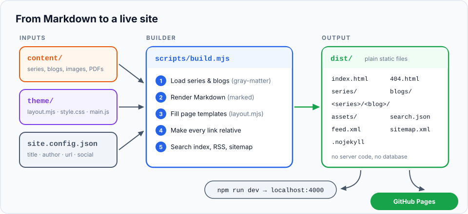
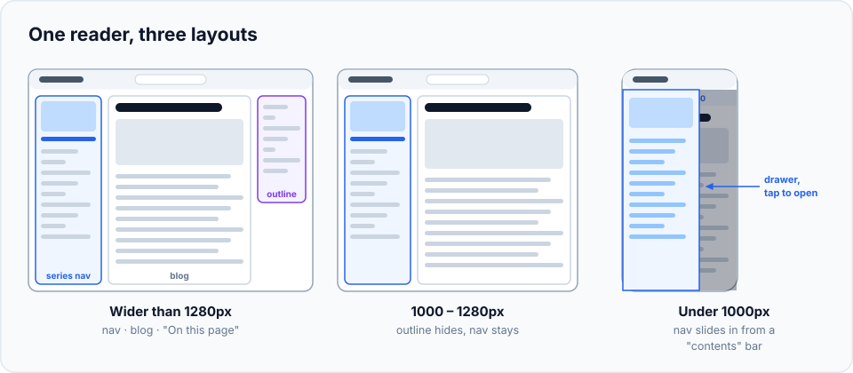
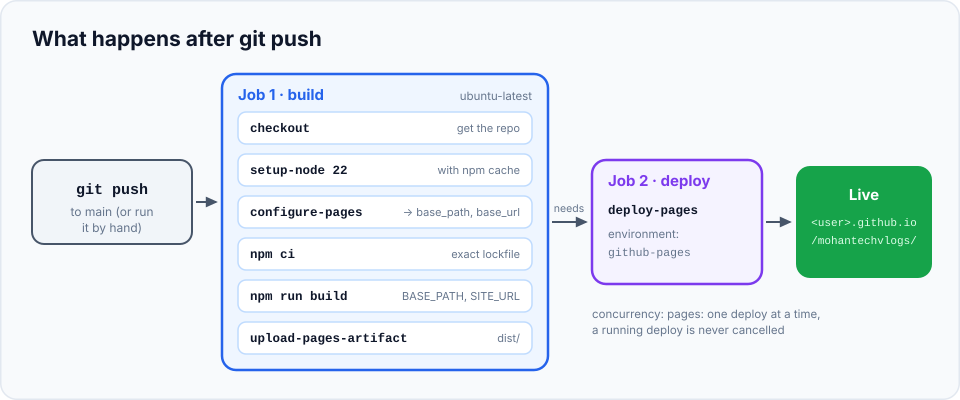

Every page you read here starts as a plain Markdown file in a Git repository. There's no CMS, no
database and no server: a small Node.js script turns the Markdown into HTML, and GitHub Actions
publishes it to GitHub Pages whenever I push to `main`.

This blog is a guided tour of that setup. It's partly documentation for future me, and partly a
blueprint you can borrow if you want a blog you fully own and understand, line by line.

> **In this blog you'll learn**
> - The **big picture**: how Markdown goes in and a static website comes out
> - The **content hierarchy**: blogs, series and sections, and how folders map to URLs
> - What the **build script** does, step by step, including the trick that makes every link work on any host
> - How the **design** works: page types, the three-column reader, dark mode and search
> - The **writing technique** every blog follows, from the intro box to the quiz
> - How **deployment** works, from `git push` to a live page
> - A **hands-on lab** where you scaffold a blog and a series and watch the build react
>
> **Prerequisites:** basic comfort with a terminal and Git (the
> [Git for Developers](../../git-for-developers/index.md) series covers both). **Time:** 30 minutes
> to read, 15 more for the lab.

## The big picture

The whole system is a pipeline with three inputs, one builder and one output folder:



1. **`content/`** holds what I write: Markdown files, diagrams, cover images and downloadable files.
2. **`theme/`** holds how it looks: HTML templates (`layout.mjs`), one stylesheet and one script.
3. **`site.config.json`** holds site-wide settings such as the title, author and URL.
4. **`scripts/build.mjs`** reads all three and writes a complete website into **`dist/`**.
5. `dist/` is just files. Locally, `npm run dev` serves it; in production, GitHub Pages does.

### Why not Jekyll, Hugo or Next.js?

Those are great tools, and if you want hundreds of themes and plugins, use one. I wanted the
opposite: **something small enough to read in one sitting.**

- **Two runtime dependencies:** `gray-matter` (reads the YAML at the top of each file) and
  `marked` (turns Markdown into HTML). Everything else is plain Node.js.
- **About 500 lines** of build code and 460 lines of templates. When something looks wrong,
  I know exactly which function to open.
- **No client-side framework.** Pages are pre-rendered HTML. One small script adds the extras
  (search, dark mode, copy buttons), and the site still reads fine without it.
- **Content stays portable.** It's ordinary Markdown with front matter, so moving to another
  generator later would be easy.

## The project layout

```text
mohantechvlogs/
├── content/                  ← everything I write
│   ├── blogs/                ← standalone blogs (like this one)
│   └── git-for-developers/   ← a series
├── theme/
│   ├── layout.mjs            ← HTML templates for every page type
│   └── assets/
│       ├── style.css         ← all styles, light + dark
│       ├── main.js           ← search, theme toggle, copy buttons, drawer…
│       └── favicon.svg
├── scripts/
│   ├── build.mjs             ← content/ → dist/
│   ├── dev.mjs               ← local preview with live reload
│   └── new.mjs               ← scaffolds new blogs and series
├── .github/workflows/deploy.yml   ← build + publish on every push to main
├── site.config.json          ← title, description, author, url, social links
└── package.json              ← scripts: dev, build, new:blog, new:series
```

`dist/` and `node_modules/` are in `.gitignore`: the built site is never committed. GitHub
rebuilds it from source on every deploy, so the repository only ever holds the real source of truth.

## The content hierarchy

The site is built around **one idea: the blog**. A blog is a folder with an `index.md`, plus an
optional `assets/` folder (images, diagrams, video) and `references/` folder (PDFs, sample code,
cheat sheets). That's the atomic unit, and it never changes shape.

What changes is *where the folder lives*:

; standalone blogs live in content/blogs/. Every blog has the same folder shape.")

| Level | What it is | Where it lives |
| --- | --- | --- |
| **Site** | The whole website | `site.config.json` |
| **Series** | An ordered course on one topic, like *Git for Developers* | `content/<series>/index.md` |
| **Section** | An optional group of blogs inside a series, like *Foundations* | listed in the series `index.md` |
| **Blog** | One piece of writing | `content/<series>/<blog>/` or `content/blogs/<blog>/` |

### Standalone blogs

Drop a blog folder into `content/blogs/` and it's published. Standalone blogs are sorted
**newest first** by their `date`, and the pager at the bottom says *Older* and *Newer*.

### Series and sections

A series is a folder with its own `index.md`. Its front matter is the table of contents:

```yaml
---
title: "Git for Developers: Basics to Advanced"
subtitle: Learn Git from zero, one concept at a time…
thumbnail: thumbnail.svg
order: 2                      # position on the home page
date: 2026-10-11
tags: [git, github, version-control, beginner, devops]

sections:
  - title: Foundations
    description: What Git is, setting it up, and your first commits.
    blogs:
      - folder: 01-what-is-version-control
      - folder: 02-install-git-and-terminal
      # …
  - title: Branching & Merging
    blogs:
      - folder: 10-branches
      # …
---

Intro text for the series (Markdown). It is not shown on the page, but search uses it.
```

A few rules make this predictable:

- **Only listed folders are published.** A blog folder that exists but isn't in `blogs:` or
  `sections:` is skipped, with a warning. That makes it safe to start writing chapter 12 while
  chapter 11 is still unpublished.
- **The list is the reading order.** Folder prefixes like `01-` are only for you; the YAML decides
  the order.
- **Numbers continue across sections.** *Branching & Merging* starts at blog 10, not 1.
- **Sections are optional.** Use a flat `blogs:` list for a short series.
- **The series can override a blog.** An entry can set its own `subtitle` or `thumbnail`
  (for example `- folder: 02-pods` followed by `subtitle: Shorter text`).
- **Missing thumbnail?** A series falls back to its first blog's cover; if nothing has an image,
  the card gets a generated gradient instead.
- **`blogs` and `series` are reserved names.** They're used for `/blogs/` and `/series/`, so a
  series can't be called either.

### A blog's front matter

```yaml
---
title: "Working Tree, Staging Area & Repository"
subtitle: The three places your work lives in Git…
date: 2026-10-11
thumbnail: assets/cover.svg
tags: [git, basics, staging, beginner]
draft: false                  # true = only visible in npm run dev
references:
  - title: "Pro Git: Recording Changes"
    url: https://git-scm.com/book/en/v2/Git-Basics-Recording-Changes-to-the-Repository
  - title: Cheat sheet (PDF)
    url: references/cheatsheet.pdf
    note: printable
---
```

The `references:` list is rendered as a numbered **References** section at the end of the blog,
like the one at the bottom of this page.

### How folders become URLs

| You write | It's published at |
| --- | --- |
| `content/blogs/how-this-blog-works/index.md` | `/blogs/how-this-blog-works/` |
| `content/git-for-developers/index.md` | `/git-for-developers/` (opens on blog 1) |
| `content/git-for-developers/05-the-three-areas/index.md` | `/git-for-developers/05-the-three-areas/` |
| *(generated)* | `/` home, `/series/`, `/blogs/`, `/404.html` |

Everything in a blog folder except `index.md` is copied next to the page, so
`` just works.

## Inside the build

`npm run build` runs `scripts/build.mjs`. Here's what happens, in order.

### 1. Load the content

The builder walks `content/`. Each folder with an `index.md` is a series (except `blogs/`, which holds
standalone blogs). `gray-matter` splits each file into its YAML front matter and its Markdown body.
Drafts are dropped unless you're running the dev server.

Along the way it **warns instead of crashing**: a listed folder that doesn't exist, a thumbnail
path that's wrong, a blog that isn't listed, a series folder without an `index.md`. A typo never
takes the site down; it shows up as a yellow line in the terminal.

### 2. Render the Markdown

`marked` converts the Markdown, with a few custom touches:

| Markdown | Becomes |
| --- | --- |
| `## A heading` | `<h2 id="a-heading">` with a `#` anchor link, and an entry in the "On this page" outline (for `##` and `###`) |
| `[next](../06-next/index.md)` | a link to `../06-next/`, so you can link `.md` files that also work on GitHub |
| A link to `https://…` | opens in a new tab with `rel="noopener"` |
| `` | `<figure>` with a `<figcaption>`; images without a title stay plain `` |
| A table | wrapped in a scrolling container so it never breaks the layout on phones |
| A fenced code block | escaped `<pre><code class="language-x">`, highlighted later in the browser |

It also counts words (ignoring code blocks) to show the **reading time**, at 200 words per minute.

### 3. Fill the templates

`theme/layout.mjs` exports one function per page type. Each takes plain data and returns a full
HTML string, using JavaScript template literals instead of a template language:

```js
export function blogPage({ site, series, blog, prev, next }) {
  if (series) return seriesReader({ site, series, blog, prev, next });
  // …standalone blog: no series sidebar, centred article
}
```

The same `blogPage` renders both kinds of blog. That's the "blog is the atomic unit" idea in code.

### 4. Make every link relative

This is the most interesting trick in the builder. The site is served from
`https://mohankumargowda137.github.io/mohantechvlogs/`, not from the root of a domain. A link like
`/assets/style.css` would point outside the site.

So the templates never write real paths. They write a placeholder, `/__site_root__/`, and the
`write()` function replaces it per page with the right number of `../`:

```js
function write(rel, data) {
  if (rel.endsWith('.html')) {
    const depth = rel.split('/').length - 1;
    const prefix = rel === '404.html' ? `${notFoundBase}/` : depth ? '../'.repeat(depth) : './';
    data = data.replaceAll(`${ROOT_TOKEN}/`, prefix);
  }
  // …write the file into dist/
}
```

| Page | Placeholder becomes |
| --- | --- |
| `dist/index.html` | `./` |
| `dist/blogs/index.html` | `../` |
| `dist/git-for-developers/05-the-three-areas/index.html` | `../../` |
| `dist/404.html` | the absolute base path, because GitHub serves it at *any* missing URL |

The payoff: the same `dist/` works on GitHub Pages, on a custom domain, on `localhost`, and even
opened straight from disk (`main.js` adds `index.html` to folder links when the page is a `file://` URL).

### 5. The extras

After the pages, the builder writes:

- **`search.json`**: one entry per series and blog with its title, subtitle, tags, headings and up
  to 12,000 characters of plain text. It's downloaded only when someone opens search.
- **`feed.xml`**: an RSS feed of the 50 newest blogs.
- **`sitemap.xml`**: every page, for search engines.
- **`.nojekyll`**: tells GitHub Pages not to run Jekyll over the files.

On my machine the full build of 30+ blogs takes about **200 ms**.

## How the design works

The design goal is *calm, wide and readable*: content first, chrome second, and nothing that
needs a framework.

### The page types

| Page | Template | What's on it |
| --- | --- | --- |
| **Home** `/` | `homePage` | A two-column split: series on the wide left, standalone blogs on the right. Three cards each, with "View all" links |
| **All series** `/series/` | `seriesIndexPage` | A grid of series cards. A filter box appears once there are more than three |
| **Series** `/<series>/` | `seriesPage` | Opens directly on blog 1 |
| **Blog in a series** | `blogPage` → `seriesReader` | The three-column reader (below) |
| **All blogs** `/blogs/` | `blogsIndexPage` | A grid of blog tiles, newest first |
| **Standalone blog** | `blogPage` | Centred article with the outline on the right, no series sidebar |
| **404** | `notFoundPage` | A small space scene: an astronaut drifting past a planet-shaped zero |

Every page shares one `shell()`: the sticky header with the search bar, the theme toggle, the
footer, and the Open Graph tags that give link previews a title, description and cover image.

### The reader: one layout, three sizes

The series reader is where people spend their time, so it gets the most care.



- **Left: the series sidebar.** Cover, title, total blogs and minutes, a progress bar
  (*Blog 5 of 30*), and every blog grouped into collapsible sections. The current blog is
  highlighted, and the sidebar remembers its scroll position as you move between blogs.
- **Centre: the blog.** A section kicker (*Foundations · Blog 5 of 30*), title, subtitle, date,
  reading time, tags, cover, the content, references, and a previous/next pager that names the section.
- **Right: "On this page".** Built from the `##` and `###` headings, shown when there are at least
  three. The heading you're reading is highlighted as you scroll.

On phones, the sidebar slides in from a sticky *contents* bar showing the series title and
your position (`5 / 30`).

### Colour, type and dark mode

All colours are CSS custom properties defined once on `:root`, then redefined for dark mode:

```css
:root {
  --bg: #fbfbfa; --surface: #ffffff; --text: #1d1d1f; --muted: #6b6b70;
  --border: #e6e6e3; --accent: #2563eb; --accent-soft: #e8efff; --code-bg: #f4f4f2;
}
@media (prefers-color-scheme: dark) {
  :root:not([data-theme="light"]) { --bg: #111113; --text: #ececee; --accent: #7aa2ff; /* … */ }
}
:root[data-theme="dark"] { /* same dark values */ }
```

- By default the site **follows your system setting**.
- The **◐ button** overrides it and saves your choice in `localStorage`. A one-line script in
  `<head>` applies it before the first paint, so there's no white flash.
- Code highlighting swaps between GitHub's light and dark highlight.js themes to match.
- Text uses the **system font stack** (San Francisco, Segoe UI, Roboto…) at 17px with a 1.7 line
  height. No web fonts to download.

### Covers and diagrams

Every image on the site is a hand-made **SVG**, so it's sharp at any size and tiny to download:

- **Covers** are 1280×720 (16:9) on a dark navy background with a dot grid, a coloured glow, a
  kicker (series name or *Behind the scenes*), a big title and a small illustration on the right.
  Each series has its own accent colour.
- **Diagrams** are 960px wide on a light card with rounded corners, one bold title, and a fixed
  palette: orange, blue, green and violet for different concepts, slate for neutral things.
- Each image is written with a **title** in Markdown (``), so it gets a caption.

If an item has no cover at all, the template generates a gradient placeholder whose hue is derived
from the title, so every card still looks intentional.

### Search

Press **⌘K**, **Ctrl K** or **/** anywhere. A command-palette style dialog opens and downloads
`search.json` (only once, and only then). Results match titles, subtitles, tags, section names,
headings and the full text, with the matched words highlighted. A match in a heading links straight
to that heading. It's fully keyboard driven: arrows to move, Enter to open, Esc to close.

## The writing technique

The tooling is only half the system. The other half is a **consistent shape for every blog**, so
readers always know where they are. Every chapter of the Git series, and this blog, follows it:

1. **An introduction box** (a blockquote): *what you'll learn*, *prerequisites* with links, and
   *how long it takes*.
2. **An analogy or the big picture** before any commands: the parcel analogy for Git's staging area,
   the pipeline diagram here.
3. **Concepts from zero**, every new term defined the first time it appears, with a diagram where a
   picture is clearer than a paragraph, and tables for anything that compares options.
4. **When to use it (and when not to).** Knowing *which* tool to reach for matters more than memorising flags.
5. **A hands-on lab**: numbered steps you run yourself, with the **real output** pasted in and
   explained. Every lab is actually run while writing, never typed from memory.
6. **Common mistakes**: the traps people really fall into, and how to get out.
7. **A recap**: five or so bullets that fit on one screen.
8. **Check your understanding**: quiz questions with the answers hidden in collapsible
   `<details>` blocks, so readers can test themselves first.
9. **A "Next" link** to the following blog, plus **references** for going deeper.

The quiz answers are plain HTML inside the Markdown, and the stylesheet gives them a card style:

```html
<details>
<summary>2. Which command shows what will go into your next commit?</summary>

`git diff --staged`.
</details>
```

## Local workflow

```bash
npm install          # once
npm run dev          # http://localhost:4000
```

The dev server (`scripts/dev.mjs`) builds the site **including drafts**, serves `dist/`, and
watches `content/`, `theme/`, `scripts/build.mjs` and `site.config.json`. Save a file and every
open tab reloads within a moment, using a tiny Server-Sent Events script that's only injected in
development.

New content is scaffolded, not copy-pasted:

```bash
npm run new:blog   -- my-blog "My Blog"                      # standalone
npm run new:series -- docker "Docker from Scratch"           # a series
npm run new:blog   -- docker/01-intro "Intro" --section "Basics"   # a blog in a section
```

`new:blog` inside a series also **edits the series `index.md` for you**: it adds the folder to the
right section (creating the section if needed) while keeping your comments and formatting.

## Deployment

Publishing is a single `git push`. GitHub Actions does the rest.



The workflow lives in `.github/workflows/deploy.yml` and has two jobs.

**Job 1: build**

| Step | Why |
| --- | --- |
| `actions/checkout@v4` (`fetch-depth: 0`) | Gets the repository with full history, so other branches can be compared against `main` |
| *Overlay content from branches* | Manual runs only: copies in content from the branches you name (see below) |
| `actions/setup-node@v4` (Node 22, npm cache) | Installs Node; the cache makes repeat installs fast |
| `actions/configure-pages@v5` | Asks GitHub where the site will live and outputs `base_path` and `base_url` |
| `npm ci` | Installs exactly the versions in `package-lock.json` |
| `npm run build` with `BASE_PATH` and `SITE_URL` | Builds `dist/` with the correct absolute URLs for the feed, sitemap, Open Graph tags and 404 page |
| `actions/upload-pages-artifact@v3` | Packages `dist/` as the Pages artifact |

**Job 2: deploy** runs only after the build succeeds (`needs: build`) and calls
`actions/deploy-pages@v4`, which publishes the artifact to the `github-pages` environment. The
job's URL appears on the workflow run, so you can click straight through to the live site.

A few details worth knowing:

- **Triggers:** every push to `main`, plus `workflow_dispatch`, which adds a *Run workflow*
  button in the Actions tab for redeploying by hand, optionally with extra branches.
- **Least-privilege permissions:** `contents: read` to check out, `pages: write` and
  `id-token: write` to deploy. The workflow can't push to the repository.
- **`concurrency: pages` with `cancel-in-progress: false`:** two quick pushes deploy one after
  the other instead of racing, and a deploy in progress is never cut off halfway.
- **Custom domains just work:** `configure-pages` reports an empty base path for a custom domain,
  and because internal links are relative, nothing else needs to change.

**One-time setup:** in the repository, open **Settings → Pages → Build and deployment** and set
**Source** to **GitHub Actions**. After that, there's nothing to configure.

### Publishing a series before it's merged

I write a series on its own branch and merge it in one go when it's complete. Readers shouldn't
have to wait for that, so the *Run workflow* form has a **branches** box. Keep "Use workflow from"
on `main`, enter a branch such as `series/system-design`, and run it.

For each branch, the overlay step finds where the branch split off `main`, lists the files under
`content/` that the branch added or changed since then, and checks out just those files on top of
`main`. Then the normal build runs.

- **Only content comes across.** Theme and script changes on the branch are ignored, so an
  unfinished design experiment can't leak onto the live site.
- **`main` is never modified.** The overlay happens inside the CI workspace and is thrown away.
- **Drafts still apply.** Blogs marked `draft: true` on the branch stay hidden.
- **Bad input fails safely.** An invalid or unknown branch name stops the run before anything
  is deployed, so the live site stays as it was.
- **It lasts until the next deploy.** A push to `main` rebuilds from `main` alone, so run the
  workflow again with the branch after merging anything else.

## Hands-on lab: add a blog and a series

Let's watch the system react to new content. Do this in a throwaway copy (or a branch) so nothing
leaks into the real site.

```bash
git clone https://github.com/mohankumargowda137/mohantechvlogs.git blog-lab
cd blog-lab
npm install
```

### Step 1: scaffold a standalone blog

```text
$ npm run new:blog -- hello-world "Hello, World"
✓ Created content/blogs/hello-world/ — it will appear at /blogs/hello-world/
```

Open `content/blogs/hello-world/index.md`:

```yaml
---
title: "Hello, World"
subtitle: "What the reader will learn"
date: 2026-10-11
thumbnail: assets/cover.png   # optional
tags: []
draft: true                   # remove when ready to publish
references: []
---

Write your blog here. Put images in `assets/` and reference them relatively:


```

Notice **`draft: true`**: new content is never published by accident.

### Step 2: see what a draft means

```text
$ npm run build
✓ Built 31 blogs (1 standalone, 1 series) in 160ms → dist/
```

Still **1 standalone** blog (this one): production builds skip drafts. Your counts and timings
will differ as the site grows. Run `npm run dev` instead and you'll see it at
`http://localhost:4000/blogs/hello-world/` with an orange **Draft** badge.

### Step 3: publish it

Delete the `draft: true` line and build again:

```text
$ npm run build
  ⚠ blogs/hello-world/index.md: thumbnail "assets/cover.png" not found — ignored
✓ Built 32 blogs (2 standalone, 1 series) in 197ms → dist/
```

Now it's counted, and the build **warns** that the cover image doesn't exist yet. The page still
builds; it just has no cover until you add `assets/cover.png` (or change the path).

### Step 4: create a series with sections

```text
$ npm run new:series -- docker "Docker from Scratch"
✓ Created content/docker/index.md — add a thumbnail.png and run npm run new:blog -- docker/<blog-folder> "Title"

$ npm run new:blog -- docker/01-what-is-a-container "What is a container?" --section "Basics"
✓ Created content/docker/01-what-is-a-container/ — created section "Basics" with it in content/docker/index.md

$ npm run new:blog -- docker/02-images "Images" --section "Basics"
✓ Created content/docker/02-images/ — added it to section "Basics" in content/docker/index.md

$ npm run new:blog -- docker/03-networking "Networking" --section "Going further"
✓ Created content/docker/03-networking/ — created section "Going further" with it in content/docker/index.md
```

Look at `content/docker/index.md`. The scaffolder wrote the table of contents for you:

```yaml
sections:
  - title: "Basics"
    blogs:
      - folder: 01-what-is-a-container
      - folder: 02-images
  - title: "Going further"
    blogs:
      - folder: 03-networking
```

### Step 5: an unlisted folder is not published

Create a blog folder by hand, without the scaffolder:

```bash
mkdir content/docker/04-volumes
echo "# Volumes" > content/docker/04-volumes/index.md
npm run build -- --drafts
```

```text
  ⚠ docker/index.md: thumbnail "thumbnail.png" not found — ignored
  ⚠ docker/01-what-is-a-container/index.md: thumbnail "assets/cover.png" not found — ignored
  ⚠ docker/02-images/index.md: thumbnail "assets/cover.png" not found — ignored
  ⚠ docker/03-networking/index.md: thumbnail "assets/cover.png" not found — ignored
  ⚠ docker/04-volumes/ is not listed in docker/index.md — not published
  ⚠ blogs/hello-world/index.md: thumbnail "assets/cover.png" not found — ignored
✓ Built 35 blogs (2 standalone, 2 series) in 167ms → dist/
```

(`--drafts` includes drafts in a production build, since the new series is still a draft. The
thumbnail warnings are the placeholder cover paths from the scaffolder.) The
folder exists, but it's not in `sections:`, so it isn't published, and the build tells you so.
Add `- folder: 04-volumes` under a section to fix it.

### Step 6: look at the output

```bash
find dist -name index.html | sort
```

```text
dist/blogs/hello-world/index.html
dist/blogs/how-this-blog-works/index.html
dist/blogs/index.html
dist/docker/01-what-is-a-container/index.html
dist/docker/02-images/index.html
dist/docker/03-networking/index.html
dist/docker/index.html
dist/git-for-developers/…
dist/index.html
dist/series/index.html
```

Every URL from the "folders become URLs" table is now a real file. Open
`dist/docker/02-images/index.html` in a text editor and search for `style.css`: you'll find
`../../assets/style.css`. That's the relative-link rewrite from the build section.

### Step 7: clean up

```bash
cd .. && rm -rf blog-lab
```

## When to use this setup (and when not to)

**It's a good fit when:**

- You write in Markdown and want your content in Git, with history and pull requests.
- You want free, fast hosting with HTTPS and no servers to maintain.
- You like knowing exactly how your site works, and you're happy to edit JavaScript to change it.
- Your content is mostly long-form text, diagrams and code.

**Reach for something else when:**

- Non-developers need to edit content in a browser. Use a headless CMS or a hosted platform.
- You need comments, logins, newsletters or anything server-side. Those need a backend or a
  third-party service.
- You want a big plugin ecosystem (image processing, i18n, many themes) out of the box. Hugo, Astro
  or Eleventy give you that for free.

## Common mistakes

- **Root-relative paths.** Writing an image path that starts with `/` (like `/assets/a.png`) works
  on localhost but breaks on GitHub Pages, because the site lives under `/mohantechvlogs/`. Always
  use paths relative to the blog folder (`assets/a.png`). The build warns about this.
- **Forgetting to list a blog in the series.** The folder exists, but nothing appears. Look for the
  *not listed* warning and add a `- folder:` entry, or use `npm run new:blog` which does it for you.
- **Leaving `draft: true`.** It shows in `npm run dev` but not on the live site. Look for the orange
  Draft badge locally.
- **A series folder without `index.md`.** The builder skips it with a *has no index.md* warning.
  An empty folder is also invisible to Git, so it won't even reach GitHub.
- **Series thumbnails are relative to the series folder**, but blog thumbnails are relative to the
  blog folder. `thumbnail: assets/cover.svg` in a blog, `thumbnail: thumbnail.svg` in a series.
- **Pages source still set to "Deploy from a branch".** The workflow runs, but nothing changes on
  the site. Set **Source** to **GitHub Actions**.

## Recap

- A **blog** is a folder with `index.md` (+ `assets/`, `references/`). It stands alone in
  `content/blogs/` or lives in a **series**, optionally grouped into **sections**.
- The series `index.md` is the table of contents: only listed blogs are published, in that order.
- `scripts/build.mjs` loads content with gray-matter, renders it with marked, fills the templates in
  `theme/layout.mjs`, rewrites every internal link to be relative, and writes search, RSS and sitemap files.
- The design is plain HTML and CSS with custom properties for theming, a three-column reader that
  collapses on smaller screens, SVG covers and diagrams, and ⌘K search.
- Every blog follows the same shape: intro, analogy, concepts, when to use, lab, mistakes, recap, quiz.
- A push to `main` runs a two-job GitHub Actions workflow that builds `dist/` and deploys it to GitHub Pages.
  A manual run can also publish content from unmerged series branches on top of `main`.

## Check your understanding

<details>
<summary>1. You created <code>content/kubernetes/05-ingress/index.md</code> by hand, but it doesn't show up on the site. What's the most likely reason?</summary>

It isn't listed in `content/kubernetes/index.md` under `blogs:` or a section's `blogs:`. The build
prints a *not listed … not published* warning. (Also check it isn't marked `draft: true`.)
</details>

<details>
<summary>2. Why do the templates write <code>/__site_root__/</code> instead of real paths?</summary>

So `write()` can replace it with a relative prefix (`./`, `../`, `../../`) for each page's depth.
That makes the same `dist/` work under `/mohantechvlogs/` on GitHub Pages, on a custom domain,
on localhost and from disk.
</details>

<details>
<summary>3. Why is <code>404.html</code> the one page that uses an absolute base path?</summary>

GitHub Pages serves `404.html` for *any* missing URL, at any depth, so a relative `../` prefix
would be wrong most of the time. Its links must be absolute.
</details>

<details>
<summary>4. Which workflow step tells the build what base path to use, and how does the value reach the build?</summary>

`actions/configure-pages` outputs `base_path` and `base_url`. The *Build site* step passes them
as the `BASE_PATH` and `SITE_URL` environment variables, which `build.mjs` reads.
</details>

<details>
<summary>5. You push two commits a few seconds apart. What happens to the deployments?</summary>

`concurrency: group: pages` with `cancel-in-progress: false` queues them: the first deploy
finishes, then the second one runs. They never overlap.
</details>

**Start reading:** the [Git for Developers](../../git-for-developers/index.md) series, built with
everything described here.
