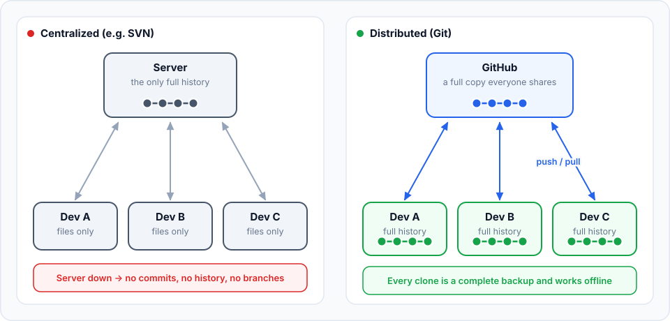
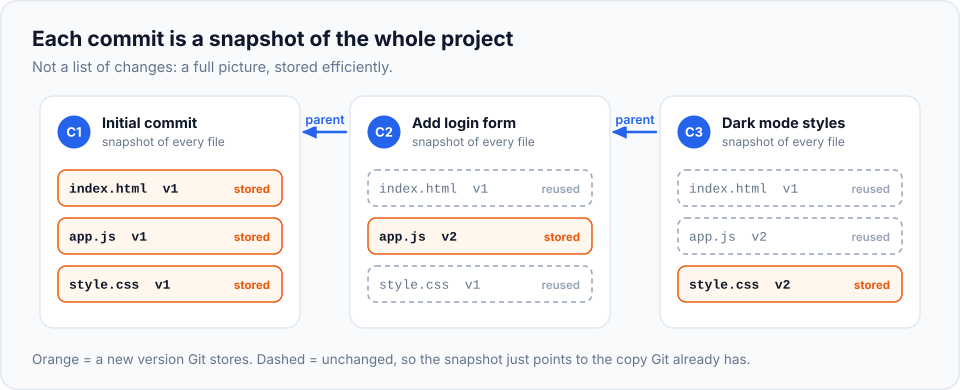

Welcome to the series! If you have never used Git before, you're in exactly the right place.
We'll start from zero, assume nothing, and build up one idea at a time until you're comfortable
with the advanced tools professional developers use every day.

This first chapter has **no commands at all**. Before you type anything, you need a clear
picture of *what problem Git solves* and *how it thinks*. Most of the confusion people have
with Git later on ("where did my changes go?") comes from skipping this part.

> **In this chapter you'll learn**
> - What version control is, and the everyday problems it solves
> - What Git is, and how it differs from GitHub
> - The single most important idea in Git: **commits are snapshots**
> - The basic vocabulary used throughout this series
>
> **Prerequisites:** none. **Time:** about 15 minutes.

## The problem: life without version control

Imagine you're building a small website. It works. Then you decide to add a new feature, and
you're nervous about breaking what already works. So you do what everyone does: you make a copy.

```text
my-website/
├── index.html
├── index_backup.html
├── index_old_working.html
├── index_before_new_menu.html
└── index_FINAL_v2_really_final.html
```

A week later you have a folder full of copies, and you can't answer simple questions:

- **What exactly changed** between yesterday's version and today's?
- **Which copy** was the one that worked before the menu broke?
- **Why** did I change this line? (You've forgotten. Everyone forgets.)

Now add a teammate. You both edit `index.html`, you email files back and forth, and someone's
work gets overwritten. You now have even more questions:

- **Who changed this**, and when?
- How can **two people work on the same files** at the same time without overwriting each other?
- How do I **combine** their changes with mine?

**Version control** is software that answers all of these questions for you, automatically.

## What version control does

A version control system (VCS) keeps a **complete history** of your project. Every time you
reach a point worth saving, you record a **commit**: a saved version of your whole project,
along with:

- **who** saved it (your name and email),
- **when** it was saved,
- a short **message** explaining *why*.

Think of it like the save points in a video game. You can play forward with confidence,
because you can always go back to any earlier save. You can even create alternate storylines
(**branches**) to try something risky, then either keep the result or throw it away.

| Without version control | With version control |
| --- | --- |
| Copies of files with confusing names | One folder, with a full history inside |
| "Which version worked?" | Jump back to any saved version in seconds |
| "Who changed this and why?" | Every change has an author, a date and a message |
| Emailing files, overwriting each other | Everyone works in parallel, and changes are combined safely |
| Scared to try big changes | Experiment on a branch, and throw it away if it fails |

## What is Git?

**Git** is the most popular version control system in the world. It was created in 2005 by
Linus Torvalds (who also created Linux) to manage the Linux source code, a project with
thousands of contributors. Today almost every software company uses it.

Git is a **program that runs on your computer**. It's free and open source, and it works
fully offline.

### Centralized vs distributed

Older version control systems (like SVN) are **centralized**. One central server holds the
history. Developers only have the current files on their machines, and they must talk to the
server to save a version, look at history or create a branch.

Git is **distributed**. When you get a copy of a project (we'll call it a *clone*), you get
**the entire history** on your own computer. Every developer has a complete copy.



Why does that matter to you?

- **Speed.** Viewing history, comparing versions and creating branches happen on your machine,
  instantly. There's no waiting for a server.
- **Works offline.** You can save versions on a plane and share them later.
- **Safety.** Every copy is a full backup. If the server dies, any developer's copy can restore it.

## Git vs GitHub: not the same thing

Beginners often mix these up, so let's settle it now.

| Git | GitHub (and GitLab, Bitbucket) |
| --- | --- |
| A program installed on your computer | A website that stores Git projects online |
| Records history, manages branches, merges changes | Adds collaboration: pull requests, code review, issue tracking |
| Works fully offline | Needs the internet |
| Created by Linus Torvalds in 2005 | A company (owned by Microsoft) |

A good analogy: **Git is like a camera, and GitHub is like Instagram.** The camera takes and
stores the pictures (your history). Instagram is a place to share them and let others comment.
You can use a camera without Instagram, but you can't post to Instagram without pictures.

We'll use Git alone for the first part of this series, and bring in GitHub in
[chapter 13](../13-github-and-remotes/index.md).

## The most important idea: commits are snapshots

Many people imagine Git stores a list of *changes* ("line 4 was edited, line 9 was deleted").
It doesn't. Every commit is a **snapshot**: a picture of **every file in your project**
exactly as it was at that moment.



"Doesn't that waste a lot of space?" No, and here's why. If a file didn't change since the
last commit, Git doesn't store it again. The new snapshot simply points to the copy Git already
has. Only files that actually changed are stored again. So you get the simplicity of full
snapshots with the efficiency of storing only what changed.

Each commit also remembers its **parent**: the commit that came right before it. Following
these parent links backwards gives you the history of the project, like a chain:

```text
First commit  ←  Second commit  ←  Third commit  ←  (latest)
```

Because each commit is a complete snapshot, Git can:

- **Show you any old version** of your project instantly, by restoring that snapshot.
- **Compare any two versions**, by comparing two snapshots.
- **Detect corruption or tampering**, as you'll see next.

## Every commit has an ID (a "hash")

Git gives every commit a unique ID that looks like this:

```text
a3f9c2e8b1d4f6a7c9e0b2d4f6a8c0e2b4d6f8a0
```

This is called a **hash**. Git calculates it from the commit's contents: the snapshot, the
author, the date, the message and the parent commit's ID. Two important consequences:

1. **Change anything, and the ID changes.** Edit one character in an old file, and its hash
   changes, which changes the hash of every commit after it. This makes Git's history very hard
   to tamper with without anyone noticing.
2. **You only need the first few characters.** Writing all 40 characters is tedious, so Git
   lets you use the first 7 or so (`a3f9c2e`) as long as they're unique in your project.

You'll see these short IDs everywhere:

```text
a3f9c2e Add contact form
7b21d04 Create home page
1e0c9aa Initial commit
```

## Vocabulary you'll meet in this series

You don't need to memorize these now. Each one gets a full explanation in its own chapter.
Come back here whenever you meet a word you don't recognise.

| Term | Plain-English meaning | Chapter |
| --- | --- | --- |
| **Repository (repo)** | A project folder that Git is tracking, including its full history | [4](../04-your-first-repository/index.md) |
| **Commit** | A saved snapshot of the project, with author, date and message | [4](../04-your-first-repository/index.md) |
| **Working tree** | The actual files you see and edit in your project folder | [5](../05-the-three-areas/index.md) |
| **Staging area** | A waiting room where you prepare what goes into the next commit | [5](../05-the-three-areas/index.md) |
| **Branch** | An independent line of work, so you can try things without touching the main version | [10](../10-branches/index.md) |
| **Merge** | Combining the work from one branch into another | [11](../11-merging/index.md) |
| **Conflict** | When two changes touch the same lines and Git needs you to decide | [12](../12-merge-conflicts/index.md) |
| **Remote** | A copy of the repository somewhere else, usually on GitHub | [13](../13-github-and-remotes/index.md) |
| **Clone** | Download a full copy of a remote repository | [13](../13-github-and-remotes/index.md) |
| **Push / Pull** | Send your commits to a remote / bring others' commits to you | [14](../14-fetch-pull-push/index.md) |
| **Pull request (PR)** | A request on GitHub to review and merge your branch | [15](../15-pull-requests/index.md) |

## Activity: explore a real project's history

You don't need to install anything for this. Let's look at the history of a real, famous
project to see commits in action.

1. Open [github.com/git/git/commits](https://github.com/git/git/commits) in your browser.
   This is the history of Git itself, stored in Git.
2. Each row is a **commit**. Notice the **message**, the **author**, and the **date**.
3. On the right of each row you'll see a short **hash** like `a3f9c2e`. That's the commit's ID.
4. Click on any commit message. You'll see exactly which lines were added (green, with `+`)
   and removed (red, with `-`) in that commit.
5. Click **Browse files** (or the `<>` icon) on that commit. You're now looking at the whole
   project **as it was at that moment**: a snapshot.

That's what you'll be able to do with your own projects by the end of chapter 4.

## When do you need version control?

Short answer: **always**, for anything you'd be sad to lose or would want to undo.

- ✅ Any code, from a one-file script to a large application
- ✅ Configuration files, infrastructure code, documentation, notes in Markdown
- ✅ Personal projects too, not just team work. "Undo" is valuable even when you're alone.
- ⚠️ Large binary files (videos, big design files) work, but need special handling
  (covered in [chapter 28](../28-large-repos/index.md))
- ❌ Passwords and secret keys should **never** be committed (covered in
  [chapter 7](../07-ignoring-files/index.md))

## Recap

- **Version control** records the history of your project so you can see, compare and restore
  any past version, and collaborate safely.
- **Git** is a free, distributed version control system: every copy has the full history.
- **GitHub** is a website for hosting and collaborating on Git repositories. It's not Git itself.
- A **commit** is a **snapshot** of every file, with an author, date, message and a link to its parent.
- Every commit has a unique **hash** ID; a short 7-character version is usually enough.

## Check your understanding

<details>
<summary>1. You edit a file but don't commit. Has Git saved a version of it?</summary>

No. Git only records a version when you **commit**. Until then, your edits exist only in your
files, like unsaved work in a game. You'll learn the exact steps in chapter 4.
</details>

<details>
<summary>2. Can you use Git without a GitHub account?</summary>

Yes. Git is a program on your computer and works fully offline. GitHub is only needed when you
want to share your repository online or collaborate through it.
</details>

<details>
<summary>3. If Git stores a full snapshot for every commit, why doesn't the project get huge?</summary>

Files that didn't change are not stored again; the new snapshot just points to the copy Git
already has. Only changed files take up new space (and Git compresses them too).
</details>

<details>
<summary>4. Why does changing an old commit change the IDs of all commits after it?</summary>

Each commit's hash is calculated from its contents **including its parent's hash**. Change one
commit, and its hash changes; the next commit's parent hash is now different, so its own hash
changes too, and so on down the chain.
</details>

**Next:** [install Git and learn just enough terminal](../02-install-git-and-terminal/index.md)
to start using it.
