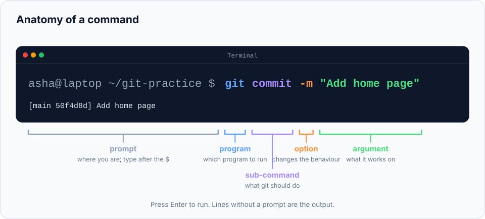

Git is mainly used from the **terminal** (also called the command line or shell). If you've
never used one, don't worry. You need about ten commands, and this chapter teaches all of
them. We'll then install Git and confirm it works.

> **In this chapter you'll learn**
> - What a terminal is and how to open one on your computer
> - How to read a command: program, options and arguments
> - The essential commands for moving around folders and creating files
> - How to install Git and check that it works
>
> **Prerequisites:** [chapter 1](../01-what-is-version-control/index.md). **Time:** 30 minutes.

## Why use the terminal for Git?

There are graphical Git apps (GitHub Desktop, the Git panel in VS Code, Sourcetree, and
others), and they're fine to use later. But learning Git in the terminal first has real
advantages:

- **You see exactly what happens.** Every action is a command, and Git prints a message
  explaining the result. Graphical tools hide these steps.
- **Every tutorial, Stack Overflow answer and colleague uses commands.** When you get stuck,
  the help you find will be written as commands.
- **It works the same everywhere:** on your laptop, on a server, and in CI pipelines.

Once you understand the commands, any Git app will make sense too, because they all run the
same commands underneath.

## Opening a terminal

| Your system | How to open it |
| --- | --- |
| **Windows** | Install Git first (see below). It includes **Git Bash**. Open the Start menu and search for "Git Bash". Use Git Bash for this series so the commands match exactly. |
| **macOS** | Press `⌘ Space`, type **Terminal**, press Enter. |
| **Linux** | Press `Ctrl Alt T` on most distributions, or find "Terminal" in your apps. |
| **VS Code** (any system) | Menu **Terminal → New Terminal**. On Windows, choose "Git Bash" from the dropdown next to the `+`. |

You'll see a window with a line of text ending in `$` (or `%` on macOS), and a blinking
cursor. That line is the **prompt**: the terminal is waiting for you to type a command.

> **Convention in this series:** in code blocks, a line starting with `$` is a command you
> type (don't type the `$` itself). Lines without `$` show what the terminal prints back.

## Anatomy of a command

Every command follows the same pattern:



```bash
git commit -m "Add home page"
```

| Part | Example | Meaning |
| --- | --- | --- |
| **Program** | `git` | Which program to run |
| **Sub-command** | `commit` | What you want that program to do (Git has many: `init`, `add`, `commit`, `log`…) |
| **Option** (flag) | `-m` | Changes how the command behaves. Short options use one dash (`-m`), long ones use two (`--message`) |
| **Argument** | `"Add home page"` | The thing the command works on. Use quotes when it contains spaces |

Press **Enter** to run the command. If it succeeds, many commands print nothing at all.
Silence usually means success.

## The ten commands you need

| Command | What it does | Example |
| --- | --- | --- |
| `pwd` | **P**rint **w**orking **d**irectory: shows which folder you are in | `pwd` |
| `ls` | **L**i**s**t the files in the current folder | `ls` |
| `ls -a` | List **a**ll files, including hidden ones (names starting with `.`) | `ls -a` |
| `mkdir` | **M**a**k**e a new **dir**ectory (folder) | `mkdir projects` |
| `cd` | **C**hange **d**irectory: move into a folder | `cd projects` |
| `cd ..` | Move up to the parent folder | `cd ..` |
| `cd ~` | Go to your home folder | `cd ~` |
| `echo "text" > file` | Create a file containing that text (replaces the file if it exists) | `echo "hello" > notes.txt` |
| `echo "text" >> file` | **Append** a line to the end of a file | `echo "more" >> notes.txt` |
| `cat` | Print a file's contents | `cat notes.txt` |
| `clear` | Clear the screen | `clear` |

Two more things that will save you lots of typing:

- **Tab completion:** type the first few letters of a file or folder name and press `Tab`.
  The terminal completes it for you.
- **History:** press the `↑` arrow key to bring back previous commands.

> **Why `echo` instead of an editor?** In the labs we create and edit files with `echo` so that
> every step is a command you can copy. In real work you'll edit files in your code editor
> (like VS Code) as usual. Git doesn't care how a file was changed.

## Installing Git

### Windows

1. Go to [git-scm.com/downloads](https://git-scm.com/downloads) and download **Git for Windows**.
2. Run the installer. The default options are fine. On the screen *"Adjusting the name of the
   initial branch"*, choose **Override the default branch name** and type `main`. (We'll set this
   again in the next chapter anyway.)
3. Open **Git Bash** from the Start menu.

### macOS

Open Terminal and type:

```bash
$ git --version
```

- If you see a version number, Git is already installed.
- If a dialog asks to install the **command line developer tools**, click **Install**. Git
  comes with them.
- For a newer version, install [Homebrew](https://brew.sh/) and run `brew install git`.

### Linux

Use your package manager:

```bash
$ sudo apt install git        # Ubuntu, Debian
$ sudo dnf install git        # Fedora
$ sudo pacman -S git          # Arch
```

`sudo` runs the command as administrator, so it asks for your password. Nothing appears while
you type a password in the terminal; that's normal.

## Hands-on lab: get comfortable, then verify Git

Follow along in your terminal. Type each command (without the `$`) and press Enter.

### Step 1: find out where you are

```bash
$ pwd
/Users/asha
```

You'll see your own **home folder** (on Windows Git Bash something like `/c/Users/asha`).

### Step 2: create a folder for all the practice in this series

```bash
$ mkdir git-practice
$ cd git-practice
$ pwd
/Users/asha/git-practice
```

You created a folder and moved into it. All labs in this series happen inside `git-practice`.

### Step 3: create and read a file

```bash
$ echo "My first file" > hello.txt
$ ls
hello.txt
$ cat hello.txt
My first file
```

### Step 4: add a line to the file

```bash
$ echo "A second line" >> hello.txt
$ cat hello.txt
My first file
A second line
```

Notice the difference: `>` **replaces** the file's contents, `>>` **adds** to the end.

### Step 5: move around

```bash
$ cd ..
$ pwd
/Users/asha
$ cd git-practice
```

### Step 6: confirm Git is installed

```bash
$ git --version
git version 2.47.0
```

Any version **2.37 or newer** is ideal for this series. If yours is older, update it using
the install steps above (on macOS, `brew install git`).

### Step 7: ask Git for help

```bash
$ git help
```

This prints a list of the most common Git commands. You can get the full manual for any
command, which is useful when you want to know every option:

```bash
$ git help commit          # opens the full manual page
$ git commit -h            # short summary printed in the terminal
```

When a manual page opens, scroll with the arrow keys and press **`q` to quit**.

### Clean up

```bash
$ rm hello.txt
```

`rm` **removes** a file permanently (there's no recycle bin in the terminal), so use it carefully.

## Common mistakes

| What you see | Why | Fix |
| --- | --- | --- |
| `command not found: git` | Git isn't installed, or the terminal was opened before installing | Install Git, then **close and reopen** the terminal |
| `No such file or directory` | You're in a different folder than you think | Run `pwd` and `ls` to check where you are |
| Typed `$ git --version` and got an error | You typed the `$` | Type only what comes after `$ ` |
| The terminal seems stuck, showing `:` or `(END)` | Git opened a viewer for long output | Press `q` |
| The terminal seems stuck after a command with quotes | A quote wasn't closed, so the terminal waits for more input | Press `Ctrl C` to cancel and try again |

## Recap

- The **terminal** lets you run commands by typing them. A command is a **program**, often a
  **sub-command**, then **options** and **arguments**.
- `pwd`, `ls`, `cd`, `mkdir`, `echo`, `cat` are enough to follow every lab in this series.
- Install Git from git-scm.com (Windows), the developer tools or Homebrew (macOS), or your
  package manager (Linux). Check it with `git --version`.
- `git help <command>` and `git <command> -h` explain any command. Press `q` to exit viewers.

## Check your understanding

<details>
<summary>1. In <code>git log --oneline -5</code>, what is the program, sub-command, and what are the options?</summary>

Program: `git`. Sub-command: `log`. Options: `--oneline` (one line per commit) and `-5` (show
only five commits). There's no argument here.
</details>

<details>
<summary>2. What's the difference between <code>echo "hi" > a.txt</code> and <code>echo "hi" >> a.txt</code>?</summary>

`>` replaces the whole file with "hi". `>>` adds "hi" as a new line at the end, keeping what
was already there.
</details>

<details>
<summary>3. You ran a command and the screen shows <code>(END)</code>. What do you do?</summary>

Press `q` to quit the viewer and get back to the prompt.
</details>

**Next:** [set up Git for the first time](../03-configure-git/index.md): tell Git who you
are and choose sensible defaults.
