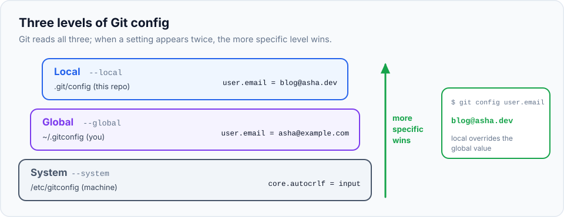
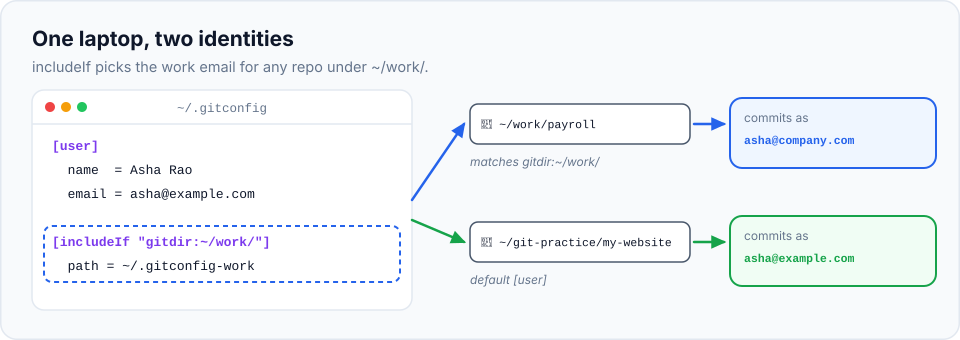

Git is installed. Before you make your first commit, Git needs a little information about you,
and a few defaults are worth changing. You do this **once per computer**, and it takes five
minutes.

> **In this chapter you'll learn**
> - Why Git needs your name and email, and how to set them
> - How to set the default branch name and the text editor Git opens
> - The three places Git settings live, and which one wins
> - How to see, change and remove any setting
> - How to use a different email for work projects automatically
>
> **Prerequisites:** [Git installed](../02-install-git-and-terminal/index.md). **Time:** 20 minutes.

## Why does Git need my name and email?

Every commit records **who made it**. Git doesn't have user accounts, so it simply writes the
name and email you configure into each commit. Your teammates (and you, months from now) will
see it in the history:

```text
commit 50f4d8db29a07cbc6a912bc0f68800db2e1498a5
Author: Asha Rao <asha@example.com>
Date:   Sun Oct 11 10:00:00 2026 +0530

    Add home page
```

If you don't set them, Git refuses to commit, or guesses something unhelpful like
`asha@Ashas-MacBook.local`.

> **Which email should I use?** If you'll use GitHub, use the **same email as your GitHub
> account**. GitHub uses it to link commits to your profile (your avatar appears next to them).
> If you want to keep your email private, GitHub gives you a no-reply address under
> **Settings → Emails**, like `12345678+asha@users.noreply.github.com`.

## The `git config` command

All Git settings are managed with one command:

```bash
git config [where] <setting.name> "<value>"     # set a value
git config <setting.name>                       # read a value
```

Settings have names made of a **section** and a **key**, separated by a dot: `user.name` is
the `name` key in the `user` section.

## The settings to set now

| Setting | Why |
| --- | --- |
| `user.name` | Your name, shown on every commit |
| `user.email` | Your email, shown on every commit |
| `init.defaultBranch` | The name of the first branch in new projects. The modern standard is `main` (older Git versions use `master`) |
| `core.editor` | The text editor Git opens when it needs you to write something longer, like a detailed commit message |

### About the editor

Sometimes Git opens a text editor and waits for you, for example when you run `git commit`
without a message. Git uses **Vim** by default, which confuses many beginners (to exit Vim,
press `Esc`, type `:wq` and press Enter). Choose an editor you're comfortable with:

| Editor | Value for `core.editor` | Notes |
| --- | --- | --- |
| VS Code | `code --wait` | `--wait` makes Git wait until you close the tab. The `code` command must work in your terminal (in VS Code: `⌘/Ctrl Shift P` → "Shell Command: Install 'code' command in PATH") |
| Nano | `nano` | Simple terminal editor. Save with `Ctrl O`, Enter; exit with `Ctrl X` |
| Notepad++ (Windows) | `"'C:/Program Files/Notepad++/notepad++.exe' -multiInst -notabbar -nosession"` | Git for Windows' installer can set this for you |

## Where settings live: three levels

You'll notice the `--global` option in the commands below. Git reads settings from three
places, and a more specific place overrides a more general one:



| Level | Option | File | Applies to | Typical use |
| --- | --- | --- | --- | --- |
| System | `--system` | `/etc/gitconfig` | Every user on this computer | Rarely touched; set by installers |
| Global | `--global` | `~/.gitconfig` | Every repository of **your** user | Your name, email, preferences |
| Local | `--local` (the default) | `.git/config` inside one repository | **Only that repository** | Exceptions for one project |

So you set your name and email **globally** once, and only use **local** settings when one
particular project needs something different.

## Hands-on lab: configure Git

### Step 1: set your identity

Use your own name and email:

```bash
$ git config --global user.name "Asha Rao"
$ git config --global user.email "asha@example.com"
```

No output means it worked.

### Step 2: set the default branch name and your editor

```bash
$ git config --global init.defaultBranch main
$ git config --global core.editor "nano"
```

(Use `"code --wait"` instead of `"nano"` if you prefer VS Code.)

### Step 3: read your settings back

Read a single value:

```bash
$ git config user.name
Asha Rao
```

List all your global settings:

```bash
$ git config --global --list
user.name=Asha Rao
user.email=asha@example.com
init.defaultbranch=main
core.editor=nano
```

### Step 4: look at the actual file

Settings are stored in a plain text file. Let's look at it:

```bash
$ cat ~/.gitconfig
[user]
	name = Asha Rao
	email = asha@example.com
[init]
	defaultBranch = main
[core]
	editor = nano
```

Each `[section]` is followed by its keys. You can edit this file directly in any editor
instead of using `git config`; both do the same thing.

### Step 5: see which file each setting came from

When a setting isn't what you expect, this command tells you **where** it's coming from:

```bash
$ git config --list --show-origin
file:/Users/asha/.gitconfig	user.name=Asha Rao
file:/Users/asha/.gitconfig	user.email=asha@example.com
file:/Users/asha/.gitconfig	init.defaultbranch=main
file:/Users/asha/.gitconfig	core.editor=nano
```

### Step 6: try a local override

Local settings only work inside a repository, so create a throwaway one (we'll explain `git
init` properly in the next chapter):

```bash
$ cd ~/git-practice
$ mkdir config-test && cd config-test
$ git init
Initialized empty Git repository in /Users/asha/git-practice/config-test/.git/
$ git config --local user.email "blog@asha.dev"
$ git config user.email
blog@asha.dev
$ git config --show-origin user.email
file:.git/config	blog@asha.dev
```

Inside this repository, the local value wins. Now remove it:

```bash
$ git config --unset user.email
$ git config user.email
asha@example.com
```

With the local value gone, Git falls back to your global email.

Clean up the test repository:

```bash
$ cd .. && rm -rf config-test
```

(`rm -rf` deletes a folder and everything inside it. Double-check the name before pressing Enter.)

## Real-life scenario: work and personal identities

Many developers use one laptop for both company projects and personal projects. Sooner or
later they push a personal project with their work email, or the other way round. Setting a
local email in every work repository is easy to forget.

Git can pick the right identity **automatically, based on the folder** a repository lives in.
This is called a **conditional include**.



**1.** Keep all work repositories in one folder, for example `~/work/`.

**2.** Create a second config file, `~/.gitconfig-work`, with only the settings that differ:

```ini
[user]
    email = asha@company.com
```

**3.** Add these lines to the end of `~/.gitconfig`:

```ini
[includeIf "gitdir:~/work/"]
    path = ~/.gitconfig-work
```

This says: *"If the repository is anywhere inside `~/work/`, also load `~/.gitconfig-work`."*
Because it's loaded after your normal settings, its email wins.

**4.** Check it:

```bash
$ cd ~/work/payroll          # any repository inside ~/work/
$ git config user.email
asha@company.com
$ git config --show-origin user.email
file:/Users/asha/.gitconfig-work	asha@company.com

$ cd ~/git-practice/my-website      # any repository outside ~/work/
$ git config user.email
asha@example.com
```

> The trailing slash in `gitdir:~/work/` matters. It means "this folder and everything inside it".

## When to use each level

| Situation | Use |
| --- | --- |
| Your name, email, editor, default branch | `--global`, once per computer |
| One project needs a different email or setting | `--local`, inside that project |
| All projects in a folder need a different email (work vs personal) | `includeIf` in your global config |
| Settings for every user on a shared machine | `--system` (needs administrator rights; rarely needed) |

## Bonus: line endings on mixed Windows/Mac/Linux teams

Windows ends lines in text files with two invisible characters (`CRLF`), macOS and Linux with
one (`LF`). On mixed teams this can make Git think *every line* of a file changed. The fix is a
file named `.gitattributes`, committed at the root of the project, that tells Git to normalise
line endings for everyone:

```text
* text=auto eol=lf
*.bat text eol=crlf
*.png binary
```

You don't need this today. Remember it for when you see a diff where every line appears changed.

## Common mistakes

| Problem | Fix |
| --- | --- |
| Commits show the wrong name or email | Check with `git config --show-origin user.email`, then fix the right level. Past commits keep the old value; only new commits use the new one |
| `Author identity unknown` error when committing | Set `user.name` and `user.email` (step 1) |
| Git opened a strange editor and you can't exit | It's Vim: press `Esc`, type `:q!` and Enter to quit without saving. Then set `core.editor` |
| VS Code opens but Git doesn't wait (empty commit message error) | Use `code --wait`, not just `code` |
| Typo in a setting name (`user.emial`) | Git happily stores it. Remove it with `git config --global --unset user.emial` |

## Recap

- `git config --global user.name` / `user.email` identify you on every commit. Set them first.
- Set `init.defaultBranch main` and an editor you know (`core.editor`).
- Settings live at **system**, **global** (`~/.gitconfig`) and **local** (`.git/config`) levels;
  the most specific wins. `--show-origin` tells you where a value came from.
- `includeIf "gitdir:~/work/"` switches settings automatically for repositories in a folder.

We'll add more settings later in the series, each in the chapter where you learn the feature
it affects.

## Check your understanding

<details>
<summary>1. You set your global email, but commits in one project show another email. Why might that be?</summary>

That repository probably has a **local** `user.email` (in its `.git/config`), or it's inside a
folder matched by an `includeIf`. Run `git config --show-origin user.email` inside it to see
which file the value comes from.
</details>

<details>
<summary>2. Which file does <code>git config --global</code> write to?</summary>

`~/.gitconfig`, the `.gitconfig` file in your home folder.
</details>

<details>
<summary>3. Does changing <code>user.email</code> change the email on commits you already made?</summary>

No. The name and email are written into each commit when it's created. Only new commits use
the new value.
</details>

**Next:** [your first repository, step by step](../04-your-first-repository/index.md).
