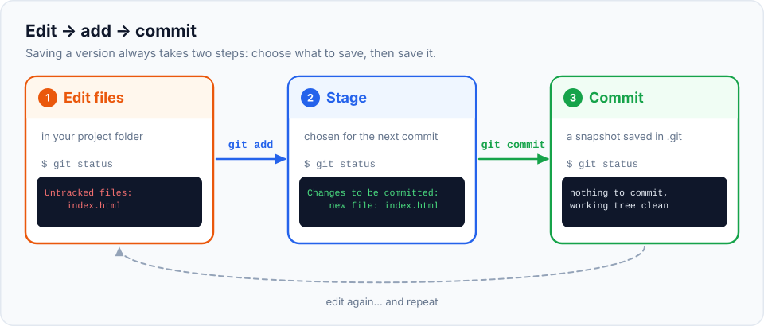

This is the chapter where you actually use Git. We'll create a tiny website project, put it
under version control, and save a few versions. Along the way we'll stop and read **every**
message Git prints, because Git is very good at telling you what's going on, if you know how
to read it.

> **In this chapter you'll learn**
> - What a repository is, and what `git init` actually creates
> - The basic loop: **edit → `git add` → `git commit`**
> - How to read `git status`, the command you'll run more than any other
> - How to see your history with `git log` and your changes with `git diff`
> - When to make a commit
>
> **Prerequisites:** [Git installed](../02-install-git-and-terminal/index.md) and
> [configured](../03-configure-git/index.md). **Time:** 30 minutes.

## What is a repository?

A **repository** (or **repo**) is a project folder that Git is tracking. It's made of two parts:

1. **Your files**: the normal files and folders you work on.
2. **A hidden folder called `.git`**: Git's database, holding every commit (snapshot) ever made,
   plus Git's settings for this project.

Your files are the present. The `.git` folder is the entire past.

> ⚠️ **Never delete or edit the `.git` folder by hand.** If you delete it, the folder becomes a
> normal folder again and **all history is gone**. Your current files stay, but every saved
> version disappears.

There are two ways to get a repository:

| Situation | Command |
| --- | --- |
| You're starting a new project, or have an existing folder that isn't tracked yet | `git init` (this chapter) |
| The project already exists on GitHub or another server | `git clone <url>` ([chapter 13](../13-github-and-remotes/index.md)) |

## The basic workflow

Saving a version in Git always takes two steps:



1. **Edit** your files as usual.
2. **`git add`**: tell Git which changes you want in the next snapshot. This is called
   **staging** the changes.
3. **`git commit`**: save the snapshot permanently, with a message.

Why two steps instead of one "save" button? Because often you've changed several things and
only some of them belong together. Staging lets you choose. We'll explore this properly in
[the next chapter](../05-the-three-areas/index.md). For now, just follow the rhythm:
**edit, add, commit**.

## Hands-on lab: create and commit to your first repository

We'll build a tiny website called `my-website`. Later chapters keep using this same project,
so follow along exactly.

### Step 1: create the project folder

```bash
$ cd ~/git-practice
$ mkdir my-website
$ cd my-website
$ ls -a
.
..
```

The folder is empty. (`.` means "this folder" and `..` means "the parent folder"; they always
appear with `ls -a`.)

Let's ask Git about it:

```bash
$ git status
fatal: not a git repository (or any of the parent directories): .git
```

**What this means:** Git looked for a `.git` folder here (and in all parent folders) and didn't
find one. This folder isn't a repository yet. Remember this error; you'll see it whenever you
run a Git command in the wrong folder.

### Step 2: turn the folder into a repository

```bash
$ git init
Initialized empty Git repository in /Users/asha/git-practice/my-website/.git/
```

Look again:

```bash
$ ls -a
.
..
.git
```

`git init` created the hidden `.git` folder. Let's peek inside, just once, out of curiosity:

```bash
$ ls .git
HEAD        config      description hooks       info        objects     refs
```

| Inside `.git` | What it's for |
| --- | --- |
| `objects/` | The database where every file version and commit will be stored |
| `refs/` | Bookmarks pointing to commits (like branches) |
| `HEAD` | Records which branch you're currently on |
| `config` | Settings for this repository only (the "local" level from chapter 3) |
| `hooks/` | Optional scripts Git can run automatically ([chapter 27](../27-hooks/index.md)) |

You never need to touch these files. Git manages them. We'll look at how they work in
[chapter 23](../23-git-internals/index.md).

```bash
$ git status
On branch main

No commits yet

nothing to commit (create/copy files and use "git add" to track)
```

**Reading it line by line:**

- `On branch main`: you're on the branch called `main` (the default you configured).
  Branches come in [chapter 10](../10-branches/index.md).
- `No commits yet`: the history is empty.
- `nothing to commit`: there are no files yet. Git even tells you what to do next.

### Step 3: create a file

```bash
$ echo "<h1>Welcome to my website</h1>" > index.html
$ ls
index.html
$ git status
On branch main

No commits yet

Untracked files:
  (use "git add <file>..." to include in what will be committed)
	index.html

nothing added to commit but untracked files present (use "git add" to track)
```

**What this means:** Git noticed a new file, `index.html`, but it's **untracked**. Git sees the
file but isn't managing it yet. Untracked files are never included in a commit until you add
them. (On most terminals they're shown in red.)

### Step 4: stage the file with `git add`

```bash
$ git add index.html
$ git status
On branch main

No commits yet

Changes to be committed:
  (use "git rm --cached <file>..." to unstage)
	new file:   index.html
```

**What this means:** `index.html` is now listed under **Changes to be committed** (usually shown
in green). It's **staged**: it will be included in the next commit. Nothing has been saved to
history yet.

### Step 5: commit

```bash
$ git commit -m "Add home page"
[main (root-commit) 50f4d8d] Add home page
 1 file changed, 1 insertion(+)
 create mode 100644 index.html
```

**Reading the result:**

| Part | Meaning |
| --- | --- |
| `main` | The branch the commit was made on |
| `(root-commit)` | This is the very first commit; it has no parent |
| `50f4d8d` | The short ID (hash) of your new commit. **Yours will be different**, because it includes your name and the exact time |
| `Add home page` | Your message |
| `1 file changed, 1 insertion(+)` | A summary: one file, one line added |
| `create mode 100644 index.html` | A new file was added (`100644` means "normal, non-executable file") |

`-m "..."` provides the commit **message** directly. If you leave out `-m`, Git opens your
editor so you can write a longer message.

```bash
$ git status
On branch main
nothing to commit, working tree clean
```

**"Working tree clean"** means your files exactly match the last commit. Everything is saved.

### Step 6: look at the history

```bash
$ git log
commit 50f4d8db29a07cbc6a912bc0f68800db2e1498a5
Author: Asha Rao <asha@example.com>
Date:   Sun Oct 11 10:00:00 2026 +0530

    Add home page
```

There's your first snapshot: its full 40-character hash, the author from your configuration,
the date and the message. (If the log is long, Git shows it in a viewer: scroll with the arrow
keys and press `q` to quit.)

### Step 7: change the file and see the difference

Add a second line to the page:

```bash
$ echo "<p>I am learning Git.</p>" >> index.html
$ cat index.html
<h1>Welcome to my website</h1>
<p>I am learning Git.</p>
$ git status
On branch main
Changes not staged for commit:
  (use "git add <file>..." to update what will be committed)
  (use "git restore <file>..." to discard changes in working directory)
	modified:   index.html

no changes added to commit (use "git add" and/or "git commit -a")
```

**What this means:** Git compares your file with the last commit and sees it's **modified**. The
change is **not staged** yet, so it wouldn't be part of a commit if you committed now.

What exactly changed? Ask `git diff`:

```bash
$ git diff
diff --git a/index.html b/index.html
index 84dc304..91038e2 100644
--- a/index.html
+++ b/index.html
@@ -1 +1,2 @@
 <h1>Welcome to my website</h1>
+<p>I am learning Git.</p>
```

**How to read a diff:**

- `--- a/index.html` is the old version, `+++ b/index.html` the new one.
- `@@ -1 +1,2 @@` says: the old file had 1 line starting at line 1; the new one has 2 lines
  starting at line 1.
- Lines starting with a space are **unchanged** (shown for context).
- Lines starting with `+` were **added** (green). Lines starting with `-` were **removed** (red).

### Step 8: commit the change

```bash
$ git add index.html
$ git commit -m "Add intro paragraph"
[main f5fdf82] Add intro paragraph
 1 file changed, 1 insertion(+)
```

No `(root-commit)` this time: this commit has a parent, the "Add home page" commit.

### Step 9: see the history in short form

```bash
$ git log --oneline
f5fdf82 Add intro paragraph
50f4d8d Add home page
```

`--oneline` shows one commit per line: short hash and message, newest first. You now have two
snapshots, and you could go back to either one at any time (you'll learn how in
[chapter 17](../17-undoing-changes/index.md)).

### Step 10 (your turn): practice the loop

Without looking back, try this on your own:

1. Create a file `about.html` containing `<h1>About me</h1>`.
2. Check `git status`. Which section is it in?
3. Stage it and commit it with the message `Add about page`.
4. Check `git log --oneline`. You should see three commits.

<details>
<summary>Show the solution</summary>

```bash
$ echo "<h1>About me</h1>" > about.html
$ git status                  # listed under "Untracked files"
$ git add about.html
$ git commit -m "Add about page"
$ git log --oneline
a1b2c3d Add about page
f5fdf82 Add intro paragraph
50f4d8d Add home page
```
</details>

## When should I commit?

A commit should be **one logical change** that you could describe in one short sentence.

| ✅ Good moments to commit | ❌ Avoid |
| --- | --- |
| You finished a small feature ("Add contact form") | One giant commit at the end of the day with everything mixed together |
| You fixed a bug ("Fix broken link in menu") | Committing code that doesn't work or doesn't build, on a shared branch |
| Before trying something risky, so you can go back | Waiting days between commits (a small mistake can then cost a lot of work) |
| Your work is in a state you'd want to return to | Unrelated changes in one commit ("Fix typo and add login and update deps") |

A useful rule of thumb: **commit early and often**. Small commits are easy to understand, easy
to review and easy to undo. You can always combine small commits later
([chapter 19](../19-interactive-rebase/index.md)), but splitting a huge commit is hard.

## Common mistakes

| What you see | Cause | Fix |
| --- | --- | --- |
| `fatal: not a git repository` | You're not inside a repository folder | `cd` into your project (check with `pwd`), or run `git init` if it's a new project |
| `nothing added to commit but untracked files present` | You ran `git commit` without staging | `git add <file>` first |
| `Author identity unknown` | Name/email not configured | See [chapter 3](../03-configure-git/index.md) |
| Ran `git init` in your home folder by mistake | Now your entire home folder is a "repository" | Remove that `.git` folder: `rm -rf ~/.git` (only in that exact location!) |
| Commit opened an editor and you're stuck | You left out `-m` | Write a message, save, close the editor. In Vim: `Esc`, `:wq`, Enter |

## Recap

- A **repository** = your project files + a hidden `.git` folder containing all history.
- `git init` turns the current folder into a repository.
- The basic loop: **edit → `git add <file>` → `git commit -m "message"`**.
- `git status` shows what's **untracked**, **modified** and **staged**. Run it constantly.
- `git diff` shows exactly what changed; `git log` (or `git log --oneline`) shows history.
- Commit small, logical units of work, often.

## Check your understanding

<details>
<summary>1. You created <code>style.css</code> and ran <code>git commit -m "Add styles"</code>. Git says "nothing added to commit". Why?</summary>

The file is untracked and wasn't staged. Git only commits what's staged. Run
`git add style.css`, then commit again.
</details>

<details>
<summary>2. What does "working tree clean" mean?</summary>

Your files are exactly the same as the last commit: there are no new, modified or staged
changes. Everything is saved in history.
</details>

<details>
<summary>3. In a diff, what do lines starting with <code>+</code> and <code>-</code> mean?</summary>

`+` lines were added in the new version, `-` lines were removed. Lines starting with a space
are unchanged context.
</details>

<details>
<summary>4. Why is the commit hash in your terminal different from the one in this chapter?</summary>

The hash is calculated from the commit's contents, including the author and the exact time.
Your name and time differ, so your hash differs.
</details>

**Next:** [working tree, staging area and repository](../05-the-three-areas/index.md): the
mental model that makes every other Git command make sense.
