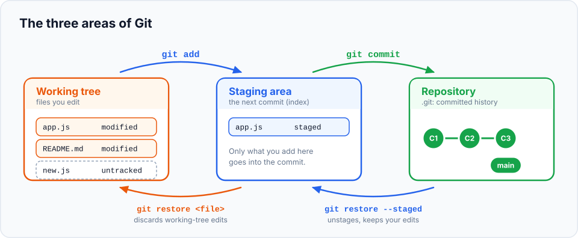
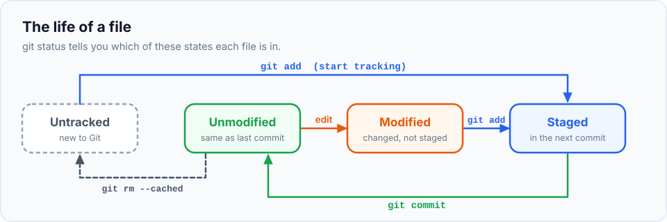
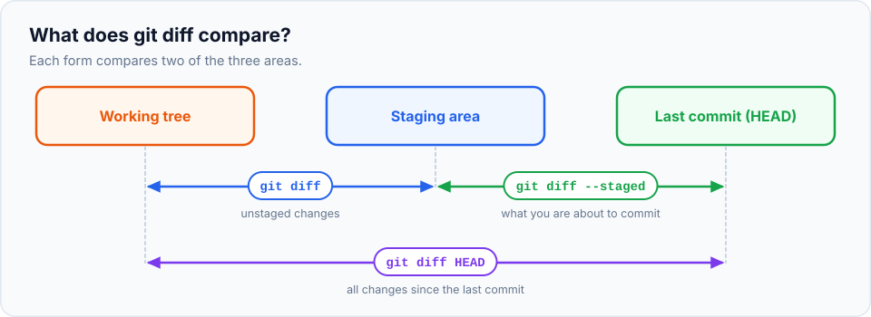

In the last chapter you followed the rhythm *edit → add → commit*. This chapter explains
**why** it works that way. It's the single most useful mental model in Git: once you can picture
the three areas, `git status`, `git diff`, `git restore` and even `git reset` stop being
mysterious.

> **In this chapter you'll learn**
> - The three areas: **working tree**, **staging area** and **repository**
> - The four states a file can be in, and how it moves between them
> - How to read the long and short forms of `git status`
> - How to see changes in each area with `git diff` and `git diff --staged`
> - How to unstage a file and how to discard changes safely
> - How to delete and rename tracked files
>
> **Prerequisites:** [chapter 4](../04-your-first-repository/index.md). **Time:** 40 minutes.

## An analogy: packing a parcel

Imagine you're sending a parcel to a friend.

1. **Your desk** is covered with things you're working on. Some are finished, some are half done.
2. **An open box** sits next to you. You pick the finished items from your desk and put them
   in the box. You can add more or take something out, as long as the box is open.
3. When you're happy with what's in the box, you **seal it, label it and send it**. Once sent,
   it's on record forever, and you start a new box.

Git works the same way:

| Parcel | Git | What it is |
| --- | --- | --- |
| Your desk | **Working tree** (or working directory) | The real files in your project folder, which you edit |
| The open box | **Staging area** (also called the **index**) | A draft of your next commit |
| Sealed, sent parcels | **Repository** (the `.git` folder) | All the commits you've made |



- **`git add`** puts a copy of a file's current content **into the box** (staging area).
- **`git commit`** **seals the box** and records it in the repository as a new commit.
- **`git restore --staged`** takes something **out of the box**, leaving it on your desk.
- **`git restore`** throws away the changes on your desk, putting the file back the way it is
  in the box (or, if the box has nothing for that file, the way it was in the last commit).

## Why have a staging area?

Because real work is messy. Suppose in one sitting you:

- fixed a typo in `about.html`,
- added a navigation link in `index.html`,
- started a stylesheet that isn't finished.

Without a staging area, your only choice would be to save **everything at once** in one muddled
commit. With it, you choose: commit the typo fix on its own, then the navigation link, and leave
the stylesheet out until it's ready. Each commit stays small and meaningful, which makes history
easy to read and individual changes easy to undo.

> **Key detail:** `git add` stages the file's content **as it is at that moment**. If you edit
> the file again after adding it, the new edit is *not* staged automatically. You'd need to run
> `git add` again. The lab below shows this.

## The four states of a file

Every file in your project is always in one of these states:



| State | Meaning | How it gets there |
| --- | --- | --- |
| **Untracked** | Git sees the file but has never stored it | You created a new file |
| **Unmodified** | Same as in the last commit | You just committed it, or haven't touched it |
| **Modified** | Changed since the last commit, change not staged | You edited it |
| **Staged** | The change is in the staging area, ready for the next commit | You ran `git add` |

Files that are unmodified, modified or staged are called **tracked**: Git knows about them.

## Reading `git status`

`git status` groups files by state:

```text
On branch main
Changes to be committed:                          ← STAGED (in the box)
  (use "git restore --staged <file>..." to unstage)
	modified:   index.html

Changes not staged for commit:                    ← MODIFIED (on your desk)
  (use "git add <file>..." to update what will be committed)
  (use "git restore <file>..." to discard changes in working directory)
	modified:   about.html

Untracked files:                                  ← UNTRACKED (Git ignores them for now)
  (use "git add <file>..." to include in what will be committed)
	style.css
```

Notice the hints in brackets: Git tells you exactly which command moves a file to another state.

### The short format

Once you're comfortable, `git status -s` (short) is much faster to read:

```text
$ git status -s
M  index.html
 M about.html
?? style.css
```

There are **two columns** before each file name:

| Left column | Right column |
| --- | --- |
| Staging area (compared with the last commit) | Working tree (compared with the staging area) |

| Code | Meaning |
| --- | --- |
| `M ` (M on the left) | Modified **and staged** |
| ` M` (M on the right) | Modified, **not staged** |
| `MM` | Staged, then modified again: part staged, part not |
| `A ` | New file, staged (**A**dded) |
| `D ` | Deleted, staged |
| `R ` | Renamed, staged |
| `??` | Untracked |

## Seeing changes in each area

`git diff` compares two areas. Which two depends on how you call it:



| Command | Shows | Question it answers |
| --- | --- | --- |
| `git diff` | Working tree vs staging area | "What have I changed but **not staged** yet?" |
| `git diff --staged` | Staging area vs last commit | "What **will go into** my next commit?" |
| `git diff HEAD` | Working tree vs last commit | "What have I changed in total since my last commit?" |

(`HEAD` means "the commit you're currently on", usually your latest commit. `--cached` is an
older name for `--staged`; they're identical.)

## Moving changes between areas: cheat sheet

| I want to… | Command |
| --- | --- |
| Stage a file | `git add file.html` |
| Stage every change in the project (new, modified and deleted files) | `git add .` (run from the project root) or `git add -A` |
| Unstage a file but keep my edits | `git restore --staged file.html` |
| Throw away my unstaged edits to a file | `git restore file.html` ⚠️ |
| Commit what's staged | `git commit -m "message"` |
| Stage **all tracked** files and commit in one go | `git commit -am "message"` |
| Delete a tracked file (and stage the deletion) | `git rm file.html` |
| Rename a tracked file (and stage the rename) | `git mv old.html new.html` |

> ⚠️ **`git restore <file>` is one of the few commands that can lose work.** It overwrites your
> file with the staged/committed version, and unstaged edits are gone for good, because Git
> never saved them. Run `git diff <file>` first to see what you'd lose.

## Hands-on lab: move changes between the three areas

We'll continue with `my-website` from chapter 4.

> **Starting here?** Run this to create the project as it was at the end of chapter 4:
>
> ```bash
> mkdir -p ~/git-practice/my-website && cd ~/git-practice/my-website && git init
> echo "<h1>Welcome to my website</h1>" > index.html && git add . && git commit -m "Add home page"
> echo "<p>I am learning Git.</p>" >> index.html && git commit -am "Add intro paragraph"
> echo "<h1>About me</h1>" > about.html && git add . && git commit -m "Add about page"
> ```

### Step 1: make three different kinds of change

```bash
$ cd ~/git-practice/my-website
$ echo "body { font-family: sans-serif; }" > style.css
$ echo "<p>I live in Bengaluru.</p>" >> about.html
$ echo "<a href='about.html'>About</a>" >> index.html
```

You created a new file and modified two existing ones.

```bash
$ git status -s
 M about.html
 M index.html
?? style.css
```

Two modified files (M in the right column: not staged) and one untracked file.

### Step 2: stage only one file

```bash
$ git add index.html
$ git status -s
 M about.html
M  index.html
?? style.css
```

Look at the `M` for `index.html`: it moved to the **left** column. It's staged now.

### Step 3: compare the two kinds of diff

```bash
$ git diff
diff --git a/about.html b/about.html
...
 <h1>About me</h1>
+<p>I live in Bengaluru.</p>
```

Plain `git diff` shows only `about.html`, because that's the only change **not staged**.

```bash
$ git diff --staged
diff --git a/index.html b/index.html
...
 <h1>Welcome to my website</h1>
 <p>I am learning Git.</p>
+<a href='about.html'>About</a>
```

`--staged` shows only `index.html`: exactly what the next commit would contain.

### Step 4: edit a file that's already staged

```bash
$ echo "<footer>Made with Git</footer>" >> index.html
$ git status -s
 M about.html
MM index.html
?? style.css
```

`MM`: `index.html` has a **staged** change (the link) and an **unstaged** change (the footer).
The long `git status` lists it in both sections. This proves the point from earlier: `git add`
staged the file *as it was at that moment*. If you committed now, the footer would not be
included.

```bash
$ git diff                 # shows only the footer
$ git diff --staged        # shows only the link
```

### Step 5: unstage a file

Changed your mind about committing `index.html` now?

```bash
$ git restore --staged index.html
$ git status -s
 M about.html
 M index.html
?? style.css
```

Both changes to `index.html` are still in the file. They're just not staged anymore. Nothing
was lost.

### Step 6: discard changes you don't want

Let's say the sentence added to `about.html` was a mistake. Throw it away:

```bash
$ git restore about.html
$ cat about.html
<h1>About me</h1>
$ git status -s
 M index.html
?? style.css
```

`about.html` is back to exactly how it was in the last commit, and it's no longer listed.

### Step 7: stage everything and commit

```bash
$ git add .
$ git status -s
M  index.html
A  style.css
$ git commit -m "Add navigation link, footer and stylesheet"
[main fc7a6cf] Add navigation link, footer and stylesheet
 2 files changed, 3 insertions(+)
 create mode 100644 style.css
```

`git add .` staged everything in the current folder, including the untracked `style.css`
(shown as `A`, added).

### Step 8: the shortcut `git commit -a`

```bash
$ echo "<p>Hobbies: cricket</p>" >> about.html
$ git commit -am "Add hobbies to about page"
[main 9bda35a] Add hobbies to about page
 1 file changed, 1 insertion(+)
```

`-a` stages every **tracked** file that changed, then commits. It's handy for quick edits.

> ⚠️ `-a` does **not** include untracked (new) files. New files always need `git add` first.

### Step 9: delete and rename files the Git way

Let's practice with a temporary file so the website itself stays intact:

```bash
$ echo "draft ideas" > notes.txt
$ git add notes.txt && git commit -m "Add notes"

$ git mv notes.txt ideas.txt          # rename
$ git status -s
R  notes.txt -> ideas.txt

$ git commit -m "Rename notes to ideas"

$ git rm ideas.txt                    # delete
rm 'ideas.txt'
$ git status -s
D  ideas.txt

$ git commit -m "Remove ideas file"
```

`git mv` and `git rm` change the file **and** stage the change in one step. You could also
rename or delete the file normally (in your file explorer or editor) and then run `git add -A`;
Git notices the change either way, and detects renames by comparing file content.

### Step 10: check your history

```bash
$ git log --oneline
...  Remove ideas file
...  Rename notes to ideas
...  Add notes
...  Add hobbies to about page
...  Add navigation link, footer and stylesheet
...  Add about page
...  Add intro paragraph
...  Add home page
```

## When to use what

| Situation | Use |
| --- | --- |
| Everything you changed belongs in one commit | `git add .` then `git commit`, or `git commit -am` for tracked files |
| Your changes cover several unrelated things | `git add` specific files, commit, then add the rest and commit again |
| You staged something by accident | `git restore --staged <file>` |
| You want to abandon an edit entirely | `git diff <file>` to check, then `git restore <file>` |
| You want to review before committing | `git diff --staged` (make this a habit) |
| One file contains two unrelated changes | Stage parts of it with `git add -p` ([next chapter](../06-staging-and-committing-well/index.md)) |

## Older commands you'll see online

Before Git 2.23 (2019), the same jobs were done with `checkout` and `reset`. They still work,
and you'll find them in older tutorials and Stack Overflow answers:

| Modern | Older equivalent |
| --- | --- |
| `git restore <file>` | `git checkout -- <file>` |
| `git restore --staged <file>` | `git reset HEAD <file>` |
| `git switch <branch>` | `git checkout <branch>` |

## Common mistakes

| Mistake | What happens | How to avoid it |
| --- | --- | --- |
| Editing after `git add` and committing straight away | The commit contains the older version of the file | Check `git status`: an `MM` means part of the file isn't staged |
| Expecting `git commit -a` to include new files | New files are left out | `git add` new files first |
| Using `git restore <file>` when you meant to unstage | Your edits are deleted | Unstage with `git restore --staged <file>` (note the `--staged`) |
| Running `git add .` from a subfolder | Only changes in that subfolder are staged | Run it from the project root, or use `git add -A` |

## Recap

- **Working tree** = your files. **Staging area** = draft of the next commit. **Repository** = saved commits.
- `git add` copies the current content into the staging area; editing again later needs another `git add`.
- `git status` (or `git status -s`) shows which state every file is in.
- `git diff` = unstaged changes, `git diff --staged` = what will be committed.
- `git restore --staged` unstages safely; `git restore` **discards** edits permanently.

## Check your understanding

<details>
<summary>1. <code>git status -s</code> shows <code>MM app.js</code>. What does that mean, and what would be committed right now?</summary>

`app.js` was staged and then modified again. Only the staged version (the left `M`) would be
committed; the newer edits (the right `M`) would stay uncommitted. Run `git add app.js` to
include them.
</details>

<details>
<summary>2. Which command shows what will go into your next commit?</summary>

`git diff --staged`.
</details>

<details>
<summary>3. You ran <code>git add secrets.txt</code> by mistake. How do you undo it without deleting the file?</summary>

`git restore --staged secrets.txt`. The file stays on disk, but it's no longer staged.
(To make Git ignore it permanently, see [chapter 7](../07-ignoring-files/index.md).)
</details>

<details>
<summary>4. Why can't Git recover changes discarded with <code>git restore file</code>?</summary>

They were never added or committed, so Git never stored a copy. Only content that has been
staged or committed is in Git's database.
</details>

**Next:** [staging smartly and writing good commits](../06-staging-and-committing-well/index.md).
