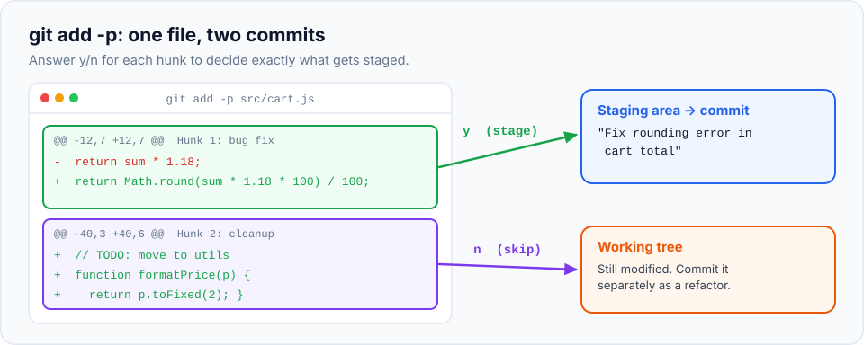
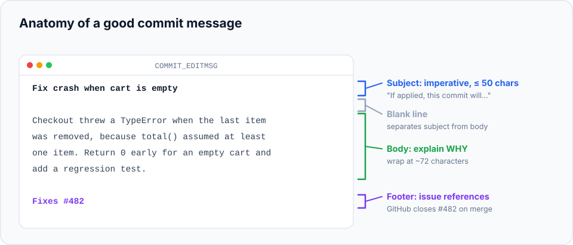

You can now save versions of your project. This chapter is about saving **good** versions:
commits that are focused, well described, and easy for anyone (including future you) to
understand. These habits are what separate a messy history from a professional one, and they
cost almost no extra time once you know the tools.

> **In this chapter you'll learn**
> - What makes a commit "good", and why it matters
> - How to stage **part** of a file with `git add -p`
> - How to write clear commit messages (and longer ones in your editor)
> - Conventional Commits, a format many teams use
> - How to fix your last commit with `git commit --amend`
>
> **Prerequisites:** [chapter 5](../05-the-three-areas/index.md). **Time:** 40 minutes.

## Why commit quality matters

Your history is read far more often than it's written. People read it to:

- **review** your work before it's merged ([chapter 15](../15-pull-requests/index.md)),
- **understand** why a line of code exists, months later ([chapter 9](../09-searching-history/index.md)),
- **undo** a specific change without undoing others ([chapter 17](../17-undoing-changes/index.md)),
- **find** which change introduced a bug ([chapter 24](../24-bisect/index.md)).

All of these are easy when each commit does **one thing** and explains **why**. They're painful
when commits are huge, mixed, and labelled "fix" or "changes".

| A good commit… | Example |
| --- | --- |
| does one logical thing | "Add contact form validation" (not "validation + new logo + typo") |
| leaves the project working | Tests pass, the site loads |
| has a message that explains the change | "Fix crash when cart is empty" |
| is small enough to review in a few minutes | Tens of lines, not thousands |

## Staging part of a file: `git add -p`

Often a single file contains two unrelated changes. Suppose in `index.html` you made the heading
friendlier **and** updated the footer. These are separate ideas, so they deserve separate
commits. But `git add index.html` stages the whole file.

`git add -p` (**p** for **patch**) shows you each change in the file, one piece at a time, and
asks whether to stage it. Each piece is called a **hunk**: a group of nearby changed lines.



When Git asks `Stage this hunk [y,n,q,a,d,s,e,?]?`, you answer with one letter:

| Key | Meaning |
| --- | --- |
| `y` | **Yes**, stage this hunk |
| `n` | **No**, don't stage it (leave it for later) |
| `s` | **Split** this hunk into smaller ones (when two changes are close together) |
| `e` | **Edit** the hunk by hand, to pick individual lines |
| `q` | **Quit**: stop here; hunks you already answered keep their answers |
| `a` / `d` | Stage **all** / **none** of the remaining hunks in this file |
| `?` | Show help |

> **Bonus:** going through `git add -p` forces you to **read your own changes** before
> committing. It's the cheapest code review there is, and it catches leftover debug code,
> accidental edits and typos.

## Hands-on lab, part 1: two changes, two commits

> **Starting here?** Create the project state from the end of chapter 5:
>
> ```bash
> mkdir -p ~/git-practice/my-website && cd ~/git-practice/my-website && git init
> printf '<h1>Welcome to my website</h1>\n<p>I am learning Git.</p>\n<a href="about.html">About</a>\n<footer>Made with Git</footer>\n' > index.html
> echo "<h1>About me</h1>" > about.html
> git add . && git commit -m "Set up website"
> ```

### Step 1: make two unrelated changes in one file

Open `index.html` in your editor and make two changes:

- change the heading to `<h1>Welcome to my website!</h1>` (add an exclamation mark),
- change the footer to `<footer>Made with Git, 2026</footer>`.

Save the file. (Prefer the terminal? This replaces the file with the edited version:)

```bash
$ printf '<h1>Welcome to my website!</h1>\n<p>I am learning Git.</p>\n<a href="about.html">About</a>\n<footer>Made with Git, 2026</footer>\n' > index.html
```

```bash
$ git diff
@@ -1,4 +1,4 @@
-<h1>Welcome to my website</h1>
+<h1>Welcome to my website!</h1>
 <p>I am learning Git.</p>
 <a href="about.html">About</a>
-<footer>Made with Git</footer>
+<footer>Made with Git, 2026</footer>
```

### Step 2: stage only the heading change

```bash
$ git add -p index.html
@@ -1,4 +1,4 @@
-<h1>Welcome to my website</h1>
+<h1>Welcome to my website!</h1>
 <p>I am learning Git.</p>
 <a href="about.html">About</a>
-<footer>Made with Git</footer>
+<footer>Made with Git, 2026</footer>
(1/1) Stage this hunk [y,n,q,a,d,s,e,?]?
```

The two changes are close together, so Git grouped them into **one** hunk. Type **`s`** and
press Enter to split it:

```text
Split into 2 hunks.
@@ -1,3 +1,3 @@
-<h1>Welcome to my website</h1>
+<h1>Welcome to my website!</h1>
 <p>I am learning Git.</p>
 <a href="about.html">About</a>
(1/2) Stage this hunk [y,n,q,a,d,j,J,g,/,e,?]?
```

Now the first hunk is just the heading. Type **`y`** (stage it). Git shows the second hunk:

```text
@@ -2,3 +2,3 @@
 <p>I am learning Git.</p>
 <a href="about.html">About</a>
-<footer>Made with Git</footer>
+<footer>Made with Git, 2026</footer>
(2/2) Stage this hunk [y,n,q,a,d,K,g,/,e,?]?
```

Type **`n`** (don't stage the footer yet).

### Step 3: check what's staged

```bash
$ git status -s
MM index.html
```

`MM`: part of the file is staged, part isn't. Exactly what we wanted.

```bash
$ git diff --staged          # what will be committed
-<h1>Welcome to my website</h1>
+<h1>Welcome to my website!</h1>

$ git diff                   # what is left over
-<footer>Made with Git</footer>
+<footer>Made with Git, 2026</footer>
```

### Step 4: make two focused commits

```bash
$ git commit -m "Make the welcome heading friendlier"
$ git add index.html
$ git commit -m "Add year to footer"
$ git log --oneline -2
...  Add year to footer
...  Make the welcome heading friendlier
```

Two changes, two clear commits, from one file.

## Writing good commit messages

A commit message answers the question: **"If applied, this commit will…"**



### The rules that matter

1. **Subject line: 50 characters or fewer**, so it fits in one line in every tool.
2. **Use the imperative mood:** "Add", "Fix", "Remove", "Update", not "Added", "Fixes" or
   "Adding". Test: *"If applied, this commit will* ***add contact form***." ✅
3. **No full stop** at the end of the subject.
4. For anything non-obvious, add a **blank line**, then a **body** explaining **why** the change
   was needed and any important details. The diff already shows *what* changed; the message is
   the only place to explain *why*.
5. **Reference tickets** when your team uses them: `Fixes #42` (GitHub closes issue 42 when
   the commit reaches the main branch).

| ❌ Unhelpful | ✅ Helpful |
| --- | --- |
| `fix` | `Fix broken link to about page` |
| `changes` | `Add dark mode styles for the header` |
| `WIP` | `Extract footer into its own file` |
| `Fixed the bug Ravi found` | `Prevent the form from submitting twice` |
| `update index.html` | `Show today's date in the footer` |

### Writing a longer message in your editor

`-m` is fine for one-line messages. For a subject plus body, run `git commit` **without** `-m`.
Git opens the editor you configured in [chapter 3](../03-configure-git/index.md):

```text
Fix crash when cart is empty

Checkout threw a TypeError when the last item was removed,
because total() assumed at least one item. Return 0 early
for an empty cart and add a regression test.

Fixes #482
# Please enter the commit message for your changes. Lines starting
# with '#' will be ignored, and an empty message aborts the commit.
```

Write the message at the top, save, and close the editor. Lines starting with `#` are ignored.
**Saving an empty message cancels the commit**, which is a handy way to back out.

> **Tip:** `git commit -v` shows the full diff below the message in the editor, so you can see
> exactly what you're describing while you write. Make it the default with
> `git config --global commit.verbose true`.

### Conventional Commits

Many teams use a format called **Conventional Commits**, which adds a **type** (and optionally
a **scope**) in front of the subject:

```text
feat(cart): add coupon support
fix(auth): refresh the token before it expires
docs: explain how to run the project locally
style: format footer markup
refactor: extract price calculation into a function
test: add tests for empty cart
chore(deps): update express to 4.21
```

| Type | Use for |
| --- | --- |
| `feat` | A new feature |
| `fix` | A bug fix |
| `docs` | Documentation only |
| `refactor` | Code change that neither fixes a bug nor adds a feature |
| `test` | Adding or fixing tests |
| `chore` | Tooling, dependencies, housekeeping |

Because the format is predictable, tools can generate changelogs and version numbers
automatically. **Use it if your team does**; otherwise, the plain rules above are enough.

## Fixing your last commit: `git commit --amend`

Everyone commits and then immediately notices a typo in the message, or a forgotten file.
`--amend` **replaces** the last commit with a corrected one.

### Fix the message

```bash
$ git commit --amend -m "Add phone number to about page"
```

### Add a forgotten change, keep the message

```bash
$ git add about.html
$ git commit --amend --no-edit
```

`--no-edit` keeps the existing message.

### Important: amend creates a *new* commit

Amending doesn't edit the old commit; it builds a new one (with a new hash) and puts it in
the old one's place. That's completely fine **before you share the commit** with anyone. If
you've already pushed it to a shared branch, amending rewrites history others may have; we'll
cover how to handle that in [chapter 14](../14-fetch-pull-push/index.md) and
[chapter 17](../17-undoing-changes/index.md).

## Hands-on lab, part 2: amend

### Step 1: commit with a typo

```bash
$ echo "<p>Phone: 12345</p>" >> about.html
$ git add about.html
$ git commit -m "Add phone numbr"
[main 7af9146] Add phone numbr
 1 file changed, 1 insertion(+)
```

### Step 2: fix the message

```bash
$ git commit --amend -m "Add contact details to about page"
[main 3079a16] Add contact details to about page
 Date: Sun Oct 11 10:00:00 2026 +0530
 1 file changed, 1 insertion(+)
```

Notice the hash changed (`7af9146` → `3079a16`): it's a new commit replacing the old one.

### Step 3: add a forgotten line to the same commit

```bash
$ echo "<p>City: Bengaluru</p>" >> about.html
$ git add about.html
$ git commit --amend --no-edit
$ git show --stat HEAD
commit ed428bbf5469f4b84bf925f901d5fe78d53dcbc0
Author: Asha Rao <asha@example.com>
Date:   Sun Oct 11 10:00:00 2026 +0530

    Add contact details to about page

 about.html | 2 ++
 1 file changed, 2 insertions(+)
```

`git show --stat HEAD` shows the latest commit (`HEAD`) with a summary of files changed. One
commit now contains both lines, with the corrected message.

## When to use what

| Situation | Use |
| --- | --- |
| All your changes belong together | `git add <files>` or `git add .` |
| One file has unrelated changes | `git add -p <file>` |
| You want to double-check your work before committing | `git add -p` (review every hunk) |
| Short, obvious change | `git commit -m "Subject"` |
| Change needs explanation | `git commit` (write subject + body in the editor) |
| Typo in the last commit message, not pushed yet | `git commit --amend -m "..."` |
| Forgot a file in the last commit, not pushed yet | `git add <file> && git commit --amend --no-edit` |
| The commit is older than the last one | Interactive rebase ([chapter 19](../19-interactive-rebase/index.md)) |

## Common mistakes

| Mistake | Fix |
| --- | --- |
| Pressed `y` on the wrong hunk in `git add -p` | Unstage with `git restore --staged <file>` and start again, or use `git restore -p --staged <file>` to unstage single hunks |
| Commit message "fix", "wip", "asdf" | Amend it right away if not pushed; build the habit for next time |
| Amended a commit that was already pushed and shared | See [chapter 14](../14-fetch-pull-push/index.md) on force pushing safely |
| `git commit --amend` opened the editor unexpectedly | That's the default (to edit the message). Save and close to keep it, or use `--no-edit` next time |

## Recap

- Good commits are **focused**, **working**, **small** and **explained**.
- `git add -p` stages a file hunk by hunk: `y`, `n`, `s` (split), `e` (edit), `q`.
- Commit subject: imperative, ≤ 50 characters. Body: blank line, then **why**.
- `git commit --amend` replaces your last (unshared) commit to fix its message or contents.

## Check your understanding

<details>
<summary>1. You edited three things in <code>app.js</code>: a bug fix, a rename, and a debug <code>console.log</code>. How do you commit only the bug fix?</summary>

Run `git add -p app.js`, answer `y` to the bug-fix hunk and `n` to the others (use `s` to split
if they're grouped together), then commit. Later, remove the `console.log` and commit the rename
separately.
</details>

<details>
<summary>2. Rewrite <code>Fixed the login bug</code> as a good subject line.</summary>

Something like `Fix login failing for emails with uppercase letters`: imperative ("Fix"), and
specific about *which* bug.
</details>

<details>
<summary>3. Why should you avoid amending a commit you've already pushed to a shared branch?</summary>

Amending creates a new commit with a different hash. Teammates who already have the old commit
now have a different history from yours, which causes confusing conflicts when you sync.
</details>

**Next:** [ignoring files with .gitignore](../07-ignoring-files/index.md): keep junk and
secrets out of your repository.
