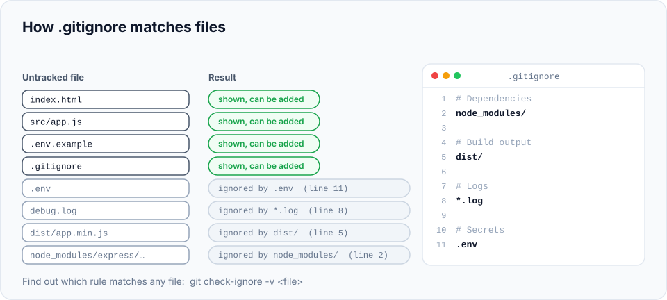

Not every file in your project folder belongs in Git. Some are generated automatically, some are
huge, some are specific to your computer, and some are **secret**. This chapter shows how to
tell Git to ignore them, and what to do when a file is committed by mistake.

> **In this chapter you'll learn**
> - Which kinds of files should never be committed, and why
> - How to write a `.gitignore` file, and how its patterns work
> - How to find out *why* a file is being ignored
> - How to stop tracking a file that was already committed
> - How to set up a personal, global ignore file for your machine
>
> **Prerequisites:** [chapter 5](../05-the-three-areas/index.md). **Time:** 30 minutes.

## What shouldn't be committed?

| Kind of file | Examples | Why not commit it |
| --- | --- | --- |
| **Dependencies** | `node_modules/`, `vendor/`, `.venv/` | Huge, and anyone can recreate them with `npm install` / `pip install` |
| **Build output** | `dist/`, `build/`, `*.class`, `*.o` | Generated from your source code; they change on every build and cause pointless conflicts |
| **Logs and temporary files** | `*.log`, `*.tmp`, `coverage/` | Noise that's different on every machine |
| **Secrets** 🔥 | `.env`, `*.pem`, `credentials.json` | Anyone with access to the repository (and everyone, if it's public) can read them, **forever**, in the history |
| **Personal / OS files** | `.DS_Store`, `Thumbs.db`, `.idea/`, `*.swp` | Specific to your computer or editor; irrelevant to everyone else |

The rule of thumb: **commit what's needed to build the project, never what's produced by
building it, and never secrets.**

> **Why secrets are special:** once a file is committed, it stays in the history even if you
> delete it in a later commit. Anyone who clones the repository can get it back. Automated bots
> scan GitHub for leaked keys within minutes of a push. If a secret is ever committed, treat it
> as compromised and change it ([chapter 30](../30-git-disasters/index.md) shows the full fix).

## How `.gitignore` works

A `.gitignore` file is a plain text file, usually at the root of your project, listing
**patterns**. Any **untracked** file that matches a pattern is ignored: it disappears from
`git status` and `git add .` won't stage it.

You commit `.gitignore` itself, so everyone on the team ignores the same files.



### Pattern rules

| Pattern | Matches | Example matches |
| --- | --- | --- |
| `debug.log` | A file with this name, in any folder | `debug.log`, `api/debug.log` |
| `*.log` | Any name ending in `.log` (`*` = any characters) | `error.log`, `logs/app.log` |
| `node_modules/` | A **folder** with this name, anywhere, and everything inside it (trailing `/` = folders only) | `node_modules/`, `api/node_modules/` |
| `/config.json` | Only at the root of the project (leading `/` = relative to this `.gitignore`) | `config.json`, but **not** `src/config.json` |
| `docs/*.pdf` | PDFs directly inside `docs/` | `docs/guide.pdf`, but not `docs/old/guide.pdf` |
| `docs/**/*.pdf` | PDFs anywhere under `docs/` (`**` = any number of folders) | `docs/guide.pdf`, `docs/old/guide.pdf` |
| `!important.log` | **Exception**: do *not* ignore this, even if an earlier pattern did | `important.log` stays visible |
| `# comment` | A comment (only at the start of a line) | — |

Two details that trip people up:

- **Comments must be on their own line.** In `*.log  # logs`, Git treats `# logs` as part of
  the pattern.
- **You can't re-include a file inside an ignored folder.** If `logs/` is ignored, `!logs/keep.txt`
  has no effect, because Git doesn't even look inside ignored folders. Use `logs/*` plus
  `!logs/keep.txt` instead.

## Hands-on lab: ignore the right files

> **Starting here?** Any repository works. To create one:
> `mkdir -p ~/git-practice/my-website && cd ~/git-practice/my-website && git init && echo "<h1>Hi</h1>" > index.html && git add . && git commit -m "Initial commit"`

### Step 1: create the kind of files real projects produce

```bash
$ cd ~/git-practice/my-website
$ mkdir -p node_modules/express && echo "module code" > node_modules/express/index.js
$ echo "API_KEY=sk_live_123" > .env
$ echo "API_KEY=your-key-here" > .env.example
$ echo "server started" > debug.log
$ mkdir dist && echo "minified" > dist/app.min.js
```

We've simulated: a downloaded dependency, a secrets file, an example secrets file (safe to
share, with placeholder values), a log file and build output.

```bash
$ git status -s
?? .env
?? .env.example
?? debug.log
?? dist/
?? node_modules/
```

If you ran `git add .` now, all of it would be committed, including your API key. Let's prevent that.

### Step 2: create a `.gitignore`

Create a file called `.gitignore` (the name starts with a dot) in the project root with your
editor, containing:

```text
# Dependencies
node_modules/

# Build output
dist/

# Logs
*.log

# Secrets
.env
```

(From the terminal: `printf '# Dependencies\nnode_modules/\n\n# Build output\ndist/\n\n# Logs\n*.log\n\n# Secrets\n.env\n' > .gitignore`)

### Step 3: check the result

```bash
$ git status -s
?? .env.example
?? .gitignore
```

The ignored files vanished from the list. Only `.env.example` (which we *want* to share) and
the new `.gitignore` remain. The ignored files still exist on your disk; Git just doesn't
offer to track them.

### Step 4: ask Git why a file is ignored

```bash
$ git check-ignore -v .env debug.log node_modules/express/index.js
.gitignore:11:.env	.env
.gitignore:8:*.log	debug.log
.gitignore:2:node_modules/	node_modules/express/index.js
```

Each line shows **which file**, **which line number** and **which pattern** caused the file to
be ignored. This is the command to reach for whenever you wonder "why doesn't Git see my file?"
For a file that isn't ignored, it prints nothing.

To list ignored files explicitly:

```bash
$ git status --ignored -s
?? .env.example
?? .gitignore
!! .env
!! debug.log
!! dist/
!! node_modules/
```

`!!` marks ignored files.

### Step 5: commit the ignore file

```bash
$ git add .
$ git commit -m "Add .gitignore and example env file"
$ git ls-files
.env.example
.gitignore
index.html
...
```

`git ls-files` lists every file Git is **tracking**. Your secrets, logs, build output and
dependencies aren't there.

### Step 6: the "already committed" trap

`.gitignore` **only affects untracked files**. If a file was committed before you added it to
`.gitignore`, Git keeps tracking it. Let's reproduce this common situation:

```bash
$ echo "port=3000" > config.local.json
$ git add config.local.json && git commit -m "Add local config"

$ echo "config.local.json" >> .gitignore
$ echo "port=4000" > config.local.json
$ git status -s
 M .gitignore
 M config.local.json
```

Even though it's in `.gitignore`, `config.local.json` still shows as modified, because it's
tracked. The fix is to **remove it from Git's index without deleting it from your disk**:

```bash
$ git rm --cached config.local.json
rm 'config.local.json'
$ git status -s
 M .gitignore
D  config.local.json
$ git commit -am "Stop tracking local config"
```

`--cached` means "remove from the staging area/repository only". The file is still on your disk:

```bash
$ ls
config.local.json  debug.log  dist  index.html  node_modules
$ echo "port=5000" > config.local.json
$ git status -s
$
```

Now changes to it are ignored.

> ⚠️ **If the file contained a secret,** it's still visible in the old commits. Removing it from
> tracking only protects the future. Change the secret, and see
> [chapter 30](../30-git-disasters/index.md) for cleaning history.

### Step 7: exceptions with `!`

Ignore all logs except one:

```bash
$ echo "keep me" > important.log
$ git status -s              # important.log is hidden by *.log
$ echo '!important.log' >> .gitignore
$ git status -s
 M .gitignore
?? important.log
```

The `!` pattern must come **after** the pattern it overrides.

## A global ignore file for your own machine

Files created by **your** operating system or editor (`.DS_Store` on macOS, `.idea/` for
JetBrains IDEs, `*.swp` for Vim) aren't specific to any project. Instead of adding them to every
project's `.gitignore`, ignore them once for your user:

```bash
$ printf ".DS_Store\n.idea/\n*.swp\nThumbs.db\n" >> ~/.gitignore_global
$ git config --global core.excludesFile ~/.gitignore_global
```

| Where | Put |
| --- | --- |
| Project `.gitignore` (committed) | Things everyone's copy of the project produces: dependencies, build output, logs, `.env` |
| Global ignore file (your machine only) | Things only your tools produce: OS files, editor folders |
| `.git/info/exclude` (this repo, your machine only, not committed) | Rare personal exceptions in one project |

## Don't start from scratch: templates

For any language or framework, [github/gitignore](https://github.com/github/gitignore) has a
ready-made template (`Node.gitignore`, `Python.gitignore`, `Java.gitignore`, …). GitHub also
offers to add one when you create a new repository. Start with the template, then add your
project's specifics.

## Keeping an empty folder

Git tracks **files**, not folders. An empty folder is invisible to Git. If you need the folder
to exist (for example `uploads/`), put a placeholder file in it. By convention it's called
`.gitkeep`:

```bash
$ mkdir uploads && touch uploads/.gitkeep
$ git add uploads/.gitkeep
```

## When to use what

| Situation | Solution |
| --- | --- |
| Starting a new project | Add a `.gitignore` from a template **before the first commit** |
| Generated files keep appearing in `git status` | Add their pattern to `.gitignore` |
| A file is in `.gitignore` but still shows as modified | It's tracked: `git rm --cached <file>`, then commit |
| Your OS or editor creates junk files | Global ignore file (`core.excludesFile`) |
| You need to share example settings without the real values | Commit `.env.example` with placeholders; ignore `.env` |
| You don't know why a file is ignored | `git check-ignore -v <file>` |

## Common mistakes

| Mistake | Fix |
| --- | --- |
| Adding `.gitignore` **after** committing `node_modules/` | `git rm -r --cached node_modules` and commit (`-r` = recursive, for folders) |
| Committing `.env` | Rotate the secret immediately; then remove it from tracking and history ([chapter 30](../30-git-disasters/index.md)) |
| Comment on the same line as a pattern | Put comments on their own line |
| Naming the file `gitignore` or `.gitignore.txt` | It must be exactly `.gitignore` (Windows may hide the extension: check the real name with `ls -a`) |

## Recap

- Never commit **dependencies**, **build output**, **logs**, **personal files** or **secrets**.
- `.gitignore` lists patterns; matching **untracked** files are ignored. Commit the `.gitignore`.
- `git check-ignore -v <file>` explains why a file is ignored.
- Already tracked? `git rm --cached <file>` stops tracking it but keeps it on disk.
- Use a global ignore file for OS and editor junk.

## Check your understanding

<details>
<summary>1. You add <code>*.log</code> to <code>.gitignore</code>, but <code>app.log</code> still appears as modified. Why?</summary>

`app.log` was committed before the rule was added, so it's tracked, and `.gitignore` doesn't
affect tracked files. Run `git rm --cached app.log` and commit.
</details>

<details>
<summary>2. What's the difference between <code>build</code> and <code>/build/</code> in .gitignore?</summary>

`build` matches a file or folder named `build` anywhere in the project. `/build/` matches only
a **folder** named `build` at the root of the project (next to the `.gitignore`).
</details>

<details>
<summary>3. You committed <code>.env</code> with a real API key, then deleted it in the next commit. Is the key safe?</summary>

No. The key is still in the earlier commit, and anyone with the repository can read it. Revoke
or rotate the key immediately; cleaning the history is a secondary step.
</details>

**Next:** [viewing history with log, show and diff](../08-viewing-history/index.md).
