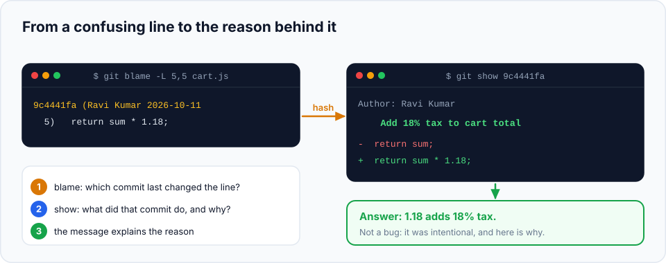

You'll spend more of your career **reading** code than writing it, and much of that code was
written by someone else, long ago. Sooner or later you'll look at a line and wonder: *"Why is
this here? Is it safe to change?"* Git can answer, as long as you know where to look.

> **In this chapter you'll learn**
> - How to find which commit last changed each line, with `git blame`
> - How to go from that commit to the **reason** for the change
> - How to find when a piece of code was **added or removed**, even if it no longer exists (`git log -S`)
> - How to follow the history of a single function (`git log -L`)
> - How to search the code itself, now or in the past (`git grep`)
>
> **Prerequisites:** [chapter 8](../08-viewing-history/index.md). **Time:** 35 minutes.

## Set up the practice project

This lab uses a tiny shopping-cart project with history from three people. Copy and paste:

```bash
cd ~/git-practice && rm -rf shop && mkdir shop && cd shop && git init
printf 'function total(items) {\n  let sum = 0;\n  for (const item of items) sum += item.price;\n  return sum;\n}\n' > cart.js
git add . && git commit -m "Add cart total"
printf 'function total(items) {\n  let sum = 0;\n  for (const item of items) sum += item.price;\n  return sum * 1.18;\n}\n' > cart.js
git commit -am "Add 18% tax to cart total" --author="Ravi Kumar <ravi@example.com>"
printf 'function applyLegacyDiscount(sum) {\n  return sum * 0.9;\n}\n' > discount.js
git add . && git commit -m "Add legacy discount for old customers"
printf 'function total(items) {\n  if (!items.length) return 0;\n  let sum = 0;\n  for (const item of items) sum += item.price;\n  return sum * 1.18;\n}\n' > cart.js
git commit -am "Return 0 for an empty cart" --author="Priya Shah <priya@example.com>"
git rm discount.js && git commit -m "Remove legacy discount, no longer offered"
```

The current `cart.js`:

```js
function total(items) {
  if (!items.length) return 0;
  let sum = 0;
  for (const item of items) sum += item.price;
  return sum * 1.18;
}
```

## `git blame`: who last changed each line?

Imagine you're new on this team and you see `return sum * 1.18;`. What's `1.18`? Is it a bug?
Ask Git:

```bash
$ git blame cart.js
^a99e28e (Asha Rao   2026-10-11 10:00:00 +0530 1) function total(items) {
fe4312f4 (Priya Shah 2026-10-11 10:00:00 +0530 2)   if (!items.length) return 0;
^a99e28e (Asha Rao   2026-10-11 10:00:00 +0530 3)   let sum = 0;
^a99e28e (Asha Rao   2026-10-11 10:00:00 +0530 4)   for (const item of items) sum += item.price;
9c4441fa (Ravi Kumar 2026-10-11 10:00:00 +0530 5)   return sum * 1.18;
^a99e28e (Asha Rao   2026-10-11 10:00:00 +0530 6) }
```

**Reading each line:**

| Part | Meaning |
| --- | --- |
| `9c4441fa` | The commit that **last changed** this line |
| `(Ravi Kumar 2026-10-11 …)` | The author and date of that commit |
| `5` | The line number |
| `return sum * 1.18;` | The line itself |
| `^` before a hash | That line hasn't changed since the very first commit |

Line 5 was last changed by Ravi in commit `9c4441fa`. Now the important step:



```bash
$ git show 9c4441fa
commit 9c4441fa...
Author: Ravi Kumar <ravi@example.com>

    Add 18% tax to cart total

-  return sum;
+  return sum * 1.18;
```

The commit message explains it: `1.18` adds 18% tax. That's why good commit messages
([chapter 6](../06-staging-and-committing-well/index.md)) matter so much: they're the answer
to every future "why?".

> **"Blame" isn't about blaming people.** The command is about finding the *commit* and its
> *context*. Many tools call the same feature "annotate". The person who wrote a line is often
> the best person to ask about it, and that's all.

### Useful blame options

| Command | What it does |
| --- | --- |
| `git blame -L 5,5 cart.js` | Only line 5 (`-L start,end` for a range) |
| `git blame -L 10,+5 cart.js` | 5 lines starting at line 10 |
| `git blame -w cart.js` | Ignore whitespace-only changes (re-indentation doesn't count) |
| `git blame -C -C -C cart.js` | Detect lines moved or copied from other files, and show their original commit |
| `git blame <commit> -- cart.js` | Blame the file as it was at an older commit |

> **In your editor:** VS Code (with the GitLens extension) and JetBrains IDEs show blame
> information inline, next to each line. GitHub has a **Blame** button on every file. Same
> information, one click away.

### Skipping "formatting" commits

> **Real-life scenario:** a teammate ran a code formatter over the whole project. Now `git blame`
> shows that one formatting commit on almost every line, hiding the real history.

Git can skip specific commits during blame. List their full hashes in a file:

```text
# .git-blame-ignore-revs
# Reformat the whole codebase with Prettier
4e1d2c3b9a0f8e7d6c5b4a39281706f5e4d3c2b1
```

```bash
$ git config blame.ignoreRevsFile .git-blame-ignore-revs
```

Commit that file to the repository root; GitHub's blame view uses it automatically.

## `git log -S`: when did this code appear or disappear?

`git blame` only shows lines that **still exist**. But what about code that was **deleted**?

> **Real-life scenario:** a customer asks why their old discount stopped working. The code
> `applyLegacyDiscount` no longer exists anywhere in the project. When was it removed, and why?

```bash
$ git log -S "applyLegacyDiscount" --oneline
47c73b4 Remove legacy discount, no longer offered
e25e851 Add legacy discount for old customers
```

`-S "text"` (called the **pickaxe**) finds commits where the **number of times that text
appears** changed: in other words, commits that **added or removed** it. You get both the
commit that introduced it and the one that removed it, with the reason in each message.

Add `-p` to see the actual code in those commits:

```bash
$ git log -S "applyLegacyDiscount" -p
```

### `-G`: search with a pattern

`-G` takes a **regular expression** and finds commits whose added or removed lines **match** it.
Unlike `-S`, it also finds commits that changed the line without changing how often the text
appears:

```bash
$ git log -G "sum \* [0-9.]+" --oneline
47c73b4 Remove legacy discount, no longer offered
e25e851 Add legacy discount for old customers
9c4441f Add 18% tax to cart total
```

This found every commit that added or removed a line like `sum * <number>`.

| Option | Finds commits where… | Typical use |
| --- | --- | --- |
| `-S "text"` | that exact text was **added or removed** | "When did this function/variable/config value appear or vanish?" |
| `-G "regex"` | an added or removed line **matches** the pattern | "Which commits changed any line that looks like this?" |

## `git log -L`: the life story of one function

To see how a single function changed over time, without the noise of everything else in the file:

```bash
$ git log -L :total:cart.js --oneline
fe4312f Return 0 for an empty cart
@@ -1,5 +1,6 @@
 function total(items) {
+  if (!items.length) return 0;
   let sum = 0;
...
9c4441f Add 18% tax to cart total
...
-  return sum;
+  return sum * 1.18;
 }
a99e28e Add cart total
...
+function total(items) {
```

The format is `-L :<function-name>:<file>`. Git shows every commit that changed that function,
newest first, with only the relevant part of the diff. You can also give line numbers:
`-L 1,6:cart.js`.

## `git grep`: search the code

`git grep` searches the contents of tracked files. It's like the `grep` command, but faster in
big projects, and it automatically skips untracked and ignored files (like `node_modules/`):

```bash
$ git grep -n "sum"
cart.js:3:  let sum = 0;
cart.js:4:  for (const item of items) sum += item.price;
cart.js:5:  return sum * 1.18;
```

`-n` shows line numbers. Some other options:

| Command | Searches |
| --- | --- |
| `git grep -i "todo"` | Case-insensitive |
| `git grep "sum" -- "*.js"` | Only JavaScript files |
| `git grep "sum" HEAD~3` | The code **as it was** three commits ago |
| `git grep -c "TODO"` | Count matches per file |

## Hands-on lab: investigate the `shop` project

Answer each question with Git commands, then check your answer.

<details>
<summary>1. Who added the empty-cart check on line 2 of <code>cart.js</code>, and what was the reason?</summary>

```bash
$ git blame -L 2,2 cart.js
fe4312f4 (Priya Shah ... 2)   if (!items.length) return 0;
$ git show fe4312f4
```

Priya, in "Return 0 for an empty cart".
</details>

<details>
<summary>2. When was the 18% tax first added?</summary>

```bash
$ git log -S "1.18" --oneline
9c4441f Add 18% tax to cart total
```
</details>

<details>
<summary>3. What did the legacy discount do before it was removed?</summary>

```bash
$ git log -S "applyLegacyDiscount" -p
```

In the commit that added it, you'll see `return sum * 0.9;`: a 10% discount. Or show the
deleted file directly from the commit that added it:
`git show e25e851:discount.js` (use your own hash).
</details>

<details>
<summary>4. How many times has the <code>total</code> function been changed?</summary>

```bash
$ git log -L :total:cart.js --oneline
```

Three commits: created, tax added, empty-cart check added.
</details>

## When to use what

| Question | Tool |
| --- | --- |
| Who last touched this line, and why? | `git blame` → `git show <commit>` |
| When did this text appear or disappear (even if it's gone now)? | `git log -S "text"` |
| Which commits changed lines matching a pattern? | `git log -G "regex"` |
| How has this function evolved? | `git log -L :function:file` |
| Where in the code is this used today? | `git grep -n "text"` |
| Where was it used in an old version? | `git grep "text" <commit>` |

## Common mistakes

| Problem | Fix |
| --- | --- |
| Blame shows a formatting or "move files" commit for every line | Use `-w` and `-C -C -C`, or a `.git-blame-ignore-revs` file |
| `git log -S` finds nothing | `-S` is case-sensitive and exact; add `--regexp-ignore-case`, or use `-G` with a looser pattern |
| `git log -L :name:file` says "no match" | Git didn't recognise the function. Use a line range instead: `-L 10,30:file` |
| Blame points to a commit with a useless message ("fix") | Look at the diff (`git show`) and the pull request it came from; then write better messages yourself! |

## Recap

- `git blame <file>` shows the last commit for each line; `git show <commit>` reveals the why.
- `git log -S "text"` finds when code was added or removed; `-G` matches a regex.
- `git log -L :func:file` shows the history of one function.
- `git grep` searches tracked files, now or at any commit.

## Check your understanding

<details>
<summary>1. Why can't <code>git blame</code> tell you when a deleted function was removed?</summary>

Blame works on the lines that exist in the file now. A deleted function has no lines left to
annotate. Use `git log -S "functionName"` instead.
</details>

<details>
<summary>2. What does a <code>^</code> in front of a hash in <code>git blame</code> output mean?</summary>

That line comes from the boundary commit (here, the very first commit) and hasn't changed since.
</details>

<details>
<summary>3. You want to see every commit that changed the <code>login</code> function in <code>auth.js</code>. Which command?</summary>

`git log -L :login:auth.js`
</details>

**Next section:** [branches](../10-branches/index.md): work on several things at once without
them interfering.
