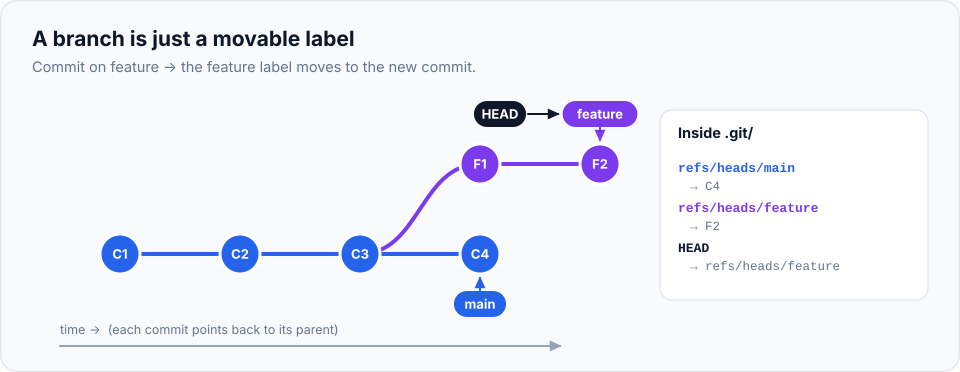
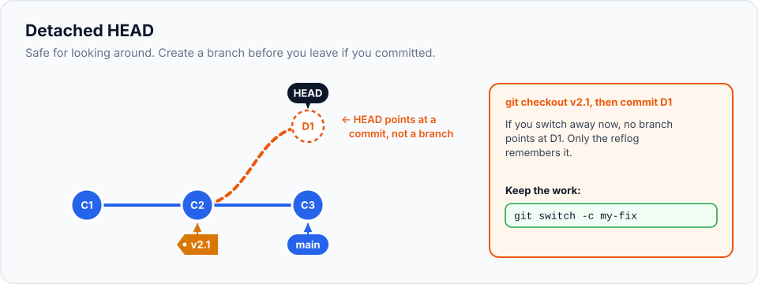

Branches are Git's superpower. They let you work on a new feature, fix an urgent bug and try a
crazy experiment, all in the same project, without any of them getting in each other's way. In
older version control systems branching was slow and scary. In Git it takes a fraction of a
second, and once you understand what a branch actually is, it's not scary at all.

> **In this chapter you'll learn**
> - The problem branches solve, with a real-life example
> - What a branch actually is (spoiler: a tiny label), and what `HEAD` means
> - How to create, switch between, list, rename and delete branches
> - What happens to your files and uncommitted changes when you switch
> - What "detached HEAD" means and how to stay safe
> - Branch naming conventions teams use
>
> **Prerequisites:** chapters [4](../04-your-first-repository/index.md)–[8](../08-viewing-history/index.md). **Time:** 45 minutes.

## The problem branches solve

You're halfway through building a **contact page** for your website. Several files are changed,
nothing works yet. Then your friend calls: *"There's a typo on your home page, can you fix it
right now?"*

Without branches, you have two bad options:

- Fix the typo, then commit it **together with your half-finished contact page**, and publish
  broken work.
- Wait until the contact page is done before fixing the typo.

With branches, you keep the unfinished contact page on its own **branch**, switch back to the
stable version, fix the typo, publish it, and switch back to continue the contact page. The two
pieces of work never touch until you decide to combine them (that's
[merging](../11-merging/index.md), the next chapter).

Professional teams use this every day:

- `main` holds the stable, working version of the project.
- Every new feature or bug fix is developed on its **own branch**.
- When it's finished and reviewed, it's **merged** into `main`.

## What a branch really is

Remember from [chapter 1](../01-what-is-version-control/index.md) that each commit points to
its parent, forming a chain. A **branch** is simply a **name that points to one commit**: the
latest commit of that line of work. That's all. It's like a sticky note on a commit.

When you make a new commit on a branch, Git moves that branch's sticky note forward to the new
commit automatically.



### What is `HEAD`?

**`HEAD`** is how Git knows **which branch you're currently on**. It's a pointer to a branch
(which in turn points to a commit). When you commit:

1. Git creates the new commit with the current commit as its parent.
2. Git moves the branch that `HEAD` points to forward, to the new commit.

You can see this in the files Git uses (you'll do this in the lab):

```bash
$ cat .git/HEAD
ref: refs/heads/main                       # HEAD points to the branch "main"
$ cat .git/refs/heads/main
57b40f5da3f54cbc4ea9e945c8814156e0f47104   # main points to this commit
```

A branch is literally a small file containing a commit hash. That's why creating one is
instant, no matter how big your project is.

## The commands

| Task | Command |
| --- | --- |
| List local branches (`*` marks the current one) | `git branch` |
| List with the latest commit of each | `git branch -v` |
| Create a branch **and switch** to it | `git switch -c <name>` |
| Create a branch without switching | `git branch <name>` |
| Switch to an existing branch | `git switch <name>` |
| Switch back to the previous branch | `git switch -` |
| Rename a branch | `git branch -m <old> <new>` (or `git branch -m <new>` for the current one) |
| Delete a branch (only if its work is merged) | `git branch -d <name>` |
| Force-delete a branch (even if not merged) | `git branch -D <name>` ⚠️ |
| See all branches as a graph | `git log --oneline --graph --all` |

> **`switch` vs `checkout`:** older tutorials use `git checkout <branch>` and
> `git checkout -b <name>`. They do the same thing. `git switch` (Git 2.23+) was added because
> `checkout` did too many different jobs. This series uses `switch`.

## Hands-on lab: build a feature on a branch

> **Starting here?** Create a project to work with:
>
> ```bash
> mkdir -p ~/git-practice/my-website && cd ~/git-practice/my-website && git init
> printf '<h1>Welcome to my website</h1>\n<p>I am learning Git.</p>\n' > index.html
> echo "<h1>About me</h1>" > about.html
> git add . && git commit -m "Add home and about pages"
> ```

### Step 1: see your branches

```bash
$ cd ~/git-practice/my-website
$ git branch
* main
```

One branch, `main`, and you're on it (`*`).

### Step 2: create a feature branch

```bash
$ git switch -c feature/contact-page
Switched to a new branch 'feature/contact-page'
$ git branch
* feature/contact-page
  main
```

`-c` means **create**. The new branch starts at the commit you were on, so right now both
branches point to the same commit, and your files haven't changed at all.

### Step 3: commit on the feature branch

```bash
$ echo "<h1>Contact me</h1>" > contact.html
$ git add contact.html
$ git commit -m "Add contact page"
[feature/contact-page 46a73df] Add contact page
 1 file changed, 1 insertion(+)
 create mode 100644 contact.html

$ echo "<a href='contact.html'>Contact</a>" >> index.html
$ git commit -am "Link to contact page"
```

Notice the commit message shows the branch name: `[feature/contact-page 46a73df]`.

```bash
$ git log --oneline
0c4774c Link to contact page
46a73df Add contact page
97dab30 Add home and about pages
$ ls
about.html  contact.html  index.html
```

### Step 4: switch back to `main`, and watch your files change

```bash
$ git switch main
Switched to branch 'main'
$ ls
about.html  index.html
$ cat index.html
<h1>Welcome to my website</h1>
<p>I am learning Git.</p>
```

`contact.html` **disappeared**, and the link in `index.html` is gone! Don't panic: nothing is
lost. When you switch branches, Git updates the files in your folder to match the **snapshot
of that branch**. `main` doesn't have the contact page yet, so its files don't either.

```bash
$ git log --oneline
97dab30 Add home and about pages
```

`main`'s history doesn't include the feature commits. They exist only on the feature branch.

### Step 5: make a commit on `main` too

This simulates "the urgent fix" that happens while a feature is in progress:

```bash
$ echo "body { font-family: sans-serif; }" > style.css
$ git add style.css
$ git commit -m "Add stylesheet"
```

### Step 6: see the branches diverge

```bash
$ git log --oneline --graph --all
* 0c4774c (feature/contact-page) Link to contact page
* 46a73df Add contact page
| * 57b40f5 (HEAD -> main) Add stylesheet
|/
* 97dab30 Add home and about pages
```

**Reading the graph:** each `*` is a commit. Both lines grow from `97dab30`. The branch names in
brackets show where each branch points. `HEAD -> main` tells you you're on `main`. The two lines
of work are now completely independent.

```bash
$ git branch -v
  feature/contact-page 0c4774c Link to contact page
* main                 57b40f5 Add stylesheet
```

### Step 7: peek at how Git stores this

```bash
$ cat .git/HEAD
ref: refs/heads/main
$ git switch feature/contact-page
$ cat .git/HEAD
ref: refs/heads/feature/contact-page
$ git switch -          # back to main
```

Switching branches really just rewrites `HEAD` (and updates your files to match).

> **Keep both branches!** The next chapter merges `feature/contact-page` into `main`.

## Switching with uncommitted changes

What happens to changes you haven't committed when you switch?

- **If the changed file is the same on both branches**, Git carries your uncommitted changes
  over to the other branch. They aren't attached to any branch until you commit.
- **If switching would overwrite your changes**, because that file is different on the other
  branch, Git refuses:

```text
error: Your local changes to the following files would be overwritten by checkout:
	contact.html
Please commit your changes or stash them before you switch branches.
Aborting
```

Git never silently destroys uncommitted work. Your options:

1. **Commit** the changes on the current branch (even a "WIP" commit you tidy up later).
2. **Stash** them: put them aside temporarily ([chapter 20](../20-stash/index.md)).
3. **Discard** them with `git restore <file>` if you don't need them.

> **Good habit:** have a clean working tree (`git status` says "nothing to commit") before
> switching branches. It avoids surprises.

## Renaming and deleting branches

Let's practise on a throwaway branch:

```bash
$ git switch -c experment              # oops, a typo in the name
$ git branch -m experiment             # rename the current branch
$ echo "test" > test.txt && git add . && git commit -m "Try something"
$ git switch main
```

Now delete it:

```bash
$ git branch -d experiment
error: The branch 'experiment' is not fully merged.
If you are sure you want to delete it, run 'git branch -D experiment'.
```

`-d` refuses because the branch has a commit that isn't on any other branch. Deleting it would
make that commit hard to find. This safety check is your friend. If you really want to throw the
work away:

```bash
$ git branch -D experiment
Deleted branch experiment (was 3e9f1a2).
```

> Deleting a branch deletes only the **label**, not the commits immediately. If you delete one
> by mistake, the hash shown in the message (`was 3e9f1a2`) lets you bring it back:
> `git branch experiment 3e9f1a2`. More in [chapter 22](../22-reflog/index.md).

You can't delete the branch you're currently on; switch away first.

## Detached HEAD

Normally `HEAD` points to a **branch**. But you can also switch directly to a **commit**, for
example to look at how the project was in the past:

```bash
$ git switch --detach HEAD~1
HEAD is now at 97dab30 Add home and about pages
$ git branch
* (HEAD detached at 97dab30)
  feature/contact-page
  main
```

This is called **detached HEAD**: `HEAD` points straight at a commit, not at a branch.



It's completely safe for **looking around**: running an old version, testing something, reading
files. The only risk: if you **commit** in this state, no branch points to the new commits. When
you switch away, Git warns you:

```text
Warning: you are leaving 1 commit behind, not connected to
any of your branches:

  c5af063 Experiment

If you want to keep it by creating a new branch, this may be a good time
to do so with:

 git branch <new-branch-name> c5af063
```

**To keep work made in detached HEAD,** create a branch **before** switching away:

```bash
$ git switch -c my-experiment
```

To leave detached HEAD without keeping anything, just switch to a branch: `git switch main`.

## Naming branches

Branch names can contain letters, numbers, `-`, `_`, `.` and `/`, but no spaces. Most teams use
a **prefix** describing the kind of work:

| Prefix | For | Example |
| --- | --- | --- |
| `feature/` | New functionality | `feature/contact-page` |
| `fix/` or `bugfix/` | Bug fixes | `fix/broken-menu-link` |
| `hotfix/` | Urgent production fixes | `hotfix/payment-timeout` |
| `docs/` | Documentation | `docs/setup-guide` |
| `chore/` | Maintenance, tooling, dependencies | `chore/update-node` |

Many teams add the ticket number: `feature/WEB-142-contact-page`. Keep names short, lowercase
and descriptive.

## When to create a branch

| ✅ Create a branch when… | Notes |
| --- | --- |
| Starting any new feature or bug fix | Even small ones. Branches are free |
| Trying an experiment you might throw away | Delete the branch if it fails |
| You need to work on two things at once | One branch each, switch between them |
| You're working with others | Never commit unfinished work directly to the shared `main` |

| ❌ You don't need a branch for… | |
| --- | --- |
| Solo projects where you only ever do one thing at a time | Committing to `main` is fine, though branching is still a good habit |

## Common mistakes

| Mistake | What happens | Fix |
| --- | --- | --- |
| Started work on `main` instead of a feature branch | Commits are on the wrong branch | If not committed yet: `git switch -c feature/x` (changes come with you). If committed: see [chapter 30](../30-git-disasters/index.md) |
| Panicking when files disappear after switching | They're on the other branch, safe | Switch back: `git switch <branch>` |
| Committing in detached HEAD and switching away | Commits become hard to find | `git branch rescue <hash>` using the hash from the warning, or find it with `git reflog` |
| `git branch -D` on the wrong branch | The label is gone | `git branch <name> <hash>` with the hash from the delete message |

## Recap

- A **branch** is a movable label pointing to a commit; creating one is instant and free.
- **`HEAD`** points to the branch you're on. Committing moves that branch forward.
- `git switch -c <name>` creates and switches; `git switch <name>` switches; `git switch -` goes back.
- Switching updates your files to that branch's snapshot. Git refuses if it would overwrite uncommitted work.
- `git branch -d` deletes merged branches safely; `-D` forces.
- **Detached HEAD** = `HEAD` on a commit, not a branch. Create a branch if you want to keep commits made there.

## Check your understanding

<details>
<summary>1. You create a branch, but your files don't change. Is something wrong?</summary>

No. A new branch starts at the commit you're on, so its snapshot is identical. Files only
change when you switch between branches that have different commits.
</details>

<details>
<summary>2. Why is creating a branch in Git so fast, even in a huge project?</summary>

A branch is just a tiny file containing one commit hash. Nothing is copied.
</details>

<details>
<summary>3. <code>git branch -d old-idea</code> says "not fully merged". What does that mean?</summary>

The branch has commits that aren't part of any other branch. Deleting it would orphan them.
Use `-D` only if you're sure you don't need that work.
</details>

<details>
<summary>4. You checked out an old commit to test something and made a fix. What should you do before switching away?</summary>

Create a branch to keep it: `git switch -c my-fix`. Otherwise the commit isn't on any branch.
</details>

**Next:** [merging](../11-merging/index.md): bring the contact page into `main`.
