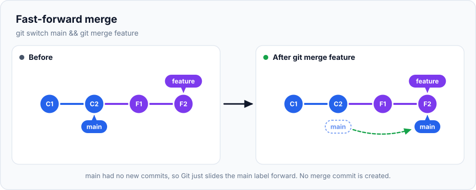
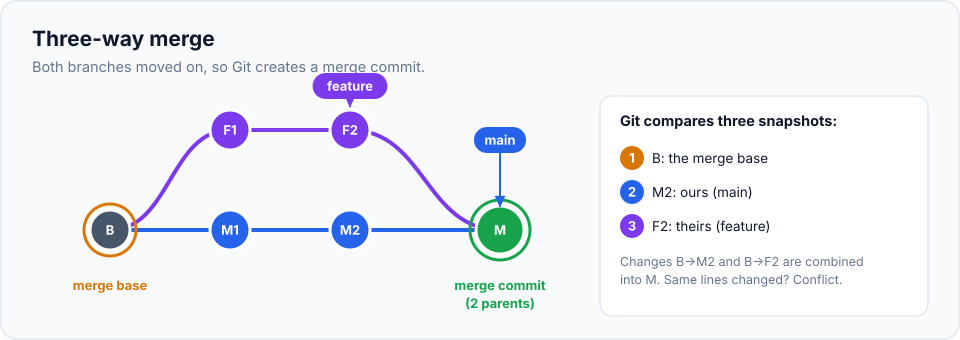
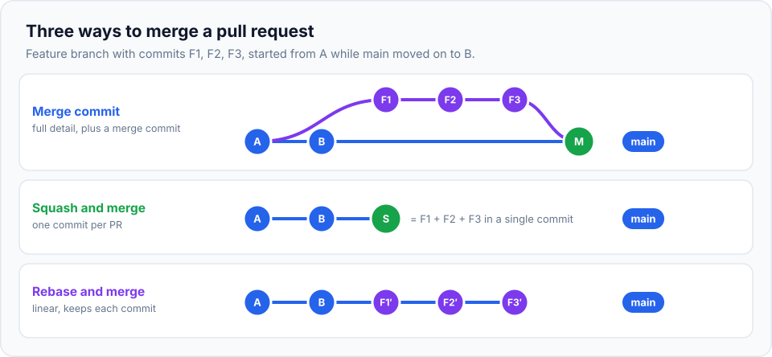

Branches let you work separately. **Merging** brings that work back together. When your contact
page is finished on its branch, you merge it into `main`, and `main` then contains both its own
changes and the contact page.

> **In this chapter you'll learn**
> - What `git merge` does and which direction it goes
> - **Fast-forward** merges: when Git just moves a label
> - **Three-way** merges: when Git creates a merge commit, and how it decides what to combine
> - How to read a merge in `git log --graph`
> - Squash merges, `--no-ff` and `--ff-only`, and when to use each
> - How merging works on GitHub ("Merge", "Squash and merge", "Rebase and merge")
> - Cleaning up branches after merging
>
> **Prerequisites:** [chapter 10](../10-branches/index.md). **Time:** 45 minutes.

## The direction of a merge

This is the first thing to get right. **You always merge *into* the branch you're on**:

```bash
git switch main                      # 1. go to the branch that should RECEIVE the work
git merge feature/contact-page       # 2. bring the other branch's work INTO it
```

Read it as: *"Merge `feature/contact-page` into the current branch."* The feature branch itself
isn't changed; `main` gains its commits.

## Two kinds of merge

What Git does depends on whether **both** branches have new commits since they split.

### Fast-forward: only one side moved

You created `fix/about-typo` from `main`, made a commit, and nobody committed to `main` in the
meantime. `main` is simply *behind*: everything on `main` is already in the fix branch.

There's nothing to combine, so Git just **slides the `main` label forward** to the fix branch's
latest commit. No new commit is created.



### Three-way merge: both sides moved

You created `feature/contact-page`, made commits on it, and meanwhile `main` also got new
commits (the stylesheet). History has **diverged**. Git can't just move a label; it has to
**combine** two sets of changes.

To do that, Git looks at **three** snapshots (hence the name):

1. The **merge base**: the last commit both branches share (where they split).
2. The tip of **your** branch (`main`).
3. The tip of **their** branch (`feature/contact-page`).

Git works out *what changed on each side since the merge base* and applies **both** sets of
changes. The result is saved as a new **merge commit**, which is special: it has **two parents**.



Why the merge base matters: if `main` changed `about.html` and the feature changed
`index.html`, Git sees two independent changes and keeps both. If both sides changed **the
same lines** differently, Git can't know which is right: that's a **merge conflict**, covered in
[the next chapter](../12-merge-conflicts/index.md).

## Hands-on lab: two kinds of merge

> **Starting here?** Recreate the state from the end of chapter 10:
>
> ```bash
> mkdir -p ~/git-practice/my-website && cd ~/git-practice/my-website && git init
> printf '<h1>Welcome to my website</h1>\n<p>I am learning Git.</p>\n' > index.html
> echo "<h1>About me</h1>" > about.html && git add . && git commit -m "Add home and about pages"
> git switch -c feature/contact-page
> echo "<h1>Contact me</h1>" > contact.html && git add . && git commit -m "Add contact page"
> echo "<a href='contact.html'>Contact</a>" >> index.html && git commit -am "Link to contact page"
> git switch main
> echo "body { font-family: sans-serif; }" > style.css && git add . && git commit -m "Add stylesheet"
> ```

### Part 1: a fast-forward merge

**Step 1.** Create a small fix branch from `main` and commit to it:

```bash
$ cd ~/git-practice/my-website
$ git switch main
$ git switch -c fix/about-text
Switched to a new branch 'fix/about-text'
$ echo "<p>I love building websites.</p>" >> about.html
$ git commit -am "Add a sentence to about page"
```

**Step 2.** Look at the graph before merging:

```bash
$ git switch main
$ git log --oneline --graph --all
* 0c4774c (feature/contact-page) Link to contact page
* 46a73df Add contact page
| * 6500eb6 (fix/about-text) Add a sentence to about page
| * 6f76c43 (HEAD -> main) Add stylesheet
|/
* 97dab30 Add home and about pages
```

`main` is at `6f76c43`; `fix/about-text` is one commit ahead of it on the same line.

**Step 3.** Merge:

```bash
$ git merge fix/about-text
Updating 6f76c43..6500eb6
Fast-forward
 about.html | 1 +
 1 file changed, 1 insertion(+)
```

**"Fast-forward"**: Git moved `main` from `6f76c43` to `6500eb6`. No new commit was needed.

**Step 4.** The fix branch has done its job. Delete it:

```bash
$ git branch -d fix/about-text
Deleted branch fix/about-text (was 6500eb6).
```

`-d` works because the branch's commits are now part of `main`.

### Part 2: a three-way merge

**Step 5.** Find where `main` and the feature branch split:

```bash
$ git merge-base main feature/contact-page
97dab30c3e1aa0f3f4bd9364d9be0d940e150de5
```

That's the "Add home and about pages" commit: the merge base. Since then, `main` got two commits
and the feature got two.

**Step 6.** Merge the feature into `main`:

```bash
$ git merge feature/contact-page
```

Because this merge creates a new commit, **Git opens your editor** with a pre-written message:

```text
Merge branch 'feature/contact-page'
# Please enter a commit message to explain why this merge is necessary,
# especially if it merges an updated upstream into a topic branch.
```

The default message is fine. Save and close the editor. (Add `--no-edit` to the command to accept
the default message without opening the editor.)

```text
Merge made by the 'ort' strategy.
 contact.html | 1 +
 index.html   | 1 +
 2 files changed, 2 insertions(+)
 create mode 100644 contact.html
```

(`ort` is the name of Git's default merge algorithm. You don't need to do anything with it.)

**Step 7.** Look at the result:

```bash
$ git log --oneline --graph --all
*   49d51e9 (HEAD -> main) Merge branch 'feature/contact-page'
|\
| * 0c4774c (feature/contact-page) Link to contact page
| * 46a73df Add contact page
* | 6500eb6 Add a sentence to about page
* | 6f76c43 Add stylesheet
|/
* 97dab30 Add home and about pages
```

The two lines join again at the merge commit `49d51e9`. Let's inspect it:

```bash
$ git show --stat HEAD
commit 49d51e9d3bf8977a26b30addb87f81fbec990590
Merge: 6500eb6 0c4774c
Author: Asha Rao <asha@example.com>

    Merge branch 'feature/contact-page'

 contact.html | 1 +
 index.html   | 1 +
```

`Merge: 6500eb6 0c4774c` lists the **two parents**: the previous tip of `main` and the tip of
the feature branch.

**Step 8.** Check the files: `main` now has everything from both sides.

```bash
$ ls
about.html  contact.html  index.html  style.css
$ cat index.html
<h1>Welcome to my website</h1>
<p>I am learning Git.</p>
<a href='contact.html'>Contact</a>
```

The stylesheet (from `main`) and the contact page and link (from the feature) are all here.

**Step 9.** Clean up:

```bash
$ git branch --merged
  feature/contact-page
* main
$ git branch -d feature/contact-page
```

`git branch --merged` lists branches whose work is fully included in the current branch: those
are safe to delete.

## Controlling how Git merges

| Command | What happens | When to use |
| --- | --- | --- |
| `git merge <branch>` | Fast-forward if possible, otherwise a merge commit | The default; fine most of the time |
| `git merge --no-ff <branch>` | **Always** create a merge commit, even if fast-forward was possible | You want history to show clearly "this feature was merged here" |
| `git merge --ff-only <branch>` | Only fast-forward; **refuse** if a merge commit would be needed | Updating a branch that should never diverge (e.g. syncing your local `main`) |
| `git merge --squash <branch>` | Stage all the branch's changes as **one** change, without committing; you commit yourself | Collapse a messy branch into a single clean commit |
| `git merge --abort` | Cancel a merge in progress, restore the state from before | Something went wrong (usually during a conflict) |

### Squash merge in practice

Your branch has commits like "WIP gallery", "fix", "more images". The individual steps aren't
interesting to anyone; the result is. A squash merge turns them into **one** commit on `main`:

```bash
$ git switch -c feature/gallery
$ echo "<h1>Gallery</h1>" > gallery.html && git add . && git commit -m "WIP gallery"
$ echo "" >> gallery.html && git commit -am "fix"
$ echo "" >> gallery.html && git commit -am "more images"

$ git switch main
$ git merge --squash feature/gallery
Squash commit -- not updating HEAD
 gallery.html | 3 +++
 1 file changed, 3 insertions(+)
$ git status -s
A  gallery.html
$ git commit -m "Add photo gallery page"
```

`main` gets one tidy commit, "Add photo gallery page", with all the changes.

> **Note:** after a squash merge, Git doesn't consider the feature branch "merged" (its original
> commits aren't on `main`; a new combined commit is). So `git branch -d feature/gallery` refuses
> with "not fully merged". That's expected: delete it with `git branch -D feature/gallery`.

## Merging on GitHub

When your team uses pull requests ([chapter 15](../15-pull-requests/index.md)), you'll click a
merge button on GitHub instead of typing `git merge`. It offers the same three styles:



| Button | Result on `main` | Good for |
| --- | --- | --- |
| **Create a merge commit** | All the branch's commits + a merge commit | Keeping the full detail of how the work happened |
| **Squash and merge** | One single commit for the whole branch | A clean `main` with one commit per feature; easy to revert |
| **Rebase and merge** | The branch's commits copied on top of `main`, no merge commit | A straight-line history that keeps individual commits ([chapter 18](../18-rebase/index.md)) |

Many teams choose **Squash and merge** as their default. Your team will usually have a convention.

## When to merge, and how often

| Situation | Do this |
| --- | --- |
| A feature or fix is finished (and reviewed) | Merge it into `main` |
| Your feature branch is taking days and `main` keeps moving | Merge `main` **into your branch** regularly (`git switch feature/x && git merge main`) so the final merge stays small and conflicts appear early |
| The branch has messy work-in-progress commits | Squash merge (or clean up first with [interactive rebase](../19-interactive-rebase/index.md)) |
| You want to see where each feature landed | `--no-ff` merges |

> **Real-life scenario:** a feature takes two weeks. Meanwhile 40 commits land on `main`. If you
> wait until the end to merge, you face one giant conflict. If you merge `main` into your branch
> every day or two, each merge is small and easy. **Integrate early and often.**

## Common mistakes

| Mistake | Fix |
| --- | --- |
| Merged in the wrong direction (merged `main` into the feature when you meant the opposite) | Not harmful: just switch to `main` and merge the feature in. Undoing a merge is covered in [chapter 17](../17-undoing-changes/index.md) |
| Forgot to switch to `main` before merging | Check with `git branch` or `git status` first; it tells you where you are |
| Merging with uncommitted changes | Git may refuse; commit or stash first so you have a clean working tree |
| Stuck in the merge-message editor | Save and close it (Vim: `Esc`, `:wq`, Enter). Use `--no-edit` next time |
| `git branch -d` refuses after a squash merge | Expected; use `-D` |

## Recap

- `git merge <branch>` brings `<branch>`'s work **into the current branch**.
- **Fast-forward**: the current branch was just behind, so Git moves the label. No new commit.
- **Three-way merge**: both sides changed; Git combines them using the **merge base** and creates a
  **merge commit with two parents**.
- `--no-ff`, `--ff-only` and `--squash` control the shape of history; `--abort` cancels.
- After merging, delete the branch with `git branch -d`.

## Check your understanding

<details>
<summary>1. You're on <code>feature/login</code> and run <code>git merge main</code>. What happens?</summary>

`main`'s new commits are brought **into** `feature/login`. `main` itself doesn't change. This is
how you keep a long-running feature branch up to date.
</details>

<details>
<summary>2. Why didn't the first merge in the lab create a merge commit?</summary>

`main` had no commits that the fix branch didn't already have, so Git could simply move (fast-forward)
the `main` label. Nothing needed combining.
</details>

<details>
<summary>3. What are the three snapshots used in a three-way merge?</summary>

The merge base (where the branches split), the tip of the current branch, and the tip of the
branch being merged.
</details>

<details>
<summary>4. When would you choose a squash merge?</summary>

When the branch's individual commits aren't meaningful (WIP, fixups) and you want `main` to get a
single clean commit describing the whole feature.
</details>

**Next:** [resolving merge conflicts](../12-merge-conflicts/index.md), step by step.
