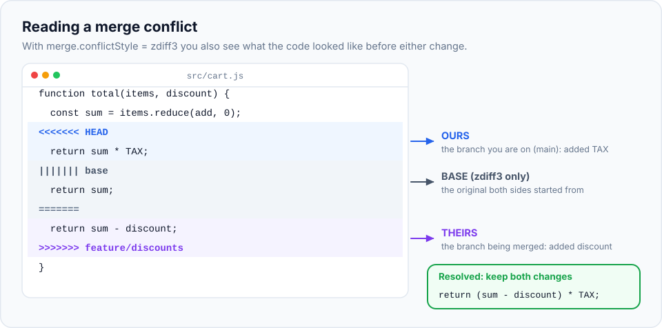

Sooner or later you'll see this:

```text
CONFLICT (content): Merge conflict in index.html
Automatic merge failed; fix conflicts and then commit the result.
```

For many beginners this is the scariest moment in Git. It shouldn't be. A conflict isn't an
error and nothing is broken. Git is simply saying: *"Two people changed the same lines in
different ways. You understand the code, I don't, so you decide."* This chapter turns that
moment into a calm, routine task.

> **In this chapter you'll learn**
> - Exactly when and why conflicts happen
> - How to read conflict markers, including the extremely helpful "base" section
> - A reliable, step-by-step method to resolve any conflict
> - How to back out of a merge safely
> - Shortcuts: taking one side completely, editor tools, and `rerere`
> - Habits that prevent most conflicts
>
> **Prerequisites:** [chapter 11](../11-merging/index.md). **Time:** 45 minutes.

## When do conflicts happen?

Git merges changes **line by line**. Most of the time the two branches changed **different**
lines or different files, and Git combines them automatically, as you saw in the last chapter.

A conflict happens only when Git can't decide on its own:

| Situation | Example |
| --- | --- |
| Both branches changed the **same line(s)** differently | You changed the heading to "Welcome to my portfolio"; a teammate changed it to "Hi, I am Asha" |
| One branch **modified** a file the other **deleted** | You fixed a bug in `old-page.html`; a teammate deleted that file |
| Both branches **added** a file with the same name but different content | Both of you created `contact.html` |

Changes to **different parts** of the same file are **not** conflicts. Git merges them automatically.

> **One surprise:** changes to **neighbouring lines** can also conflict. If one branch edits
> line 2 and the other adds a new line right after line 2, Git can't be sure which order is right,
> so it asks you. Changes separated by at least one untouched line merge cleanly.

## What Git does during a conflict

When a merge has conflicts, Git:

1. Merges everything it **can** automatically, and stages those files.
2. Writes the conflicting parts into the affected files, surrounded by **conflict markers**.
3. **Pauses** the merge and waits for you. You're now "in the middle of a merge".

Nothing is committed until you finish. You can also cancel at any moment.

## Reading conflict markers

A conflicted section looks like this:

```text
<<<<<<< HEAD
<h1>Welcome to my portfolio</h1>
=======
<h1>Hi, I am Asha</h1>
>>>>>>> feature/new-heading
```

| Marker | Meaning |
| --- | --- |
| `<<<<<<< HEAD` | Start of **your** version: the branch you're on (also called **"ours"**) |
| `=======` | Divider between the two versions |
| `>>>>>>> feature/new-heading` | End of **their** version: the branch you're merging in (**"theirs"**) |

Everything outside the markers merged fine. Your job is to replace the whole block (markers
included) with the correct final content.

### Turn on the "base" view: `zdiff3`

The default view shows *ours* and *theirs*, but not what the line looked like **before** either
change. Without that, it's hard to tell what each side actually *did*. One setting fixes this:

```bash
$ git config --global merge.conflictStyle zdiff3
```

Now conflicts include a third section, the **base** (the original from the merge base):

```text
<<<<<<< HEAD
<h1>Welcome to my portfolio</h1>
||||||| 88fa6f3
<h1>Welcome to my website</h1>
=======
<h1>Hi, I am Asha</h1>
>>>>>>> feature/new-heading
```

Now the story is clear:

- **Base:** "Welcome to my website"
- **Ours** changed "website" → "portfolio"
- **Theirs** changed the whole greeting → "Hi, I am Asha"

Both changes are intentional, so a good resolution probably **keeps both ideas**, for example
"Hi, I am Asha. Welcome to my portfolio".

Here's a code example of the same idea:



Without the base you might pick one side and silently throw away a teammate's work. With it,
you can see that one side added tax and the other added a discount, and that the correct answer
is both. (`zdiff3` needs Git 2.35 or newer. On older versions use `diff3`.)

## The step-by-step method

Every conflict, no matter how large, is resolved the same way:

1. **See which files conflict:** `git status` lists them under "Unmerged paths".
2. **Open each file** and find every `<<<<<<<` block.
3. **Understand both sides.** Using the base section: what did each side change, and why?
   (`git log` on each branch, or asking your teammate, helps.)
4. **Edit the block** into the correct final code, and **delete all marker lines**.
5. **Check no markers are left:** `git diff --check`.
6. **Test** that the code still works.
7. **Mark the file resolved:** `git add <file>`.
8. **Finish the merge:** `git commit` (Git suggests a message).

At any point before step 8, `git merge --abort` puts everything back to how it was before you
started the merge.

## Hands-on lab: create and resolve a conflict

We'll create a conflict on purpose, in a separate practice repository.

### Step 1: set up two branches that change the same line

```bash
$ cd ~/git-practice && rm -rf conflict-demo && mkdir conflict-demo && cd conflict-demo && git init
$ printf '<h1>Welcome to my website</h1>\n<p>I am learning Git.</p>\n<a href="contact.html">Contact</a>\n' > index.html
$ git add . && git commit -m "Initial site"

$ git switch -c feature/new-heading
```

Open `index.html` and change the first line to `<h1>Hi, I am Asha</h1>`. Save, then commit:

```bash
$ git commit -am "Use a personal heading"
$ git switch main
```

Now change the **same line** on `main` to `<h1>Welcome to my portfolio</h1>`. Save, then commit:

```bash
$ git commit -am "Call the site a portfolio"
```

### Step 2: merge, and meet the conflict

```bash
$ git merge feature/new-heading
Auto-merging index.html
CONFLICT (content): Merge conflict in index.html
Automatic merge failed; fix conflicts and then commit the result.
```

### Step 3: read `git status`

```bash
$ git status
On branch main
You have unmerged paths.
  (fix conflicts and run "git commit")
  (use "git merge --abort" to abort the merge)

Unmerged paths:
  (use "git add <file>..." to mark resolution)
	both modified:   index.html
```

Git tells you everything: which file conflicts ("both modified"), how to finish ("fix conflicts
and run git commit") and how to escape ("git merge --abort"). In short status form the file
shows as `UU` (**u**nmerged on both sides).

### Step 4: look at the file

```bash
$ cat index.html
<<<<<<< HEAD
<h1>Welcome to my portfolio</h1>
=======
<h1>Hi, I am Asha</h1>
>>>>>>> feature/new-heading
<p>I am learning Git.</p>
<a href="contact.html">Contact</a>
```

Only the heading is in conflict. The other lines merged fine.

### Step 5: practise backing out

Let's say you're not ready to deal with it right now:

```bash
$ git merge --abort
$ git status -s
$ cat index.html
<h1>Welcome to my portfolio</h1>
<p>I am learning Git.</p>
<a href="contact.html">Contact</a>
```

Everything is exactly as it was before the merge. Knowing this escape hatch exists takes the
fear out of conflicts.

### Step 6: turn on zdiff3 and merge again

```bash
$ git config --global merge.conflictStyle zdiff3
$ git merge feature/new-heading
CONFLICT (content): Merge conflict in index.html
$ cat index.html
<<<<<<< HEAD
<h1>Welcome to my portfolio</h1>
||||||| 88fa6f3
<h1>Welcome to my website</h1>
=======
<h1>Hi, I am Asha</h1>
>>>>>>> feature/new-heading
<p>I am learning Git.</p>
<a href="contact.html">Contact</a>
```

Now you can see the original line too.

### Step 7: resolve

Open `index.html` in your editor and replace the **entire** block, from `<<<<<<<` to
`>>>>>>>`, with the line you want. The file should end up as:

```html
<h1>Hi, I am Asha. Welcome to my portfolio</h1>
<p>I am learning Git.</p>
<a href="contact.html">Contact</a>
```

Check that no markers remain:

```bash
$ git diff --check
$
```

No output means no leftover markers. (If some remain, it prints lines like
`index.html:1: leftover conflict marker`.)

### Step 8: mark as resolved and finish

```bash
$ git add index.html
$ git status
On branch main
All conflicts fixed but you are still merging.
  (use "git commit" to conclude merge)

$ git commit
```

The editor opens with the message `Merge branch 'feature/new-heading'`. Save and close.

```bash
$ git log --oneline --graph
*   69cfeee Merge branch 'feature/new-heading'
|\
| * f95dac2 Use a personal heading
* | a0a475a Call the site a portfolio
|/
* 88fa6f3 Initial site
```

You've resolved your first conflict. 🎉

## Shortcuts and tools

### Take one side for a whole file

Sometimes you know one version is right for an entire file:

```bash
$ git checkout --ours   index.html      # keep my branch's version
$ git checkout --theirs index.html      # keep the incoming branch's version
$ git add index.html
```

> **Real-life scenario:** `package-lock.json` (an auto-generated file) conflicts. Don't edit it by
> hand. Take one version and regenerate it:
>
> ```bash
> $ git checkout --theirs package-lock.json
> $ npm install
> $ git add package-lock.json
> ```

### Conflicts where a file was deleted

```text
CONFLICT (modify/delete): old-page.html deleted in HEAD and modified in feature/x.
Version feature/x of old-page.html left in tree.
```

Decide: keep the file (`git add old-page.html`) or delete it (`git rm old-page.html`), then commit.

### Use your editor

Editors make conflict resolution visual:

- **VS Code** highlights each conflict with buttons: **Accept Current Change** (ours),
  **Accept Incoming Change** (theirs), **Accept Both Changes**, plus a **3-way merge editor**.
- **JetBrains IDEs** (IntelliJ, WebStorm, PyCharm) have a three-panel merge tool.
- `git mergetool` launches whichever merge tool you've configured.

Even with tools, the thinking is the same: understand both changes, then decide.

### rerere: resolve the same conflict only once

**rerere** stands for "**re**use **re**corded **re**solution". When it's on, Git remembers how you
resolved each conflict. If the exact same conflict appears again (common when you repeatedly
update a long-running branch), Git applies your earlier resolution automatically:

```bash
$ git config --global rerere.enabled true
```

You'll see `Recorded resolution for 'index.html'` when you commit a resolution, and later
`Resolved 'index.html' using previous resolution.` Always review the result, then `git add` it.

### Ours vs theirs during a rebase

In [chapter 18](../18-rebase/index.md) you'll learn **rebase**, which can also produce conflicts.
Warning in advance: during a rebase, the meanings of *ours* and *theirs* are **swapped**.
*Ours* is the branch you're rebasing onto; *theirs* is your own commit being replayed.

## Preventing conflicts

You can't avoid conflicts completely, but you can make them rare and small:

| Habit | Why it helps |
| --- | --- |
| **Merge `main` into your branch often** (or rebase) | Small, early conflicts instead of one giant one at the end |
| **Keep branches short-lived** | Less time for the code to drift apart |
| **Keep changes focused** | A branch that touches 3 files conflicts less than one touching 60 |
| **Don't mix reformatting with real changes** | Reformatting a whole file conflicts with everyone else's edits to it |
| **Communicate** | If two people are rewriting the same module, agree on who does what |
| **Split giant shared files** | Files everyone appends to (a big routes or constants file) are conflict magnets |

## When to use what

| Situation | Approach |
| --- | --- |
| Both sides' changes are needed | Edit the block to combine them |
| One side is clearly right for this block | Keep that side's lines, delete the rest |
| One side is right for the whole file | `git checkout --ours/--theirs <file>` |
| Generated files (lockfiles, build output) | Take one side, then regenerate |
| You're confused or out of time | `git merge --abort`, ask the other author, try again later |
| The same conflict keeps coming back | Enable `rerere` |

## Common mistakes

| Mistake | Consequence | Avoid it with |
| --- | --- | --- |
| Leaving marker lines in the file | Broken code gets committed | `git diff --check` before `git add` |
| Choosing one side without understanding the other | A teammate's work silently disappears | Use `zdiff3`, read the base, ask |
| Forgetting `git add` after fixing | `git commit` fails with "unmerged files" | Follow the 8 steps |
| Panicking and deleting the folder / re-cloning | Lost local work | `git merge --abort` is always available during a merge |
| Not testing after resolving | A resolution that's syntactically fine but logically wrong | Run the app/tests before committing |

## Recap

- A conflict means **both sides changed the same lines** (or one modified and the other deleted
  a file). Git pauses so **you** decide.
- `<<<<<<< HEAD` = ours, `=======` = divider, `>>>>>>> branch` = theirs, `|||||||` = base (with `zdiff3`).
- Resolve: edit → remove markers → `git diff --check` → test → `git add` → `git commit`.
- `git merge --abort` cancels the merge at any point.
- Set `merge.conflictStyle zdiff3` and `rerere.enabled true`.

## Check your understanding

<details>
<summary>1. Two branches both edited <code>style.css</code>, one at line 3, one at line 40. Will there be a conflict?</summary>

No. The changes are on different lines far apart, so Git merges them automatically.
</details>

<details>
<summary>2. After editing the conflicted file, <code>git commit</code> says you have unmerged files. What did you forget?</summary>

`git add <file>` to mark it as resolved.
</details>

<details>
<summary>3. Why is the base section (zdiff3) so useful?</summary>

It shows the original line, so you can see what each side actually changed. That lets you
combine both intentions instead of accidentally discarding one.
</details>

<details>
<summary>4. You're in the middle of a messy conflict and want to start over. What do you run?</summary>

`git merge --abort`
</details>

**Next section:** [GitHub, remotes and your first push](../13-github-and-remotes/index.md).
