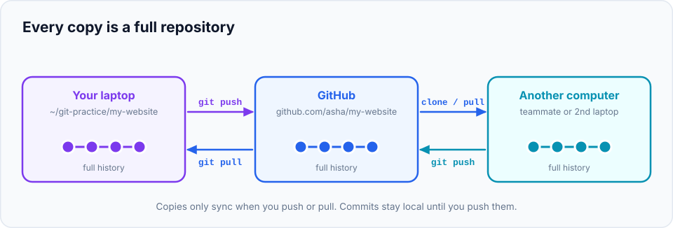

So far your repository has lived only on your computer. That's fine for learning, but in real
life you want your code **backed up**, **accessible from other machines**, and **shared with
teammates**. That's what a **remote** is for, and GitHub is the most popular place to host one.

> **In this chapter you'll learn**
> - What a remote is, and what `origin` means
> - How to create a GitHub account and sign in from the terminal
> - How to create a repository on GitHub and push your existing project to it
> - What `-u` (upstream tracking) does, and how to read "ahead/behind" in `git status`
> - How to `clone` a repository onto another computer
> - How to practise without a GitHub account, using a local "fake server"
>
> **Prerequisites:** chapters [4](../04-your-first-repository/index.md)–[11](../11-merging/index.md). **Time:** 45 minutes.

## What is a remote?

A **remote** is another copy of your repository, somewhere else: usually on a server like
GitHub, GitLab or Bitbucket. Your local repository stores a **name** and a **URL** for each
remote, so you can send commits to it (**push**) and get commits from it (**fetch / pull**).



Key facts:

- Both copies are **complete repositories** with the full history (remember: Git is distributed).
- They **don't sync automatically**. Nothing goes to GitHub until you push, and nothing comes
  from GitHub until you fetch or pull.
- The usual name for your main remote is **`origin`**. It's only a convention; there's nothing
  special about the name.

| Command | Direction | What it does |
| --- | --- | --- |
| `git clone <url>` | GitHub → you | Download a complete copy of a repository (once) |
| `git push` | you → GitHub | Send your new commits |
| `git fetch` / `git pull` | GitHub → you | Get new commits made by others ([next chapter](../14-fetch-pull-push/index.md)) |

## Step 1: create a GitHub account

1. Go to [github.com](https://github.com) and sign up (free).
2. Use the **same email** you configured as `user.email` in
   [chapter 3](../03-configure-git/index.md), so your commits link to your profile.
3. Turn on **two-factor authentication** (Settings → Password and authentication). GitHub
   requires it for most accounts, and it protects your code.

## Step 2: let your terminal sign in to GitHub

GitHub **doesn't accept your account password** for Git operations. Choose one of these:

| Method | Best for | How |
| --- | --- | --- |
| **GitHub CLI** (easiest) | Beginners | Install `gh` from [cli.github.com](https://cli.github.com/), run `gh auth login`, choose **GitHub.com → HTTPS → Login with a web browser**. It configures Git for you |
| **SSH key** | Long-term use; no prompts ever | Follow GitHub's [SSH setup guide](https://docs.github.com/en/authentication/connecting-to-github-with-ssh) |
| **Git Credential Manager** | Windows users | Already included with Git for Windows; the first push opens a browser sign-in |

With HTTPS, repository URLs look like `https://github.com/asha/my-website.git`. With SSH they
look like `git@github.com:asha/my-website.git`. GitHub shows both; use the one matching the
method you chose.

> **Don't have a GitHub account, or don't want one yet?** Skip to
> [Practise without GitHub](#practise-without-github-a-local-fake-server) below. Everything in
> this chapter and the next works the same way.

## Hands-on lab: publish `my-website` on GitHub

### Step 3: create an empty repository on GitHub

1. On GitHub, click **+** (top right) → **New repository**.
2. **Repository name:** `my-website`.
3. **Public** or **Private**: either works. (Public = anyone can see it.)
4. **Leave "Add a README", ".gitignore" and "license" unchecked.** Your project already has
   history; an empty GitHub repository avoids a mismatch on the first push.
5. Click **Create repository**.

GitHub shows a page titled *"…or push an existing repository from the command line"* with the
exact commands. We'll run them one by one so you understand each.

### Step 4: connect your local repository to GitHub

```bash
$ cd ~/git-practice/my-website
$ git remote -v
$
```

No output: the repository has no remotes yet. Add one called `origin` (use **your** URL from
GitHub):

```bash
$ git remote add origin https://github.com/asha/my-website.git
$ git remote -v
origin	https://github.com/asha/my-website.git (fetch)
origin	https://github.com/asha/my-website.git (push)
```

`git remote add <name> <url>` just saves a name for the URL. Nothing is sent yet. (Fetch and
push URLs are listed separately because they *can* differ; normally they're the same.)

### Step 5: push your history

```bash
$ git push -u origin main
Enumerating objects: 15, done.
Counting objects: 100% (15/15), done.
Delta compression using up to 8 threads
Compressing objects: 100% (11/11), done.
Writing objects: 100% (15/15), 1.32 KiB | 1.32 MiB/s, done.
Total 15 (delta 3), reused 0 (delta 0), pack-reused 0
To https://github.com/asha/my-website.git
 * [new branch]      main -> main
branch 'main' set up to track 'origin/main'.
```

**Reading the command:** push the branch `main` to the remote `origin`.

**Reading the output:**

- The first lines show Git packing and sending commits and files.
- `* [new branch] main -> main`: a new branch `main` was created on GitHub from your local `main`.
- `branch 'main' set up to track 'origin/main'`: that's what **`-u`** did. It links your local
  `main` to `main` on `origin`. From now on, plain `git push` and `git pull` on this branch know
  where to go. You only need `-u` the **first** time you push a branch.

### Step 6: see it on GitHub

Refresh the repository page in your browser. Your files are there. Click **commits** (the clock
icon with a number): your entire history, with your messages and authorship, is online. Click
any commit to see its diff.

### Step 7: the everyday cycle: commit locally, then push

```bash
$ echo "<p>Thanks for visiting!</p>" >> index.html
$ git commit -am "Add a thank-you note"
$ git status
On branch main
Your branch is ahead of 'origin/main' by 1 commit.
  (use "git push" to publish your local commits)
```

**"Ahead by 1 commit"**: you have a commit that GitHub doesn't have yet. Commit and push are
separate steps: committing is local and instant, pushing shares it.

```bash
$ git push
To https://github.com/asha/my-website.git
   2a71e27..44e9686  main -> main
$ git status
On branch main
Your branch is up to date with 'origin/main'.
```

`2a71e27..44e9686` means GitHub's `main` moved from the first hash to the second.

### Step 8: see the remote branches Git knows about

```bash
$ git branch -vv
* main 44e9686 [origin/main] Add a thank-you note
$ git branch -a
* main
  remotes/origin/main
```

`origin/main` is a **remote-tracking branch**: your local record of where `main` is on GitHub.
`[origin/main]` in `git branch -vv` shows that `main` tracks it. The next chapter explains these
in depth; for now, know that `git status`'s "ahead/behind" message compares your branch with it.

### Step 9: clone it, as a teammate (or your other laptop) would

Cloning is how you get a copy of any repository: yours, your company's, or an open-source
project's. Let's clone your website into a different folder to simulate a second computer:

```bash
$ cd ~/git-practice
$ git clone https://github.com/asha/my-website.git my-website-laptop2
Cloning into 'my-website-laptop2'...
remote: Enumerating objects: 18, done.
...
Receiving objects: 100% (18/18), done.
$ cd my-website-laptop2
$ git log --oneline
44e9686 Add a thank-you note
...
$ git remote -v
origin	https://github.com/asha/my-website.git (fetch)
origin	https://github.com/asha/my-website.git (push)
```

`git clone` did several things at once:

1. Created the folder `my-website-laptop2` (the last argument; leave it out to use the repository's name).
2. Downloaded **all** commits and history.
3. Added the remote `origin` pointing to the URL.
4. Created a local `main` branch tracking `origin/main`, and checked it out.

We'll use this second copy in the next chapter to simulate a teammate.

## Practise without GitHub: a local "fake server"

Git can use a folder on your own disk as a remote. This is perfect for practising (and it's how
this chapter's examples were tested). The server-side copy is a **bare repository**: a repository
with history but no working files, just like the one GitHub keeps.

```bash
$ cd ~/git-practice
$ git init --bare fake-github/my-website.git
Initialized empty Git repository in /Users/asha/git-practice/fake-github/my-website.git/

$ cd my-website
$ git remote add origin ../fake-github/my-website.git
$ git push -u origin main
To ../fake-github/my-website.git
 * [new branch]      main -> main
branch 'main' set up to track 'origin/main'.

$ cd ..
$ git clone fake-github/my-website.git my-website-laptop2
Cloning into 'my-website-laptop2'...
done.
```

Every command in this chapter and the next works identically: only the URL is a folder path.

## Managing remotes

| Task | Command |
| --- | --- |
| List remotes and their URLs | `git remote -v` |
| Add a remote | `git remote add <name> <url>` |
| Change a remote's URL (e.g. HTTPS → SSH) | `git remote set-url origin git@github.com:asha/my-website.git` |
| Rename a remote | `git remote rename origin upstream` |
| Remove a remote | `git remote remove <name>` |
| Detailed info (branches, tracking) | `git remote show origin` |

## When to use what

| Situation | Do this |
| --- | --- |
| You have a local project and want it on GitHub | Create an **empty** GitHub repo → `git remote add origin <url>` → `git push -u origin main` |
| The project already exists on GitHub | `git clone <url>` |
| First push of any new branch | `git push -u origin <branch>` |
| Later pushes on that branch | `git push` |
| Starting a brand-new project | Either way works: `git init` locally and push, or create on GitHub (with README) and clone |

## Common mistakes

| Error | Cause | Fix |
| --- | --- | --- |
| `remote origin already exists` | You already added `origin` | Check `git remote -v`; change it with `git remote set-url origin <url>` |
| `Support for password authentication was removed` | GitHub doesn't accept account passwords | Use `gh auth login`, SSH, or a credential manager (step 2) |
| `Permission denied (publickey)` | SSH key not set up or not added to GitHub | Follow the SSH article, or switch to an HTTPS URL |
| `Updates were rejected because the remote contains work that you do not have locally` | You created the GitHub repo **with** a README, so it has a commit you don't | Run `git pull origin main --allow-unrelated-histories`, resolve if needed, then push. Next time create it empty |
| `src refspec main does not match any` | You have no commits yet, or your branch is called `master` | Commit first; check the branch name with `git branch` |
| `repository not found` | Typo in the URL, or no access to a private repo | Copy the URL again from GitHub's **Code** button |

## Recap

- A **remote** is a named URL for another copy of your repository; `origin` is the conventional name.
- Connect a local project: `git remote add origin <url>`, then `git push -u origin main`.
- `-u` sets up **tracking**, so later `git push`/`git pull` need no arguments and `git status`
  reports "ahead/behind".
- `git clone <url>` downloads a full copy with history and sets up `origin` for you.
- A bare repository on your disk can stand in for GitHub while practising.

## Check your understanding

<details>
<summary>1. You committed three times but your teammate can't see the changes on GitHub. Why?</summary>

Commits are local until you **push**. Run `git push`.
</details>

<details>
<summary>2. What does <code>-u</code> in <code>git push -u origin main</code> do?</summary>

It sets the remote branch `origin/main` as the **upstream** of your local `main`, so future
`git push` and `git pull` on that branch work without arguments, and `git status` can tell you
whether you're ahead or behind.
</details>

<details>
<summary>3. What four things does <code>git clone</code> do?</summary>

Creates the folder, downloads the full history, adds the `origin` remote, and creates and checks
out a local `main` branch that tracks `origin/main`.
</details>

**Next:** [syncing with fetch, pull and push](../14-fetch-pull-push/index.md), and what happens
when two people push at the same time.
