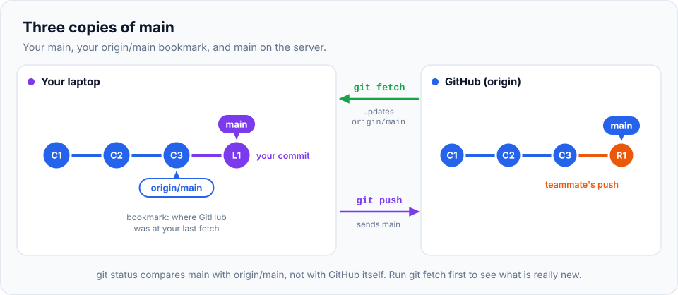

In the last chapter you pushed your own work to GitHub. Real projects have **several people**
pushing to the same repository. This chapter shows how everyone stays in sync, what Git does
when two people push at nearly the same time, and how to avoid ever overwriting a teammate's work.

> **In this chapter you'll learn**
> - The three copies of a branch: local `main`, `origin/main` and `main` on the server
> - The difference between `git fetch` and `git pull`, and why it matters
> - How to see what's new before integrating it
> - What "ahead", "behind" and "diverged" mean, and how to handle each
> - Why a push gets rejected, and the right way to fix it
> - Pushing, tracking and deleting branches on the remote
> - Force pushing safely with `--force-with-lease`
>
> **Prerequisites:** [chapter 13](../13-github-and-remotes/index.md). **Time:** 50 minutes.

## Three copies of `main`

This is the key idea of the chapter. When you work with a remote, there are really **three**
versions of each branch:



| Name | Lives | Updated when | Think of it as |
| --- | --- | --- | --- |
| `main` | Your computer | You commit, merge, pull | Your work |
| `origin/main` | Your computer | You **fetch** (or pull) | A **photo** of the server's `main`, taken at your last fetch |
| `main` on GitHub | The server | Anyone pushes | The real shared branch |

`origin/main` is called a **remote-tracking branch**. It's read-only (you can't commit to it)
and it **doesn't update by itself**. This explains a common surprise:

> `git status` says *"Your branch is up to date with 'origin/main'"*, yet your teammate pushed
> ten minutes ago. Both are true: you're up to date with your **old photo**. Git doesn't contact
> GitHub during `git status`. Fetch first to take a new photo.

## `git fetch` vs `git pull`

 into your branch.")

**`git fetch`** downloads new commits from the remote and updates the remote-tracking branches
(`origin/main`, `origin/feature-x`…). It **never changes your branches or your files**. It's
always safe to run.

**`git pull`** is two commands in one:

1. `git fetch`, then
2. integrate `origin/main` into your current branch, by **merging** it (or **rebasing**, depending
   on your settings).

| | `git fetch` | `git pull` |
| --- | --- | --- |
| Downloads new commits | ✅ | ✅ |
| Updates `origin/*` | ✅ | ✅ |
| Changes your current branch and files | ❌ never | ✅ |
| Can cause merge conflicts | ❌ | ✅ |
| Use when | You want to **look** before integrating | You're ready to **update** your branch |

> **Habit worth building:** `git fetch`, look at what came in, then pull or merge. You'll never
> be surprised by what `git pull` just did to your branch.

## Ahead, behind, diverged

After a fetch, `git status` compares your branch with its remote-tracking branch:

| Message | Means | Do |
| --- | --- | --- |
| `up to date with 'origin/main'` | Same commits (as of your last fetch) | Nothing |
| `ahead of 'origin/main' by 2 commits` | You have commits the server doesn't | `git push` |
| `behind 'origin/main' by 1 commit, and can be fast-forwarded` | The server has commits you don't | `git pull` |
| `have diverged, and have 1 and 2 different commits each` | Both sides have new commits | `git pull` (merge or rebase), then `git push` |

## Hands-on lab: two teammates, one repository

To feel what collaboration is like, we'll simulate **two developers**, Asha and Ravi, each with
their own clone, sharing one "server". We use a local bare repository as the server
([chapter 13](../13-github-and-remotes/index.md#practise-without-github-a-local-fake-server)),
so no GitHub account is needed, and you can see both sides at once.

### Setup

```bash
cd ~/git-practice && rm -rf team && mkdir team && cd team
git init --bare server/team-site.git

# Asha creates the project and pushes it
git clone server/team-site.git asha
cd asha
printf '<h1>Team site</h1>\n<p>Welcome!</p>\n' > index.html
git add . && git commit -m "Add home page"
git push -u origin main
cd ..

# Ravi clones it, and sets his own name for this copy
git clone server/team-site.git ravi
cd ravi
git config user.name "Ravi Kumar" && git config user.email "ravi@example.com"
cd ..
```

(The `warning: You appear to have cloned an empty repository` from Asha's clone is expected:
the server was empty at that moment.)

You now have `team/asha` and `team/ravi`: two independent clones of `team/server/team-site.git`.

### Part 1: Ravi pushes, Asha catches up

**Step 1.** Ravi adds a page and pushes:

```bash
$ cd ~/git-practice/team/ravi
$ echo "<h1>About the team</h1>" > about.html
$ git add . && git commit -m "Add about page"
$ git push
```

**Step 2.** Asha checks her status:

```bash
$ cd ../asha
$ git status
On branch main
Your branch is up to date with 'origin/main'.
```

"Up to date", even though Ravi pushed! Her `origin/main` photo is old.

**Step 3.** Asha fetches:

```bash
$ git fetch
From .../server/team-site
   4901283..abff8e1  main       -> origin/main
$ git status
On branch main
Your branch is behind 'origin/main' by 1 commit, and can be fast-forwarded.
  (use "git pull" to update your local branch)
```

The fetch updated `origin/main` (from `4901283` to `abff8e1`). Her own `main` and her files
haven't changed.

**Step 4.** Asha looks at what's new **before** integrating:

```bash
$ git log --oneline main..origin/main
abff8e1 Add about page
$ git diff main origin/main --stat
 about.html | 1 +
 1 file changed, 1 insertion(+)
```

`main..origin/main` means "commits on `origin/main` that aren't on `main`": exactly what she's missing.

**Step 5.** She's happy with it, so she pulls:

```bash
$ git pull
Updating 4901283..abff8e1
Fast-forward
 about.html | 1 +
 1 file changed, 1 insertion(+)
 create mode 100644 about.html
```

A **fast-forward**, just like in [chapter 11](../11-merging/index.md): Asha had no new commits,
so her `main` simply moved forward.

### Part 2: both commit, and Asha's push is rejected

**Step 6.** Ravi adds a footer and pushes:

```bash
$ cd ../ravi
$ git pull                                   # Ravi syncs first (good habit)
$ echo "<footer>(c) Team</footer>" >> index.html
$ git commit -am "Add footer"
$ git push
```

**Step 7.** Meanwhile Asha, without fetching, adds a contact page and tries to push:

```bash
$ cd ../asha
$ echo "<h1>Contact</h1>" > contact.html
$ git add . && git commit -m "Add contact page"
$ git push
To .../server/team-site.git
 ! [rejected]        main -> main (fetch first)
error: failed to push some refs to '.../server/team-site.git'
hint: Updates were rejected because the remote contains work that you do
hint: not have locally. This is usually caused by another repository pushing
hint: to the same ref. You may want to first integrate the remote changes
hint: (e.g., 'git pull ...') before pushing again.
```

**Why was it rejected?** The server's `main` has Ravi's "Add footer", which Asha doesn't have. If
Git accepted her push, the server's `main` would jump to Asha's commit and **Ravi's commit would
be lost**. Git refuses to do that. A rejected push is Git protecting your teammate.

**The fix: integrate their work first, then push.**

**Step 8.** Asha pulls:

```bash
$ git pull
hint: You have divergent branches and need to specify how to reconcile them.
hint: You can do so by running one of the following commands sometime before
hint: your next pull:
hint:
hint:   git config pull.rebase false  # merge
hint:   git config pull.rebase true   # rebase
hint:   git config pull.ff only       # fast-forward only
...
fatal: Need to specify how to reconcile divergent branches.
```

Both sides have new commits (they **diverged**), so a fast-forward isn't possible. Git asks you
to choose, **once**, how `pull` should combine them:

| Setting | What `git pull` does when branches diverged | Resulting history |
| --- | --- | --- |
| `pull.rebase false` | **Merge** `origin/main` into your branch | Adds a merge commit like "Merge branch 'main' of …" |
| `pull.rebase true` | **Rebase**: replay your unpushed commits on top of `origin/main` | Straight line, no extra merge commits |
| `pull.ff only` | Refuse; you decide manually each time | — |

Most developers choose **rebase** for pulls: it avoids cluttering history with "Merge branch
'main' of github.com:…" commits every time two people work at once. (Rebase is explained fully
in [chapter 18](../18-rebase/index.md). For now: it puts your new commits *after* the ones you
pulled.) Set it globally:

```bash
$ git config --global pull.rebase true
$ git pull
Successfully rebased and updated refs/heads/main.
$ git log --oneline --graph
* 20c3e4b Add contact page
* b73f15b Add footer
* abff8e1 Add about page
* 4901283 Add home page
```

Asha's "Add contact page" now sits **on top of** Ravi's "Add footer". A clean, straight history.

> If both changed the same lines, the pull stops with a **conflict**. Resolve it as in
> [chapter 12](../12-merge-conflicts/index.md); during a rebase, finish with
> `git rebase --continue` instead of `git commit`.

**Step 9.** Now the push works:

```bash
$ git push
   b73f15b..20c3e4b  main -> main
$ git status
Your branch is up to date with 'origin/main'.
```

**Step 10.** Ravi gets Asha's work:

```bash
$ cd ../ravi && git pull && git log --oneline
```

Both clones now have identical history.

## Pushing branches

So far everyone pushed `main`. In practice, you push **feature branches** and merge them through
pull requests ([next chapter](../15-pull-requests/index.md)).

```bash
$ git switch -c feature/blog
$ echo "<h1>Blog</h1>" > blog.html && git add . && git commit -m "Add blog page"
$ git push
fatal: The current branch feature/blog has no upstream branch.
To push the current branch and set the remote as upstream, use

    git push --set-upstream origin feature/blog
```

A new branch has no upstream yet, so Git doesn't know where to push it. Do what it says (`-u` is
short for `--set-upstream`):

```bash
$ git push -u origin feature/blog
 * [new branch]      feature/blog -> feature/blog
branch 'feature/blog' set up to track 'origin/feature/blog'.
```

> **Hack:** make this automatic for every new branch:
> `git config --global push.autoSetupRemote true`. Then the first plain `git push` sets up
> tracking by itself.

### Getting a teammate's branch

```bash
$ git fetch
$ git switch feature/blog
branch 'feature/blog' set up to track 'origin/feature/blog'.
Switched to a new branch 'feature/blog'
```

If a local branch doesn't exist but `origin/feature/blog` does, `git switch` creates a local
branch tracking it automatically.

### Deleting remote branches, and cleaning up stale ones

```bash
$ git push origin --delete feature/blog       # delete the branch on the server
$ git branch -vv
* feature/blog 8ccb247 [origin/feature/blog: gone] Add blog page
```

`gone` means the remote branch no longer exists (often because a pull request was merged and
GitHub deleted the branch). To remove such stale `origin/*` references automatically on every
fetch:

```bash
$ git config --global fetch.prune true
```

## Force pushing, safely

Normally Git rejects any push that would remove commits from the server. But sometimes you
**intend** to replace history on **your own** branch: for example, after amending a commit you
already pushed ([chapter 6](../06-staging-and-committing-well/index.md)) or after cleaning up
commits ([chapter 19](../19-interactive-rebase/index.md)). Then you need to **force** the push.

**Never use plain `git push --force`.** It overwrites the remote branch no matter what's there,
including commits a teammate pushed a minute ago that you've never seen.

Use this instead:

```bash
$ git push --force-with-lease --force-if-includes
```

| Option | Protection |
| --- | --- |
| `--force-with-lease` | Only overwrite the remote branch if it's still where your `origin/<branch>` says it was. If someone pushed since your last fetch, the push is **rejected** (`stale info`) |
| `--force-if-includes` | Also reject if you **fetched** their new commits but never actually integrated them into your branch (closes a loophole in `--force-with-lease`). Git 2.30+ |

In testing this, Asha amended a commit on a shared feature branch while Ravi pushed a new commit
to it:

```text
$ git push --force-with-lease --force-if-includes
 ! [rejected]        feature/x -> feature/x (remote ref updated since checkout)
hint: Updates were rejected because the tip of the remote-tracking
hint: branch has been updated since the last checkout. You may want
hint: to integrate those changes locally (e.g., 'git pull ...')
hint: before forcing an update.
```

Ravi's work was protected. Asha must pull (rebase) his commit in first, then push.

Make the safe version easy to type with an alias:

```bash
$ git config --global alias.pushf "push --force-with-lease --force-if-includes"
$ git pushf
```

> **Golden rules of force pushing:**
> 1. Only force-push **your own** branches (feature branches nobody else commits to), or after
>    agreeing with everyone who uses the branch.
> 2. **Never** force-push shared branches like `main` or `develop`. Protect them on GitHub so
>    nobody can (**Settings → Branches → Add rule**: block force pushes).

## When to use what

| Situation | Command |
| --- | --- |
| See if anything new is on the server, safely | `git fetch` then `git status` |
| See what's new before integrating | `git log --oneline main..origin/main` |
| Update your branch with the server's version | `git pull` |
| Share your commits | `git push` |
| First push of a new branch | `git push -u origin <branch>` (or set `push.autoSetupRemote`) |
| Push rejected ("fetch first") | `git pull`, resolve conflicts if any, `git push` |
| You rewrote history on your own branch | `git push --force-with-lease --force-if-includes` |
| Remote branches deleted, but still in your list | `git fetch --prune` (or set `fetch.prune true`) |

## Common mistakes

| Mistake | Fix |
| --- | --- |
| Assuming `git status` checks the server | It doesn't. `git fetch` first |
| `git push --force` on `main` | Never. If it happened, see [chapter 30](../30-git-disasters/index.md); teammates' clones and the reflog can restore lost commits |
| Getting merge commits like "Merge branch 'main' of github.com:…" everywhere | Set `pull.rebase true` |
| Pulling with uncommitted changes and getting an error | Commit or stash first, or set `git config --global rebase.autoStash true` |
| Working for days without pulling | Pull at least daily; small syncs mean small conflicts |

## Recap

- `main` (yours), `origin/main` (your last photo of the server) and the server's `main` are different.
- `git fetch` updates the photo only; `git pull` = fetch + merge/rebase into your branch.
- A rejected push means the server has commits you don't: pull, then push.
- Set `pull.rebase true` for a clean history, `push.autoSetupRemote true` and `fetch.prune true` for convenience.
- Force push only your own branches, and always with `--force-with-lease --force-if-includes`.

## Check your understanding

<details>
<summary>1. Is it safe to run <code>git fetch</code> while you have uncommitted changes?</summary>

Yes. Fetch only updates `origin/*` references; it never touches your branches or working files.
</details>

<details>
<summary>2. Your push is rejected with "fetch first". What happened, and what do you do?</summary>

Someone pushed commits to that branch that you don't have. Run `git pull` (resolving any
conflicts), then `git push` again.
</details>

<details>
<summary>3. What does <code>git log main..origin/main</code> show?</summary>

Commits that are on `origin/main` but not on your local `main`: what you'd receive if you pulled.
(`origin/main..main` shows the opposite: what you'd push.)
</details>

<details>
<summary>4. Why is <code>--force-with-lease</code> safer than <code>--force</code>?</summary>

It refuses to overwrite the remote branch if it has changed since you last fetched it, so you
can't accidentally wipe out a teammate's new commits.
</details>

**Next:** [pull requests and code review](../15-pull-requests/index.md).
