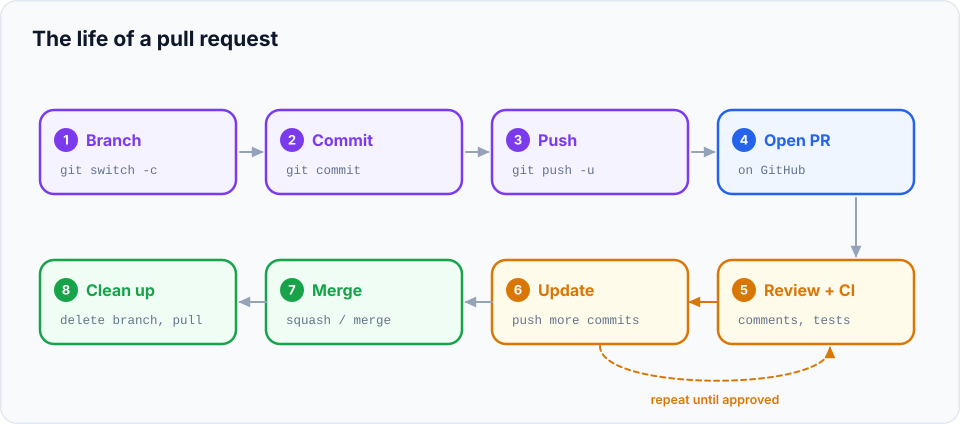

In a team, you rarely merge your own branch into `main` straight from the terminal. Instead you
open a **pull request** (PR): a page on GitHub that says *"Here are my changes on this branch;
please review them and merge them into `main`."* Pull requests are where teams discuss code,
catch bugs before they reach users, run automated tests, and share knowledge.

> **In this chapter you'll learn**
> - What a pull request is, and the life cycle of one from branch to merge
> - How to open a PR on GitHub (website and command line)
> - How to write a description reviewers love
> - How to review a PR: comments, suggestions, approve or request changes
> - How to update a PR after feedback, and keep it up to date with `main`
> - How to merge, clean up, and link PRs to issues
>
> **Prerequisites:** [chapter 14](../14-fetch-pull-push/index.md), a GitHub account and your
> `my-website` repository on GitHub ([chapter 13](../13-github-and-remotes/index.md)). **Time:** 45 minutes.

## Why pull requests?

Merging directly into `main` works for one person. For a team it's risky: nobody else looks at the
code before it goes live. A pull request adds a checkpoint:

| Without PRs | With PRs |
| --- | --- |
| Bugs are found by users | Many bugs are found by a reviewer or automated tests first |
| Only the author knows how the code works | At least two people understand every change |
| No record of *why* decisions were made | The discussion is saved with the change forever |
| Anyone can break `main` | `main` can require reviews and passing tests before merging |

> "Pull request" is GitHub's and Bitbucket's name. GitLab calls the same thing a **merge request (MR)**.

## The life of a pull request



1. **Create a branch** and commit your work on it ([chapter 10](../10-branches/index.md)).
2. **Push** the branch to GitHub.
3. **Open a pull request** from your branch into `main`.
4. **Automated checks** (tests, linters, builds) run, if the repository has them set up.
5. **Reviewers** read the changes and leave comments.
6. You **update** the PR by pushing more commits to the same branch.
7. When reviewers **approve** and checks pass, someone **merges** the PR.
8. The branch is **deleted**, and everyone **pulls** the updated `main`.

## Hands-on lab: your first pull request

You'll do the whole cycle on your own `my-website` repository. Reviewing your own PR is a real
practice too: many developers read through their PR on GitHub before asking anyone else.

### Step 1: start from an up-to-date `main`

```bash
$ cd ~/git-practice/my-website
$ git switch main
$ git pull
```

Always branch from the latest `main`, so your work starts from the newest code.

### Step 2: create a branch and make a change

```bash
$ git switch -c feature/projects-page
$ printf '<h1>My projects</h1>\n<ul>\n  <li>This website</li>\n</ul>\n' > projects.html
$ echo "<a href='projects.html'>Projects</a>" >> index.html
$ git add . && git commit -m "Add projects page and link to it"
```

### Step 3: push the branch

```bash
$ git push -u origin feature/projects-page
...
remote: Create a pull request for 'feature/projects-page' on GitHub by visiting:
remote:      https://github.com/asha/my-website/pull/new/feature/projects-page
...
 * [new branch]      feature/projects-page -> feature/projects-page
```

GitHub even prints a link to open a PR for the branch you just pushed.

### Step 4: open the pull request

**On the website:**

1. Open your repository on GitHub. A yellow banner says *"feature/projects-page had recent
   pushes"*: click **Compare & pull request**. (Or use the link from the push output.)
2. Check the two dropdowns at the top: **base: `main`** ← **compare: `feature/projects-page`**.
   The base is the branch you want to merge **into**.
3. **Title:** `Add projects page`
4. **Description:** use the structure below.
5. Click **Create pull request**. (Click the arrow next to it and choose **Create draft pull
   request** if the work isn't ready for review yet.)

**From the terminal** (with the [GitHub CLI](https://cli.github.com/)):

```bash
$ gh pr create --title "Add projects page" --body "Adds a projects page linked from the home page."
$ gh pr create --fill          # use the commit messages as title and description
$ gh pr create --draft         # open as a draft
```

### A description reviewers will love

A reviewer arrives with no context. Give it to them:

```markdown
## What
Adds a Projects page listing things I've built, linked from the home page.

## Why
Visitors asked where to find my work. Closes #3.

## How to test
1. Open index.html in a browser
2. Click "Projects"
3. The list shows "This website"

## Screenshots
(drag an image here for UI changes)
```

Writing `Closes #3` (or `Fixes #3`, `Resolves #3`) links the PR to issue number 3, and GitHub
**closes the issue automatically** when the PR is merged.

### Step 5: explore the pull request page

| Tab | Shows |
| --- | --- |
| **Conversation** | The description, comments, review summaries, check results, and the merge button |
| **Commits** | Every commit on the branch |
| **Checks** | Automated tests and builds (if configured) |
| **Files changed** | The diff, where reviewers comment on specific lines |

### Step 6: review it

Go to **Files changed** and review the PR as if someone else wrote it:

1. Hover over a line and click the blue **+** to comment on that line.
2. For a concrete fix, click the **±** icon (**Add a suggestion**) and edit the line in the
   comment box. Try it on the `<li>` line: suggest `  <li>This website, built while learning Git</li>`.
3. Click **Start a review** (instead of *Add single comment*) to collect several comments.
4. When finished, click **Review changes** (top right) and choose:

| Option | Means |
| --- | --- |
| **Comment** | General feedback, no verdict |
| **Approve** | Looks good, OK to merge |
| **Request changes** | Must be addressed before merging |

(GitHub doesn't let you approve your own PR. On a real team, a colleague does this.)

### Step 7: update the PR after feedback

There are two ways to address a comment:

**Accept a suggestion on GitHub:** click **Commit suggestion** under the comment. GitHub creates
the commit on your branch for you. Pull it locally to stay in sync:

```bash
$ git pull
```

**Or change the code locally and push:**

```bash
$ echo "  <!-- more projects coming soon -->" >> projects.html
$ git commit -am "Add placeholder for future projects"
$ git push
```

Any commit you push to the branch **automatically appears in the PR**. There's no need to open
a new one. Reply to each comment ("Done", or explain why you disagree), and click **Resolve
conversation** when it's handled.

### Step 8: keep the PR up to date with `main`

If `main` received new commits while your PR was open, GitHub may say *"This branch is out-of-date
with the base branch"* or show conflicts. Bring `main` into your branch:

```bash
$ git switch feature/projects-page
$ git fetch
$ git merge origin/main            # or: git rebase origin/main, then git push --force-with-lease
$ git push
```

If there are conflicts, resolve them as in [chapter 12](../12-merge-conflicts/index.md). The
**Update branch** button on the PR page does the same merge on GitHub's side when there are no
conflicts.

### Step 9: merge

On the **Conversation** tab, choose the merge method from the dropdown on the green button
([chapter 11](../11-merging/index.md#merging-on-github) explains each):

- **Create a merge commit**
- **Squash and merge** ← choose this one for the lab
- **Rebase and merge**

Edit the final commit message if needed, then **Confirm**. GitHub offers **Delete branch**:
click it, since the branch's job is done.

From the terminal: `gh pr merge --squash --delete-branch`.

### Step 10: sync your computer

The merge happened on GitHub, so your local `main` doesn't know about it yet:

```bash
$ git switch main
$ git pull
$ git log --oneline -3
f1e2d3c Add projects page (#1)
...
$ git branch -D feature/projects-page     # -D because it was squash-merged
$ git fetch --prune                       # remove origin/feature/projects-page
```

The `(#1)` at the end of the squashed commit message is the PR number; GitHub adds it so you can
always find the discussion that led to the change.

## Being a good reviewer

Reviews are about the code, not the person. A few guidelines that make teams work well:

| Do | Avoid |
| --- | --- |
| Ask questions: "What happens if the list is empty?" | Commands without reasons: "Change this." |
| Explain the *why* behind suggestions | Nitpicking style that a formatter could fix |
| Mark minor points as optional: "nit: …" | Approving without reading ("LGTM 👍" on 1,000 lines) |
| Praise good solutions too | Rewriting the PR in your own style |
| Review promptly, since others are waiting on you | Leaving a PR for days without a word |

Check: does it do what it says? Is it correct for edge cases? Is it understandable? Are there
tests? Could anything break for users?

## Making PRs that get reviewed fast

1. **Keep it small.** Around 200–400 changed lines gets a careful review. 2,000 lines gets skimmed.
2. **One purpose per PR.** A feature, a refactor and a dependency upgrade are three PRs.
3. **Self-review first** on the **Files changed** tab. You'll catch half the issues yourself.
4. **Write the description** (what, why, how to test).
5. **Clean commits** help reviewers follow along ([chapter 19](../19-interactive-rebase/index.md)).
6. **Use draft PRs** to get early feedback on direction before polishing.

## Checking out someone else's PR locally

To run a teammate's PR on your machine:

```bash
$ gh pr checkout 42                        # with GitHub CLI
# or with plain Git:
$ git fetch origin pull/42/head:pr-42
$ git switch pr-42
```

## Team settings worth knowing

Repository admins can configure (**Settings → Rules / Branches**):

- **Require a pull request before merging** into `main` (no direct pushes).
- **Require approvals** (e.g. at least one reviewer).
- **Require status checks to pass** (tests must be green).
- **Block force pushes** to `main`.
- A **PR template** (`.github/pull_request_template.md`) pre-fills every new PR's description.
- **CODEOWNERS** (`.github/CODEOWNERS`) automatically requests reviews from the owners of the
  files a PR touches.

## When to use a pull request

| Situation | PR? |
| --- | --- |
| Team project, any change to `main` | ✅ Always |
| Open-source contribution | ✅ Always (from a fork, see [next chapter](../16-team-workflows/index.md)) |
| Solo project | Optional. Still useful for self-review and for a record of larger changes |
| Early, unfinished work you want feedback on | ✅ As a **draft** PR |

## Common mistakes

| Mistake | Fix |
| --- | --- |
| Opened the PR against the wrong base branch | Click **Edit** next to the PR title and change the base |
| Opening a new PR for every round of feedback | Push to the same branch; the PR updates itself |
| Forgetting to pull `main` after merging on GitHub | `git switch main && git pull` |
| Huge PRs that sit unreviewed | Split into smaller, stacked PRs |
| Merge button disabled | Check the PR page: required reviews, failing checks, or conflicts with `main` |

## Recap

- A **pull request** proposes merging a branch into another (usually `main`) with review and discussion.
- Cycle: branch → commit → push → open PR → review → push updates → approve → merge → delete branch → pull.
- Pushing to the PR's branch updates the PR automatically.
- Small, focused, well-described PRs get merged faster.
- `Closes #N` in the description closes issue N when the PR merges.

## Check your understanding

<details>
<summary>1. A reviewer asks for changes. Do you open a new pull request?</summary>

No. Commit the changes on the same branch and push; the existing PR updates automatically.
</details>

<details>
<summary>2. Your PR says "This branch is out-of-date with the base branch". What does that mean?</summary>

`main` has new commits that your branch doesn't include. Merge (or rebase) `origin/main` into your
branch and push, or click **Update branch** on GitHub.
</details>

<details>
<summary>3. After merging your PR on GitHub, your local <code>main</code> doesn't have the change. Why?</summary>

The merge happened on the server. Run `git switch main && git pull` to bring it down.
</details>

**Next:** [team workflows and forks](../16-team-workflows/index.md): how whole teams organise their branches.
