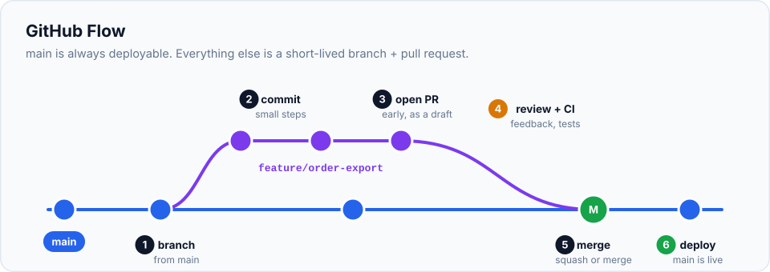
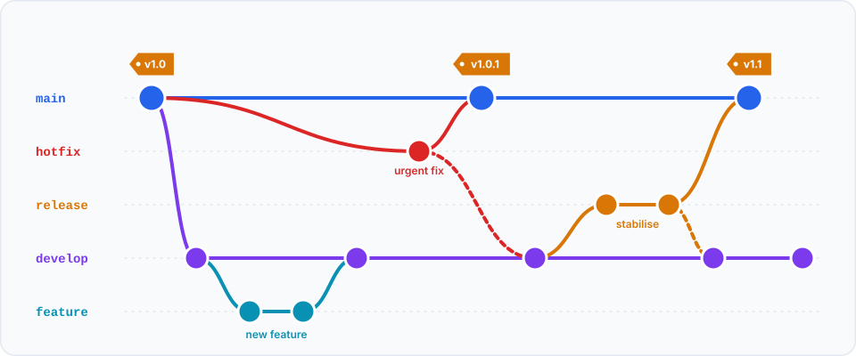

Git gives you branches, merges and remotes, but it doesn't tell a team **how** to use them.
Which branches exist? Where do new features start? When does code reach users? A team's answer to
these questions is its **workflow**. This chapter covers the three you'll meet most often, and how
anyone can contribute to a project they don't own, using **forks**.

> **In this chapter you'll learn**
> - What a branching workflow is and why teams agree on one
> - **GitHub Flow**, **trunk-based development** and **Git Flow**: how each works and when to use it
> - What feature flags are and why trunk-based teams need them
> - What a **fork** is, and the complete open-source contribution process
> - How to keep your fork in sync with the original project
>
> **Prerequisites:** chapters [14](../14-fetch-pull-push/index.md) and [15](../15-pull-requests/index.md). **Time:** 45 minutes.

## Why agree on a workflow?

Without a shared convention, one person commits straight to `main`, another keeps a branch alive
for two months, a third deploys from their own branch… and nobody knows which version is live.
A workflow answers:

- Which branch always contains **working, releasable** code?
- Where does new work **start**, and how does it **get back**?
- How are **releases** and **urgent fixes** handled?

## 1. GitHub Flow: simple and the most common

**One long-lived branch: `main`, which is always deployable.** Everything else is a short-lived
branch that comes back through a pull request.



The whole workflow, which you already did in [chapter 15](../15-pull-requests/index.md):

```bash
git switch main && git pull                  # 1. start from the latest main
git switch -c feature/order-export           # 2. branch
# ...commit...                               # 3. commit small steps
git push -u origin feature/order-export      # 4. push
gh pr create                                 # 5. open a PR, review, CI
# merge on GitHub                            # 6. merge → main is deployed
git switch main && git pull                  # 7. sync, delete the branch
```

| Pros | Cons |
| --- | --- |
| Very easy to learn and explain | Assumes you can deploy `main` at any time |
| Code reaches users quickly | No built-in way to maintain old versions |
| Short branches mean few conflicts | Needs good automated tests to keep `main` safe |

**Use it when:** you build a website, web app or API that deploys whenever `main` changes. This is
the right default for most teams, and for your own projects.

## 2. Trunk-based development: integrate constantly

Like GitHub Flow, but taken further. Everyone integrates into `main` (the "trunk") **at least once
a day**. Branches live **hours**, not days. Some teams even commit directly to `main`, protected by
strong automated tests.

But what if a feature takes three weeks? You can't merge half a feature into a branch that users
see… unless it's **switched off**. Trunk-based teams use **feature flags**: the new code is merged
and deployed, but hidden behind a setting:

```js
if (featureFlags.isEnabled('new-checkout', user)) {
  return renderNewCheckout();   // merged, deployed, but only visible when the flag is on
}
return renderOldCheckout();
```

The team can turn the flag on for testers, then for 10% of users, then everyone, and turn it off
instantly if something goes wrong.

| Pros | Cons |
| --- | --- |
| Almost no merge conflicts (everything integrates daily) | Requires excellent automated tests |
| Fastest feedback, fastest delivery | Feature flags add complexity and need cleaning up |
| Everyone always works on the latest code | Discipline: every commit must keep `main` working |

**Use it when:** an experienced team with strong CI and testing wants maximum speed. It's how many
large tech companies work.

## 3. Git Flow: for scheduled, versioned releases

Git Flow uses **two** long-lived branches plus three kinds of short-lived ones:



| Branch | Purpose | Branches from | Merges into |
| --- | --- | --- | --- |
| `main` | Only released versions, each **tagged** (`v1.0`, `v1.1`) | — | — |
| `develop` | Integration of finished features for the next release | `main` | — |
| `feature/*` | One feature | `develop` | `develop` |
| `release/*` | Stabilising a version: final fixes, version numbers, no new features | `develop` | `main` **and** `develop` |
| `hotfix/*` | Urgent fix to the released version | `main` | `main` **and** `develop` |

| Pros | Cons |
| --- | --- |
| Clear structure for planned releases | Many branches and merges to manage |
| Can stabilise a release while new features continue | Slow: features wait for the next release |
| Easy to patch the current version | Overkill for continuously deployed apps |

**Use it when:** you ship **numbered versions**: mobile apps going through app-store review,
desktop software, libraries, firmware, or products where customers run several versions at once.

## Which should I use?

| Your situation | Workflow |
| --- | --- |
| Learning, personal projects, small teams, web apps that deploy continuously | **GitHub Flow** |
| Experienced team, strong tests, wants to deploy many times a day | **Trunk-based** |
| Versioned releases, app stores, supporting old versions | **Git Flow** (or a lighter variant: GitHub Flow + release branches) |

The best workflow is the simplest one that fits how you **release**. When you join a team, ask
which one it uses: it's often written in the repository's `CONTRIBUTING.md`.

## Forks: contributing to projects you don't own

You can't push to a repository unless you've been given access. So how does anyone contribute to
open-source projects like React or VS Code? With a **fork**.

A **fork** is **your own copy of someone else's repository, on GitHub**. You push to your fork
(you own it), then open a pull request from your fork back to the original. The maintainers review
and merge it.

By convention you have two remotes:

| Remote | Points to | You… |
| --- | --- | --- |
| `origin` | **Your fork** (`github.com/you/awesome-lib`) | push your branches here |
| `upstream` | **The original** (`github.com/original-org/awesome-lib`) | pull new changes from here |

, open a pull request to upstream.")

## Hands-on lab: the complete fork workflow

You can do this on GitHub with any public project (start with a small one, and read its
`CONTRIBUTING.md` first). To practise without bothering real maintainers, the steps below also
show a fully local simulation; the commands are the same, only the URLs differ.

### Step 1: fork

**On GitHub:** open the project page and click **Fork** (top right) → **Create fork**. You now have
`github.com/<you>/awesome-lib`.

**Local simulation** (the original project and your fork as folders):

```bash
cd ~/git-practice && rm -rf oss && mkdir oss && cd oss
mkdir maint && cd maint && git init && echo "# Awesome Lib" > README.md && git add . && git commit -m "Initial commit" && cd ..
git clone --bare maint servers/original-org/awesome-lib.git           # "the original on GitHub"
git clone --bare servers/original-org/awesome-lib.git servers/asha/awesome-lib.git   # "your fork"
```

### Step 2: clone **your fork**

```bash
$ git clone https://github.com/asha/awesome-lib.git
# simulation: git clone servers/asha/awesome-lib.git awesome-lib
$ cd awesome-lib
```

Clone your fork, not the original: you need push access to `origin`.

### Step 3: add the original as `upstream`

```bash
$ git remote add upstream https://github.com/original-org/awesome-lib.git
# simulation: git remote add upstream ../servers/original-org/awesome-lib.git
$ git remote -v
origin	https://github.com/asha/awesome-lib.git (fetch)
origin	https://github.com/asha/awesome-lib.git (push)
upstream	https://github.com/original-org/awesome-lib.git (fetch)
upstream	https://github.com/original-org/awesome-lib.git (push)
```

### Step 4: make your contribution on a branch

```bash
$ git switch -c fix/readme-description
$ echo "A tiny library." >> README.md
$ git commit -am "Describe the library in README"
$ git push -u origin fix/readme-description
 * [new branch]      fix/readme-description -> fix/readme-description
```

Never work on your fork's `main` for contributions; always use a branch. It keeps your `main`
clean for syncing.

### Step 5: open the pull request

On GitHub, your fork shows **Compare & pull request**. Check the direction carefully:

```text
base repository: original-org/awesome-lib   base: main
       ← head repository: asha/awesome-lib  compare: fix/readme-description
```

Write a clear description, and follow the project's PR template if it has one. Then wait for
review, and respond to feedback by pushing to the same branch, exactly as in chapter 15.

### Step 6: keep your fork in sync

While you work, the original project moves on. (In the simulation, play the maintainer:)

```bash
# simulation only: the maintainer adds a license to the original
cd ../maint && git remote add origin ../servers/original-org/awesome-lib.git
echo "MIT" > LICENSE && git add . && git commit -m "Add license" && git push origin main
cd ../awesome-lib
```

Your fork doesn't update by itself. Bring the changes in from `upstream`:

```bash
$ git fetch upstream
From ../servers/original-org/awesome-lib
 * [new branch]      main       -> upstream/main
$ git switch main
$ git log --oneline main..upstream/main
c67c0d3 Add license
$ git merge --ff-only upstream/main
Updating e0e00f5..c67c0d3
Fast-forward
 LICENSE | 1 +
$ git push origin main
```

`--ff-only` guarantees your `main` is an exact copy of upstream's; if it refuses, you committed to
your `main` by mistake. On GitHub, the **Sync fork** button on your fork's page does the same thing.

To update a contribution branch that's open as a PR:

```bash
$ git switch fix/readme-description
$ git rebase upstream/main          # or: git merge upstream/main
$ git push --force-with-lease       # needed after a rebase
```

## Tips for your first open-source contribution

- Look for issues labelled **good first issue** or **help wanted**.
- **Read `CONTRIBUTING.md`** and follow the project's code style, commit format and test requirements.
- For anything bigger than a typo, **comment on the issue first** to check the maintainers want it.
- Keep the PR small, and be patient: maintainers are often volunteers.

## Common mistakes

| Mistake | Fix |
| --- | --- |
| Cloned the original instead of your fork, then can't push | `git remote rename origin upstream`, then `git remote add origin <your-fork-url>` |
| Committed contributions to your fork's `main` | Create a branch from it (`git branch fix/x`), then reset `main` to `upstream/main` ([chapter 30](../30-git-disasters/index.md)) |
| PR opened against your own fork instead of the original | Check the **base repository** dropdown when creating the PR |
| Fork months out of date, PR full of unrelated changes | Sync `main` from upstream, then rebase your branch onto it |
| Choosing Git Flow for a simple web app | Prefer GitHub Flow; add release branches only if you truly need versions |

## Recap

- A **workflow** is the team's agreement on how branches are used.
- **GitHub Flow**: `main` + short PR branches. The best default.
- **Trunk-based**: integrate into `main` daily, hide unfinished work behind **feature flags**.
- **Git Flow**: `main` + `develop` + feature/release/hotfix branches, for versioned releases.
- **Forks** let you contribute without write access: `origin` = your fork, `upstream` = the original.
- Sync a fork: `git fetch upstream` → `git merge --ff-only upstream/main` → `git push origin main`.

## Check your understanding

<details>
<summary>1. Your team deploys a web app every time something is merged. Which workflow fits best?</summary>

GitHub Flow (or trunk-based if the team has strong automated testing and wants to integrate daily).
</details>

<details>
<summary>2. In a fork setup, which remote do you push your branches to?</summary>

`origin`, your fork. You fetch from `upstream`, the original project.
</details>

<details>
<summary>3. How can trunk-based teams merge a feature that isn't finished yet?</summary>

They hide it behind a **feature flag**, so the code is merged and deployed but not active for users
until the flag is turned on.
</details>

**Next section:** [undo almost anything](../17-undoing-changes/index.md).
