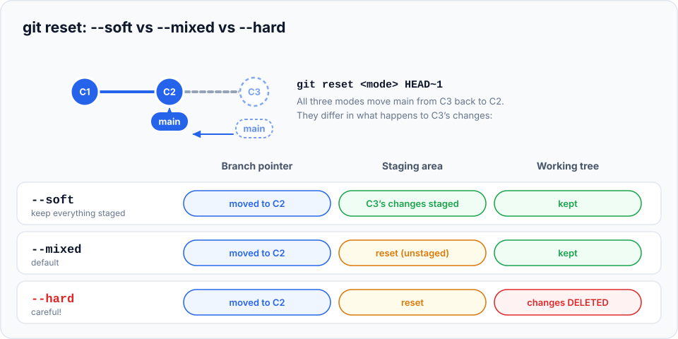
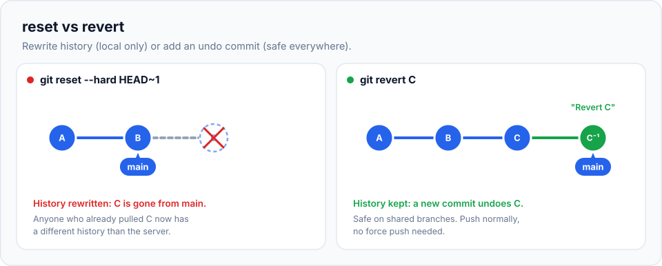

Everyone makes mistakes with Git: committing the wrong file, a broken change reaching `main`,
throwing away the wrong edits. Experienced developers aren't the ones who never make them; they're
the ones who know **which undo command fits which mistake**. By the end of this chapter, so will you.

> **In this chapter you'll learn**
> - The one question to ask before undoing anything
> - Undoing **uncommitted** changes: `git restore` and `git clean`
> - Getting a file back from any older commit
> - Undoing **commits** by moving a branch: `git reset --soft`, `--mixed`, `--hard`
> - Undoing commits **safely on shared branches**: `git revert` (including merges)
> - A decision table for the most common situations
>
> **Prerequisites:** chapters [5](../05-the-three-areas/index.md), [8](../08-viewing-history/index.md),
> [10](../10-branches/index.md) and [14](../14-fetch-pull-push/index.md). **Time:** 60 minutes.

## The one question to ask first

> **Have other people already got this commit?** (Is it pushed to a branch others use?)
>
> - **No, it's only on my computer** (or only on my own branch): you may **rewrite history**:
>   amend, reset. Nobody will notice.
> - **Yes, it's shared:** **don't rewrite history.** Add a **new** commit that undoes the change:
>   revert.

Why? Rewriting history replaces commits with new ones ([chapter 1](../01-what-is-version-control/index.md):
change anything, and hashes change). If teammates already have the old commits, their history and
yours no longer match, and the next sync becomes a mess of duplicates and conflicts.

## The decision table

Keep this table handy. The rest of the chapter explains each line.

| Mistake | Fix | Rewrites history? |
| --- | --- | --- |
| Edited a file, want to throw the edits away | `git restore <file>` | No (but discards uncommitted work ⚠️) |
| Staged a file by accident | `git restore --staged <file>` | No |
| Want a file as it was in an older commit | `git restore --source=<commit> <file>` | No |
| Typo in the last commit message / forgot a file | `git commit --amend` ([chapter 6](../06-staging-and-committing-well/index.md)) | Yes |
| Undo the last commit(s), keep the changes staged | `git reset --soft HEAD~1` | Yes |
| Undo the last commit(s), keep the changes unstaged | `git reset HEAD~1` | Yes |
| Throw away the last commit(s) **and** their changes | `git reset --hard HEAD~1` ⚠️ | Yes |
| Undo a commit that's already pushed and shared | `git revert <commit>` | No |
| Undo a merge that's already pushed | `git revert -m 1 <merge-commit>` | No |
| Delete untracked files (build junk, logs) | `git clean -n` then `git clean -fd` ⚠️ | No |
| "I reset/rebased and lost commits!" | `git reflog` ([chapter 22](../22-reflog/index.md)) | — |

## Set up the practice repository

```bash
cd ~/git-practice && rm -rf undo-lab && mkdir undo-lab && cd undo-lab && git init
echo "<h1>Home</h1>"  > index.html && git add . && git commit -m "Add home page"
echo "<h1>About</h1>" > about.html && git add . && git commit -m "Add about page"
echo "<h1>Blog</h1>"  > blog.html  && git add . && git commit -m "Add blog page"
echo "<h1>Shop</h1>"  > shop.html  && git add . && git commit -m "Add shop page"
git log --oneline
```

```text
103aefb Add shop page
6b87581 Add blog page
c5072e4 Add about page
02e2fe7 Add home page
```

## Part 1: undoing uncommitted changes

You met these in [chapter 5](../05-the-three-areas/index.md); here's the complete picture.

### Throw away edits to a file

```bash
$ echo "<p>oops</p>" >> about.html
$ git status -s
 M about.html
$ git restore about.html
$ git status -s
$
```

`git restore <file>` replaces the file in your working tree with the staged version (or the last
committed version if nothing is staged).

> ⚠️ **Uncommitted edits discarded this way cannot be recovered.** Git never saved them. If you're
> not 100% sure, use `git stash` instead ([chapter 20](../20-stash/index.md)): it puts changes aside
> where you can still get them back.

Other forms:

| Command | Effect |
| --- | --- |
| `git restore .` | Discard **all** unstaged changes in the current folder ⚠️ |
| `git restore -p <file>` | Choose hunk by hunk which changes to discard |
| `git restore --staged <file>` | Unstage; your edits stay in the file |
| `git restore --staged --worktree <file>` | Unstage **and** discard ⚠️ |

### Get a file back from an older commit

Suppose `about.html` was perfect two commits ago, and you want that version back:

```bash
$ git restore --source=HEAD~2 about.html
$ cat about.html
<h1>About</h1>
$ git status -s
 M about.html
```

`--source` takes any commit (hash, `HEAD~N`, branch name, tag). Only that file changes, and it
appears as a normal modification: review it, then commit it like any other change. History isn't
touched. (`git restore about.html` puts it back if you change your mind.)

### Delete untracked files: `git clean`

`restore` only touches **tracked** files. New files that Git doesn't track (build output, logs,
temporary files) need `git clean`:

```bash
$ echo junk > tmp1.log
$ mkdir build && echo x > build/out.js
$ git clean -n
Would remove tmp1.log
$ git clean -nd
Would remove build/
Would remove tmp1.log
$ git clean -fd
Removing build/
Removing tmp1.log
```

| Option | Meaning |
| --- | --- |
| `-n` | **Dry run**: only show what would be deleted. **Always run this first.** |
| `-f` | **Force**: actually delete (required, as a safety measure) |
| `-d` | Also delete untracked **folders** |
| `-x` | Also delete **ignored** files (like `node_modules/`, `dist/`): a "fresh clone" state |
| `-i` | Interactive: choose what to delete |

> ⚠️ `git clean` deletes files permanently (no recycle bin) and Git can't bring them back, because
> it never tracked them.

## Part 2: undoing commits with `git reset`

`git reset <commit>` **moves the current branch back** to point at `<commit>`. The commits that
came after it are no longer on the branch.

The interesting question is: **what happens to the changes those commits contained?** That's what
the three modes decide:



| Mode | Branch moves back | Changes from the removed commits end up… | Use it to… |
| --- | --- | --- | --- |
| `--soft` | ✅ | **Staged**, ready to commit again | Redo the commit(s): combine several into one, or change the message and contents |
| `--mixed` (default) | ✅ | **In your files, unstaged** | "Uncommit" and rethink what goes into which commit |
| `--hard` | ✅ | **Deleted** ⚠️ | Throw the work away entirely |

Think back to the three areas from [chapter 5](../05-the-three-areas/index.md): `--soft` resets only
the **repository** (branch pointer), `--mixed` also resets the **staging area**, `--hard` also resets
the **working tree**.

### Lab: try all three modes

**`--soft`: uncommit, keep everything staged**

```bash
$ git reset --soft HEAD~1
$ git log --oneline
6b87581 Add blog page
c5072e4 Add about page
02e2fe7 Add home page
$ git status -s
A  shop.html
```

The "Add shop page" commit is gone from the branch, but `shop.html` is still there **and staged**.
You could add more changes and commit again. Recommit it for now:

```bash
$ git commit -m "Add shop page"
```

> **Real-life use: squash your last few commits into one.** `git reset --soft HEAD~3` followed by
> `git commit -m "Add product pages"` turns three commits into one.

**`--mixed` (the default): uncommit, keep changes as unstaged edits**

```bash
$ git reset HEAD~1
$ git log --oneline
6b87581 Add blog page
...
$ git status -s
?? shop.html
```

The commit is gone and nothing is staged, but the file is still on disk. (It shows as untracked
because it was a new file.) Recommit:

```bash
$ git add . && git commit -m "Add shop page"
```

**`--hard`: uncommit and delete the changes**

```bash
$ echo "<p>unsaved</p>" >> index.html       # an uncommitted edit, to show what --hard does
$ git reset --hard HEAD~1
HEAD is now at 6b87581 Add blog page
$ ls
about.html  blog.html  index.html
$ cat index.html
<h1>Home</h1>
```

The commit is gone, `shop.html` is gone, **and** the uncommitted edit to `index.html` is gone.
Everything matches the "Add blog page" commit exactly.

Was the shop commit lost forever? No! **Committed** work is recoverable for a while. Right after a
reset, `ORIG_HEAD` points to where you were:

```bash
$ git reset --hard ORIG_HEAD
HEAD is now at 103aefb Add shop page
$ ls
about.html  blog.html  index.html  shop.html
```

Back. (The uncommitted `<p>unsaved</p>` line, however, is gone for good: it was never committed.
[Chapter 22](../22-reflog/index.md) covers recovery in depth.)

> ⚠️ **Before any `reset --hard`, run `git status`.** If you have uncommitted work you might want,
> commit or stash it first.

### Other uses of reset

```bash
git reset --hard origin/main      # make my local branch exactly match the server
git reset --soft main             # on a feature branch: turn all its commits into one staged change
```

## Part 3: undoing shared commits with `git revert`

`git revert <commit>` doesn't remove anything. It creates a **new commit that does the exact
opposite** of the given commit: lines it added are removed, lines it removed are added back.
History only moves forward, so it's safe on shared branches.



### Lab: revert a commit from the middle of history

Let's undo "Add blog page", which is **not** the latest commit:

```bash
$ git revert HEAD~1
```

Git opens your editor with a message:

```text
Revert "Add blog page"

This reverts commit 6b87581e9d5488a9be271d88e539ab82ca72a6b3.
```

Add a line explaining **why** (e.g. "The blog isn't ready to launch"), save and close.
(`--no-edit` skips the editor.)

```text
[main ea7f9a3] Revert "Add blog page"
 1 file changed, 1 deletion(-)
 delete mode 100644 blog.html
$ git log --oneline
ea7f9a3 Revert "Add blog page"
103aefb Add shop page
6b87581 Add blog page
c5072e4 Add about page
02e2fe7 Add home page
$ ls
about.html  index.html  shop.html
```

`blog.html` is gone, but the history still shows that it was added and then deliberately reverted,
and why. The shop page, which came **after** the blog, is untouched: revert undoes exactly one
commit's changes.

Changed your mind? Revert the revert:

```bash
$ git revert --no-edit HEAD
[main a2f9f0b] Revert "Revert "Add blog page""
$ ls
about.html  blog.html  index.html  shop.html
```

### Real-life scenario: a broken deploy on Friday evening

PR #482 was merged into `main` as commit `e4b1c09`, deployed, and broke checkout. There's no time
to debug:

```bash
$ git switch main && git pull
$ git revert e4b1c09
$ git push
```

Production is fixed through the normal process, everyone can see exactly what happened, and on
Monday you can fix the original change and reapply it.

### Reverting a merge commit

A merge commit has **two parents**, so Git needs to know which side to keep:

```text
$ git revert HEAD
error: commit f99bb5b is a merge but no -m option was given.
```

`-m 1` means "keep parent number 1", the branch you merged **into** (usually `main`), and undo
what the merged branch brought in:

```bash
$ git revert -m 1 HEAD
[main ccd58e3] Revert "Merge branch 'feature/chat'"
 1 file changed, 1 deletion(-)
 delete mode 100644 chat.html
```

> **Gotcha:** after reverting a merge, merging the same branch again **won't** bring its changes
> back: Git considers those commits already merged. To re-land the feature later, **revert the
> revert** first, then merge any new fixes.

### Reverting several commits

```bash
git revert --no-edit HEAD~3..HEAD     # one revert commit per commit, newest first
git revert -n HEAD~3..HEAD            # stage all the reverts together…
git commit -m "Revert the checkout redesign"   # …and record them as one commit
```

## reset vs revert vs restore

The three names sound alike, but they work on different things:

| Command | Works on | Changes history? | Safe after pushing? |
| --- | --- | --- | --- |
| `git restore` | **Files** (working tree / staging area) | No | ✅ (only affects your local files) |
| `git reset` | The **branch pointer** (and optionally staging area/files) | **Yes**, removes commits from the branch | ❌ only on unshared commits |
| `git revert` | **Commits**, by adding an opposite commit | No, only adds | ✅ the right tool for shared branches |

## When to use what: scenarios

| Scenario | Solution |
| --- | --- |
| "I committed, then realised it should be two commits" (not pushed) | `git reset HEAD~1`, then stage and commit in two parts |
| "My last 4 commits are messy WIP" (not pushed) | `git reset --soft HEAD~4`, then one clean commit (or interactive rebase, [chapter 19](../19-interactive-rebase/index.md)) |
| "This experiment failed, throw it all away" (not pushed) | `git reset --hard <commit-before-experiment>` |
| "A bad commit is on `main` and everyone has pulled it" | `git revert <commit>` |
| "I want yesterday's version of one config file" | `git restore --source=<commit> config.json` |
| "My working tree is full of generated junk" | `git clean -nd`, then `git clean -fd` |
| "I pushed a commit to my own feature branch and want it gone" | `git reset` then `git push --force-with-lease` ([chapter 14](../14-fetch-pull-push/index.md#force-pushing-safely)) |

## Common mistakes

| Mistake | Fix / prevention |
| --- | --- |
| `git reset --hard` with uncommitted work you needed | Unrecoverable for uncommitted edits. Prevention: `git stash` or commit before resetting |
| Resetting commits that were already pushed to `main` | Others still have them; your next push is rejected. Use `revert` on shared branches |
| `git revert` on a merge without `-m` | Add `-m 1` |
| `git clean -fdx` deleted `.env` or other ignored local files | `-x` includes ignored files. Always dry-run with `-n` first |
| Confusing `restore` and `reset` | `restore` = files; `reset` = branch/commits |

## Recap

- **First ask:** is the commit shared? If yes, **revert**; if no, you may **reset/amend**.
- `git restore <file>` discards edits; `--staged` unstages; `--source=<commit>` brings back an old version.
- `git reset --soft | --mixed | --hard <commit>` moves the branch back, keeping changes staged / unstaged / not at all.
- `git revert <commit>` adds an opposite commit; `-m 1` for merges.
- `git clean -n`, then `-fd`, removes untracked files.
- Committed work is recoverable (`ORIG_HEAD`, reflog); uncommitted work discarded by restore/reset/clean is not.

## Check your understanding

<details>
<summary>1. You pushed a commit to <code>main</code> an hour ago and teammates pulled it. It has a bug. Reset or revert?</summary>

**Revert.** The commit is shared; resetting would rewrite history that others already have.
</details>

<details>
<summary>2. After <code>git reset --soft HEAD~2</code>, where are the changes from those two commits?</summary>

Still in your files, and **staged**: ready to be committed again (for example as a single commit).
</details>

<details>
<summary>3. What's the difference between <code>git reset HEAD~1</code> and <code>git reset --hard HEAD~1</code>?</summary>

Both remove the last commit from the branch. The default (`--mixed`) keeps its changes in your files
as unstaged edits; `--hard` deletes those changes from your files too.
</details>

<details>
<summary>4. Why should you run <code>git clean -n</code> before <code>git clean -f</code>?</summary>

`-n` shows what would be deleted without deleting it. `git clean -f` removes untracked files
permanently, and Git can't recover them.
</details>

**Next:** [rebase](../18-rebase/index.md): keep your branch up to date with a clean, linear history.
