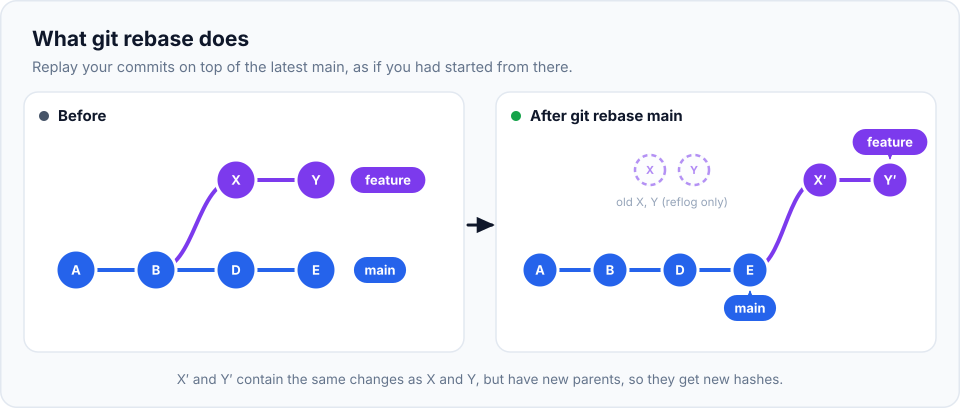

You've learned one way to bring branches together: **merge**. **Rebase** is the other. It solves
the same problem (getting the latest `main` into your feature branch) but produces a cleaner,
straight-line history. It's also the command people are most afraid of. By the end of this
chapter you'll understand exactly what it does, when it's safe, and how to get out of trouble.

> **In this chapter you'll learn**
> - What `git rebase` does, step by step
> - How rebase differs from merge, with pros and cons of each
> - **The golden rule** of rebasing, and why breaking it hurts your team
> - How to handle conflicts during a rebase (`--continue`, `--skip`, `--abort`)
> - How `git pull --rebase` keeps everyday history clean
> - How to move commits to a different base with `rebase --onto`
>
> **Prerequisites:** chapters [11](../11-merging/index.md), [12](../12-merge-conflicts/index.md)
> and [14](../14-fetch-pull-push/index.md). **Time:** 50 minutes.

## The situation rebase is for

You branched `feature/gallery` from `main` and made two commits. Meanwhile, `main` got two new
commits. History has diverged:

```text
          X---Y        feature/gallery
         /
    A---B---D---E      main
```

You want your feature to include the latest `main`. You have two options:

**Merge `main` into your branch** (chapter 11): Git creates a merge commit joining the two lines.
History shows exactly what happened, branches and all.

**Rebase your branch onto `main`:** Git **moves** your commits so they start from the latest `main`,
as if you had created the branch just now:

```text
                  X'--Y'   feature/gallery
                 /
    A---B---D---E          main
```

## What rebase does, step by step

```bash
git switch feature/gallery
git rebase main
```



Git:

1. Finds the commits on your branch that aren't on `main` (X and Y).
2. Saves them aside temporarily.
3. Moves your branch to the tip of `main` (E).
4. **Re-applies** X, then Y, one at a time, as **new commits** X′ and Y′.

**X′ is not X.** It contains the same changes and the same message, but it has a **different parent**
(E instead of B), so it gets a **different hash** (remember from [chapter 1](../01-what-is-version-control/index.md):
a commit's hash includes its parent's hash). That's what "rebase rewrites history" means.

The old X and Y still exist for a while (recoverable through the reflog, [chapter 22](../22-reflog/index.md)),
but no branch points to them anymore.

## Merge vs rebase

| | Merge | Rebase |
| --- | --- | --- |
| How | Adds a merge commit joining two lines | Re-creates your commits on top of the other branch |
| History | Shows exactly what happened, including parallel work | Looks as if the work happened in sequence: a straight line |
| Rewrites existing commits? | No | **Yes**: your commits get new hashes |
| Conflicts | Resolved once, in the merge commit | Possibly once **per replayed commit** |
| Safe on branches others use? | ✅ Always | ❌ Only on branches nobody else has |
| Readability of `git log` | Can get busy ("railroad tracks") | Easy to read |

Neither is "better". Most teams use **both**:

- **Rebase** your **own** feature branch onto `main` to keep it up to date and tidy.
- **Merge** (or squash-merge) finished features into `main`, usually through a pull request.

## ⚠️ The golden rule

> **Never rebase commits that other people already have.**

Rebase replaces commits with new ones. Suppose you pushed `feature/gallery`, and Ravi pulled it and
added a commit on top. Then you rebase and force-push. Now:

- The server has X′ and Y′.
- Ravi's branch is built on X and Y, which no longer exist on the server.

When Ravi pulls, Git sees two different histories. He gets duplicate commits, confusing conflicts,
and possibly loses work. One rebase, one confused teammate, one lost afternoon.

**Safe:**

- Rebasing commits that exist only on your computer.
- Rebasing your own pushed feature branch **that nobody else works on**, then pushing with
  `git push --force-with-lease` ([chapter 14](../14-fetch-pull-push/index.md#force-pushing-safely)).

**Not safe:**

- Rebasing `main`, `develop` or any branch others commit to or build on.

## Hands-on lab, part 1: a clean rebase

### Setup

```bash
cd ~/git-practice && rm -rf rebase-lab && mkdir rebase-lab && cd rebase-lab && git init
printf '<h1>Home</h1>\n<p>Welcome</p>\n' > index.html && git add . && git commit -m "Add home page"
echo "body { margin: 0; }" > style.css && git add . && git commit -m "Add stylesheet"

git switch -c feature/gallery
echo "<h1>Gallery</h1>" > gallery.html && git add . && git commit -m "Add gallery page"
echo "<a href='gallery.html'>Gallery</a>" >> index.html && git commit -am "Link to gallery"

git switch main
echo "<h1>About</h1>" > about.html && git add . && git commit -m "Add about page"
echo "h1 { color: teal; }" >> style.css && git commit -am "Make headings teal"
```

### Step 1: look at the diverged history

```bash
$ git log --oneline --graph --all
* c5c0be5 (feature/gallery) Link to gallery
* e7cbab2 Add gallery page
| * 135ca01 (HEAD -> main) Make headings teal
| * 82f9589 Add about page
|/
* 708cb6d Add stylesheet
* da7a764 Add home page
```

Note the hashes of the feature commits: `e7cbab2` and `c5c0be5`.

### Step 2: rebase the feature onto `main`

```bash
$ git switch feature/gallery
$ git rebase main
Successfully rebased and updated refs/heads/feature/gallery.
```

### Step 3: look again

```bash
$ git log --oneline --graph --all
* e340370 (HEAD -> feature/gallery) Link to gallery
* 82c8ad8 Add gallery page
* 135ca01 (main) Make headings teal
* 82f9589 Add about page
* 708cb6d Add stylesheet
* da7a764 Add home page
```

Three things to notice:

1. History is a **straight line**: the gallery commits now come after "Make headings teal".
2. The gallery commits have **new hashes** (`82c8ad8`, `e340370`). They're new commits.
3. Your branch now contains everything from `main`: check with `ls` (you'll see `about.html`).

### Step 4: merging is now a fast-forward

```bash
$ git switch main
$ git merge feature/gallery
Updating 135ca01..e340370
Fast-forward
 gallery.html | 1 +
 index.html   | 1 +
```

Because the feature sits directly on top of `main`, the merge just moves `main` forward. No merge
commit, perfectly linear history.

## Conflicts during a rebase

Rebase replays your commits one by one. If one of them conflicts with what's on `main`, the rebase
**pauses at that commit**:

```text
CONFLICT (content): Merge conflict in index.html
error: could not apply 9f85480... Friendlier title
hint: Resolve all conflicts manually, mark them as resolved with
hint: "git add/rm <conflicted_files>", then run "git rebase --continue".
hint: You can instead skip this commit: run "git rebase --skip".
hint: To abort and get back to the state before "git rebase", run "git rebase --abort".
```

| Command | What it does |
| --- | --- |
| *(edit files, then)* `git add <file>` + `git rebase --continue` | You resolved the conflict; carry on with the next commit |
| `git rebase --skip` | Drop this commit entirely and continue (rarely what you want) |
| `git rebase --abort` | Cancel the whole rebase; your branch goes back exactly as it was |

Notice the difference from a merge: you finish with **`git rebase --continue`**, not `git commit`.

> **Reminder:** during a rebase, **"ours" and "theirs" are swapped** compared to a merge. `HEAD`
> (ours) is `main` plus the commits replayed so far; "theirs" is **your** commit being applied.
> In the conflict markers this looks like `<<<<<<< HEAD` (main's version) and
> `>>>>>>> 9f85480 (Friendlier title)` (your commit).

## Hands-on lab, part 2: resolve a conflict mid-rebase

### Step 1: create two branches that change the same line

```bash
$ git switch -c feature/title
```

Change the first line of `index.html` to `<h1>Home sweet home</h1>`, then:

```bash
$ git commit -am "Friendlier title"
$ git switch main
```

Change the same line to `<h1>My Home</h1>`, then:

```bash
$ git commit -am "Personal title"
```

### Step 2: rebase and hit the conflict

```bash
$ git switch feature/title
$ git rebase main
CONFLICT (content): Merge conflict in index.html
error: could not apply 9f85480... Friendlier title

$ git status
interactive rebase in progress; onto f4aa50c
Last command done (1 command done):
   pick 9f85480 Friendlier title
No commands remaining.
You are currently rebasing branch 'feature/title' on 'f4aa50c'.
  (fix conflicts and then run "git rebase --continue")
  (use "git rebase --skip" to skip this patch)
  (use "git rebase --abort" to check out the original branch)

Unmerged paths:
	both modified:   index.html
```

`git status` tells you exactly where you are: which commit is being replayed and what to do next.

```bash
$ cat index.html
<<<<<<< HEAD
<h1>My Home</h1>
||||||| parent of 9f85480 (Friendlier title)
<h1>Home</h1>
=======
<h1>Home sweet home</h1>
>>>>>>> 9f85480 (Friendlier title)
<p>Welcome</p>
<a href='gallery.html'>Gallery</a>
```

### Step 3: resolve and continue

Edit the block into `<h1>My home sweet home</h1>`, remove all markers, then:

```bash
$ git add index.html
$ git rebase --continue
```

Git opens your editor with the commit message ("Friendlier title"); save and close to keep it.

```text
Successfully rebased and updated refs/heads/feature/title.
$ git log --oneline --graph -3
* ebabc20 (HEAD -> feature/title) Friendlier title
* f4aa50c (main) Personal title
* e340370 Link to gallery
```

> Rebasing a branch with many commits can mean resolving the same area several times. If that
> happens a lot, enable `rerere` ([chapter 12](../12-merge-conflicts/index.md#rerere-resolve-the-same-conflict-only-once))
> or merge instead.

## Everyday rebasing: `git pull --rebase`

You already met this in [chapter 14](../14-fetch-pull-push/index.md). When your local `main` and
`origin/main` both have new commits, a plain merge-pull creates commits like *"Merge branch 'main' of
github.com:team/site"*, which carry no meaning. Pulling with rebase replays your unpushed commits on
top of what you fetched instead:

```bash
git config --global pull.rebase true       # make it the default
git config --global rebase.autoStash true  # stash & restore uncommitted changes automatically
```

This is the safest kind of rebase: it only rewrites **your own commits that haven't been pushed yet**.

## Keeping a feature branch up to date

While your PR is open, `main` moves on. To update your branch:

```bash
git switch feature/gallery
git fetch
git rebase origin/main
git push --force-with-lease       # your branch's commits changed, so a force push is needed
```

Use the merge alternative (`git merge origin/main` + normal `git push`) if anyone else has commits
on your branch.

## Advanced: `rebase --onto`

`git rebase --onto <new-base> <old-base> <branch>` means: *"take the commits on `<branch>` that come
after `<old-base>`, and replay them onto `<new-base>`."* It's how you **move a set of commits to a
different starting point**.

 from feature-a onto main.")

**Real-life scenario 1: you branched from the wrong place.** You meant to branch from `main`, but
created `fix/login` while on `develop`. Now it carries `develop`'s unfinished commits too:

```bash
git rebase --onto main develop fix/login
```

Only the commits made on `fix/login` move onto `main`.

**Real-life scenario 2: stacked branches.** You built `feature-b` on top of `feature-a` (it needed
its code). `feature-a` was squash-merged into `main`, so `main` now has those changes as a single new
commit, and `feature-b` still carries the old individual commits:

```bash
git rebase --onto main feature-a feature-b
```

> **Hack (Git 2.38+):** `git config --global rebase.updateRefs true`. When you rebase a branch that
> has other branches stacked inside it, Git moves those branch pointers along too.

## When to use rebase vs merge

| Situation | Use |
| --- | --- |
| Update **your own** feature branch with the latest `main` | **Rebase** (or merge, both are fine) |
| Someone else also commits to your feature branch | **Merge** |
| Bringing a finished feature into `main` | **Merge / squash-merge** via a pull request |
| `git pull` with local unpushed commits | **Rebase** (`pull.rebase true`) |
| Shared branches (`main`, `develop`, release branches) | **Never rebase** |
| You want an exact record of how work happened | **Merge** |
| You want a clean, linear, readable history | **Rebase** |

## Common mistakes

| Mistake | Fix |
| --- | --- |
| Rebased a shared branch and force-pushed | Tell your team immediately; teammates can recover with `git reflog`. Prevention: the golden rule |
| Running `git commit` instead of `git rebase --continue` after resolving | Usually harmless (it makes an extra commit); then run `git rebase --continue` |
| Confused mid-rebase | `git status` explains where you are; `git rebase --abort` undoes everything |
| Normal `git push` rejected after rebasing your pushed branch | Expected: commits were rewritten. Use `git push --force-with-lease` (own branch only) |
| Rebase went wrong and already finished | `git reset --hard ORIG_HEAD` right afterwards, or find the old state in `git reflog` |

## Recap

- `git rebase main` replays your branch's commits **on top of** `main` as **new** commits.
- Result: linear history; a later merge into `main` is a fast-forward.
- **Golden rule:** only rebase commits nobody else has.
- Conflicts pause the rebase: resolve → `git add` → `git rebase --continue` (or `--skip`/`--abort`).
- `pull.rebase true` keeps everyday syncing clean; `rebase --onto` moves commits to a new base.

## Check your understanding

<details>
<summary>1. Why do commits get new hashes after a rebase?</summary>

Each commit's hash includes its parent. Rebasing gives the replayed commits a new parent (the tip of
`main`), so they become new commits with new hashes.
</details>

<details>
<summary>2. You and Ravi both push to <code>feature/search</code>. Should you rebase it onto main?</summary>

No. Others have its commits. Merge `main` into it instead, or coordinate with Ravi first.
</details>

<details>
<summary>3. Mid-rebase you resolved a conflict and ran <code>git add</code>. What next?</summary>

`git rebase --continue`.
</details>

<details>
<summary>4. After rebasing your already-pushed feature branch, <code>git push</code> is rejected. Why, and what do you run?</summary>

The remote still has the old commits, which your branch no longer contains, so a normal push would
discard them. If it's your own branch, `git push --force-with-lease`.
</details>

**Next:** [interactive rebase](../19-interactive-rebase/index.md): polish your commits before
anyone reviews them.
