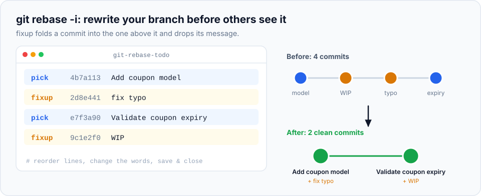

Real work is messy. While building a feature you'll make commits like "WIP", "fix typo", "actually
fix it" and "address review comments". That's fine while you work. But before your branch is
reviewed and merged, you can **edit those commits into a clean story** that's easy to review and easy
to understand later. That's **interactive rebase**.

> **In this chapter you'll learn**
> - What interactive rebase is and when it's safe to use
> - How to read and edit the "todo list"
> - All the main actions: `pick`, `reword`, `squash`, `fixup`, `drop`, `edit`, and reordering
> - How to split one commit into two
> - The `--fixup` + `--autosquash` workflow for review feedback
> - How to run tests on every commit, and how to back out
>
> **Prerequisites:** [chapter 18](../18-rebase/index.md) (and its golden rule). **Time:** 50 minutes.

## Before and after

Here's a typical feature branch before cleanup:

```text
7331b7a Validate coupon expiry
58e86cd fix typo
b66cdc7 WIP
879dcb7 Add coupon model
```

"fix typo" corrects the coupon model, and "WIP" was the first half of the validation. A reviewer
reading these four commits sees half-finished work and corrections. After a two-minute interactive
rebase:

```text
b370f39 Validate coupon expiry
df09d56 Add coupon model
```

Two commits, each complete and meaningful. Same final code.

> **When is it safe?** Interactive rebase rewrites commits, so the [golden rule](../18-rebase/index.md#the-golden-rule)
> applies: only on commits nobody else has. The typical moment is **before opening a pull request**,
> or on your own PR branch before merging (followed by `git push --force-with-lease`).

## How it works

```bash
git rebase -i <base>
```

`-i` means **interactive**. `<base>` is the commit **just before** the first one you want to edit:

| Command | Lets you edit |
| --- | --- |
| `git rebase -i main` | Every commit on your branch since it split from `main` (most common) |
| `git rebase -i HEAD~3` | The last 3 commits |
| `git rebase -i <hash>` | Every commit after `<hash>` |

Git opens your editor with a **todo list**: one line per commit, **oldest first** (the opposite of
`git log`!):

```text
pick 879dcb7 Add coupon model
pick b66cdc7 WIP
pick 58e86cd fix typo
pick 7331b7a Validate coupon expiry

# Rebase e01a02e..7331b7a onto e01a02e (4 commands)
#
# Commands:
# p, pick <commit> = use commit
# r, reword <commit> = use commit, but edit the commit message
# e, edit <commit> = use commit, but stop for amending
# s, squash <commit> = use commit, but meld into previous commit
# f, fixup [-C | -c] <commit> = like "squash" but keep only the previous
#                    commit's log message, unless -C is used...
# d, drop <commit> = remove commit
# ...
# These lines can be re-ordered; they are executed from top to bottom.
#
# If you remove a line here THAT COMMIT WILL BE LOST.
```

You edit this list (change the first word of a line, move lines up or down), **save and close** the
editor. Git then replays the commits from top to bottom, following your instructions.

## The actions

| Action | Short | What it does | Typical use |
| --- | --- | --- | --- |
| `pick` | `p` | Keep the commit as is | Default |
| `reword` | `r` | Keep the changes, edit the message (Git opens the editor) | Fix a vague or misspelt message |
| `squash` | `s` | Combine into the commit **above**, and let you write a combined message | Merge two meaningful steps into one |
| `fixup` | `f` | Combine into the commit **above**, discard this commit's message | Fold "fix typo" into the commit it fixes |
| `drop` | `d` | Delete the commit (or just delete the line) | Remove debug or experimental commits |
| `edit` | `e` | Stop after this commit so you can change it | Change code in an old commit, or split it |
| *move a line* | — | Change the order of commits | Put related commits next to each other |



## Hands-on lab, part 1: clean up a branch

### Setup

```bash
cd ~/git-practice && rm -rf coupons && mkdir coupons && cd coupons && git init
echo "<h1>Shop</h1>" > index.html && git add . && git commit -m "Initial shop"
git switch -c feature/coupons
echo "const coupons = {};" > coupon.js && git add . && git commit -m "Add coupon model"
echo "function validate(c) { return c.expiry > Date.now(); }" > validate.js && git add . && git commit -m "WIP"
echo "const coupons = { SAVE10: 10 };" > coupon.js && git commit -am "fix typo"
echo "// expiry is in milliseconds" >> validate.js && git commit -am "Validate coupon expiry"
git log --oneline
```

### Step 1: plan the cleanup

Look at what each commit really does:

| Commit | Touches | Belongs with |
| --- | --- | --- |
| Add coupon model | `coupon.js` | — (keep) |
| WIP | creates `validate.js` | the validation work |
| fix typo | `coupon.js` | **Add coupon model** |
| Validate coupon expiry | `validate.js` | the validation work |

Goal: "fix typo" folded into "Add coupon model"; "WIP" and "Validate coupon expiry" combined into one
commit called "Validate coupon expiry".

### Step 2: start the interactive rebase

```bash
$ git rebase -i main
```

### Step 3: edit the todo list

Change it to this (move "fix typo" up, and change the action words):

```text
pick 879dcb7 Add coupon model
fixup 58e86cd fix typo
reword b66cdc7 WIP
fixup 7331b7a Validate coupon expiry
```

Reading it top to bottom:

1. Use "Add coupon model".
2. **fixup** "fix typo" into it (keep the first message, discard "fix typo").
3. Use "WIP" but **reword** its message.
4. **fixup** "Validate coupon expiry" into it.

Save and close the editor.

### Step 4: reword when asked

Git replays the commits. At the `reword` line it opens the editor showing `WIP`. Replace it with:

```text
Validate coupon expiry
```

Save and close.

```text
Successfully rebased and updated refs/heads/feature/coupons.
```

### Step 5: check the result

```bash
$ git log --oneline
b370f39 Validate coupon expiry
df09d56 Add coupon model
e01a02e Initial shop
$ git show --stat HEAD~1
    Add coupon model

 coupon.js | 1 +
```

Two clean commits. The final code is exactly the same as before; only the way history describes it changed.

> **If it goes wrong:** during the rebase, `git rebase --abort` restores everything. After it
> finished, `git reset --hard ORIG_HEAD` (immediately afterwards) or the reflog
> ([chapter 22](../22-reflog/index.md)) brings back the old commits.

## The professional workflow: `--fixup` and `--autosquash`

Moving lines around in the todo list works, but there's a faster way. When you make a correction,
tell Git **at commit time** which commit it belongs to:

```bash
git commit --fixup <commit>
```

This creates a commit named `fixup! <original message>`. Later, `--autosquash` moves every such
commit under its target and marks it `fixup` **automatically**.

### Hands-on lab, part 2

**Step 1.** You notice the coupon model needs another code. Fix it and commit it as a fixup of
"Add coupon model" (use its hash from your log, or `HEAD~1`):

```bash
$ echo "const coupons = { SAVE10: 10, SAVE20: 20 };" > coupon.js
$ git add coupon.js
$ git commit --fixup HEAD~1
[feature/coupons fdb7343] fixup! Add coupon model
$ git log --oneline
fdb7343 fixup! Add coupon model
b370f39 Validate coupon expiry
df09d56 Add coupon model
```

**Step 2.** Squash it in automatically:

```bash
$ git rebase -i --autosquash main
```

The todo list opens **already arranged**:

```text
pick df09d56 Add coupon model
fixup fdb7343 fixup! Add coupon model
pick b370f39 Validate coupon expiry
```

Just save and close.

```bash
$ git log --oneline
...  Validate coupon expiry
...  Add coupon model
e01a02e Initial shop
```

Make autosquash the default so you never need the flag:

```bash
$ git config --global rebase.autoSquash true
```

> **Real-life scenario:** a reviewer leaves six comments on three different commits of your PR. For
> each fix, run `git commit --fixup <commit-it-belongs-to>` and push, so the reviewer can see exactly
> what changed. Once the PR is approved: `git rebase -i main` (autosquash arranges everything), then
> `git push --force-with-lease`. The final history looks as if you got it right first time.

> **Tip:** can't remember a hash? `git commit --fixup ":/coupon model"` targets the most recent commit
> whose message contains "coupon model".

## Splitting a commit in two

You committed an API change and a UI change together, and want them separate.

```bash
$ git rebase -i main
```

Mark the commit with **`edit`**. Git stops right after applying it:

```text
Stopped at a1b2c3d...  Add export API and button
You can amend the commit now, with
  git commit --amend
Once you are satisfied with your changes, run
  git rebase --continue
```

Undo the commit but keep its changes (a mixed reset from [chapter 17](../17-undoing-changes/index.md)),
then commit them in two parts:

```bash
$ git reset HEAD~1
$ git add api/
$ git commit -m "Add orders export endpoint"
$ git add ui/
$ git commit -m "Add export button to orders page"
$ git rebase --continue
```

## Run a command on every commit: `--exec`

Want to be sure **every** commit on your branch passes the tests (not just the last one)? `--exec`
runs a command after each commit is replayed, and stops if it fails:

```bash
$ git rebase main --exec "npm test"
```

This matters when a team uses "Rebase and merge" on GitHub, where every individual commit lands on
`main`, and for `git bisect` ([chapter 24](../24-bisect/index.md)), which works best when every
commit works.

## When to use interactive rebase

| Situation | Action |
| --- | --- |
| Before opening a PR: messy WIP commits | Squash/fixup into meaningful commits |
| A commit message is vague or wrong (not the last one) | `reword` |
| A debug commit should never have been made | `drop` |
| Review feedback on specific commits | `git commit --fixup` + `--autosquash` |
| One commit mixes two unrelated changes | `edit` + reset + two commits |
| The team squash-merges PRs anyway | Less important: the PR becomes one commit. Still nice for reviewers |
| Commits are already on `main` or shared | ❌ Don't. Use `revert` for mistakes on shared branches |

## Common mistakes

| Mistake | Fix |
| --- | --- |
| Forgetting the todo list is **oldest first** | `squash`/`fixup` merge into the line **above** them. Read top to bottom |
| Deleting a line by accident | That commit is dropped. `git rebase --abort` if still running, otherwise `ORIG_HEAD` / reflog |
| Using `squash` on the first line | Not allowed: there's no earlier commit to combine with. The first line must be `pick`/`reword`/`edit` |
| Rebasing commits that are already on `main` | Use `git rebase -i main` (not a big `HEAD~N`) so only your branch's commits are listed |
| Push rejected after cleanup | Expected: use `git push --force-with-lease` on your own branch |

## Recap

- `git rebase -i <base>` opens a todo list (oldest first) of commits after `<base>`.
- `pick`, `reword`, `squash`, `fixup`, `drop`, `edit`, plus reordering, reshape history.
- `git commit --fixup <commit>` + `rebase.autoSquash true` = corrections land in the right place automatically.
- Split a commit: `edit` → `git reset HEAD~1` → commit in parts → `git rebase --continue`.
- Only rewrite unshared commits; `--abort` and `ORIG_HEAD` are your safety nets.

## Check your understanding

<details>
<summary>1. What's the difference between <code>squash</code> and <code>fixup</code>?</summary>

Both combine a commit into the one above it. `squash` lets you edit a combined message (both messages
are kept as a starting point); `fixup` silently discards the fixup commit's message.
</details>

<details>
<summary>2. Why is the todo list in the opposite order to <code>git log</code>?</summary>

Git replays the commits from top to bottom, so the oldest must come first.
</details>

<details>
<summary>3. Your PR has 12 commits and a reviewer asked for 3 small fixes in different places. What's the cleanest approach?</summary>

Make each fix with `git commit --fixup <commit>`, push for re-review, then `git rebase -i main` with
autosquash and `git push --force-with-lease`.
</details>

**Next:** [stash](../20-stash/index.md): put unfinished work aside without committing it.
