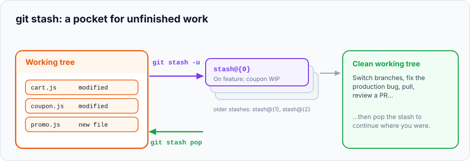

You're in the middle of something: three files changed, nothing working yet. Suddenly you need a
clean working tree, for an urgent fix, to pull, or to review a colleague's branch. You don't want to
commit half-finished work, and you definitely don't want to lose it. **`git stash`** puts your changes
in a safe place and gives you a clean working tree in one command.

> **In this chapter you'll learn**
> - What the stash is and how it works (a stack of saved changes)
> - How to stash, list, inspect, restore and delete stashed work
> - Why new files aren't stashed by default, and how to include them
> - The difference between `pop` and `apply`
> - What to do when restoring a stash conflicts
> - When to stash, and when a commit is the better choice
>
> **Prerequisites:** chapters [5](../05-the-three-areas/index.md) and [10](../10-branches/index.md). **Time:** 30 minutes.

## The problem

Recall from [chapter 10](../10-branches/index.md) that Git refuses to switch branches when your
uncommitted changes would be overwritten:

```text
error: Your local changes to the following files would be overwritten by checkout:
	index.html
Please commit your changes or stash them before you switch branches.
```

And even when Git *does* let you switch, your uncommitted changes come with you, which is rarely what
you want when you're about to work on something unrelated.

## What the stash is

The **stash** is a separate place inside your repository where Git can store uncommitted changes.
`git stash` takes the changes in your working tree and staging area, saves them, and resets your files
to match the last commit. Later, you restore them onto any branch.



Stashes form a **stack**: the newest is `stash@{0}`, the one before it `stash@{1}`, and so on. Each
new stash pushes the others down one place.

## The commands

| Command | What it does |
| --- | --- |
| `git stash` | Stash changes to **tracked** files (staged and unstaged) |
| `git stash -u` | Also stash **untracked** (new) files |
| `git stash -m "message"` | Stash with a description |
| `git stash list` | Show all stashes |
| `git stash show [stash@{n}]` | Summary of what a stash contains |
| `git stash show -p [stash@{n}]` | Full diff of a stash |
| `git stash pop` | Restore the newest stash **and delete it** from the list |
| `git stash apply [stash@{n}]` | Restore a stash but **keep it** in the list |
| `git stash drop [stash@{n}]` | Delete a stash |
| `git stash clear` | Delete **all** stashes ⚠️ |
| `git stash push <file>…` | Stash only specific files |
| `git stash -p` | Choose hunks to stash interactively |
| `git stash branch <name>` | Create a new branch from where the stash was made and restore the stash there |

## Hands-on lab: the urgent-fix interruption

### Setup: you're in the middle of a feature

```bash
cd ~/git-practice && rm -rf stash-lab && mkdir stash-lab && cd stash-lab && git init
printf '<h1>Home</h1>\n<p>Welcome</p>\n' > index.html
echo "body {}" > style.css
git add . && git commit -m "Initial site"

git switch -c feature/dark-mode
echo "body { background: #111; }" > style.css
echo "<button>Toggle theme</button>" >> index.html
echo "const theme = 'dark';" > theme.js
```

```bash
$ git status -s
 M index.html
 M style.css
?? theme.js
```

Two modified files and one **new** file. Now your colleague messages: *"The welcome text needs an
exclamation mark, right now please!"*

### Step 1: see the untracked-file gotcha

```bash
$ git stash
Saved working directory and index state WIP on feature/dark-mode: 6e0ca50 Initial site
$ git status -s
?? theme.js
```

The modified files were stashed, but **`theme.js` is still here**. By default, stash only saves
**tracked** files. New files stay behind and would follow you to the other branch. Bring the stash
back so we can do it properly:

```bash
$ git stash pop
```

### Step 2: stash everything, with a description

```bash
$ git stash -u -m "dark mode: toggle button"
Saved working directory and index state On feature/dark-mode: dark mode: toggle button
$ git status -s
$
$ git stash list
stash@{0}: On feature/dark-mode: dark mode: toggle button
```

`-u` (`--include-untracked`) included `theme.js`. The working tree is clean.

> **Always add `-m`.** Three weeks from now, `stash@{3}: WIP on main: 6e0ca50` tells you nothing;
> `stash@{3}: On feature/dark-mode: dark mode: toggle button` tells you everything.

### Step 3: do the urgent fix

```bash
$ git switch main
$ git switch -c hotfix/welcome
```

Change `Welcome` to `Welcome!` in `index.html`, then:

```bash
$ git commit -am "Fix welcome punctuation"
$ git switch main && git merge hotfix/welcome && git branch -d hotfix/welcome
```

(In a team you'd push the hotfix and open a PR.)

### Step 4: go back and inspect your stash

```bash
$ git switch feature/dark-mode
$ git stash list
stash@{0}: On feature/dark-mode: dark mode: toggle button
$ git stash show
 index.html | 1 +
 style.css  | 2 +-
 2 files changed, 2 insertions(+), 1 deletion(-)
$ git stash show -p --include-untracked
...
+<button>Toggle theme</button>
...
-body {}
+body { background: #111; }
...
+const theme = 'dark';
```

(`git stash show` lists only tracked files; add `--include-untracked` to see new files too.)

### Step 5: restore it

```bash
$ git stash apply
$ git status -s
 M index.html
 M style.css
?? theme.js
$ git stash list
stash@{0}: On feature/dark-mode: dark mode: toggle button
```

Your work is back, exactly as it was. `apply` **kept** the stash in the list. Once you're sure
everything is fine, remove it:

```bash
$ git stash drop
Dropped refs/stash@{0} (f0deb67...)
```

`git stash pop` does both steps (apply + drop) at once. Use `pop` normally, and `apply` when you want
to apply the same stash to several branches, or want to be extra careful.

## When restoring a stash conflicts

If the branch changed in the same places since you stashed, restoring can conflict:

```text
$ git stash pop
CONFLICT (content): Merge conflict in index.html
...
The stash entry is kept in case you need it again.
```

Resolve it like any conflict ([chapter 12](../12-merge-conflicts/index.md)): edit the file, then
`git add` it. Notice that Git **kept the stash** because the pop didn't complete cleanly. Once you've
resolved it, delete it yourself with `git stash drop`.

Alternatively, restore the stash onto a fresh branch created from the exact commit where you stashed,
where it's guaranteed to apply cleanly:

```bash
$ git stash branch draft-paragraph
Switched to a new branch 'draft-paragraph'
...
Dropped refs/stash@{0} (...)
```

## Stashing only some changes

```bash
git stash push -m "just the css" style.css    # only this file
git stash -p                                   # choose hunk by hunk (like git add -p)
git stash --keep-index                          # stash only what's NOT staged; keep staged changes
```

`--keep-index` is useful to test exactly what you're about to commit: stash everything else, run your
tests, then pop.

## Stash or commit?

A stash is convenient but **easy to forget**. Stashes aren't on any branch, aren't pushed to GitHub,
and pile up silently.

| Situation | Better choice |
| --- | --- |
| Quick interruption (minutes): pull, switch to fix something small | **Stash** |
| Moving uncommitted changes to another branch | **Stash**, switch, pop |
| Leaving the work for hours or days | **WIP commit** on your branch: `git commit -am "WIP: dark mode"` |
| You want the work backed up on GitHub | **WIP commit** and push |
| You need to work on two things at the same time | **Worktrees** ([chapter 25](../25-worktrees/index.md)) |

A WIP commit can be undone later with `git reset HEAD~1` (changes come back as unstaged edits) or
folded into a proper commit with interactive rebase.

> **Hack:** `git config --global rebase.autoStash true` makes `git pull --rebase` and `git rebase`
> stash and restore your uncommitted changes automatically.

## Common mistakes

| Mistake | Fix |
| --- | --- |
| New files weren't stashed | Use `git stash -u` |
| Forgot stashes existed, now there are 9 | `git stash list`, inspect with `git stash show -p stash@{n}`, drop what you don't need |
| `git stash clear` or `drop` by mistake | Recoverable for a while: see [chapter 22](../22-reflog/index.md#recovering-a-dropped-stash) |
| Popped onto the wrong branch | `git stash` again (it re-stashes the same changes), switch, pop |
| Conflict when popping | Resolve, `git add`, then `git stash drop` (the stash was kept) |

## Recap

- `git stash` saves uncommitted changes and cleans your working tree; `-u` includes new files; `-m` names it.
- `git stash list` / `show -p` inspect; `pop` restores and deletes; `apply` restores and keeps.
- Conflicting pops keep the stash; resolve, then `drop`.
- For anything longer than a quick interruption, a WIP commit is safer than a stash.

## Check your understanding

<details>
<summary>1. You ran <code>git stash</code> but <code>git status</code> still shows a file. Why?</summary>

It's an untracked (new) file. Plain `git stash` only stores tracked files; use `git stash -u`.
</details>

<details>
<summary>2. What's the difference between <code>git stash pop</code> and <code>git stash apply</code>?</summary>

Both restore the changes. `pop` then deletes the stash from the list (if it applied cleanly); `apply`
keeps it.
</details>

<details>
<summary>3. You'll be away from a half-finished feature for a week. Stash or commit?</summary>

Commit (a WIP commit on your feature branch, ideally pushed). Stashes are easy to forget and aren't
backed up on the remote.
</details>

**Next:** [cherry-pick](../21-cherry-pick/index.md): copy individual commits between branches.
