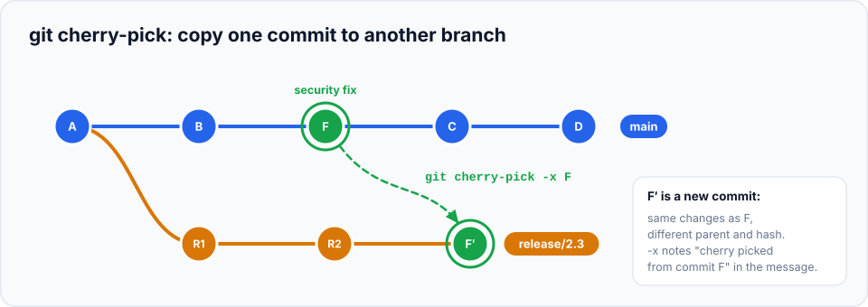

Merging brings over **everything** from another branch. But sometimes you want just **one commit**:
a bug fix that's needed on an older release, or one useful change from a branch that isn't ready yet.
**`git cherry-pick`** copies a single commit (or a few) onto your current branch.

> **In this chapter you'll learn**
> - What cherry-pick does, and why the copy is a *new* commit
> - How to backport a fix to a release branch, recording where it came from (`-x`)
> - How to pick several commits, or combine them without committing (`-n`)
> - Why cherry-picks can conflict, and how to handle it
> - How to rescue commits made on the wrong branch
> - When cherry-picking is the wrong tool
>
> **Prerequisites:** chapters [10](../10-branches/index.md)–[12](../12-merge-conflicts/index.md). **Time:** 35 minutes.

## What cherry-pick does

`git cherry-pick <commit>` takes the **changes** introduced by that commit (its diff compared with
its parent) and applies them to your current branch as a **new commit**, with the same message and
author.



The copy (F′) is a different commit from the original (F): it has a different parent, so a different
hash. Git doesn't link them, so later it can't tell that they contain the same change. Keep that in
mind; it's why cherry-picking shouldn't become your main way of moving work around.

## Hands-on lab, part 1: backport a security fix

**The scenario:** your shop shipped **version 1.0** from a `release/1.0` branch. Development on
`main` has continued with new features. Now a crash is found and fixed on `main`. Customers on 1.0
need the fix, but **not** the unfinished new features.

### Setup

```bash
cd ~/git-practice && rm -rf shop-release && mkdir shop-release && cd shop-release && git init
printf 'function login(user) {\n  return check(user.password);\n}\n' > auth.js
echo "<h1>Shop</h1>" > index.html
git add . && git commit -m "Release 1.0"
git branch release/1.0

echo "<p>New arrivals</p>" >> index.html && git commit -am "Add new arrivals section"
printf 'function login(user) {\n  if (!user) return false;\n  return check(user.password);\n}\n' > auth.js
git commit -am "Fix crash when login is called without a user"
echo "<p>Sale!</p>" >> index.html && git commit -am "Add sale banner"
```

```bash
$ git log --oneline
40715e5 Add sale banner
78ee776 Fix crash when login is called without a user
cb663be Add new arrivals section
64fa79d Release 1.0
```

The fix is `78ee776`, sandwiched between two features. Merging `main` into the release would bring
the features too.

### Step 1: switch to the release branch

```bash
$ git switch release/1.0
$ git log --oneline
64fa79d Release 1.0
```

### Step 2: cherry-pick the fix

Use the fix's hash from **your** log:

```bash
$ git cherry-pick -x 78ee776
[release/1.0 d7dc7e6] Fix crash when login is called without a user
 1 file changed, 1 insertion(+)
```

### Step 3: verify

```bash
$ git log --oneline
d7dc7e6 Fix crash when login is called without a user
64fa79d Release 1.0
$ cat auth.js
function login(user) {
  if (!user) return false;
  return check(user.password);
}
$ cat index.html
<h1>Shop</h1>
```

The fix is in; the new features aren't. Look at the full message:

```bash
$ git log -1
commit d7dc7e6...
    Fix crash when login is called without a user

    (cherry picked from commit 78ee776649cd4ff6b7873fbb00d3f7c6634600f4)
```

That last line was added by **`-x`**. It records where the copy came from, so anyone can trace the
backport back to the original fix. Always use `-x` when picking from a public branch.

## Hands-on lab, part 2: when a cherry-pick conflicts

A commit's changes are a diff against **its parent**. If your branch looks different around those
lines, the diff may not apply cleanly. Let's try to pick only the sale banner onto the release:

```bash
$ git cherry-pick 40715e5
Auto-merging index.html
CONFLICT (content): Merge conflict in index.html
error: could not apply 40715e5... Add sale banner
hint: After resolving the conflicts, mark them with
hint: "git add/rm <pathspec>", then run
hint: "git cherry-pick --continue".
hint: You can instead skip this commit with "git cherry-pick --skip".
hint: To abort and get back to the state before "git cherry-pick",
hint: run "git cherry-pick --abort".
$ cat index.html
<h1>Shop</h1>
<<<<<<< HEAD
=======
<p>New arrivals</p>
<p>Sale!</p>
>>>>>>> 40715e5 (Add sale banner)
```

Why? The sale banner was added **after** the "New arrivals" line, which doesn't exist on the release
branch. The commit **depends on** an earlier commit. You have three choices:

| Choice | Command |
| --- | --- |
| Resolve it (keep only what you want), then continue | edit, `git add index.html`, `git cherry-pick --continue` |
| Skip this commit | `git cherry-pick --skip` |
| Cancel the cherry-pick | `git cherry-pick --abort` |

Let's cancel:

```bash
$ git cherry-pick --abort
$ git status -s
$
```

> **Lesson:** cherry-pick works best for **self-contained** commits, like a focused bug fix. That's
> one more reason to keep commits small and focused ([chapter 6](../06-staging-and-committing-well/index.md)).

## Picking several commits

```bash
git cherry-pick A B C        # these three commits, in this order
git cherry-pick A..C         # every commit after A, up to and including C
git cherry-pick A^..C        # same, but including A
git cherry-pick -n A B       # apply both, stage the result, don't commit (combine into one)
```

| Option | Meaning |
| --- | --- |
| `-x` | Add "(cherry picked from commit …)" to the message |
| `-n` / `--no-commit` | Apply the changes but don't commit, so you can combine or edit first |
| `-e` / `--edit` | Edit the message before committing |
| `--continue` / `--skip` / `--abort` | Drive a cherry-pick that stopped on a conflict |

## Real-life scenario: committed on the wrong branch

You made two commits on `main` that should have been on a feature branch. Nothing is pushed yet.
**If the commits are at the tip of the branch, you don't even need cherry-pick:**

```bash
$ git log --oneline -3
efdc424 Link to cart
448d4ab Add cart page
40715e5 Add sale banner

$ git branch feature/cart          # 1. a new branch, pointing at the same commits
$ git reset --hard HEAD~2          # 2. move main back two commits
$ git switch feature/cart          # 3. continue on the feature branch
$ git log --oneline -3
efdc424 Link to cart
448d4ab Add cart page
40715e5 Add sale banner
```

`main` no longer has them; `feature/cart` does. Nothing was copied.

**Use cherry-pick when the feature branch already exists** and has moved on:

```bash
git switch feature/cart
git cherry-pick 448d4ab efdc424
git switch main
git reset --hard HEAD~2            # only if these commits are NOT pushed
```

## When to use cherry-pick

| ✅ Good uses | ❌ Better alternatives exist |
| --- | --- |
| Backporting a bug/security fix to a release branch | Moving a whole feature between branches → **merge** |
| Taking one ready commit out of an unfinished branch | Keeping two long-lived branches in sync → **merge** regularly |
| Rescuing commits from the wrong branch | Updating your branch with `main` → **merge** or **rebase** |
| Recovering a commit found in the reflog | Undoing a commit → **revert** |

Regular cherry-picking between long-lived branches creates **duplicate commits** (same change,
different hashes). When those branches are later merged, Git may report confusing conflicts.

## Common mistakes

| Mistake | Fix |
| --- | --- |
| Picking a commit that depends on earlier ones | Pick the dependencies too (in order), or resolve the conflict by hand |
| Forgetting `-x` on a backport | `git commit --amend` and add the "(cherry picked from commit …)" line yourself |
| Cherry-picking a merge commit | Needs `-m 1`; usually you should pick the individual commits instead |
| Losing track of which fixes were backported | Use `-x`; `git log --grep="cherry picked from"` finds them |

## Recap

- `git cherry-pick <commit>` copies one commit's changes onto the current branch as a new commit.
- `-x` records the source commit; `-n` applies without committing; ranges use `A..C` / `A^..C`.
- Conflicts happen when the commit depends on code your branch doesn't have: `--continue`, `--skip` or `--abort`.
- Great for backports and rescues; use merge or rebase to move whole branches.

## Check your understanding

<details>
<summary>1. Why does the cherry-picked commit have a different hash from the original?</summary>

It has a different parent (the tip of your current branch), and a commit's hash includes its parent.
</details>

<details>
<summary>2. A fix landed on <code>main</code> and must go to <code>release/2.3</code> without the other new features. Which command?</summary>

`git switch release/2.3` then `git cherry-pick -x <fix-commit>`.
</details>

<details>
<summary>3. Your cherry-pick conflicts because the commit builds on an earlier feature commit. What are your options?</summary>

Pick the earlier commit first (if it's wanted), resolve the conflict manually, or abort with
`git cherry-pick --abort`.
</details>

**Next:** [reflog](../22-reflog/index.md): Git's safety net for recovering "lost" commits.
