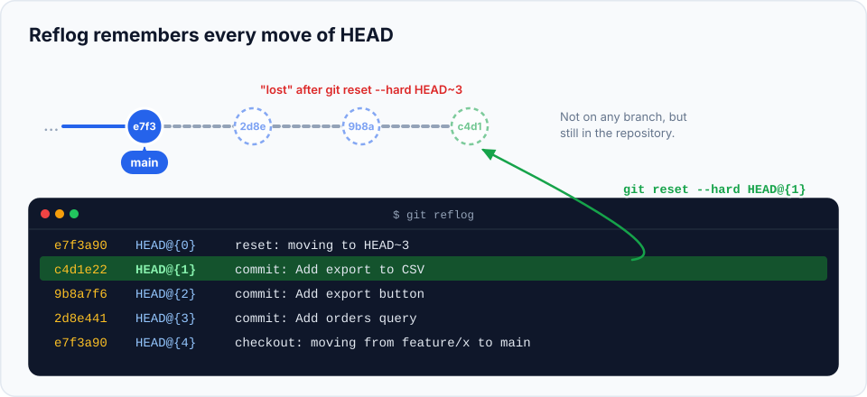

Here's the most reassuring fact in this whole series: **once something has been committed, it's very
hard to lose it in Git.** A `reset --hard`, a rebase gone wrong, a deleted branch: in each case the
commits are still inside your repository. They're just not on any branch anymore, so `git log` doesn't
show them. The **reflog** is how you find them again.

> **In this chapter you'll learn**
> - What the reflog records, and how to read it
> - How to undo a `reset --hard`, a bad rebase or a merge
> - How to restore a deleted branch
> - How to rescue commits made in detached HEAD
> - How to recover a dropped stash
> - What the reflog **can't** save, and how long it keeps things
>
> **Prerequisites:** chapters [10](../10-branches/index.md) and [17](../17-undoing-changes/index.md). **Time:** 35 minutes.

## What is the reflog?

Every time **`HEAD` moves** (you commit, switch branches, reset, rebase, merge, pull, amend,
cherry-pick), Git writes a line in a private journal called the **reference log**, or **reflog**.



Key facts:

- It's **local**: only on your computer, never pushed or shared.
- It records **where HEAD was**, so it remembers commits even after no branch points to them.
- Entries are kept for **90 days** by default (30 days for commits no longer on any branch).

## Reading the reflog

```bash
$ git reflog
a90bd20 HEAD@{0}: reset: moving to HEAD~3
3ba822c HEAD@{1}: commit: Add export to CSV
db4f886 HEAD@{2}: commit: Add export button
14b5d40 HEAD@{3}: commit: Add orders query
a90bd20 HEAD@{4}: commit (initial): Add orders page
```

Read it **top-down, newest first**, like a diary of what you did:

| Part | Meaning |
| --- | --- |
| `a90bd20` | The commit HEAD pointed to after this action |
| `HEAD@{0}` | "Where HEAD is now"; `HEAD@{1}` = where it was one move ago, and so on |
| `reset: moving to HEAD~3` | What happened |

Any `HEAD@{n}` can be used wherever Git expects a commit: `git show HEAD@{2}`,
`git reset --hard HEAD@{1}`, `git branch rescue HEAD@{3}`.

## Hands-on lab: lose things on purpose, then get them back

### Setup

```bash
cd ~/git-practice && rm -rf reflog-lab && mkdir reflog-lab && cd reflog-lab && git init
echo "<h1>Orders</h1>" > orders.html && git add . && git commit -m "Add orders page"
echo "<table></table>" >> orders.html && git commit -am "Add orders query"
echo "<button>Export</button>" >> orders.html && git commit -am "Add export button"
echo "<script>exportCsv()</script>" >> orders.html && git commit -am "Add export to CSV"
git log --oneline
```

### Rescue 1: undo a `reset --hard`

You meant to drop one commit, but typed `HEAD~3`:

```bash
$ git reset --hard HEAD~3
HEAD is now at a90bd20 Add orders page
$ git log --oneline
a90bd20 Add orders page
```

Three commits of work seem gone. Don't panic. Look at the reflog:

```bash
$ git reflog
a90bd20 HEAD@{0}: reset: moving to HEAD~3
3ba822c HEAD@{1}: commit: Add export to CSV
...
```

`HEAD@{1}`, the position just before the reset, is the commit you want:

```bash
$ git reset --hard HEAD@{1}
HEAD is now at 3ba822c Add export to CSV
$ git log --oneline
3ba822c Add export to CSV
db4f886 Add export button
14b5d40 Add orders query
a90bd20 Add orders page
```

All three commits are back. (`git reset --hard 3ba822c` works just as well, using the hash.)

### Rescue 2: restore a deleted branch

```bash
$ git switch -c feature/search
$ echo "<h1>Search</h1>" > search.html && git add . && git commit -m "Add search page"
$ git switch main
$ git branch -D feature/search
Deleted branch feature/search (was c660d58).
```

The unmerged work looks lost. Git printed the hash (`was c660d58`), but if you missed it, search the
reflog for the branch name:

```bash
$ git reflog | grep search
3ba822c HEAD@{0}: checkout: moving from feature/search to main
c660d58 HEAD@{1}: commit: Add search page
3ba822c HEAD@{2}: checkout: moving from main to feature/search
```

The last commit you made on that branch was `c660d58`. Recreate the branch there:

```bash
$ git branch feature/search c660d58
$ git log --oneline feature/search -1
c660d58 Add search page
```

The branch is back, with all its history.

### Rescue 3: undo a rebase (or merge) that went wrong

A rebase that produced a mess can be undone by finding the entry from **just before** it started:

```bash
$ git reflog
3f2a1b0 HEAD@{0}: rebase (finish): returning to refs/heads/feature/x
...
9e8d7c6 HEAD@{5}: rebase (start): checkout main
8c9d0e1 HEAD@{6}: commit: Validate coupon expiry        ← the state before the rebase

$ git reset --hard HEAD@{6}
```

Shortcut: right after a rebase, merge or reset, **`ORIG_HEAD`** points to where you were:

```bash
$ git reset --hard ORIG_HEAD
```

(Only the most recent such operation is remembered in `ORIG_HEAD`; the reflog remembers them all.)

### Rescue 4: commits made in detached HEAD

When you leave detached HEAD with commits behind, Git warns you and prints their hash
([chapter 10](../10-branches/index.md#detached-head)):

```text
Warning: you are leaving 1 commit behind, not connected to
any of your branches:

  c5af063 Experiment
```

Create a branch at that hash: `git branch experiment c5af063`. Missed the warning? It's in the reflog
as a `commit:` entry right before a `checkout: moving from …` line.

### Recovering a dropped stash

Stashes are stored as commits too. If you dropped or cleared one by mistake:

```bash
$ echo "draft" > notes.txt && git add notes.txt && git stash -m "important draft"
$ git stash drop
Dropped refs/stash@{0} (adb0f8631e42f28c4daabd76f5b16b236c89a28c)
```

If you still see the `Dropped … (hash)` line, simply apply that hash:

```bash
$ git stash apply adb0f86
```

If not, ask Git for commits that nothing points to anymore:

```bash
$ git fsck --unreachable | grep commit
unreachable commit e59a854fd3a3165d3937a4c6400fe9671e52fd54
unreachable commit adb0f8631e42f28c4daabd76f5b16b236c89a28c
```

Inspect each candidate with `git show <hash>` until you find your stash (its message starts with
"On <branch>:" or "WIP on <branch>:"), then `git stash apply <hash>`.

## More reflog tricks

| Command | Shows |
| --- | --- |
| `git reflog show feature/search` | The history of one branch's pointer, not HEAD |
| `git log -g --oneline` | The reflog in `git log` format |
| `git show main@{yesterday}` | Where `main` was yesterday |
| `git diff main@{2.hours.ago} main` | What changed on `main` in the last two hours |
| `git reflog --date=iso` | Reflog with timestamps |

## What the reflog can't save

| ✅ Recoverable | ❌ Not recoverable |
| --- | --- |
| Commits removed by `reset`, `rebase`, `amend` | Uncommitted edits discarded by `reset --hard`, `restore`, `checkout --` |
| Deleted branches | Untracked files deleted by `git clean` |
| Commits left in detached HEAD | Work that only existed on someone else's computer (the reflog is local) |
| Dropped stashes (via `fsck`) | Commits whose reflog entries expired and were cleaned up by `git gc` (after ~30–90 days) |

> **The lesson of this chapter: commit early, commit often**, even as "WIP". A committed mistake can
> be undone in seconds. An uncommitted one can be gone forever. You can always tidy commits up later
> with [interactive rebase](../19-interactive-rebase/index.md).

## When to reach for the reflog

| Situation | Steps |
| --- | --- |
| "My commits disappeared after a reset" | `git reflog` → `git reset --hard HEAD@{n}` |
| "The rebase made a mess" | `git reset --hard ORIG_HEAD` right away, or find the pre-rebase entry in the reflog |
| "I deleted the wrong branch" | Hash from the delete message or `git reflog` → `git branch <name> <hash>` |
| "I lost a stash" | Hash from the drop message, or `git fsck --unreachable` → `git stash apply <hash>` |
| "What did I do an hour ago?" | `git reflog --date=relative` |

## Common mistakes

| Mistake | Fix |
| --- | --- |
| Looking for lost commits with `git log` | `git log` shows only what's reachable from branches. Use `git reflog` |
| Recovering to the wrong `HEAD@{n}` | Run `git show HEAD@{n}` before resetting; if you pick wrong, the reflog has a new entry for that reset too, so just reset again |
| Expecting a teammate's lost commits in your reflog | Each clone has its own reflog; they must check theirs |

## Recap

- The **reflog** records every position `HEAD` has had, on your machine, for up to 90 days.
- `git reflog` → find the entry before the mistake → `git reset --hard HEAD@{n}` (or `git branch <name> <hash>`).
- `ORIG_HEAD` quickly undoes the last reset, rebase or merge.
- Dropped stashes can be found with `git fsck --unreachable`.
- Committed work is recoverable; uncommitted work is not. Commit often.

## Check your understanding

<details>
<summary>1. After <code>git reset --hard HEAD~2</code>, <code>git log</code> doesn't show your last two commits. Are they deleted?</summary>

No. They're still in the repository and listed in `git reflog`. `git reset --hard HEAD@{1}` brings
them back.
</details>

<details>
<summary>2. Can you use your reflog to recover a commit your colleague lost on their laptop?</summary>

No. The reflog is local. They need to check their own reflog (unless the commit was pushed or fetched
somewhere you have it).
</details>

<details>
<summary>3. You discarded uncommitted edits with <code>git restore</code>. Can the reflog help?</summary>

No. Those edits were never committed, so Git never stored them.
</details>

**Next section:** [under the hood](../23-git-internals/index.md): how Git stores everything.
