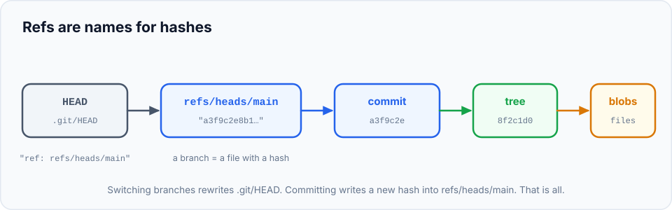

You can use Git for years without reading this chapter. But spending forty minutes inside the `.git`
folder makes branches, `HEAD`, rebasing, the reflog and detached HEAD stop being abstract ideas: you'll
**see** exactly what they are. And it's surprisingly simple. Git is basically **a database of four
kinds of objects, plus a few text files that point to them.**

> **In this chapter you'll learn**
> - What's inside the `.git` folder
> - The four object types: **blob**, **tree**, **commit** and **tag**
> - How content-addressing (hashes) gives Git deduplication and tamper-evidence
> - What branches and `HEAD` physically are
> - How to inspect any object with `git cat-file`, and useful "plumbing" commands for scripts
> - Why `.git` stays small (packfiles)
>
> **Prerequisites:** chapters [1](../01-what-is-version-control/index.md) to [10](../10-branches/index.md). **Time:** 40 minutes.

## Inside `.git`

| Path | What it is |
| --- | --- |
| `objects/` | **The database**: every version of every file, every folder listing, every commit |
| `refs/heads/` | Your **branches**: one tiny file each, containing a commit hash |
| `refs/tags/` | Tags |
| `refs/remotes/` | Remote-tracking branches like `origin/main` |
| `HEAD` | Which branch you're on |
| `index` | The **staging area** (a binary file) |
| `logs/` | The **reflog** ([chapter 22](../22-reflog/index.md)) |
| `config` | Repository-level settings |
| `hooks/` | Scripts Git can run automatically ([chapter 27](../27-hooks/index.md)) |

## The four object types

Everything Git stores in `objects/` is one of four types, and every object is saved under **the hash
of its own content**:

; trees point to blobs (file contents) and other trees.")

| Object | Stores | Think of it as |
| --- | --- | --- |
| **blob** | The **contents** of one file. No name, no permissions, just the bytes | A file's content |
| **tree** | A list of entries: name + type + hash, for files (blobs) and sub-folders (trees) | A folder |
| **commit** | A pointer to the top-level tree, the parent commit(s), author, committer, date and message | A snapshot + its metadata |
| **tag** | An annotated tag: the object it labels, tag name, tagger, message ([chapter 26](../26-tags-and-releases/index.md)) | A named release |

Notice that **a blob has no filename**. Names live in trees. This has two big consequences:

- Two identical files anywhere in the project, in any commit, are stored **once**.
- Renaming a file doesn't store its content again; only the tree changes.

## Hands-on lab: watch Git build its database

### Step 1: an empty repository has no objects

```bash
$ cd ~/git-practice && rm -rf internals && mkdir internals && cd internals && git init
$ find .git/objects -type f | wc -l
       0
```

### Step 2: a hash depends only on content

```bash
$ echo "hello" | git hash-object --stdin
ce013625030ba8dba906f756967f9e9ca394464a
```

`git hash-object` calculates the hash Git would give this content. Run it on any computer in the world:
same content, same hash. Now create a file with the same content:

```bash
$ echo "hello" > greeting.txt
$ git hash-object greeting.txt
ce013625030ba8dba906f756967f9e9ca394464a
```

Identical. The filename doesn't matter, only the content.

### Step 3: `git add` creates a blob

```bash
$ git add greeting.txt
$ find .git/objects -type f
.git/objects/ce/013625030ba8dba906f756967f9e9ca394464a
```

Staging the file **stored it in the database**: an object whose name is its hash (the first two
characters become a folder name, to keep folders small). Inspect it with `git cat-file`:

```bash
$ git cat-file -t ce01362         # -t = type
blob
$ git cat-file -p ce01362         # -p = pretty-print the content
hello
```

> This is why staged changes are safe from `git restore` but unstaged ones aren't: `git add` writes the
> content into Git's database.

### Step 4: commit, and count the objects

Add a sub-folder, and a second file with the same content as the first:

```bash
$ mkdir src && echo "console.log('hi')" > src/app.js
$ cp greeting.txt copy.txt
$ git add . && git commit -m "First commit"
$ find .git/objects -type f | wc -l
       5
```

Three files, but only **5** objects. Let's see why.

### Step 5: walk from commit to files

Start at the commit:

```bash
$ git cat-file -p HEAD
tree a577e17c4a0fe2b03e5f9c6e530212ea024d4fa8
author Asha Rao <asha@example.com> 1791693000 +0530
committer Asha Rao <asha@example.com> 1791693000 +0530

First commit
```

A commit is just text: a pointer to a **tree**, the author and committer (with a Unix timestamp and
time zone) and the message. No `parent` line, because it's the first commit. Follow the tree:

```bash
$ git cat-file -p HEAD^{tree}
100644 blob ce013625030ba8dba906f756967f9e9ca394464a	copy.txt
100644 blob ce013625030ba8dba906f756967f9e9ca394464a	greeting.txt
040000 tree d33487c9fd106a74324bf7ad52fdafb3efcdd4a2	src
```

(`HEAD^{tree}` means "the tree of the HEAD commit".) Look closely: **`copy.txt` and `greeting.txt`
point to the same blob**. Two files, one stored object: deduplication in action.

The five objects are: 1 commit + 1 root tree + 1 `src` tree + 2 blobs (`hello` and `app.js`).

`git ls-tree -r` lists every file in a commit, recursing into folders:

```bash
$ git ls-tree -r HEAD
100644 blob ce013625030ba8dba906f756967f9e9ca394464a	copy.txt
100644 blob ce013625030ba8dba906f756967f9e9ca394464a	greeting.txt
100644 blob 6687898e2a0fe2da282efab6b5f7f38b7f788f56	src/app.js
```

(`100644` = normal file, `100755` = executable, `040000` = folder.)

### Step 6: a second commit reuses what didn't change

```bash
$ echo "bye" >> greeting.txt && git commit -am "Second commit"
$ git cat-file -p HEAD
tree b7aae0c8bea7149143d8a5267739322de5a71d83
parent 6341474b11dc84f4678dddff927953c5c2af82dd
...
Second commit
```

Now there's a **`parent`** line: that's the link that forms history. Only three new objects were
created: the new `greeting.txt` blob, a new root tree, and the commit. The `src` tree and its blob
didn't change, so the new tree simply points to the existing ones. That's the "snapshots that reuse
unchanged files" idea from [chapter 1](../01-what-is-version-control/index.md), made concrete.

## Hashes make history tamper-evident

Because every object's name is the hash of its content:

- Change one byte in a file → its blob hash changes → the tree listing it changes → the commit
  pointing to that tree changes → **every later commit changes** (each includes its parent's hash).

So a single commit hash vouches for the **entire history** behind it. Anyone holding that hash can
detect if anything earlier was altered. It's also why rewriting history (amend, rebase) always produces
new hashes.

## Refs: human-friendly names for hashes

Hashes are unreadable, so Git has **refs**: small files that contain a hash.

```bash
$ cat .git/refs/heads/main
6341474b11dc84f4678dddff927953c5c2af82dd
$ cat .git/HEAD
ref: refs/heads/main
```

There it is. **A branch is a 41-byte text file containing a commit hash.** `HEAD` is a text file
pointing to that branch. Committing writes a new hash into the branch file; switching branches rewrites
`HEAD`.



Now you can explain, in one sentence each:

| Concept | What it is physically |
| --- | --- |
| A branch | A file in `refs/heads/` holding a commit hash |
| `HEAD` | A file saying which branch (or, if detached, which commit) you're on |
| Detached HEAD | `.git/HEAD` contains a hash instead of `ref: refs/heads/...` |
| Creating a branch | Writing one small file; that's why it's instant |
| `git reset --hard <c>` | Writing `<c>` into the current branch's file (and updating the index and files) |
| A "lost" commit | An object still in `objects/` that no ref points to |
| `origin/main` | A file in `refs/remotes/origin/` updated by fetch |

> Some refs are packed into a single `.git/packed-refs` file for speed, so don't be surprised if a
> branch file seems missing. `git rev-parse <name>` always gives the right hash.

## Plumbing commands: useful in scripts

Git has two layers of commands: **porcelain** (the friendly ones you use daily: `add`, `commit`, `log`)
and **plumbing** (low-level building blocks with stable output). A few plumbing commands are handy:

```bash
$ git rev-parse HEAD                  # full hash of any name
6341474b11dc84f4678dddff927953c5c2af82dd
$ git rev-parse --short HEAD          # short hash, e.g. to tag a Docker image in CI
6341474
$ git rev-parse --abbrev-ref HEAD     # current branch name, e.g. in scripts and prompts
main
$ git cat-file -t <hash>              # object type
$ git ls-files                        # all tracked files
$ git count-objects -vH               # size of the object database
```

## Packfiles: why `.git` stays small

New objects are stored individually ("loose objects"), compressed. Periodically Git **packs** them into
a single **packfile**, storing similar objects as **deltas** (differences) from each other:

```bash
$ git count-objects -vH
count: 8
size: 32.00 KiB
in-pack: 0
$ git gc
$ git count-objects -vH
count: 0
in-pack: 8
packs: 1
size-pack: 1.80 KiB
```

32 KiB of loose objects became a 1.8 KiB pack. Git runs this automatically (`git gc --auto`) when
loose objects pile up, and when you clone, everything arrives already packed. For large repositories,
`git maintenance start` schedules this in the background.

## When does knowing this help?

| Situation | How internals help |
| --- | --- |
| Something "disappeared" | You know commits are objects that stay until garbage-collected → reflog / `fsck` |
| Branching feels heavy | It's a 41-byte file. Make as many as you like |
| Understanding rebase/amend | New content or parents → new hashes → "rewritten history" |
| Writing scripts or CI | `rev-parse`, `ls-files`, `cat-file` give stable, parseable output |
| Big repository | Packfiles, `git gc`, partial clones ([chapter 28](../28-large-repos/index.md)) |

## Common mistakes

| Mistake | Why it's a problem |
| --- | --- |
| Editing files inside `.git` by hand | Easy to corrupt the repository. Use Git commands (`git update-ref`, `git config`) |
| Deleting `.git/objects` to "save space" | Destroys history. Use `git gc` |
| Parsing porcelain output (like `git status`) in scripts | It can change between versions. Use plumbing or `--porcelain` flags |

## Recap

- Git's database holds **blobs** (file contents), **trees** (folders), **commits** and **tags**, each
  stored under the **hash of its content**.
- Identical content is stored once; changing anything changes every hash above it.
- **Branches and HEAD are tiny text files** pointing to commits.
- `git cat-file -p` inspects any object; `rev-parse`, `ls-tree`, `ls-files` are handy for scripts.
- Packfiles compress the database; `git gc` packs it.

## Check your understanding

<details>
<summary>1. Two different files in different folders have identical content. How many blobs are stored?</summary>

One. Blobs are identified by content only; both tree entries point to the same blob.
</details>

<details>
<summary>2. What does <code>.git/HEAD</code> contain normally, and in detached HEAD?</summary>

Normally `ref: refs/heads/<branch>`. In detached HEAD, a commit hash directly.
</details>

<details>
<summary>3. Why can't you change an old commit without changing the hashes of all later commits?</summary>

Each commit's content includes its parent's hash. Changing a commit changes its hash, so its child's
content (the parent line) changes, so the child's hash changes, and so on.
</details>

**Next:** [find the bug-introducing commit with bisect](../24-bisect/index.md).
