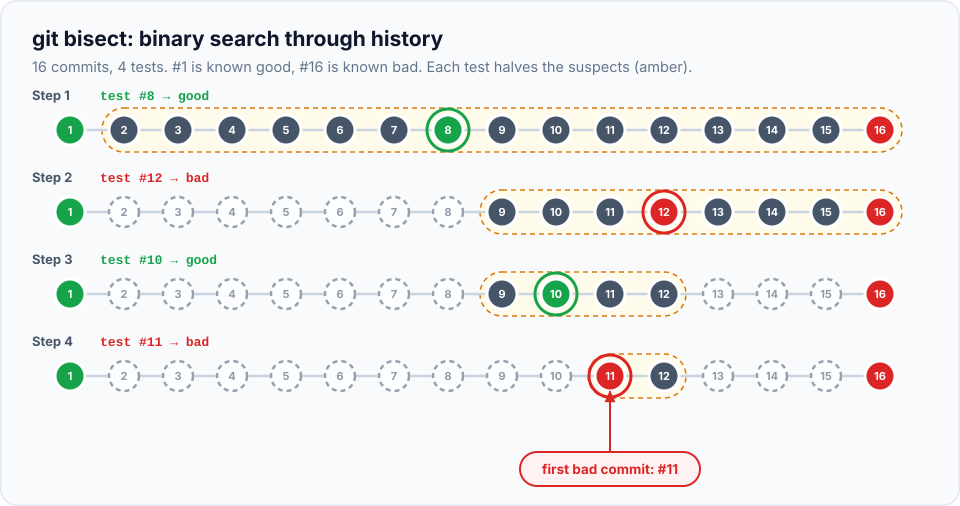

> **Real-life scenario:** last month's release worked. Today, the "Contact us" link on the home page is
> broken. Hundreds of commits landed in between, from many people. Nobody knows which one did it.

You could check out commits one at a time until you find it, which could take all day. Or you could let
Git do a **binary search** with `git bisect`: test the commit in the middle, discard the half that's
clearly fine (or clearly broken), and repeat. Each test **halves** the suspects.

> **In this chapter you'll learn**
> - How binary search finds a bad commit in very few steps
> - How to run a manual bisect: `start`, `good`, `bad`, `reset`
> - How to skip commits you can't test
> - How to automate the whole search with `git bisect run` and a script
> - Tips for bisecting real-world projects
>
> **Prerequisites:** chapters [8](../08-viewing-history/index.md) and [10](../10-branches/index.md)
> (detached HEAD). **Time:** 35 minutes.

## Why binary search is so fast



| Commits to search | Tests needed (at most) |
| --- | --- |
| 16 | 4 |
| 100 | 7 |
| 1,000 | 10 |
| 10,000 | 14 |

You need two starting facts:

- a **bad** commit, where the bug exists (usually the latest one), and
- a **good** commit, where it didn't (an older release, last week's commit…).

Git checks out the commit halfway between. You test it and say "good" or "bad". Git halves the range and
repeats, until one commit is left: **the first bad commit**.

## Hands-on lab, part 1: manual bisect

### Setup: a project with a hidden bug

This creates 16 commits. One of them, somewhere in the middle, accidentally breaks the contact link
(it changes "Contact us" to "Contakt"). Copy and paste:

```bash
cd ~/git-practice && rm -rf bisect-lab && mkdir bisect-lab && cd bisect-lab && git init
printf '<h1>Shop</h1>\n<a href="contact.html">Contact us</a>\n' > index.html
git add . && git commit -m "Version 1: home page with contact link"
git tag v1.0
for i in $(seq 2 16); do
  echo "<p>Product $i</p>" >> products.html
  if [ "$i" = 11 ]; then printf '<h1>Shop</h1>\n<a href="contact.html">Contakt</a>\n' > index.html; fi
  git add . && git commit -m "Add product $i"
done
```

(`git tag v1.0` names the first commit "v1.0" so we can refer to it easily. Tags are covered in
[chapter 26](../26-tags-and-releases/index.md).)

Confirm the bug exists now:

```bash
$ grep "Contact us" index.html
$
```

No match: the link text is broken. Our **test** for each commit will be:

```bash
grep -q "Contact us" index.html && echo GOOD || echo BAD
```

It prints `GOOD` if the link is intact, `BAD` otherwise. In a real project, the test might be running
the app, clicking through a page, or running a specific automated test.

### Step 1: start, and mark the known bad and good commits

```bash
$ git bisect start
status: waiting for both good and bad commits
$ git bisect bad                  # the current commit (HEAD) is broken
status: waiting for good commit(s), bad commit known
$ git bisect good v1.0            # this one was fine
Bisecting: 7 revisions left to test after this (roughly 3 steps)
[5d268814c4db1135ad7560968adba30455ac670d] Add product 8
```

Git checked out **commit 8**, in the middle. You're now in detached HEAD at that commit
([chapter 10](../10-branches/index.md#detached-head)). That's expected.

### Step 2: test and report, repeatedly

```bash
$ grep -q "Contact us" index.html && echo GOOD || echo BAD
GOOD
$ git bisect good
Bisecting: 3 revisions left to test after this (roughly 2 steps)
[4b342812c798bbd0b2d24a3425d4fafdf651909b] Add product 12
```

Commit 8 is fine, so the bug is somewhere in 9–16. Git jumped to 12.

```bash
$ grep -q "Contact us" index.html && echo GOOD || echo BAD
BAD
$ git bisect bad
Bisecting: 1 revision left to test after this (roughly 1 step)
[3c2cb50d88c7273fbaf4dbd2ed19f4d47deb4739] Add product 10

$ grep -q "Contact us" index.html && echo GOOD || echo BAD
GOOD
$ git bisect good
Bisecting: 0 revisions left to test after this (roughly 0 steps)
[d5a6ecf1040e915e50c5484baefb36aa9b9efa78] Add product 11

$ grep -q "Contact us" index.html && echo GOOD || echo BAD
BAD
$ git bisect bad
d5a6ecf1040e915e50c5484baefb36aa9b9efa78 is the first bad commit
commit d5a6ecf1040e915e50c5484baefb36aa9b9efa78
Author: Asha Rao <asha@example.com>

    Add product 11

 index.html    | 2 +-
 products.html | 1 +
 2 files changed, 2 insertions(+), 1 deletion(-)
```

**Found it in 4 tests.** "Add product 11" also changed `index.html`, which it shouldn't have. See exactly
what it did:

```bash
$ git show d5a6ecf -- index.html
-<a href="contact.html">Contact us</a>
+<a href="contact.html">Contakt</a>
```

### Step 3: finish

```bash
$ git bisect reset
Switched to branch 'main'
```

**Always run `git bisect reset` at the end.** It ends the bisect session and takes you back to the
branch you started on.

## Useful bisect commands

| Command | When |
| --- | --- |
| `git bisect start [bad] [good]` | Start; you can give both commits right away: `git bisect start HEAD v1.0` |
| `git bisect good` / `git bisect bad` | Report the result for the current commit |
| `git bisect skip` | This commit **can't be tested** (doesn't build, unrelated crash). Git picks a nearby one |
| `git bisect log` | Show the decisions so far (useful if you think you made a mistake) |
| `git bisect visualize` | See the remaining suspects in `git log` / gitk |
| `git bisect reset` | Stop and return to your original branch |

> **Marked a commit wrong?** Save the log (`git bisect log > bisect.txt`), edit out the wrong line, then
> `git bisect reset` and `git bisect replay bisect.txt`.

> **Not hunting a bug?** "good" and "bad" sound odd when you're searching for, say, when something got
> *faster*. Use your own words: `git bisect start --term-old=slow --term-new=fast`, then
> `git bisect slow` / `git bisect fast`.

## Hands-on lab, part 2: let a script do it

If you can write a command that **exits with code 0 when the commit is good** and **non-zero when it's
bad**, Git can run the whole search for you.

### Step 1: write the test script

Save it **outside** the repository, so it isn't affected when Git checks out older commits:

```bash
$ printf '#!/bin/sh\ngrep -q "Contact us" index.html\n' > ../check-contact.sh
$ chmod +x ../check-contact.sh
```

`grep -q` exits with 0 when it finds the text and 1 when it doesn't: exactly the convention bisect needs.
(`chmod +x` makes the script executable.)

### Step 2: run the search

```bash
$ git bisect start HEAD v1.0
$ git bisect run ../check-contact.sh
running  '../check-contact.sh'
Bisecting: 3 revisions left to test after this (roughly 2 steps)
[4b342812...] Add product 12
running  '../check-contact.sh'
...
d5a6ecf1040e915e50c5484baefb36aa9b9efa78 is the first bad commit
...
bisect found first bad commit
$ git bisect reset
```

Same answer, no manual work. On a real project you might run your test suite:

```bash
git bisect run npm test -- contact-link.test.js
```

### Exit codes `git bisect run` understands

| Exit code | Meaning |
| --- | --- |
| `0` | Good |
| `1` to `127` (except 125) | Bad |
| `125` | **Skip**: this commit can't be tested |
| `128` or more | Abort the bisect (something went badly wrong) |

### Real-life tip: a test that didn't exist back then

Usually you write the regression test **now**, so old commits don't contain it. Keep the test and a small
wrapper script outside the repo:

```bash
#!/bin/sh
# ../check.sh: run against whatever commit bisect checked out
npm ci --silent || exit 125           # can't install dependencies? skip this commit
node ../contact-link-test.js          # exit 0 = good, 1 = bad
```

## Tips for real projects

- **Limit the search to the relevant folder:** `git bisect start HEAD v1.0 -- src/checkout/` only
  considers commits that touched that folder.
- **Merge-heavy history:** `git bisect start --first-parent` (Git 2.29+) walks only the main branch's
  merge commits, telling you which **pull request** broke things first.
- **Small commits pay off here.** Bisect points to one commit. If that commit is "Misc changes, 2,000
  lines", you've still got searching to do. Focused commits ([chapter 6](../06-staging-and-committing-well/index.md))
  make bisect precise.
- **Commits that don't build** make bisect harder (lots of `skip`). Another reason every commit should
  leave the project working ([chapter 19](../19-interactive-rebase/index.md#run-a-command-on-every-commit---exec)).

## When to use bisect

| ✅ Use it when | ❌ Not needed when |
| --- | --- |
| You know a good version and a bad version, but not what changed | The error message points directly at the cause |
| Many commits between good and bad | Only one or two commits to check |
| The problem is reproducible with a test you can run on any commit | The bug depends on data or environment you can't recreate for old commits |
| Performance regressions ("it got slow") | — |

## Common mistakes

| Mistake | Fix |
| --- | --- |
| Forgetting `git bisect reset` | You stay in detached HEAD at some old commit. Run `git bisect reset` |
| Test script inside the repository | Older commits don't have it (or have an old version). Keep it outside, e.g. `../check.sh` |
| Uncommitted changes before starting | Bisect checks out other commits; commit or stash first |
| Swapping good/bad by mistake | `git bisect log`, fix, `git bisect replay` |
| Script returns 128+ on a build failure | Exit 125 to skip instead |

## Recap

- `git bisect` binary-searches history: about log₂(n) tests (1,000 commits ≈ 10 tests).
- `start` → `bad` → `good <ref>` → test and mark each commit → `reset`.
- `git bisect skip` for untestable commits; `git bisect log` to review.
- `git bisect run <script>` automates it: exit 0 = good, 1–127 = bad, 125 = skip.

## Check your understanding

<details>
<summary>1. About how many tests does bisect need for 500 commits?</summary>

About 9, since 2⁹ = 512.
</details>

<details>
<summary>2. The commit bisect gives you doesn't compile, so you can't test it. What do you do?</summary>

`git bisect skip`. Git chooses a nearby commit instead (in a script, exit with code 125).
</details>

<details>
<summary>3. Why should the test script for <code>git bisect run</code> live outside the repository?</summary>

Bisect checks out older commits, which may not contain the script, or may contain an older version of it.
</details>

**Next:** [worktrees](../25-worktrees/index.md): several branches checked out at once.
