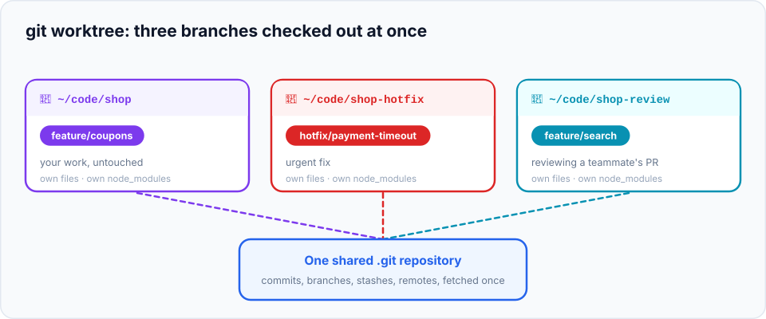

> **Real-life scenario:** you're deep in a feature. The dev server is running, 14 files are modified,
> your test database is set up just right. A teammate asks for an urgent review of their branch. Then a
> production hotfix comes in. The usual routine: stash or commit WIP, switch branch, reinstall
> dependencies, restart the server, do the other task, switch back, unstash, restart again… and hope
> nothing got mixed up.

**Worktrees** remove that routine. One repository can have **several working folders**, each with a
**different branch checked out**, all sharing the same history. Open each in its own editor window and
switch between tasks by switching windows.

> **In this chapter you'll learn**
> - What a worktree is, and how it differs from cloning the repository again
> - How to add, list, remove and clean up worktrees
> - The rules and gotchas (one branch per worktree, ignored files aren't shared)
> - Practical patterns: hotfixes, PR reviews, long-running tasks, side-by-side comparisons
>
> **Prerequisites:** chapters [10](../10-branches/index.md) and [20](../20-stash/index.md). **Time:** 25 minutes.

## What is a worktree?

Until now, each repository had **one** working tree: the folder with your files. `git worktree` lets you
attach **more** working trees to the same repository, each in its own folder:



- The original folder is the **main worktree**; the others are **linked worktrees**.
- All of them share **one** `.git` database: commits, branches, stashes, remotes, configuration.
- A commit made in any worktree is **immediately visible** in all the others (it's the same repository).
- Each worktree has its **own files, its own staging area, and its own `HEAD`**.

### Worktree vs a second clone

| | `git worktree add` | `git clone` again |
| --- | --- | --- |
| History stored | Once (shared) | Twice |
| Create | Instant | Full download |
| Branches, stashes, config | Shared | Separate |
| Fetch | Once, visible everywhere | In each clone separately |
| A commit in one is visible in the other | Immediately | Only after push + fetch |

## The commands

| Task | Command |
| --- | --- |
| Add a worktree for an existing branch | `git worktree add <folder> <branch>` |
| Add a worktree with a **new** branch | `git worktree add <folder> -b <new-branch> <start-point>` |
| Add a worktree at a commit, no branch (detached) | `git worktree add --detach <folder> <commit>` |
| List worktrees | `git worktree list` |
| Remove a worktree (and its folder) | `git worktree remove <folder>` |
| Clean up records of folders you deleted manually | `git worktree prune` |

## Hands-on lab: hotfix and review without touching your work

### Setup: you're in the middle of a feature

```bash
cd ~/git-practice && rm -rf shop shop-hotfix shop-review
mkdir shop && cd shop && git init
echo "<h1>Shop</h1>" > index.html && git add . && git commit -m "Initial shop"
git branch feature/search                        # a teammate's branch, to review later
git switch -c feature/coupons
echo "coupons wip" > coupon.js                   # your uncommitted work in progress
```

### Step 1: create a worktree for the hotfix

The hotfix must start from `main`, on a new branch. Put the worktree **next to** your project folder
(not inside it):

```bash
$ git worktree add ../shop-hotfix -b hotfix/price-text main
Preparing worktree (new branch 'hotfix/price-text')
HEAD is now at e01a02e Initial shop
```

Read it as: *"Add a worktree in the folder `../shop-hotfix`, with a new branch `hotfix/price-text`
starting from `main`."*

### Step 2: create a worktree to review a branch

```bash
$ git worktree add ../shop-review feature/search
Preparing worktree (checking out 'feature/search')
```

### Step 3: see what you have

```bash
$ git worktree list
/Users/asha/git-practice/shop          e01a02e [feature/coupons]
/Users/asha/git-practice/shop-hotfix   e01a02e [hotfix/price-text]
/Users/asha/git-practice/shop-review   e01a02e [feature/search]
```

Three folders, three branches, one repository.

### Step 4: do the hotfix in its own folder

```bash
$ cd ../shop-hotfix
$ git status -s
$
$ git branch --show-current
hotfix/price-text
$ echo "<p>Prices include tax</p>" >> index.html
$ git commit -am "Clarify that prices include tax"
```

The hotfix folder is clean and on its own branch. Your `coupon.js` work isn't here; it's untouched in
the main folder. (In real life, you'd now push the hotfix and open a PR.)

### Step 5: the commit is visible everywhere

```bash
$ cd ../shop
$ git log --oneline hotfix/price-text -1
32f7939 Clarify that prices include tax
$ git status -s
?? coupon.js
```

The commit made in the hotfix worktree is already in the main folder's repository, and your work in
progress is exactly where you left it.

### Step 6: the one-branch rule

```bash
$ git worktree add ../shop-again hotfix/price-text
fatal: 'hotfix/price-text' is already checked out at '/Users/asha/git-practice/shop-hotfix'
```

**A branch can be checked out in only one worktree at a time.** Otherwise two folders could commit to
the same branch and step on each other. If you just want to look at the code, use `--detach`.

### Step 7: clean up

```bash
$ git worktree remove ../shop-review
$ git worktree list
/Users/asha/git-practice/shop          e01a02e [feature/coupons]
/Users/asha/git-practice/shop-hotfix   32f7939 [hotfix/price-text]
```

If you delete a worktree folder by hand instead, Git marks it `prunable`; clean that up with:

```bash
$ rm -rf ../shop-hotfix
$ git worktree prune
```

Removing a worktree doesn't delete its **branch** (or its commits); the branch is still in the repository.
`git worktree remove` refuses if the worktree has uncommitted changes (add `--force` if you're sure).

## Rules and gotchas

- **One branch per worktree** (step 6).
- **Ignored files aren't shared.** Each worktree has its own `node_modules/`, `.env`, build output and
  so on. Run `npm install` (or your setup) in a new worktree, and copy `.env` if needed.
- **Keep worktrees outside the main folder**, as siblings (`../shop-hotfix`). A worktree inside your
  project would show up as a folder in `git status`, editors and search.
- **Each worktree can run its own dev server**: use different ports.

## Real-life patterns

**Review a pull request without disturbing your work:**

```bash
git fetch origin
git worktree add --detach ../review-pr-42 origin/feature/search
cd ../review-pr-42 && npm ci && npm test        # run it, click around, read the code
cd - && git worktree remove ../review-pr-42
```

**Long-running tasks in parallel:** run a slow test suite or a production build in one worktree while you
keep coding in another.

**Compare behaviour side by side:** run `main` on port 3000 and your branch on port 3001 to compare a UI
change or a performance difference.

**Several AI coding agents at once:** give each agent its own worktree and branch, so they never
overwrite each other's files.

> **Hack:** a shell function that creates a worktree named after the branch:
>
> ```bash
> # add to ~/.zshrc or ~/.bashrc
> wt() { git worktree add "../$(basename "$PWD")-${1//\//-}" "$1"; }
> # usage: wt feature/search   →   creates ../shop-feature-search
> ```

## When to use worktrees

| Situation | Best tool |
| --- | --- |
| 2-minute interruption, then back to work | `git stash` ([chapter 20](../20-stash/index.md)) |
| Interruption that needs a running app, dependencies, or takes a while | **Worktree** |
| Reviewing and running someone's branch while keeping yours running | **Worktree** |
| Working on two features in parallel for days | **Worktree** (or just switch branches with clean commits) |
| You need a completely independent copy (different remotes, experiments with config) | A separate clone |

## Common mistakes

| Mistake | Fix |
| --- | --- |
| "Branch is already checked out" | Use the existing worktree (`git worktree list`), or `--detach` |
| App fails in the new worktree | Install dependencies and copy ignored files like `.env` |
| Deleting the folder by hand, then Git still lists it | `git worktree prune` |
| Creating the worktree inside the project folder | Remove it and recreate it as a sibling folder (`../name`) |

## Recap

- `git worktree add <folder> <branch>` checks out another branch in another folder, sharing one repository.
- Commits, branches and stashes are shared; files, staging area and `HEAD` are per worktree.
- One branch can be checked out in only one worktree at a time.
- Remove with `git worktree remove`; clean up deleted folders with `git worktree prune`.

## Check your understanding

<details>
<summary>1. You commit in <code>../shop-hotfix</code>. Do you need to push and fetch to see it from <code>../shop</code>?</summary>

No. Worktrees share one repository, so the commit is immediately available everywhere.
</details>

<details>
<summary>2. Why does Git refuse to check out the same branch in two worktrees?</summary>

Both folders could then commit to the same branch independently, making one folder's files and staging
area out of sync with the branch. Git prevents that.
</details>

<details>
<summary>3. Your app crashes in a new worktree with "module not found". Why?</summary>

Ignored folders like `node_modules/` aren't shared between worktrees. Install dependencies in the new worktree.
</details>

**Next:** [tags, releases and signed commits](../26-tags-and-releases/index.md).
