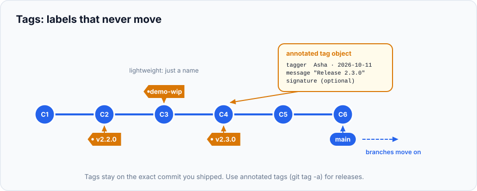

When you ship software, you need to know **exactly which code** went out. "The version from Tuesday
afternoon" isn't good enough when a customer reports a bug in it three months later. **Tags** give
commits permanent, human-friendly names like `v2.3.0`. This chapter also covers **commit signing**, so
nobody can make commits that falsely appear to be yours.

> **In this chapter you'll learn**
> - What a tag is, and how it differs from a branch
> - Lightweight vs annotated tags, and which to use
> - Semantic versioning: what `MAJOR.MINOR.PATCH` means
> - How to push, list, inspect and delete tags
> - How to answer "what's in this release?" and "which releases contain this fix?"
> - How to publish a GitHub Release
> - How to sign commits and tags with your SSH key
>
> **Prerequisites:** chapters [8](../08-viewing-history/index.md) and [14](../14-fetch-pull-push/index.md). **Time:** 40 minutes.

## Tags vs branches

Both are names that point to a commit. The difference is movement:

| | Branch | Tag |
| --- | --- | --- |
| Moves when you commit | ✅ Yes, follows new work | ❌ Never, stays on one commit |
| Purpose | An ongoing line of work | A fixed point: "this is v1.0" |
| Pushed by `git push` | ✅ (the current branch) | ❌ Must be pushed explicitly |



## Lightweight vs annotated tags

| | Lightweight | Annotated |
| --- | --- | --- |
| Create | `git tag v1.0.0` | `git tag -a v1.0.0 -m "First public release"` |
| What's stored | Just a name pointing to a commit (like a branch that doesn't move) | A full **tag object**: tagger, date, message, optional signature |
| Pushed by `--follow-tags` | ❌ | ✅ |
| Use for | Private, temporary bookmarks | **Releases. Always.** |

## Semantic versioning

Most projects name release tags with **semantic versioning**: `v` + **MAJOR.MINOR.PATCH**.

| Increase | When the release… | Example |
| --- | --- | --- |
| **MAJOR** | Breaks compatibility (users must change something) | `v1.4.2` → `v2.0.0` |
| **MINOR** | Adds features, nothing breaks | `v1.4.2` → `v1.5.0` |
| **PATCH** | Only fixes bugs | `v1.4.2` → `v1.4.3` |
| *pre-release* | Isn't final yet | `v2.0.0-beta.1`, `v2.0.0-rc.1` |

The version number then tells users how risky an upgrade is, before they read anything.

## Hands-on lab: tag, push and query releases

### Setup

We'll use a local "server" so you can practise pushing tags ([chapter 13](../13-github-and-remotes/index.md#practise-without-github-a-local-fake-server)):

```bash
cd ~/git-practice && rm -rf releases && mkdir releases && cd releases
git init --bare server/site.git
git clone server/site.git site && cd site
echo "<h1>Site</h1>" > index.html && git add . && git commit -m "Add home page"
echo "<h1>About</h1>" > about.html && git add . && git commit -m "Add about page"
```

### Step 1: create an annotated release tag and a lightweight tag

```bash
$ git tag -a v1.0.0 -m "First public release"
$ git tag demo-for-client
$ git tag
demo-for-client
v1.0.0
```

Both point to the current commit. (To tag an older commit, add its hash: `git tag -a v0.9.0 <hash> -m "..."`.)

### Step 2: see the difference

```bash
$ git show v1.0.0
tag v1.0.0
Tagger: Asha Rao <asha@example.com>
Date:   Sun Oct 11 10:00:00 2026 +0530

First public release

commit 254474a...
    Add about page
...
```

The annotated tag has its own tagger, date and message, followed by the commit it labels. Ask Git what
kind of object each tag is ([chapter 23](../23-git-internals/index.md)):

```bash
$ git cat-file -t v1.0.0
tag
$ git cat-file -t demo-for-client
commit
```

The annotated tag is a real **tag object**; the lightweight tag is just a name for the commit.

### Step 3: keep working, then describe where you are

```bash
$ echo "<p>fixed</p>" >> about.html && git commit -am "Fix typo on about page"
$ echo "<h1>Blog</h1>" > blog.html && git add . && git commit -m "Add blog"
$ git describe
v1.0.0-2-gb6b2281
```

`git describe` reads as: *"2 commits after `v1.0.0`, at commit `b6b2281`"* (the `g` stands for Git).
CI systems often use it as a build version string.

### Step 4: release v1.1.0 and list what's in it

```bash
$ git tag -a v1.1.0 -m "Blog release"
$ git log --oneline v1.0.0..v1.1.0
b6b2281 Add blog
6338409 Fix typo on about page
```

`v1.0.0..v1.1.0` lists the commits in v1.1.0 that weren't in v1.0.0: a ready-made draft of your
release notes.

```bash
$ git diff v1.0.0 v1.1.0 --stat         # files changed between releases
$ git tag -l "v1.*"                     # list tags matching a pattern
v1.0.0
v1.1.0
```

### Step 5: which releases contain a fix?

> **Real-life scenario:** a customer asks "Is the about-page typo fixed in the version I have?"

```bash
$ git tag --contains 6338409
v1.1.0
```

Only v1.1.0 contains that commit. If they're on v1.0.0, they need to upgrade.

### Step 6: push tags (they're not pushed automatically!)

```bash
$ git push
 * [new branch]      main -> main
$ git ls-remote --tags origin
$
```

`git push` sent the branch, but **no tags**. `git ls-remote --tags origin` asks the server which tags
it has: none. Push them explicitly:

```bash
$ git push origin v1.0.0              # one tag
 * [new tag]         v1.0.0 -> v1.0.0
$ git push --follow-tags              # pushes annotated tags that point at pushed commits
 * [new tag]         v1.1.0 -> v1.1.0
```

Notice `demo-for-client` (lightweight) wasn't pushed by `--follow-tags`. That's by design: lightweight
tags are usually private. Make `--follow-tags` automatic:

```bash
$ git config --global push.followTags true
```

> Avoid `git push --tags`: it pushes **every** local tag, including experiments and private bookmarks.

### Step 7: delete a tag

```bash
$ git tag -d demo-for-client                 # local
Deleted tag 'demo-for-client' (was 254474a)
$ git push origin --delete v1.0.0            # on the server
 - [deleted]         v1.0.0
```

> ⚠️ **Don't move or reuse a published release tag.** Users, package managers and CI caches may have
> already fetched it. If `v1.4.0` was broken, release `v1.4.1`.

## GitHub Releases

On GitHub, a **Release** is a tag plus a title, release notes and optional downloadable files (binaries,
zips). Create one on the repository page (**Releases → Draft a new release**) or from the terminal:

```bash
gh release create v1.1.0 --generate-notes                    # notes from merged PRs since the last tag
gh release create v1.1.0 ./dist/app.zip --notes-file CHANGELOG.md
```

`--generate-notes` builds the release notes from pull request titles since the previous release, which
is one more reason to write good PR titles ([chapter 15](../15-pull-requests/index.md)).

## Signed commits: prove it was really you

Git takes the author's name and email from configuration ([chapter 3](../03-configure-git/index.md)),
and **anyone can configure any name and email**. Someone could make commits that appear to come from
you. **Signing** adds a cryptographic signature that proves the commit was made by the holder of your
private key. GitHub shows a **Verified** badge on signed commits.

The easiest way is to sign with an **SSH key** (Git 2.34+), possibly the same one you use to push
([GitHub's SSH guide](https://docs.github.com/en/authentication/connecting-to-github-with-ssh)).

### Step 1: tell Git to sign with your SSH key

If you don't have a key yet: `ssh-keygen -t ed25519 -C "you@example.com"` (press Enter for the defaults).

```bash
$ git config --global gpg.format ssh
$ git config --global user.signingkey ~/.ssh/id_ed25519.pub
$ git config --global commit.gpgsign true      # sign every commit
$ git config --global tag.gpgsign true         # sign every annotated tag
```

(The settings are named `gpg…` for historical reasons: GPG keys were the original signing method.)

### Step 2: let Git verify signatures locally

To check SSH signatures, Git needs to know which keys belong to whom, via an "allowed signers" file:

```bash
$ echo "$(git config user.email) $(cat ~/.ssh/id_ed25519.pub)" >> ~/.ssh/allowed_signers
$ git config --global gpg.ssh.allowedSignersFile ~/.ssh/allowed_signers
```

### Step 3: commit and check

```bash
$ git commit -am "Signed change"
$ git log --show-signature -1
commit 97d6e00...
Good "git" signature for asha@example.com with ED25519 key SHA256:0x3FGgccUg...
Author: Asha Rao <asha@example.com>

    Signed change
```

**"Good signature"**: verified. Signed tags work the same way:

```bash
$ git tag -s v1.2.0 -m "Signed release"
$ git tag -v v1.2.0
Good "git" signature for asha@example.com with ED25519 key SHA256:0x3FGgccUg...
```

### Step 4: tell GitHub about the key

On GitHub: **Settings → SSH and GPG keys → New SSH key**, set **Key type** to **Signing Key**, and paste
your public key (`cat ~/.ssh/id_ed25519.pub`). A key used for both pushing and signing must be added
**twice**, once as each type. Your next pushed commits show **Verified**.

Teams can require signatures on protected branches (**Settings → Rules → Require signed commits**).

## When to use what

| Situation | Do this |
| --- | --- |
| You're releasing a version | `git tag -a vX.Y.Z -m "..."` + push it (or `push.followTags`) |
| A temporary bookmark for yourself | Lightweight tag (don't push it) |
| Writing release notes | `git log --oneline vPREV..vNEW` or `gh release create --generate-notes` |
| "Which versions contain this fix?" | `git tag --contains <commit>` |
| Running an old version to reproduce a bug | `git switch --detach v1.0.0` |
| A published tag points at the wrong commit | Release a new version; don't move the tag |
| Your company or project requires verified commits | SSH signing (4 config lines) |

## Common mistakes

| Mistake | Fix |
| --- | --- |
| Tag exists locally but not on GitHub | Tags aren't pushed by `git push`: `git push origin <tag>` or set `push.followTags true` |
| Using lightweight tags for releases | Use `-a` (annotated) so the release has a tagger, date and message |
| `git push --tags` published junk tags | Delete them remotely: `git push origin --delete <tag>` |
| "No principal matched" when verifying | Set up the allowed signers file (step 2) |
| GitHub shows "Unverified" | Add the key as a **Signing Key**; make sure the commit email matches a verified email on your account |

## Recap

- **Tags** are fixed names for commits; use **annotated** tags (`-a`) for releases.
- Name releases with **semantic versioning**: MAJOR.MINOR.PATCH.
- Tags aren't pushed by default: `git push origin <tag>`, or `push.followTags true`.
- `git describe`, `git log vA..vB` and `git tag --contains` answer release questions.
- Sign commits with your SSH key: `gpg.format ssh`, `user.signingkey`, `commit.gpgsign true`.

## Check your understanding

<details>
<summary>1. You pushed your branch, but your teammate can't see tag <code>v2.0.0</code>. Why?</summary>

`git push` doesn't push tags. Run `git push origin v2.0.0` (or set `push.followTags true` for the future).
</details>

<details>
<summary>2. Version 3.4.1 adds a new feature without breaking anything. What's the next version?</summary>

`3.5.0`: a MINOR bump, with PATCH reset to 0.
</details>

<details>
<summary>3. What does <code>v1.0.0-2-gb6b2281</code> from <code>git describe</code> mean?</summary>

Two commits after the tag `v1.0.0`, currently at commit `b6b2281`.
</details>

<details>
<summary>4. Why sign commits when you already set your name and email?</summary>

Anyone can configure your name and email. A signature proves the commit was made with your private key.
</details>

**Next:** [Git hooks](../27-hooks/index.md): automatic checks on every commit and push.
