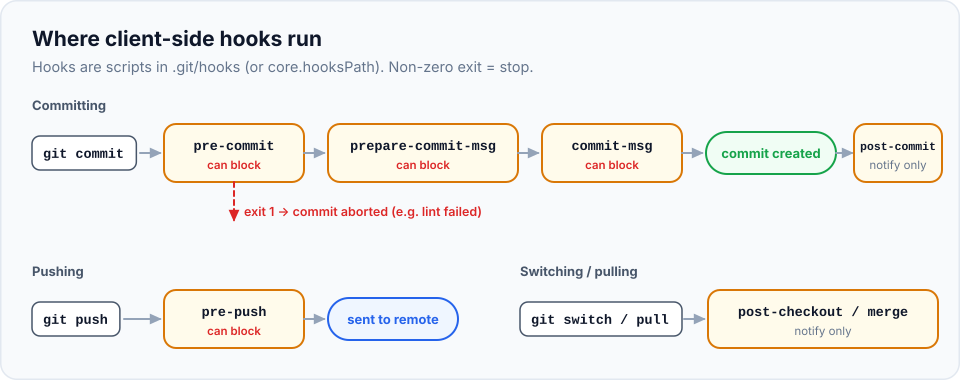

Code review and CI catch problems, but minutes or hours later. **Hooks** catch them **seconds** after you
make them, on your own machine. A hook is a script Git runs automatically at certain moments: before a
commit is created, after you write the message, before a push. If the script fails, Git stops.

> **In this chapter you'll learn**
> - What hooks are, where they live, and which events they run on
> - How to write your first hook and see it block a commit
> - How to share hooks with your team (`core.hooksPath`, Husky, pre-commit, Lefthook)
> - Practical hooks: block debug code, enforce commit messages, add ticket IDs, protect `main`
> - How to skip a hook when you must, and why hooks don't replace CI
>
> **Prerequisites:** chapters [6](../06-staging-and-committing-well/index.md) and [14](../14-fetch-pull-push/index.md);
> basic comfort reading a short shell script. **Time:** 45 minutes.

## How hooks work

- A hook is an **executable file** with a specific name (like `pre-commit`) in the repository's hooks folder.
- Git runs it at the matching moment.
- If it **exits with a non-zero code**, the operation is **cancelled** (for hooks that can block).
- Hooks can be written in any language (shell, Python, Node…), as long as the file is executable and starts
  with a "shebang" line like `#!/bin/sh`.



| Hook | Runs | Can block? | Typical use |
| --- | --- | --- | --- |
| `pre-commit` | Before the commit is created (before you write the message) | ✅ | Lint/format staged files, block debug code and secrets |
| `prepare-commit-msg` | Before the message editor opens | ✅ | Pre-fill the message, e.g. add the ticket ID |
| `commit-msg` | After you write the message | ✅ | Enforce a message format |
| `post-commit` | After the commit is created | ❌ | Notifications |
| `pre-push` | Before anything is sent to the remote | ✅ | Run tests, block pushes to protected branches |
| `post-checkout` / `post-merge` | After switching branches / after a merge or pull | ❌ | Reinstall dependencies if the lockfile changed |

Hooks live in `.git/hooks/` by default. Every new repository comes with examples:

```bash
$ ls .git/hooks
applypatch-msg.sample  commit-msg.sample  fsmonitor-watchman.sample  post-update.sample
pre-applypatch.sample  pre-commit.sample  pre-push.sample  ...
```

The `.sample` suffix means they're inactive. A hook runs only if a file exists with the **exact** name
(no extension) and is executable.

### The sharing problem

The `.git/` folder **isn't committed**, so hooks placed in `.git/hooks/` exist only on your computer.
To share hooks with your team, keep them in a **committed** folder and point Git at it:

```bash
git config core.hooksPath .githooks
```

That's what we'll do in the lab.

## Hands-on lab: write and share hooks

### Setup

```bash
cd ~/git-practice && rm -rf hooks-lab && mkdir hooks-lab && cd hooks-lab
git init --bare server/app.git
git clone server/app.git app && cd app
echo "console.info('app');" > app.js && git add . && git commit -m "Initial commit"
mkdir .githooks
git config core.hooksPath .githooks
```

### Hook 1: block debug code (`pre-commit`)

Create `.githooks/pre-commit` with this content (the `cat > file <<'EOF' … EOF` form writes everything up
to `EOF` into the file; you can also create it in your editor):

```bash
cat > .githooks/pre-commit <<'EOF'
#!/bin/sh
# Block commits that add console.log or debugger statements
if git diff --cached -U0 | grep -E "^\+.*(console\.log|debugger)"; then
  echo "Remove console.log / debugger before committing."
  exit 1
fi
EOF
chmod +x .githooks/pre-commit
```

**How it works:** `git diff --cached -U0` shows the **staged** changes. `grep` looks for **added** lines
(starting with `+`) containing `console.log` or `debugger`. If it finds any, the hook prints a message and
exits with `1`, which cancels the commit. `chmod +x` makes the file executable; without it, Git silently
ignores the hook.

Try it:

```bash
$ echo "console.log(order);" >> app.js
$ git commit -am "Log the order"
+console.log(order);
Remove console.log / debugger before committing.
$ git log --oneline -1
c1adf4e Initial commit
```

The commit was **blocked**. The hook even showed the offending line.

**Skipping a hook in an emergency:**

```bash
$ git commit --no-verify -am "Log the order (temporary)"
```

`--no-verify` (or `-n`) skips `pre-commit` and `commit-msg` hooks. Use it rarely and consciously. Undo that
commit for now: `git reset --hard HEAD~1`.

### Hook 2: enforce a commit message format (`commit-msg`)

Git passes the hook one argument, `$1`: the path to a file containing the message.

```bash
cat > .githooks/commit-msg <<'EOF'
#!/bin/sh
# Require Conventional Commits: type(optional scope): description
if ! head -1 "$1" | grep -qE "^(feat|fix|docs|chore|refactor|test)(\(.+\))?: .+"; then
  echo "Commit message must look like: feat(cart): add coupon support"
  exit 1
fi
EOF
chmod +x .githooks/commit-msg
```

```bash
$ echo "// cart" >> app.js
$ git commit -am "update stuff"
Commit message must look like: feat(cart): add coupon support
$ git commit -am "feat(cart): add cart comment"
$ git log --oneline -1
ac7dffb feat(cart): add cart comment
```

### Hook 3: never push directly to `main` (`pre-push`)

`pre-push` receives one line per branch being pushed on its standard input, in the form
`<local ref> <local sha> <remote ref> <remote sha>`:

```bash
cat > .githooks/pre-push <<'EOF'
#!/bin/sh
while read local_ref local_sha remote_ref remote_sha; do
  if [ "$remote_ref" = "refs/heads/main" ]; then
    echo "Pushing directly to main is not allowed. Open a pull request."
    exit 1
  fi
done
EOF
chmod +x .githooks/pre-push
```

```bash
$ git push origin main
Pushing directly to main is not allowed. Open a pull request.
error: failed to push some refs to '.../server/app.git'

$ git switch -c feat/cart
$ git push -u origin feat/cart
 * [new branch]      feat/cart -> feat/cart
```

### Hook 4: add the ticket ID automatically (`prepare-commit-msg`)

Many teams name branches after tickets (`feature/SHOP-142-coupons`) and want the ticket ID in every commit
message. Let a hook do it. It receives `$1` (the message file) and `$2` (the message's source: `message`
for `-m`, `merge`, `squash`, `commit` for amend, …):

```bash
cat > .githooks/prepare-commit-msg <<'EOF'
#!/bin/sh
# $1 = file with the message, $2 = where the message came from
case "$2" in merge|squash|commit) exit 0 ;; esac   # skip merges, squashes and amends
BRANCH=$(git rev-parse --abbrev-ref HEAD)
TICKET=$(echo "$BRANCH" | grep -oE "[A-Z]+-[0-9]+")
if [ -n "$TICKET" ] && ! grep -q "$TICKET" "$1"; then
  printf "%s: %s\n" "$TICKET" "$(cat "$1")" > "$1"
fi
EOF
chmod +x .githooks/prepare-commit-msg
rm .githooks/commit-msg      # remove hook 2 so this example's message format is allowed
```

```bash
$ git switch -c feature/SHOP-142-coupons
$ echo "// coupons" >> app.js
$ git commit -am "Validate coupon codes"
$ git log --oneline -1
c3ec057 SHOP-142: Validate coupon codes
```

### Step 5: share the hooks

```bash
$ git add .githooks
$ git commit -m "chore: add shared git hooks"
```

Each teammate runs **once** after cloning:

```bash
$ git config core.hooksPath .githooks
```

(Put that line in your README or project setup script, since config isn't committed.)

## Hook managers

For real projects, a hook manager installs hooks automatically and adds conveniences:

| Tool | Best for | How hooks are defined |
| --- | --- | --- |
| **Husky** + **lint-staged** | JavaScript / TypeScript projects | `.husky/pre-commit` files; installed by `npm install` |
| **pre-commit** | Any language, especially Python; huge library of ready-made hooks | `.pre-commit-config.yaml` |
| **Lefthook** | Any language; single fast binary; runs hooks in parallel | `lefthook.yml` |

A typical JavaScript setup: **Husky** installs the hooks whenever someone runs `npm install`, and
**lint-staged** runs your tools only on the **staged** files, so the hook stays fast even in a big project:

```json
{
  "scripts": { "prepare": "husky" },
  "lint-staged": {
    "*.{js,ts,tsx}": ["eslint --fix", "prettier --write"],
    "*.{css,md,json}": "prettier --write"
  }
}
```

```bash
# .husky/pre-commit
npx lint-staged
```

Set it up with `npm install --save-dev husky lint-staged` and `npx husky init`.

## More hooks worth stealing

**Reinstall dependencies when they changed** (`post-merge`, runs after `git pull`):

```bash
#!/bin/sh
if git diff --name-only HEAD@{1} HEAD | grep -q "package-lock.json"; then
  echo "package-lock.json changed. Running npm install..."
  npm install
fi
```

**Block secrets** before they reach history: run a scanner such as [gitleaks](https://github.com/gitleaks/gitleaks)
on staged changes in `pre-commit`, and also enable GitHub's **push protection** for secret scanning.

**Run tests before pushing** (`pre-push`): `npm test || exit 1`. Keep it to fast tests, or developers
will start using `--no-verify`.

## Hooks are a convenience, not a guarantee

Anyone can skip hooks with `--no-verify`, or simply never install them. So:

- Keep hooks **fast** (a few seconds). Slow hooks get bypassed.
- Run the **same checks in CI** ([GitHub Actions](https://docs.github.com/en/actions)) as the real gate,
  and require them to pass before merging ([chapter 15](../15-pull-requests/index.md#team-settings-worth-knowing)).

## When to use hooks

| Goal | Hook |
| --- | --- |
| Catch lint/format errors immediately | `pre-commit` (+ lint-staged) |
| Prevent debug code or secrets being committed | `pre-commit` |
| Consistent commit messages | `commit-msg` |
| Ticket IDs in every message | `prepare-commit-msg` |
| Don't push broken code / don't push to main | `pre-push` |
| Keep dependencies in sync after pulling | `post-merge`, `post-checkout` |

## Common mistakes

| Problem | Fix |
| --- | --- |
| Hook doesn't run at all | Check the exact filename (no `.sh`), `chmod +x`, and `git config core.hooksPath` |
| Works on Mac, fails on Windows | Use `#!/bin/sh` and POSIX shell syntax; Git for Windows runs hooks with its bundled shell |
| Hook takes 2 minutes | Check only staged files (lint-staged), move slow checks to CI |
| Teammates don't have the hooks | `core.hooksPath` must be set per clone, or use a manager that installs on `npm install` |
| Bypassing hooks routinely with `--no-verify` | Fix the hook (speed, false positives) instead |

## Recap

- Hooks are executable scripts named after events; a non-zero exit cancels the action.
- `pre-commit`, `commit-msg`, `prepare-commit-msg` and `pre-push` are the most useful.
- Share hooks via a committed folder + `core.hooksPath`, or a manager (Husky, pre-commit, Lefthook).
- `--no-verify` skips them, so hooks speed up feedback but CI must enforce the rules.

## Check your understanding

<details>
<summary>1. You created <code>.githooks/pre-commit</code> but it never runs. What are the two most likely reasons?</summary>

The file isn't executable (`chmod +x` missing), or Git isn't pointed at the folder
(`git config core.hooksPath .githooks`).
</details>

<details>
<summary>2. Which hook should check the commit message format, and how does it get the message?</summary>

`commit-msg`. Git passes the path to a file containing the message as `$1`.
</details>

<details>
<summary>3. Why should important checks also run in CI?</summary>

Hooks are local and optional: they can be skipped with `--no-verify` or not installed. CI runs for every
push and PR, regardless of anyone's machine.
</details>

**Next:** [big repositories](../28-large-repos/index.md): shallow and partial clones, sparse checkout,
Git LFS and submodules.
