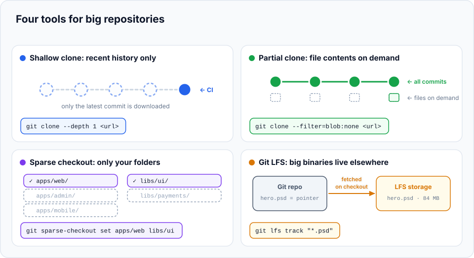
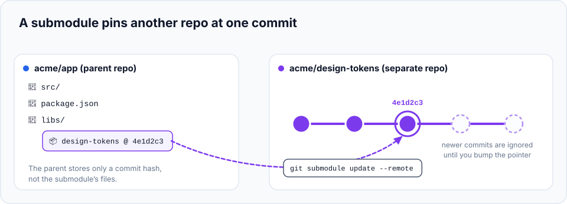

On a normal project, Git feels instant. It slows down when a repository gets **big** in one of three ways:
a very **long history**, a huge **number of files** (a "monorepo" holding many apps), or large **binary
files** (videos, design files, datasets). Each has its own fix, and this chapter shows them all, plus
**submodules**, Git's way of embedding one repository inside another.

> **In this chapter you'll learn**
> - **Shallow clones**: download only recent history (ideal for CI)
> - **Partial clones**: download history now, file contents on demand (ideal for developers)
> - **Sparse checkout**: only put the folders you work on onto your disk
> - **Git LFS**: keep large binary files out of Git's history
> - **Submodules**: how they work, their pitfalls, and alternatives
> - Settings that speed up big repositories
>
> **Prerequisites:** chapters [13](../13-github-and-remotes/index.md) and [23](../23-git-internals/index.md). **Time:** 50 minutes.



## Set up a practice "monorepo"

To try these features without downloading gigabytes, we'll build a small monorepo and clone it through a
`file://` URL (which makes Git behave as it would with a real server):

```bash
cd ~/git-practice && rm -rf big && mkdir big && cd big
mkdir mono && cd mono && git init
for a in web admin mobile; do mkdir -p apps/$a && echo "$a app" > apps/$a/index.js; done
mkdir -p libs/ui libs/payments && echo ui > libs/ui/button.js && echo pay > libs/payments/stripe.js
echo '{"name":"mono"}' > package.json
git add . && git commit -m "Initial monorepo"
for i in 1 2 3 4 5; do echo "change $i" >> apps/web/index.js; git commit -am "Web change $i"; done
git config uploadpack.allowFilter true      # let clones request partial downloads (GitHub has this on)
cd ..
```

## 1. Shallow clone: only recent history

```bash
$ git clone --depth 1 file://$PWD/mono shallow
$ cd shallow
$ git log --oneline
db71b46 Web change 5
$ git rev-parse --is-shallow-repository
true
```

`--depth 1` downloaded **only the latest commit**, no history at all. On a project with ten years of
history, that can be the difference between minutes and seconds.

The trade-off: commands that need history (`git log`, `git blame`, `git bisect`, merging with old
branches) don't work properly. You can fetch more later:

```bash
$ git fetch --deepen 2          # 2 more commits of history
$ git log --oneline
db71b46 Web change 5
624b8e7 Web change 4
89c32e6 Web change 3
$ git fetch --unshallow         # the full history
$ cd ..
```

**Use it for:** CI pipelines, Docker builds, deployments: anywhere you only need the current code.
(Most CI systems, including GitHub Actions' `actions/checkout`, use depth 1 by default.)

## 2. Partial clone: full history, file contents on demand

```bash
$ git clone --filter=blob:none file://$PWD/mono partial
$ cd partial && git log --oneline | wc -l
       6
$ cd ..
```

`--filter=blob:none` downloads **every commit and tree** (so `git log` sees the whole history) but **no file
contents (blobs)** except those needed for the files you check out. When you later look at an old version
of a file (`git show`, `git diff`, `git blame`, switching branches), Git fetches the missing contents
automatically from the server.

| | Full clone | Shallow (`--depth 1`) | Partial (`--filter=blob:none`) |
| --- | --- | --- | --- |
| Download size | Everything | Smallest | Small |
| `git log` of full history | ✅ | ❌ | ✅ |
| Old file versions | Local | ❌ | Fetched when needed (needs network) |
| Best for | Small/medium repos | CI, one-off builds | **Developers on big repos** |

Try it on a real large project: `git clone --filter=blob:none https://github.com/microsoft/vscode.git`.

## 3. Sparse checkout: only the folders you work on

A monorepo might hold 50 apps, but you work on two. **Sparse checkout** keeps only the folders you choose
in your working tree. Everything else is still in the repository, just not on your disk.

```bash
$ git clone --filter=blob:none --sparse file://$PWD/mono sparse
$ cd sparse
$ ls
package.json
```

With `--sparse`, only the files at the **root** of the repository are checked out at first. Choose your
folders:

```bash
$ git sparse-checkout set apps/web libs/ui
$ ls -R apps libs
apps:
web

apps/web:
index.js

libs:
ui

libs/ui:
button.js
```

`apps/admin`, `apps/mobile` and `libs/payments` aren't on disk. `git status`, your editor's search and
file watchers now only deal with what you need.

| Command | Effect |
| --- | --- |
| `git sparse-checkout set <dir>…` | Replace the list of folders |
| `git sparse-checkout add <dir>` | Add a folder |
| `git sparse-checkout list` | Show the current list |
| `git sparse-checkout disable` | Check out everything again |

```bash
$ git sparse-checkout add apps/admin
$ ls apps
admin  web
$ git sparse-checkout disable
$ ls apps
admin  mobile  web
$ cd ..
```

Combined with a partial clone, Git only downloads contents for the folders you've selected.

## 4. Git LFS: large binary files

Git keeps **every version of every file forever**. A 200 MB video edited ten times means 2 GB that
**everyone** downloads on every clone, forever, even after the video is deleted. Binary files also can't be
diffed or merged meaningfully.

**Git LFS** (Large File Storage) solves this: the real file is stored on a separate LFS server, and Git's
history only contains a tiny **pointer** text file. The real content is downloaded only for the version you
check out.

**Install** (once per machine): `brew install git-lfs` (macOS), `sudo apt install git-lfs` (Ubuntu); it's
included with Git for Windows. Then:

```bash
git lfs install                          # once per machine: sets up Git to use LFS
git lfs track "*.psd" "*.mp4"            # in a repository: which files go to LFS
git add .gitattributes                   # the tracking rules are stored here; commit them
git add design/hero.psd
git commit -m "Add hero design"
git push                                 # uploads the big file to LFS, the pointer to Git
```

What Git actually stores for `hero.psd`:

```text
version https://git-lfs.github.com/spec/v1
oid sha256:4d7a214614ab2935c943f9e0ff69d22eadbb8f32b1258daaa5e2ca24d17e2393
size 84213337
```

Useful commands: `git lfs ls-files` (which files are in LFS), `git lfs track` (show patterns).

> **Set up LFS before committing big files.** If large files are already in history, `git lfs migrate
> import --include="*.psd,*.mp4" --everything` rewrites history to move them into LFS. That changes every
> commit hash, so coordinate with the team (everyone re-clones afterwards).

GitHub's free plan includes some LFS storage and bandwidth; check your plan's limits for big assets.

### Find what's bloating a repository

```bash
git count-objects -vH                    # total size
git rev-list --objects --all \
  | git cat-file --batch-check='%(objecttype) %(objectname) %(objectsize) %(rest)' \
  | awk '$1=="blob"' | sort -k3 -n -r | head -10     # the 10 largest files in all of history
```

## 5. Submodules: a repository inside a repository

A **submodule** embeds another Git repository at a specific path, **pinned to one exact commit**. For
example, your app might include a shared `design-tokens` repository.



### Hands-on: add, update and clone with a submodule

```bash
cd ~/git-practice/big
git config --global protocol.file.allow always    # only needed for this local practice (file paths)
mkdir tokens && cd tokens && git init && echo "--brand: teal;" > colors.css && git add . && git commit -m "Add brand colors" && cd ..
mkdir app && cd app && git init && echo app > README.md && git add . && git commit -m "Initial commit"
```

**Add the submodule:**

```bash
$ git submodule add ../tokens libs/design-tokens
Cloning into '.../app/libs/design-tokens'...
$ cat .gitmodules
[submodule "libs/design-tokens"]
	path = libs/design-tokens
	url = ../tokens
$ git commit -m "Add design-tokens submodule"
```

(With GitHub you'd use a URL: `git submodule add https://github.com/acme/design-tokens.git libs/design-tokens`.)

**What the parent stores** is not the files, but a pointer to one commit:

```bash
$ git ls-tree HEAD libs/
160000 commit c5a7a7e673e07b77d1bdd0317bbbb946cf0af664	libs/design-tokens
```

Mode `160000` with type `commit`: "at this path, use commit `c5a7a7e` of another repository".

**The submodule repository gets a new commit.** Your app doesn't change until you **bump** the pointer:

```bash
$ cd ../tokens && echo "--accent: orange;" >> colors.css && git commit -am "Add accent color" && cd ../app
$ git status -s
$
$ git submodule update --remote libs/design-tokens
Submodule path 'libs/design-tokens': checked out 'be9c260...'
$ git status -s
 M libs/design-tokens
$ git diff --submodule
Submodule libs/design-tokens c5a7a7e..be9c260:
  > Add accent color
$ git commit -am "Bump design-tokens"
```

**Cloning a project with submodules** has a classic trap:

```bash
$ cd .. && git clone app app-clone
$ ls app-clone/libs/design-tokens
$
```

**Empty!** A normal clone doesn't fetch submodule contents. Fix it:

```bash
$ cd app-clone
$ git submodule update --init --recursive
Submodule path 'libs/design-tokens': checked out 'be9c260...'
$ ls libs/design-tokens
colors.css
```

Better: clone with `git clone --recurse-submodules <url>`, and make everyday commands (pull, switch)
update submodules automatically:

```bash
git config --global submodule.recurse true
```

### Should you use submodules?

Submodules are powerful but often **cause confusion**: empty folders after cloning, the submodule being
in detached HEAD, "modified" submodules you didn't touch, teammates forgetting to update them. Consider
the alternatives first:

| You need… | Usually better than a submodule |
| --- | --- |
| To share code between projects | A versioned **package** (npm, PyPI, Maven…) |
| Several apps that change together | A **monorepo** (with sparse checkout if it's big) |
| To copy a third-party library's code into your project | Your package manager, or `git subtree` |

Submodules make sense when you need **an exact commit of an independent repository** that isn't published
as a package: firmware SDKs, shared protocol definitions, some game-engine setups.

## 6. Speed settings for big repositories

```bash
git maintenance start                   # background prefetch, commit-graph and packing (Git 2.31+)
git config core.fsmonitor true          # a file-system watcher makes `git status` fast (macOS/Windows, Git 2.37+)
git config core.untrackedCache true     # cache the scan for untracked files
git config feature.manyFiles true       # a bundle of settings for repos with many files
```

## When to use what

| Problem | Solution |
| --- | --- |
| CI checkout is slow | `--depth 1` |
| Developer clone of a huge repo is slow | `--filter=blob:none` |
| Monorepo: your editor and `git status` crawl | Sparse checkout (+ partial clone) |
| Repo is huge because of videos, images, datasets | Git LFS (ideally from day one) |
| You must pin an exact commit of another repo | Submodule |
| You just want to share code between projects | A package, not a submodule |

## Common mistakes

| Mistake | Fix |
| --- | --- |
| `git log`/`blame` show almost nothing | It's a shallow clone: `git fetch --unshallow` |
| Committed a 500 MB file, push is rejected | Remove it from the unpushed commits ([chapter 30](../30-git-disasters/index.md)), then track it with LFS |
| Submodule folder is empty | `git submodule update --init --recursive` |
| Submodule shows as modified though you didn't change it | Its checked-out commit differs from the one recorded. `git submodule update` (to match the parent) or commit the new pointer |
| LFS file shows as a small text pointer | Git LFS isn't installed on that machine: install it, then `git lfs pull` |

## Recap

- **Shallow clone** (`--depth 1`): latest commit only. Great for CI.
- **Partial clone** (`--filter=blob:none`): full history, contents on demand. Great for developers on big repos.
- **Sparse checkout** (`git sparse-checkout set <dirs>`): only selected folders on disk.
- **Git LFS**: big binaries stored outside history, behind pointer files.
- **Submodules** pin another repo's commit: clone with `--recurse-submodules`, bump with `git submodule update --remote`.

## Check your understanding

<details>
<summary>1. Your CI job only builds the latest code. Which clone option speeds it up most?</summary>

`git clone --depth 1` (a shallow clone).
</details>

<details>
<summary>2. What does a partial clone with <code>--filter=blob:none</code> skip downloading?</summary>

File contents (blobs) that aren't needed for your current checkout. Commits and trees are all downloaded,
so the history is complete.
</details>

<details>
<summary>3. A teammate clones your project and the submodule folder is empty. What should they run?</summary>

`git submodule update --init --recursive` (or clone again with `--recurse-submodules`).
</details>

**Next:** [25 Git hacks that save hours](../29-productivity-hacks/index.md).
