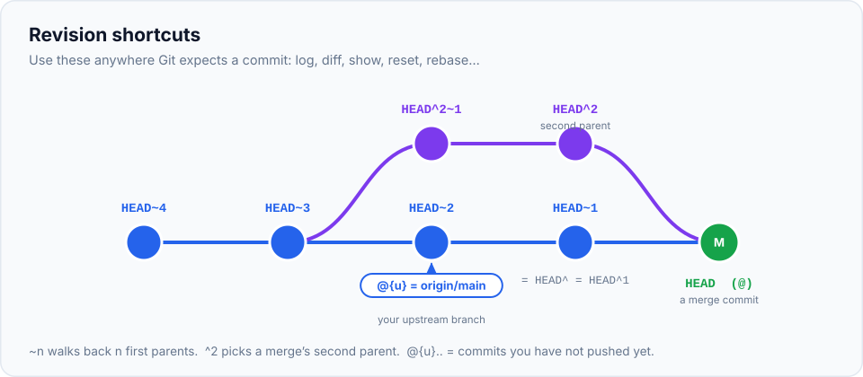

You now know Git properly. This chapter collects the small things that make daily work **faster and
smoother**: settings that remove friction, aliases for commands you type constantly, shortcuts for naming
commits, and a few commands most developers never discover. Each one comes with **what it does** and
**when it helps**, so you can pick the ones that fit how you work.

> **In this chapter you'll learn**
> - A recommended `~/.gitconfig`, setting by setting
> - How to create aliases, including ones that run shell commands
> - Revision shortcuts: `@{u}`, `@{-1}`, `HEAD^2`, `:/text`, `A..B`, `A...B`
> - Handy commands: `git grep`, `range-diff`, `shortlog`, `archive`, `restore --source`
> - Tools that make Git nicer: delta, a Git-aware prompt, tab completion
>
> **Prerequisites:** chapters 1–22 (each tip links back to where the concept is explained). **Time:** 40 minutes.

## Part 1: a better `~/.gitconfig`

You can paste this into `~/.gitconfig` (keep your own `[user]` section), or apply settings one at a time
with `git config --global <name> <value>`.

```ini
[init]
    defaultBranch = main
[core]
    editor = code --wait
    excludesFile = ~/.gitignore_global
[column]
    ui = auto
[branch]
    sort = -committerdate
[tag]
    sort = version:refname
[diff]
    algorithm = histogram
    colorMoved = plain
    renames = true
[fetch]
    prune = true
[pull]
    rebase = true
[push]
    autoSetupRemote = true
    followTags = true
[rebase]
    autoSquash = true
    autoStash = true
    updateRefs = true
[merge]
    conflictStyle = zdiff3
[rerere]
    enabled = true
[commit]
    verbose = true
[help]
    autocorrect = prompt
```

### What each setting does

| Setting | Effect | Why it helps | Learn more |
| --- | --- | --- | --- |
| `branch.sort = -committerdate` | `git branch` lists the most recently used branches first | The branch you worked on yesterday is at the top, not buried alphabetically | [ch. 10](../10-branches/index.md) |
| `tag.sort = version:refname` | Tags sort as versions | `v1.10.0` comes after `v1.9.0`, not before | [ch. 26](../26-tags-and-releases/index.md) |
| `column.ui = auto` | Lists of branches/tags in columns | Less scrolling | — |
| `diff.algorithm = histogram` | A smarter diff algorithm | Clearer diffs when code is moved or blocks are similar | [ch. 8](../08-viewing-history/index.md) |
| `diff.colorMoved = plain` | Moved lines get a different colour | You can tell "moved" apart from "deleted + added" | — |
| `fetch.prune = true` | Removes `origin/x` when `x` is deleted on the server | No stale remote branches piling up | [ch. 14](../14-fetch-pull-push/index.md) |
| `pull.rebase = true` | `git pull` rebases your local commits | No pointless "Merge branch 'main' of …" commits | [ch. 14](../14-fetch-pull-push/index.md), [18](../18-rebase/index.md) |
| `push.autoSetupRemote = true` | First push of a new branch sets up tracking | Never type `--set-upstream origin <branch>` again | [ch. 14](../14-fetch-pull-push/index.md) |
| `push.followTags = true` | Pushes annotated tags along with commits | Releases don't get "forgotten" locally | [ch. 26](../26-tags-and-releases/index.md) |
| `rebase.autoSquash = true` | `fixup!` commits are arranged automatically | One-command cleanup after review | [ch. 19](../19-interactive-rebase/index.md) |
| `rebase.autoStash = true` | Stashes and restores uncommitted changes around a rebase/pull | Pull without "please commit or stash" errors | [ch. 20](../20-stash/index.md) |
| `rebase.updateRefs = true` | Rebasing moves stacked branches too | Easier stacked PRs | [ch. 18](../18-rebase/index.md) |
| `merge.conflictStyle = zdiff3` | Conflicts show the original (base) version | You can see what each side actually changed | [ch. 12](../12-merge-conflicts/index.md) |
| `rerere.enabled = true` | Remembers how you resolved conflicts | Resolve a repeated conflict only once | [ch. 12](../12-merge-conflicts/index.md) |
| `commit.verbose = true` | Shows the diff in the editor while you write the message | Better messages, fewer mistakes | [ch. 6](../06-staging-and-committing-well/index.md) |
| `help.autocorrect = prompt` | `git stauts` → *"Did you mean 'status'? [y/N]"* | Typos stop costing you a retype (Git 2.34+) | — |

## Part 2: aliases

An **alias** is a shortcut: `git st` instead of `git status -sb`. Create one with
`git config --global alias.<name> "<command>"`, or add it to the `[alias]` section of `~/.gitconfig`:

```ini
[alias]
    st     = status -sb
    co     = switch
    cob    = switch -c
    lg     = log --graph --pretty=format:'%C(yellow)%h%C(reset) %s %C(green)(%cr)%C(reset) %C(blue)<%an>%C(reset)%C(red)%d%C(reset)'
    last   = log -1 --stat
    undo   = reset --soft HEAD~1
    amend  = commit --amend --no-edit
    unstage = restore --staged
    pushf  = push --force-with-lease --force-if-includes
    wip    = !git add -A && git commit -m 'WIP' --no-verify
    gone   = !git fetch --prune && git for-each-ref --format='%(refname:short) %(upstream:track)' refs/heads | awk '$2 == \"[gone]\" {print $1}' | xargs git branch -D
    aliases = config --get-regexp ^alias\\.
```

| Alias | What it does | When you'll use it |
| --- | --- | --- |
| `git st` | Compact status with the branch and ahead/behind counts | Constantly |
| `git lg` | Colourful one-line graph with relative dates, authors and branch names | Understanding where branches are |
| `git last` | The last commit with its file summary | "What did I just commit?" |
| `git undo` | Uncommits the last commit; changes stay staged | Committed too early ([ch. 17](../17-undoing-changes/index.md)) |
| `git amend` | Adds staged changes to the last commit, same message | Forgot a file ([ch. 6](../06-staging-and-committing-well/index.md)) |
| `git unstage <file>` | Unstages a file | Staged by mistake |
| `git pushf` | The safe force push | After rebasing your own branch ([ch. 14](../14-fetch-pull-push/index.md#force-pushing-safely)) |
| `git wip` | Commits everything as "WIP", skipping hooks | Must leave right now; tidy up later |
| `git gone` | Deletes local branches whose remote branch was deleted | Weekly cleanup after merged PRs |
| `git aliases` | Lists all your aliases | Remembering what you set up |

**Aliases starting with `!`** run as a **shell command** instead of a Git sub-command, so you can chain
commands with `&&` and use pipes. `gone` asks Git for each local branch's tracking status, picks those
marked `[gone]`, and deletes them.

### Try it

```bash
$ git st
## main...origin/main [ahead 1]
$ git log --oneline @{u}..
1ed6e0d Add b
$ git undo
$ git st
## main...origin/main
A  b.txt
```

## Part 3: revision shortcuts

Anywhere Git expects a commit (`log`, `show`, `diff`, `reset`, `rebase`, `switch`…), you can use these:



| Syntax | Means | Example |
| --- | --- | --- |
| `HEAD~3` | 3 commits back, following first parents | `git show HEAD~3` |
| `HEAD^` / `HEAD^1` | The first parent (same as `HEAD~1`) | `git diff HEAD^ HEAD` |
| `HEAD^2` | The **second parent** of a merge commit: the branch that was merged in | `git log HEAD^2` |
| `@` | Shorthand for `HEAD` | `git show @` |
| `@{u}` / `@{upstream}` | The branch you track, like `origin/main` | `git diff @{u}` |
| `@{-1}` / `-` | The branch you were on before | `git switch -`, `git merge -` |
| `main@{yesterday}` | Where `main` pointed yesterday (from the reflog) | `git diff main@{yesterday} main` |
| `:/fix login` | The newest commit whose message contains "fix login" | `git show :/"fix login"` |
| `A..B` | Commits reachable from B but not from A | `git log main..feature` |
| `A...B` | Commits on either side but not both (where they diverged) | `git log --oneline main...feature` |

Combinations you'll use every week:

```bash
git log --oneline @{u}..       # what will I push?
git log --oneline ..@{u}       # what will I get when I pull? (after git fetch)
git diff @{u}                  # how my branch differs from the server
git switch -                   # toggle between the last two branches
git merge -                    # merge the branch I was just on
git show :/"fix login"         # find a commit by its message
```

## Part 4: lesser-known commands

**`git grep`: search only tracked files, fast.** Skips `node_modules/` and other ignored files
automatically ([ch. 9](../09-searching-history/index.md)).

```bash
git grep -n "TODO" -- '*.js'
```

**`git restore --source`: grab a file from any branch or commit**, without switching
([ch. 17](../17-undoing-changes/index.md)).

```bash
git restore --source=main -- src/config.js          # take main's version of one file
git restore --source=HEAD~5 -- package.json         # as it was 5 commits ago
```

**`git commit --allow-empty`: trigger CI without changing anything.**

```bash
git commit --allow-empty -m "Re-run CI"
```

**`git range-diff`: compare two versions of the same branch.** After you rebase or clean up a PR, show
reviewers what *actually* changed between the old and new versions:

```bash
git range-diff main origin/feature/coupons feature/coupons
```

**`git shortlog`: summaries by author.**

```bash
git shortlog -sn --since="3 months ago"     # commit counts per person
git shortlog v1.0.0..v1.1.0                 # release changes grouped by author
```

**`git archive`: export a clean copy of the code** (no `.git` folder), e.g. for a download or a deploy:

```bash
git archive --format=zip -o website-v1.1.0.zip v1.1.0
```

**`git switch --detach <tag>`: run an old version** to reproduce a bug, then `git switch -` to come back.

## Part 5: tools that make Git nicer

**Better diffs with delta.** Syntax highlighting, line numbers and side-by-side view in the terminal:

```bash
brew install git-delta            # or see github.com/dandavison/delta for other systems
git config --global core.pager delta
git config --global interactive.diffFilter "delta --color-only"
git config --global delta.side-by-side true
```

**A Git-aware prompt.** Always seeing the current branch and status in your prompt prevents a whole class of
mistakes (committing on the wrong branch). [Starship](https://starship.rs/) does this with almost no setup;
Oh My Zsh's `git` theme and plugin do too.

**Tab completion.** Make sure pressing `Tab` completes branch names and commands. It comes with Git for
Windows and with Homebrew's Git; on Linux install your distribution's `bash-completion` package.

**A GUI for the hard parts.** Even terminal experts use visual tools for some tasks: VS Code's Git panel
and merge editor for conflicts, GitLens for inline blame, or GitHub Desktop / Fork / Tower for browsing
history. They run the same commands you now understand.

## When to use what

| You want to… | Hack |
| --- | --- |
| Stop retyping long commands | Aliases (`st`, `lg`, `undo`, `amend`, `pushf`) |
| Get rid of daily friction | The `~/.gitconfig` in Part 1 |
| Check what you're about to push | `git log @{u}..` |
| Jump between two branches | `git switch -` |
| Find a commit by its message | `git show :/"words"` |
| Clean up merged branches | `git gone` |
| Make diffs readable | `diff.algorithm histogram`, `delta` |

## Common mistakes

| Mistake | Fix |
| --- | --- |
| Copying a big config without understanding it | Add settings one at a time and read the table above |
| An alias shadows a real command | Git ignores aliases with the same name as built-in commands; pick another name |
| Shell alias fails on Windows | Run Git Bash; `!` aliases use a POSIX shell |
| `pull.rebase true` on a branch others push to | Fine: it only rebases **your unpushed** commits |

## Recap

- A dozen config lines (`pull.rebase`, `push.autoSetupRemote`, `fetch.prune`, `zdiff3`, `rerere`,
  `branch.sort`…) quietly remove daily friction.
- Aliases turn long commands into two letters; `!` aliases can run shell pipelines.
- Revision shortcuts (`@{u}..`, `@{-1}`, `HEAD^2`, `:/msg`) let you name commits without hashes.
- `git grep`, `restore --source`, `range-diff`, `shortlog` and `archive` are worth knowing.

## Check your understanding

<details>
<summary>1. Which command lists the commits you haven't pushed yet?</summary>

`git log --oneline @{u}..` (commits on your branch that aren't on its upstream).
</details>

<details>
<summary>2. In a merge commit, what's the difference between <code>HEAD^1</code> and <code>HEAD^2</code>?</summary>

`HEAD^1` is the first parent (the branch you merged **into**); `HEAD^2` is the second parent (the branch
that was merged **in**).
</details>

<details>
<summary>3. What makes <code>git gone</code> different from a normal alias?</summary>

It starts with `!`, so Git runs it as a shell command. That allows chaining several commands and using
pipes (`|`), which a plain alias can't do.
</details>

**Last chapter:** [fixing real-world Git disasters](../30-git-disasters/index.md).
