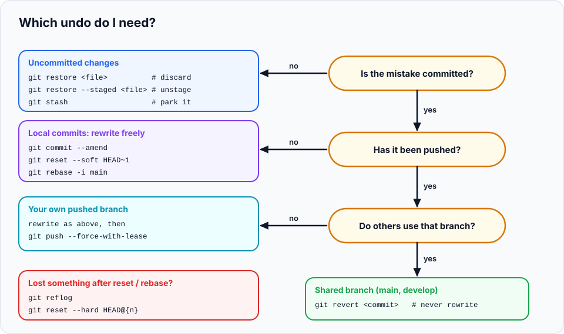

Mistakes with Git feel scary because they often happen in front of the team, under time pressure. The good
news: you now know every tool needed to fix them. This last chapter brings them together into a
**playbook**: for each common disaster, how to recognise it, why it happened, the fix, and how to prevent it.
It finishes with **drills** so you can practise the fixes before you need them.

> **In this chapter you'll learn**
> - A calm three-step routine for any Git emergency
> - How to pick the right undo tool with one flowchart
> - Step-by-step fixes for 15 real situations
> - How to handle a leaked secret properly
> - Drills to practise the most common rescues
>
> **Prerequisites:** the whole series, especially chapters [17](../17-undoing-changes/index.md),
> [21](../21-cherry-pick/index.md) and [22](../22-reflog/index.md). **Time:** 60 minutes.

## The emergency routine

Before typing any fix:

1. **Stop.** Don't run commands you found in a hurry. Most "Git disasters" get worse because of the
   second, panicked command.
2. **Look.** Find out exactly where you are:
   ```bash
   git status
   git log --oneline --graph -10 --all
   ```
3. **Back up if unsure.** A safety branch costs nothing and guarantees you can return to this exact state:
   ```bash
   git branch backup-before-fix
   ```

Then answer the key question from [chapter 17](../17-undoing-changes/index.md): **is the mistake committed,
pushed, and shared?**



---

## Commits in the wrong place

### 1. "I committed to `main` instead of a feature branch"

**Symptoms:** `git log` on `main` shows your new commits; you meant to open a PR.

**Not pushed yet:**

```bash
git branch feature/search          # 1. a branch that keeps the commits
git reset --hard origin/main       # 2. move main back to match the server
git switch feature/search          # 3. continue on the feature branch
```

The commits never moved: you just put a new label on them and moved `main`'s label back
([chapter 21](../21-cherry-pick/index.md#real-life-scenario-committed-on-the-wrong-branch)).

**Already pushed to `main`:** don't rewrite shared history. Revert the commits on `main`
(`git revert <commit>`), then redo the work on a branch and open a PR. On a solo project or by team
agreement, a force push may be acceptable.

**Prevent:** a Git-aware prompt ([chapter 29](../29-productivity-hacks/index.md#part-5-tools-that-make-git-nicer))
and branch protection that blocks direct pushes to `main`.

### 2. "I committed to the wrong feature branch"

Move the last commit from `feature/a` to `feature/b` (not pushed):

```bash
git switch feature/b
git cherry-pick feature/a          # copy the tip commit of feature/a
git switch feature/a
git reset --hard HEAD~1            # remove it from feature/a
```

### 3. "I started working on the wrong branch, but haven't committed"

Uncommitted changes aren't attached to any branch, so just create the right one. The changes come with you:

```bash
git switch -c feature/right-branch
```

If Git refuses to switch because of conflicting files: `git stash`, `git switch <branch>`, `git stash pop`
([chapter 20](../20-stash/index.md)).

---

## Fixing commits

### 4. "Typo in my last commit message" / "I forgot a file"

```bash
git add forgotten-file.js          # only if you forgot a file
git commit --amend                 # fix the message (or --no-edit to keep it)
```

If you'd already pushed it to **your own** branch: `git push --force-with-lease`. On a shared branch, leave
it ([chapter 6](../06-staging-and-committing-well/index.md)).

### 5. "A commit in the middle of my branch is wrong"

Not pushed (or your own branch): interactive rebase, mark it `edit` or `reword`
([chapter 19](../19-interactive-rebase/index.md)). Already shared: `git revert <commit>`.

### 6. "A bad change is on `main` and everyone has it"

```bash
git switch main && git pull
git revert <commit>                # for a merge commit: git revert -m 1 <merge-commit>
git push
```

Production is fixed through the normal process and history shows what happened
([chapter 17](../17-undoing-changes/index.md#part-3-undoing-shared-commits-with-git-revert)).

---

## "I lost my work!"

### 7. "I ran `reset --hard` / a rebase and my commits are gone"

They're not gone if they were committed:

```bash
git reflog                         # find the entry just before the mistake
git reset --hard HEAD@{n}
```

Right after a rebase/merge/reset, `git reset --hard ORIG_HEAD` also works ([chapter 22](../22-reflog/index.md)).

### 8. "I deleted a branch I needed"

```bash
git reflog | grep "branch-name"    # or use the hash from "Deleted branch x (was abc1234)"
git branch branch-name <hash>
```

If it was pushed, it may also still be on the server: `git switch branch-name` recreates it from `origin`.

### 9. "I lost uncommitted changes"

If they were discarded by `git restore`, `reset --hard` or `git clean`, Git **cannot** recover them: they
were never stored. Check your editor's local history (VS Code: **Timeline** view; JetBrains: **Local
History**), which often has a copy. **Prevent:** commit WIP often; stash instead of discarding when unsure.

### 10. "My stash disappeared"

```bash
git fsck --unreachable | grep commit     # then git show <hash> to find it
git stash apply <hash>
```

([chapter 22](../22-reflog/index.md#recovering-a-dropped-stash))

---

## Secrets and big files

### 11. "I committed a password / API key" 🔥

Do these **in this order**:

**① Revoke and rotate the secret immediately.** Change the password, delete the API key and create a new
one. If it was pushed, especially to a public repository, assume it's already been copied: automated bots
scan GitHub for keys within minutes. **This is the only step that actually protects you.** Cleaning history
afterwards doesn't un-leak anything.

**② Not pushed yet?** Remove it from the commits.

If it's in the **last** commit:

```bash
git rm --cached .env
echo ".env" >> .gitignore && git add .gitignore
git commit --amend --no-edit
```

If it's in an **older** unpushed commit, edit that commit with interactive rebase (practised in drill 3
below).

**③ Already pushed?** Rewrite all history with [git-filter-repo](https://github.com/newren/git-filter-repo)
(install it via `brew install git-filter-repo` or `pip install git-filter-repo`), on a fresh clone:

```bash
git filter-repo --invert-paths --path .env                          # remove the file everywhere
# or replace the secret text everywhere:
git filter-repo --replace-text <(echo 'sk_live_51H8...==>REMOVED')

# filter-repo removes "origin" as a safety measure; add it back
git remote add origin git@github.com:acme/shop.git
git push --force --all && git push --force --tags
```

Every teammate must then re-clone (old clones still contain the secret). GitHub may still show the old
commits in pull requests or forks; GitHub Support can purge those.

**④ Prevent it next time:** `.gitignore` for `.env` files from day one ([chapter 7](../07-ignoring-files/index.md)),
a secret scanner in a pre-commit hook ([chapter 27](../27-hooks/index.md)), and GitHub **push protection**.

### 12. "I committed a huge file and now I can't push"

```text
remote: error: File video.mp4 is 412.00 MB; this exceeds GitHub's file size limit of 100.00 MB
```

GitHub rejects the push, so the file is only in **your unpushed** commits. Remove it from them exactly as
for a secret (amend if it's the last commit, interactive rebase `edit` if it's older), then add it to
`.gitignore`, or track it with Git LFS ([chapter 28](../28-large-repos/index.md)) if it belongs in the project.

---

## Sync problems

### 13. "My push was rejected"

```text
 ! [rejected]        main -> main (fetch first)
```

Someone else pushed first. Integrate, then push ([chapter 14](../14-fetch-pull-push/index.md)):

```bash
git pull                          # with pull.rebase true, your commits go on top
git push
```

### 14. "Someone force-pushed and now my branch is a mess"

Your local branch has the old commits; the server has rewritten ones.

**No local work to keep:**

```bash
git fetch
git reset --hard origin/feature-x
```

**You have local commits on top:** replay only yours onto the new version:

```bash
git fetch
git rebase --onto origin/feature-x <last-commit-you-had-from-them> feature-x
```

([chapter 18](../18-rebase/index.md#advanced-rebase---onto)). Then agree as a team on who may force-push which
branches.

### 15. "I want my local branch to exactly match the server"

```bash
git fetch origin
git reset --hard origin/main
git clean -nd                     # preview untracked files
git clean -fd                     # delete them
```

⚠️ Discards all local commits and changes on this branch. Make a backup branch first if in doubt.

---

## Other everyday puzzles

| Situation | Fix | Chapter |
| --- | --- | --- |
| "I'm in the middle of a merge/rebase/cherry-pick and want out" | `git merge --abort` / `git rebase --abort` / `git cherry-pick --abort` | [12](../12-merge-conflicts/index.md), [18](../18-rebase/index.md) |
| "`git pull` says I have divergent branches" | `git config --global pull.rebase true`, then `git pull` | [14](../14-fetch-pull-push/index.md) |
| "Detached HEAD" warning | Just looking? `git switch main`. Made commits? `git switch -c new-branch` first | [10](../10-branches/index.md) |
| "File is in .gitignore but Git still tracks it" | `git rm --cached <file>`, commit | [7](../07-ignoring-files/index.md) |
| "Every line of a file shows as changed" | Line endings or permissions: `git diff -w`, `.gitattributes`, `core.fileMode false` | [3](../03-configure-git/index.md) |
| "I renamed `File.js` to `file.js` and Git didn't notice" (macOS/Windows) | `git mv File.js file.js` | [5](../05-the-three-areas/index.md) |
| "I need one file from another branch" | `git restore --source=<branch> -- <file>` | [17](../17-undoing-changes/index.md) |
| "Submodule folder is empty" | `git submodule update --init --recursive` | [28](../28-large-repos/index.md) |

---

## Hands-on lab: disaster drills

Practise the three most common rescues in a safe sandbox. Each drill sets up the disaster, then you fix it.

### Setup (once)

```bash
cd ~/git-practice && rm -rf drills && mkdir drills && cd drills
git init --bare server/app.git
git clone server/app.git app && cd app
echo "app" > app.js && git add . && git commit -m "Initial commit" && git push -u origin main
```

### Drill 1: committed to `main` by mistake

**Create the disaster:**

```bash
echo "<h1>Search</h1>" > search.html && git add . && git commit -m "Add search page"
echo "<a href='search.html'>Search</a>" >> app.js && git commit -am "Link to search"
```

**Your task:** move both commits to `feature/search` and make `main` match the server again.

<details>
<summary>Solution</summary>

```bash
git branch feature/search
git reset --hard origin/main
git switch feature/search
git log --oneline -3          # both commits are here
git log --oneline main -1     # main is back at "Initial commit"
```
</details>

### Drill 2: deleted an unmerged branch

**Create the disaster:**

```bash
git switch main
git branch -D feature/search
```

**Your task:** get the branch back, with both commits.

<details>
<summary>Solution</summary>

```bash
git reflog | grep -i search           # find "commit: Link to search"
git branch feature/search <hash>      # the hash on that line
git log --oneline feature/search -2
```
</details>

### Drill 3: a secret in an older, unpushed commit

**Create the disaster:**

```bash
git switch main
echo "API_KEY=sk_live_123" > .env && echo "use key" >> app.js
git add . && git commit -m "Connect payment API"
echo "more" >> app.js && git commit -am "Handle payment errors"
git log --stat -2              # .env is in "Connect payment API", one commit back
```

**Your task:** remove `.env` from history **before pushing**, keep the file on disk, and make sure it's
ignored from now on. (Imagine you've already rotated the key.)

<details>
<summary>Solution</summary>

Start an interactive rebase of the unpushed commits and mark the bad one as `edit`:

```bash
git rebase -i origin/main
```

In the todo list, change `pick` to `edit` on the "Connect payment API" line, save and close.
Git stops at that commit:

```text
Stopped at 565ef6e...  Connect payment API
You can amend the commit now, with
  git commit --amend
Once you are satisfied with your changes, run
  git rebase --continue
```

Remove the file from the commit (not from disk), ignore it, and amend:

```bash
git rm --cached .env
echo ".env" >> .gitignore && git add .gitignore
git commit --amend --no-edit
git rebase --continue
```

Check:

```bash
$ git log --oneline --stat origin/main..
24910cd Handle payment errors
 app.js | 1 +
ce061dd Connect payment API
 .gitignore | 1 +
 app.js     | 1 +
$ ls -a | grep env
.env
```

`.env` is gone from every commit but still on your disk, and now ignored. Safe to push.
</details>

---

## The habits that prevent most disasters

| Habit | Prevents |
| --- | --- |
| **Commit early and often** (WIP commits are fine) | Lost work: committed work is always recoverable |
| **`git status` before any destructive command** | Discarding the wrong thing |
| **`git fetch` and look before you pull** | Surprises after pulling |
| **`--force-with-lease`, never `--force`**; protect `main` | Overwriting teammates' work |
| **Small branches, small PRs, sync daily** | Huge conflicts |
| **`.gitignore` + secret scanning from day one** | Leaked credentials |
| **Read Git's messages** | Most errors include the exact command that fixes them |

## Download the cheat sheet

Every command from all 30 chapters on one page:
[git-cheatsheet.md.txt](references/git-cheatsheet.md.txt). Print it or keep it open in a tab.

## Recap

- In an emergency: **stop, look (`status`, `log --graph`), back up (`git branch backup`)**, then fix.
- Not pushed → rewrite freely (`reset`, `amend`, `rebase -i`). Shared → `revert`.
- Committed work is recoverable with the **reflog**; uncommitted work usually isn't.
- A leaked secret: **rotate it first**, then clean history.

## Check your understanding

<details>
<summary>1. You committed an API key and pushed it to a public repository ten minutes ago. What's your very first step?</summary>

Revoke/rotate the key immediately. Cleaning history comes after, and doesn't undo the leak.
</details>

<details>
<summary>2. You made three commits on <code>main</code> (not pushed) that belong on a feature branch. What are the commands?</summary>

`git branch feature/x`, `git reset --hard origin/main`, `git switch feature/x`.
</details>

<details>
<summary>3. Why is <code>git branch backup-before-fix</code> a good first move in an emergency?</summary>

It costs nothing and keeps a label on your current state, so whatever you try next, you can always
return with `git reset --hard backup-before-fix`.
</details>

---

**Congratulations, you've finished the series!** 🎉 You started with "what is version control" and now
know branching, merging, conflicts, remotes, pull requests, undoing anything, rebasing, internals,
debugging with bisect, hooks and large-repository techniques. The best way to make it stick is to use it
every day. Start again from [chapter 1](../01-what-is-version-control/index.md) whenever you need a
refresher, and share the series with a teammate who's still afraid of `git rebase`.
