No system launches with a million users. Every product begins with a handful of people, and the user base grows from there. Along the way from zero to a million, new problems show up, old designs get refined, and the architecture keeps improving. In this blog we will walk through the core building blocks and basic techniques of system design, the foundation you need before you can design larger, more complex systems.

### Single server setup

Since every system starts small, we will begin with the simplest possible setup: a single server that runs everything, including the web app, the database, the cache and so on.

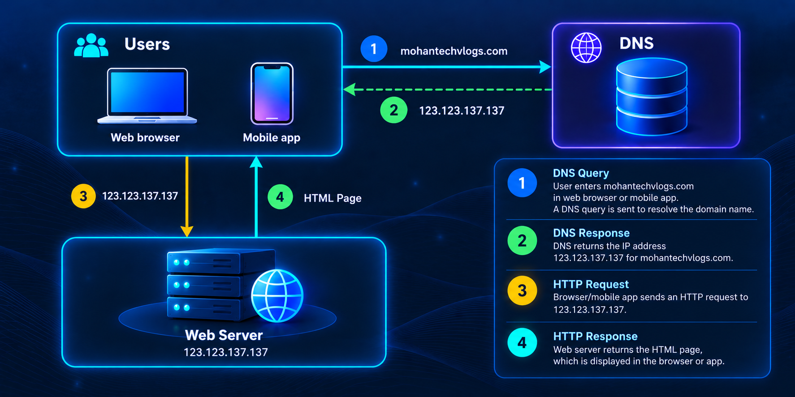

Let's follow a request through this setup step by step.

1.  A user visits the website using a domain name such as mohantechvlogs.com. Before anything else, the user's computer asks the DNS (Domain Name System) for the IP address behind that name.
    
2.  The DNS server looks up the domain and replies with its IP address. For example, say DNS returns 123.123.137.137.
    
3.  With the IP address in hand, the browser sends an HTTP request straight to your web server.
    
4.  The web server handles the request and responds with either an HTML page or a JSON response, which the browser then renders.
    

### Database

As the application grows, running the web server, database and cache on one machine starts to hurt performance, because every component competes for the same CPU, memory and disk. The fix is to give each component its own server: one for web traffic, one for the database, one for the cache and so on. Splitting them up also lets us scale each component on its own, based on the load it actually sees.

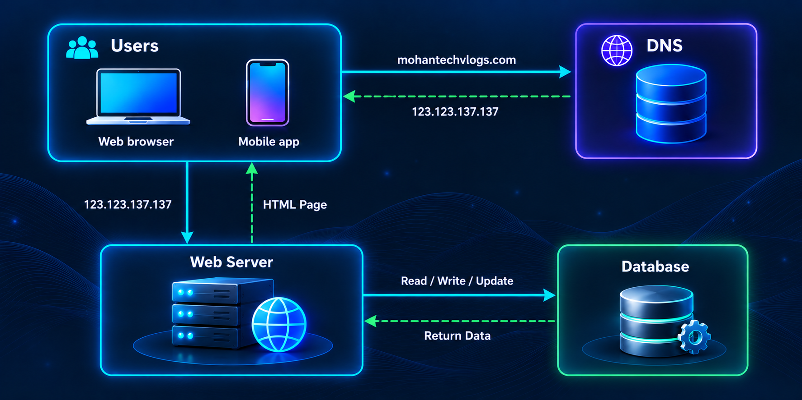

### Which database to use ?

Today there are many databases to choose from when building an application. Most of them fall into two broad families: **Relational Databases** and **Non-Relational Databases.**

1.  **Relational Database**: These are the traditional databases that have been around for decades. Data is stored in tables made up of rows, and you can join data across different tables. Well-known examples include MySQL, Oracle, PostgreSQL and Microsoft SQL Server.
    
2.  **Non-Relational Database:** Also called NoSQL databases. They come in four main types: key-value stores, graph stores, column stores and document stores. Joins are generally not supported. Well-known examples include Amazon DynamoDB, HBase, Cassandra, CouchDB and Neo4j.
    

For most applications, a relational database is the right choice. They handle typical workloads without trouble and have a proven track record of more than 40 years. A non-relational database is worth considering, though, when:

*   Your application needs extremely low latency.
    
*   Your data is unstructured, or it has no real relationships between entities.
    
*   You only need to serialize and deserialize data (JSON, XML, YAML etc.).
    
*   You need to store a huge volume of data.
    

### Vertical Scaling vs Horizontal Scaling

There are two common ways to scale a system: vertically and horizontally. Let's look at how each one works.

1.  **Vertical scaling :** Also known as *"scale up"*, vertical scaling means making a single server more powerful by giving it more CPU, RAM, storage and so on. It works well while traffic is low, and its biggest strength is simplicity. However, it has some serious limitations:
    
    *   There is a hard ceiling. You cannot keep adding CPU and memory to one server forever.
    *   The single server is a single point of failure, with no failover or redundancy if it goes down.
    
2.  **Horizontal scaling:** Also known as "scale-out", horizontal scaling means adding more servers to your pool of resources. Because of the limits of vertical scaling, horizontal scaling is the preferred approach for large-scale applications.
    

Now suppose we have started scaling horizontally, but users still run into trouble reaching the website. This can happen in a couple of situations:

**Scenario 1** : Users connect directly to the web server, so if that server goes offline, the website becomes unreachable.

**Scenario 2**: When too many users hit the web server at the same time and it reaches its capacity, users see slow responses or cannot connect at all.

So how do we deal with these situations?

The answer is a load balancer, which we will cover in the next section.

### Load balancer

A load balancer spreads incoming traffic evenly across a group of web servers, known as a load-balanced set. The diagram below shows how it works.

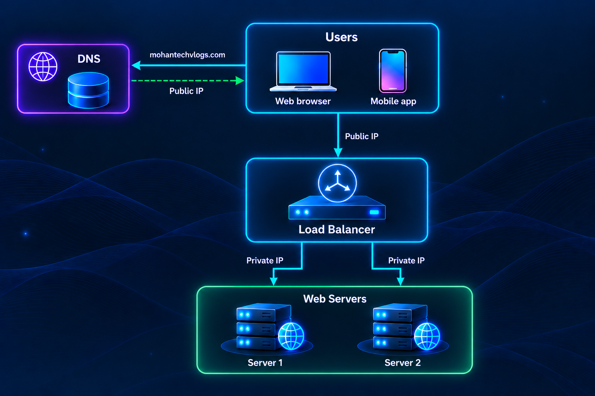

With a load balancer in place, users connect to the load balancer's public IP instead of talking to the web servers directly. Clients can no longer reach the web servers themselves. This also improves security: the servers only have private IPs, which are reachable from other servers on the same network but not from the internet. The load balancer talks to the web servers over these private IPs.

By adding a second server behind the load balancer, we have solved the failover problem and made the web tier more available. Here is how:

*   If Server 1 goes down, all traffic is sent to Server 2, so the website stays up. We can then add a new healthy server to the pool to rebalance the load.
    
*   If traffic grows quickly and two servers can no longer keep up, the load balancer handles it smoothly. Just add more servers to the pool, and the load balancer starts sending requests to them automatically.
    

The web tier can now handle the load, but we still have only one database serving requests from all the web servers. It has no failover and no redundancy. Database replication solves this, and that is what we will look at next.

### Database replication

Many database management systems support replication, typically using a master/slave relationship between the original database (the master) and its copies (the slaves).

The master database usually handles writes only. Slave databases receive copies of the master's data and handle reads only. Every command that changes data, such as insert, update or delete, has to go to the master. Since most applications perform far more reads than writes, a system usually has more slave databases than master databases. The diagram below shows one master database with several slaves.

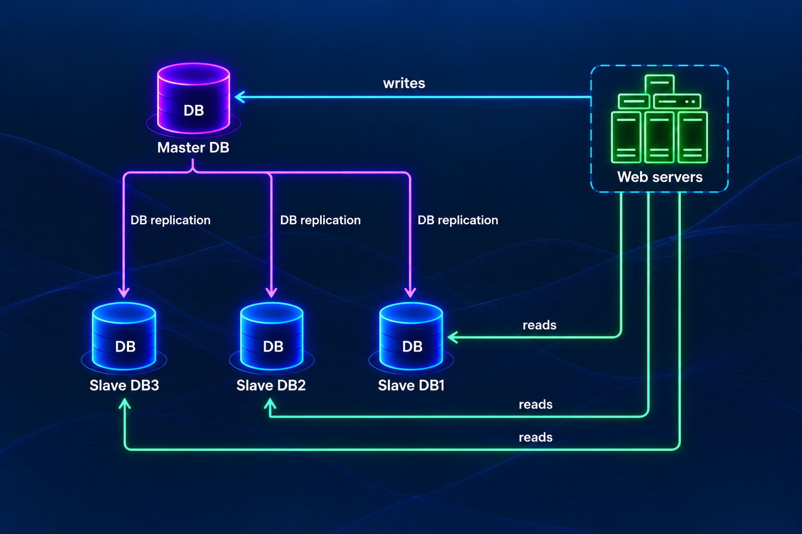

**Advantages of database replication:**

*   Better performance: In the master-slave model, all writes and updates go to the master, while reads are spread across the slaves. Because more queries can run in parallel, overall performance improves.
    
*   Reliability: If one of your database servers is destroyed by a natural disaster like a typhoon or an earthquake, your data is still safe because copies exist in multiple locations.
    
*   High availability: Since data is replicated across locations, the website keeps running even when one database goes offline, because the data can still be read from another database server.
    

Now let's walk through what happens when a database goes offline.

**Scenario 1** : If there is only one slave database and it goes offline, reads are temporarily sent to the master. Once the problem is detected, a new slave database replaces the failed one. If there are several slaves, reads are simply redirected to the remaining healthy slaves, and a new database server is brought in to replace the failed one.

**Scenario 2:** If the master database goes offline, one of the slaves is promoted to become the new master. All database operations temporarily run on this new master, and a new slave is immediately added to take over replication. In real production systems, promoting a new master is trickier, because the slave's data may not be fully up to date. Any missing data has to be filled in by running data recovery scripts. Other replication approaches such as multi-master and circular replication can help here, but they are more complicated to set up.

The diagram below shows our design so far, with a load balancer and database replication.

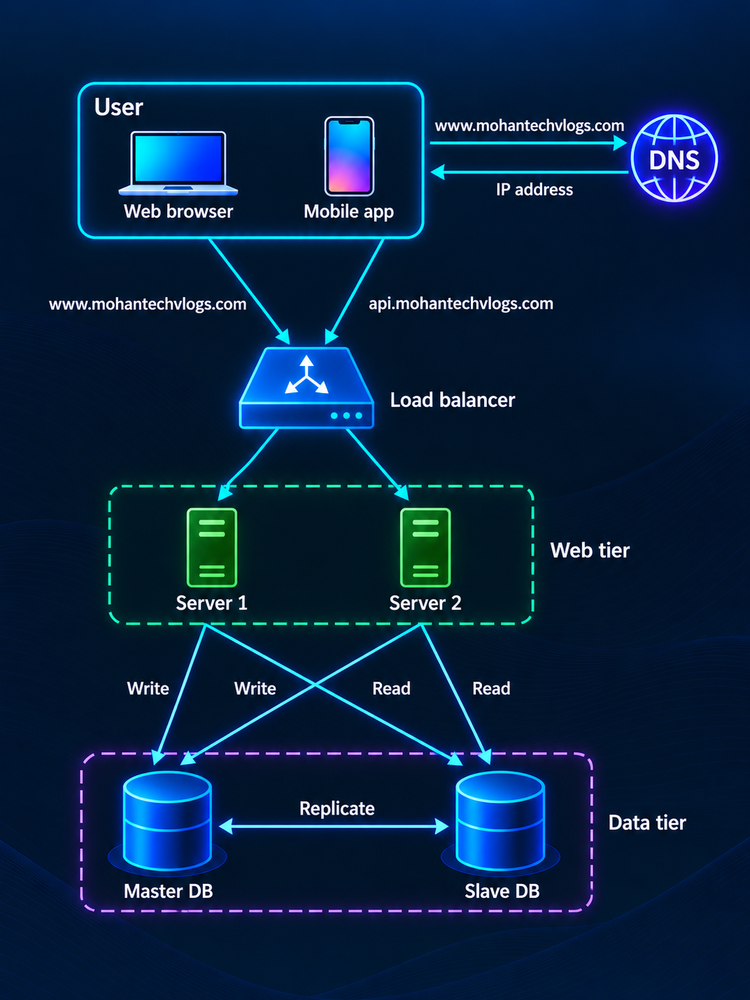

Here is how a request flows through this design:

*   The user gets the load balancer's IP address from DNS.
    
*   The user connects to the load balancer using that IP address.
    
*   The HTTP request is forwarded to either Server 1 or Server 2.
    
*   The web server reads user data from a slave database.
    
*   The web server sends any data-changing operation, meaning writes, updates and deletes, to the master database.
    

Now that we have a solid understanding of the web and data tiers, it is time to improve load and response times. We can do this by adding a cache layer and moving static content (images, videos, CSS and JavaScript files) to a CDN (Content Delivery Network).

### Cache

A cache is a temporary storage area that keeps the results of expensive operations, or frequently requested data, in memory so that later requests can be served faster. In the previous diagram, every page load triggers one or more database calls to fetch data. Hitting the database again and again slows the application down, and a cache helps fix that.

The cache tier is a temporary data layer that is much faster than the database. Having a separate cache tier gives us better performance, takes load off the database, and lets us scale the cache independently. The diagram below shows a setup with a cache server.

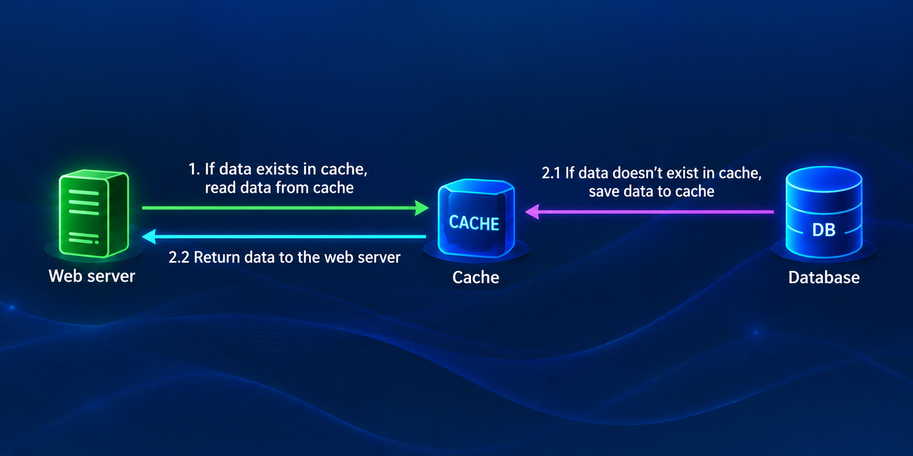

When a web server receives a request, it first checks whether the cache already has the response. If it does, the data is sent straight back to the client. If not, the server queries the database, saves the result in the cache, and then returns it to the client. This approach is called a **read-through cache**. Other caching strategies exist too, and the right one depends on the type of data, its size and how it is accessed.

Working with a cache server is straightforward, since most of them offer easy-to-use APIs for popular programming languages. The snippet below shows a typical example using the Memcached API.

```plaintext
SECONDS = 1
cache.set("blog1", "This is the content of blog 1", 3600 * SECONDS)
cache.get("blog1")
```

**Considerations for using cache**

Keep the following points in mind when adding a cache:

*   Use a cache when data is read often but changed rarely. Cached data lives in volatile memory, so a cache server is a poor place to persist data. If the cache server restarts, everything in memory is lost. Important data should therefore always be stored in a persistent data store.
    
*   **Expiration policy**: It is good practice to set an expiration policy. When cached data expires, it is removed from the cache. Without an expiration policy, data stays in memory forever. Avoid making the expiration time too short, or the system will reload data from the database too often. Avoid making it too long as well, or the data will go stale.
    
*   **Consistency**: This means keeping the data store and the cache in sync. They can drift apart because updates to the data store and the cache do not happen in a single transaction. Once you scale across multiple regions, keeping the data store and cache consistent becomes even harder.
    
*   **Mitigating failures**: A single cache server is a potential single point of failure (SPOF). To avoid this, run multiple cache servers across different data centers. It also helps to overprovision memory by some percentage, which gives you a buffer as memory usage grows.
    
*   **Eviction Policy**: When the cache is full, adding new items may force existing items out. This is called cache eviction. *LRU (Least Recently Used)* is the most common eviction policy. Other policies, such as *LFU (Least Frequently Used)* or *FIFO (First In, First Out)*, can be used to suit different use cases.
    

### Content delivery network (CDN)

A CDN is a network of servers spread across different geographic locations, used to deliver static content. CDN servers cache static files such as images, videos, CSS and JavaScript.

Dynamic content caching is a newer idea, where HTML pages are cached based on the request path, query strings, cookies and request headers.

Here is how a CDN works at a high level: when a user visits a website, the CDN server nearest to them delivers the static content. Naturally, the farther a user is from a CDN server, the slower the site loads. For example, if the CDN servers are in Mumbai, users in India will get content faster than users in Europe. The image below shows how a CDN improves load time.

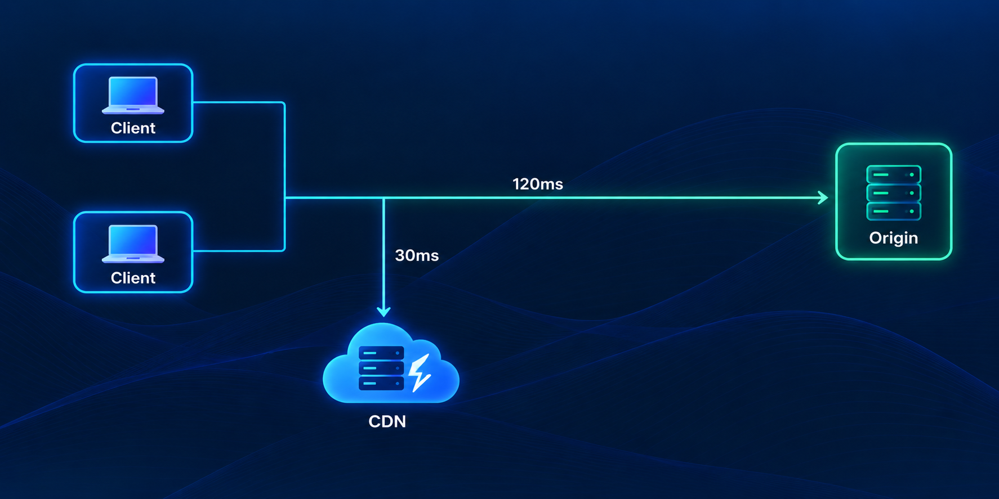

**How CDN works in system?**

1.  User A requests a static file, image.png, using an image URL. The domain in that URL is provided by the CDN provider. The two URLs below show what image URLs typically look like with leading CDN providers such as Amazon and Akamai.  
    **Amazon:** [https://mohantechvlogs.cloudfront.net/image.png](https://mohantechvlogs.cloudfront.net/image.png)  
    **Akamai:** [https://mohantechvlogs.akamai.com/image-manager/image.png](https://mohantechvlogs.akamai.com/image-manager/image.png)
    
2.  If the CDN server does not have image.png in its cache, it fetches the file from the origin, which can be a web server or online storage such as Amazon S3.
    
3.  The origin sends image.png back to the CDN server, optionally with a Time-to-Live (TTL) HTTP header that says how long the image should be cached.
    
4.  The CDN caches the image and returns it to User A. The image stays in the CDN cache until the TTL runs out.
    
5.  User B then requests the same image.
    
6.  As long as the TTL has not expired, the image is served straight from the cache.
    

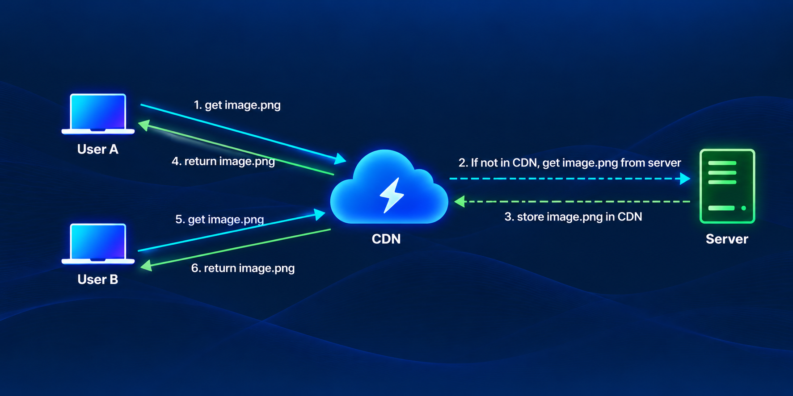

**Considerations of using a CDN**

*   **Cost**: CDNs are run by third-party providers, and you pay for data transferred in and out of the CDN. Caching assets that are rarely requested gives little benefit, so consider keeping those out of the CDN.
    
*   **Cache Expiry**: For time-sensitive content, choosing a cache expiry time matters. It should be neither too long nor too short. Too long, and the content may be outdated. Too short, and the CDN will keep reloading content from the origin servers.
    
*   **CDN fallback**: Think about how your website or application behaves when the CDN fails. During a temporary CDN outage, clients should be able to notice the problem and fetch resources directly from the origin.
    
*   **Invalidating files**: You can remove a file from the CDN before it expires in one of these ways:  
    1\. Invalidate the CDN object using the APIs your CDN vendor provides.  
    2\. Use object versioning to serve a different version of the object. To version an object, add a parameter such as a version number to the URL. For example, version 2 can be added to the query string: image.png?v=2
    

With the cache and CDN in place, our design now looks like the diagram below.

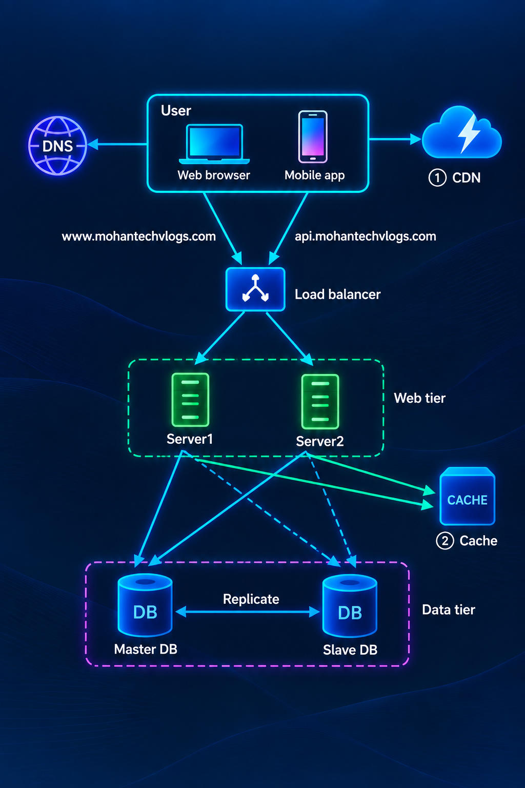

These additions bring the following performance gains:

1.  Static assets (JS, CSS, images etc.) are no longer served by the web servers. They are fetched from the CDN, which is faster.
    
2.  Caching data reduces the load on the database.
    

### Stateless web tier

Next, let's see how to scale the web tier horizontally. To do that, we need to move state, such as user session data, out of the web tier. A good approach is to store session data in persistent storage like a relational database or a NoSQL store. Every web server in the cluster can then read state from that shared storage. This is known as a stateless web tier.

**Stateful architecture**

Stateful and stateless servers differ in one key way. A stateful server remembers client data (state) between requests. A stateless server keeps no such information.

The following diagram illustrates a stateful architecture.

Here, User A's session data and profile image are stored on Server 1. To authenticate User A, every HTTP request has to go to Server 1. If a request lands on another server, such as Server 2, authentication fails because Server 2 does not have User A's session data. In the same way, all of User B's requests must go to Server 2, and all of User C's requests must go to Server 3.

The problem is that every request from the same client has to reach the same server. Most load balancers can enforce this using sticky sessions, but that adds overhead. It also makes adding or removing servers much harder, and handling server failures becomes more difficult.

### Stateless architectures

The image below shows a stateless architecture.

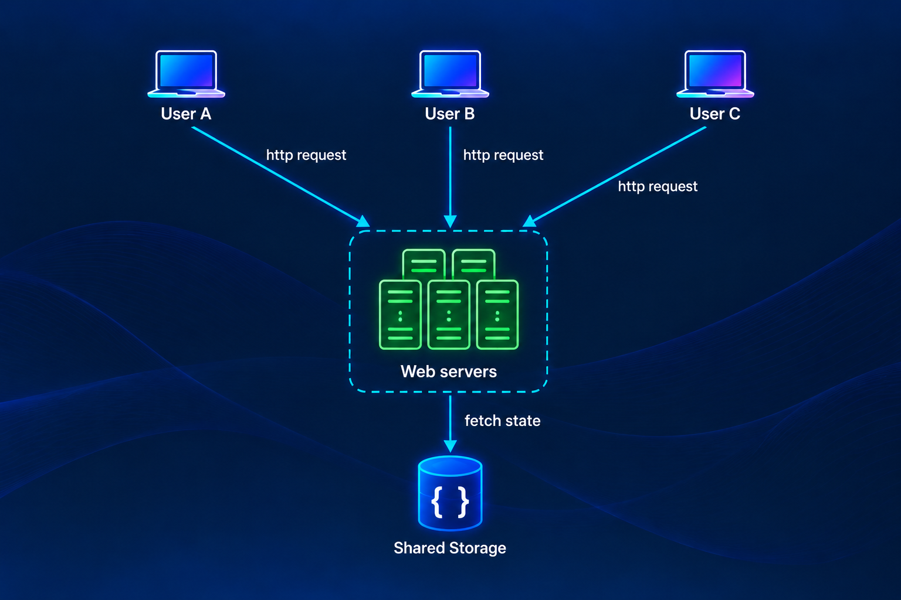

In a stateless architecture, a user's HTTP requests can go to any web server, and that server fetches state from a shared data store. Because state lives in the shared store rather than on the web servers, the system is simpler, more robust and easier to scale.

The image below shows our updated design with a stateless web tier.

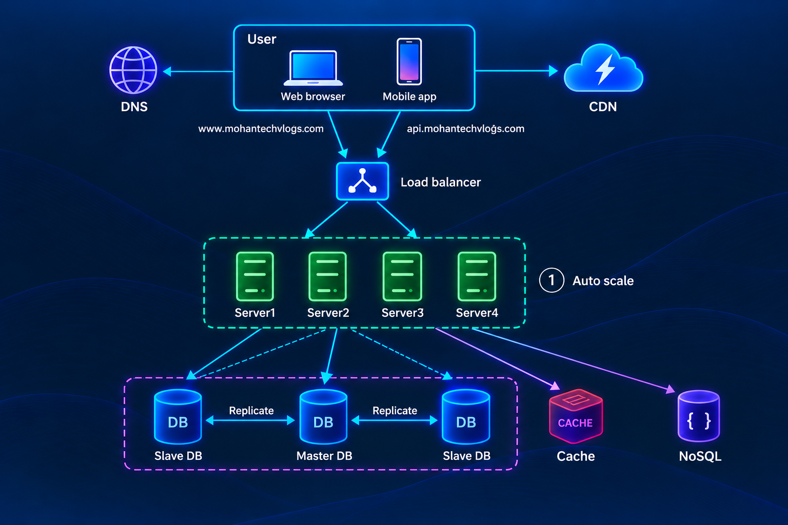

In this design, session data has been moved out of the web tier and into a persistent data store. That shared store could be a relational database, Memcached/Redis, NoSQL and so on. Here we pick a NoSQL store because it is easy to scale. Autoscaling means automatically adding or removing web servers depending on traffic. Once state is no longer kept on the web servers, autoscaling the web tier becomes easy: servers can be added or removed based on the traffic load.

Now imagine your website has grown well beyond one country and attracts a large number of users from around the world. To improve availability and give users in different regions a better experience, supporting multiple data centers becomes essential.

### Data centers

The diagram below shows an example setup with two data centers. Under normal conditions, users are routed by geoDNS (also called geo-routing) to the nearest data center, with x% of traffic going to ap-south-1 (Mumbai) and the remaining (100-x)% going to ap-south-2 (Hyderabad). geoDNS is a DNS service that resolves a domain name to different IP addresses depending on where the user is located.

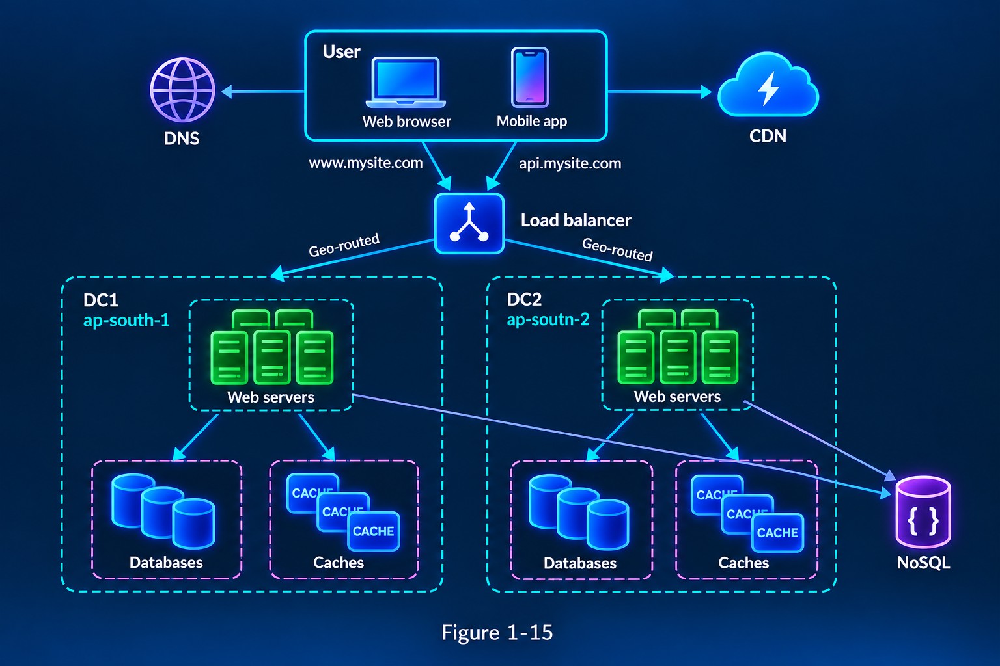

If a data center suffers a major outage, all traffic is sent to a healthy data center instead. In the image below, data center 2 (ap-south-2) is down, so 100% of the traffic goes to data center 1 (ap-south-1).

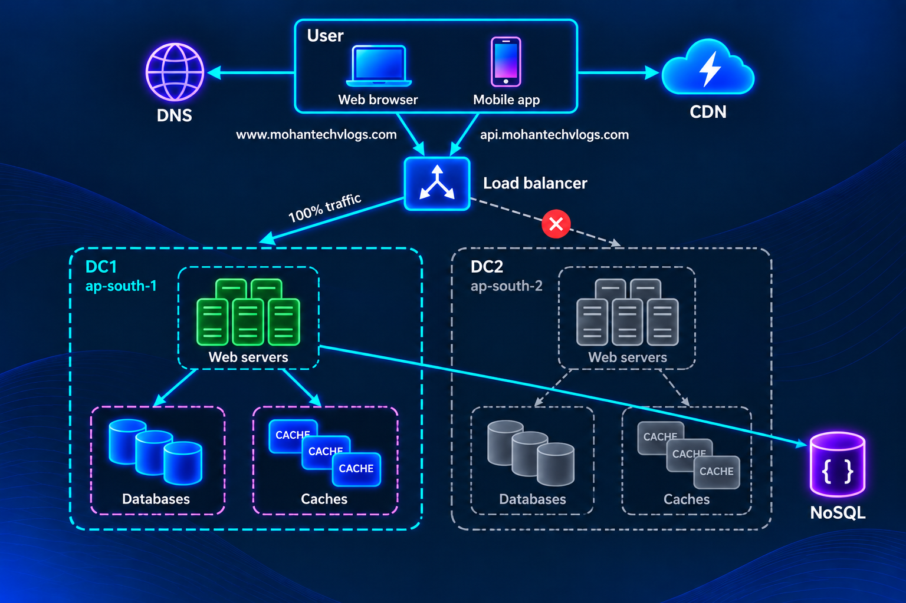

A multi-data center setup comes with several technical challenges that need to be solved:

*   **Traffic redirection**: You need reliable tools to send traffic to the right data center. GeoDNS can route users to the nearest data center based on their location.
    
*   **Data synchronization**: Users in different regions may be served by different local databases or caches. During a failover, traffic might land in a data center that does not have the user's data. A common solution is to replicate data across multiple data centers.
    
*   **Test and deployment**: With multiple data centers, it is important to test your website or application from different locations. Automated deployment tools are essential for keeping services consistent across every data center.
    

To scale the system further, we need to decouple its components so each one can scale on its own. Many real-world distributed systems use a message queue to solve exactly this problem.

### Message queue

A message queue is a durable component, held in memory, that enables asynchronous communication. It acts as a buffer and hands out asynchronous requests. Its basic design is simple. Services that create messages, called producers or publishers, publish them to the queue. Other services or servers, called consumers or subscribers, connect to the queue and carry out the actions described in the messages. The figure below shows this model.

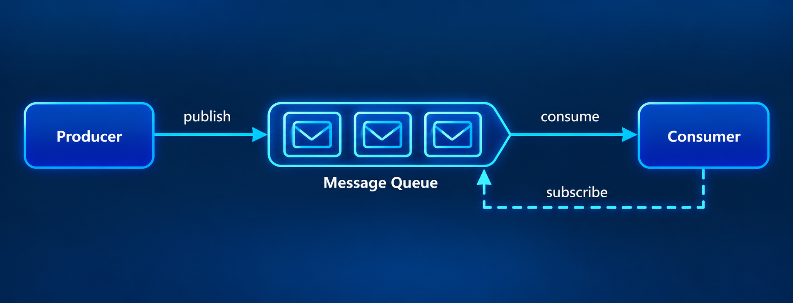

This decoupling is why message queues are a popular choice for building scalable, reliable applications. With a queue in between, the producer can post a message even when the consumer is not available to process it, and the consumer can read messages even when the producer is not available.

Here is a practical example: your application lets users customize photos by cropping, sharpening, blurring and so on. These tasks take time to finish. In the figure below, the web servers publish photo processing jobs to the message queue. Photo processing workers pick jobs off the queue and perform the customizations asynchronously. Producers and consumers can be scaled independently. When the queue grows large, you add more workers to cut down processing time. When the queue is mostly empty, you can reduce the number of workers.

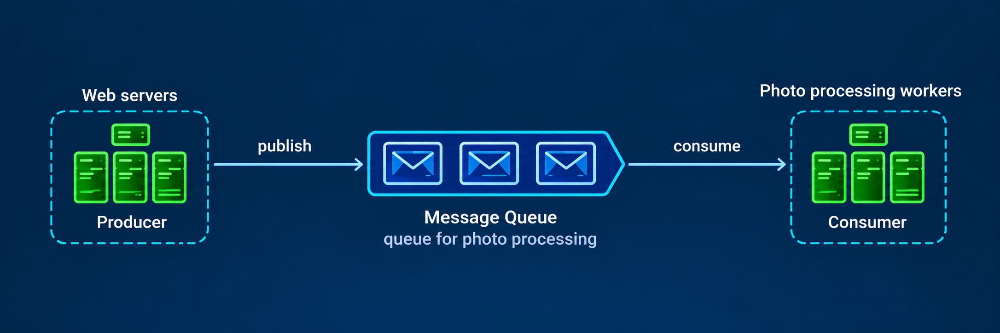

### Logging, metrics and automation

For a small website running on a few servers, logging, metrics and automation are good habits but not strictly required. Now that the site has grown to support a large business, investing in these tools becomes essential.

**Logging**: Watching error logs is important because it helps you spot errors and problems in the system. You can check logs on each server individually, or use tools that collect them into a central service where they are easy to search and view.

**Metrics:** Collecting different kinds of metrics gives you business insights and shows you how healthy the system is. Some useful metrics include:

*   Host level metrics: CPU, memory, disk I/O etc.
    
*   Aggregated level metrics: for example, the performance of the whole database tier, cache tier etc.
    
*   Key business metrics: daily active users, retention, revenue etc.
    

**Automation:** As a system becomes large and complex, we need to build or adopt automation tools to stay productive. Continuous integration is a good practice where every code check-in is verified automatically, helping teams catch problems early. Automating your build, test and deployment processes can also boost developer productivity significantly.

**Adding message queues and different tools**

The diagram below shows the updated design. It brings the following improvements:

1.  A message queue is added, making the system more loosely coupled and more resilient to failures.
    
2.  Logging, monitoring, metrics and automation tools are now part of the design.
    

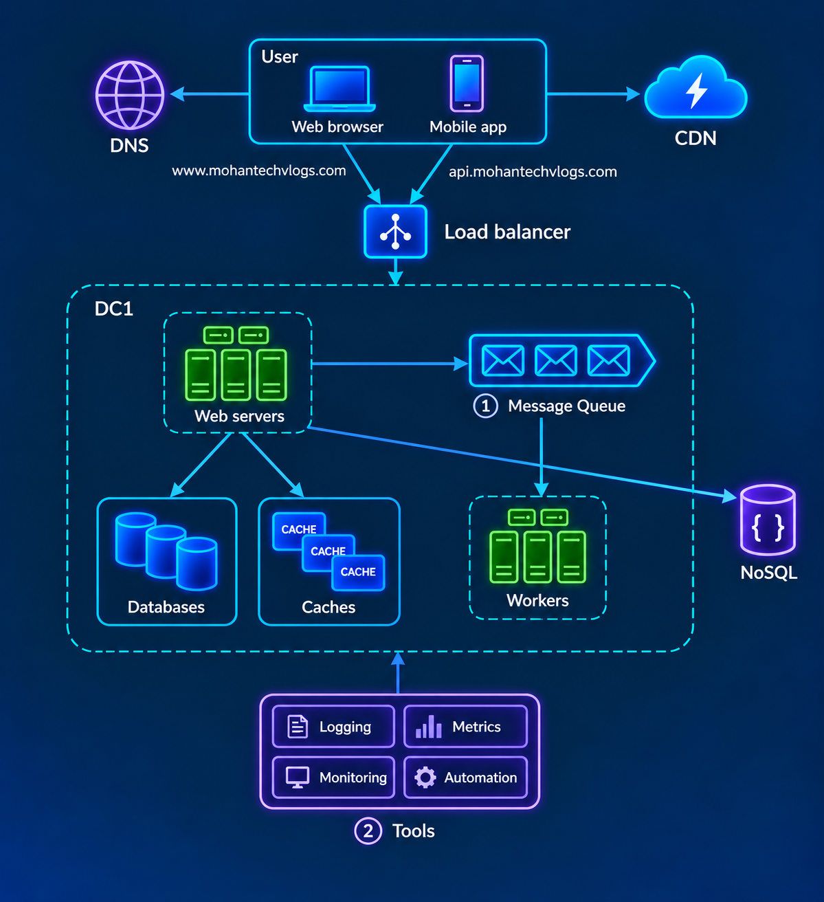

As data keeps growing every day, the database gets more and more overloaded. It is time to scale the data tier.

### Database scaling

There are two ways to scale a database: vertical scaling and horizontal scaling.

**Vertical Scaling**

Vertical scaling, or scaling up, means adding more power (CPU, RAM, disk etc.) to an existing machine. Some database servers are extremely powerful. For example, Amazon Relational Database Service (RDS) offers database servers with up to 24 TB of RAM. A server like that can handle a huge amount of data. In 2013, [stackoverflow.com](http://stackoverflow.com) had more than 10 million unique visitors, yet it ran on just one master database. Still, vertical scaling has serious drawbacks:

*   You can keep adding CPU, RAM and so on to the database server, but hardware has limits. With a large enough user base, one server will not be enough.
    
*   The risk of a single point of failure is higher.
    
*   Vertical scaling is expensive overall, since powerful servers cost much more.
    

**Horizontal scaling**

Horizontal scaling, also called sharding, means adding more servers. The figure below compares vertical and horizontal scaling.

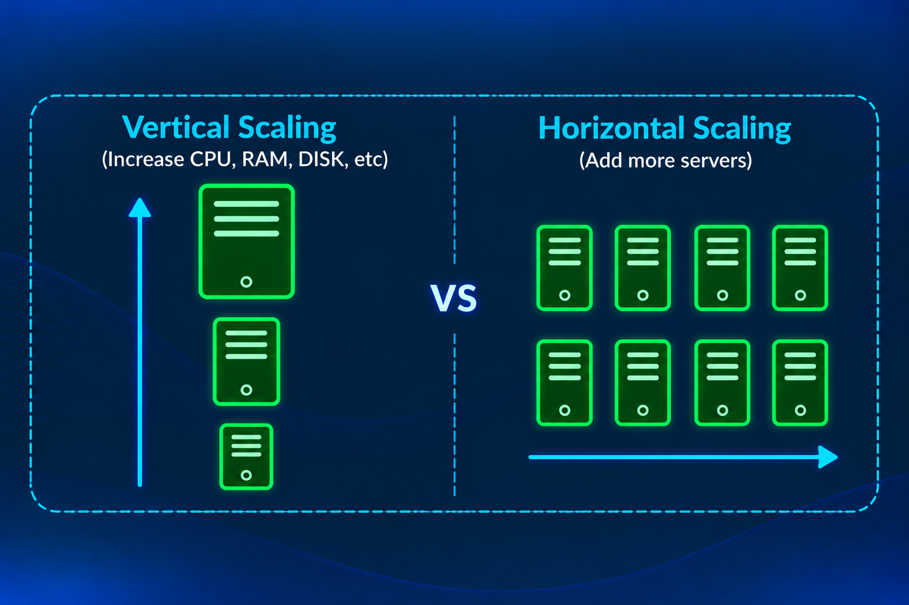

Sharding splits a large database into smaller, easier-to-manage pieces called shards. Every shard uses the same schema, but the data stored in each shard is unique to it.

The image below shows an example of sharded databases. User data is assigned to a database server based on the user ID. Whenever data is accessed, a hash function determines which shard holds it. In this example, the hash function is ***user\_id % 4***. If the result is 0, shard 0 is used to store and read the data. If the result is 1, shard 1 is used, and the same logic applies to the other shards.

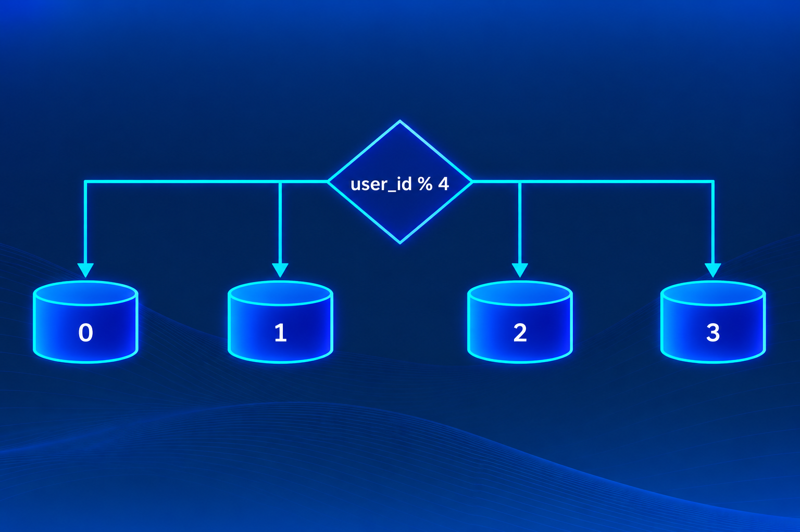

The most important decision when designing a sharding strategy is picking the sharding key. The sharding key (also called a partition key) is made up of one or more columns that decide how data is distributed. In the image below, *user\_id* is the sharding key. A good sharding key lets you read and update data efficiently by sending each query to the right database. One of the most important criteria when choosing a key is that it should spread data evenly across all shards.

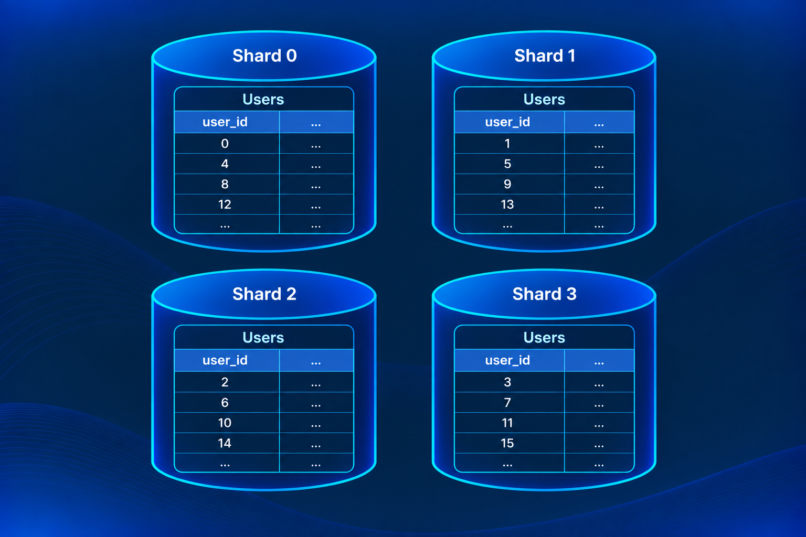

Sharding is a powerful way to scale a database, but it is far from perfect. It brings new complexity and challenges to the system:

1.  **Resharding data**: Resharding is needed when a single shard can no longer hold more data because of rapid growth. Some shards may also fill up faster than others because data is not evenly distributed, which is called shard exhaustion. When that happens, the sharding function has to be updated and data has to be moved around. Consistent hashing is a common technique for solving this problem.
    
2.  **Celebrity problem**: Also called the hotspot key problem, this happens when one shard receives far more traffic than the others, which can overload that server. Imagine the data for Virat Kohli (cricket superstar), Cristiano Ronaldo (football legend) and the US president all landing in the same shard. In a social application, that shard would be flooded with read requests. To fix this, we may need to give each celebrity a dedicated shard, and some shards may even need to be split further.
    
3.  **Join and de-normalization**: Once a database is sharded across multiple servers, joining data across shards becomes difficult. A common workaround is to de-normalize the database so that queries can run against a single table.
    

In the diagram below, we shard the databases to keep up with rapidly growing data traffic. We also move some non-relational functionality to a NoSQL data store to reduce the load on the database.

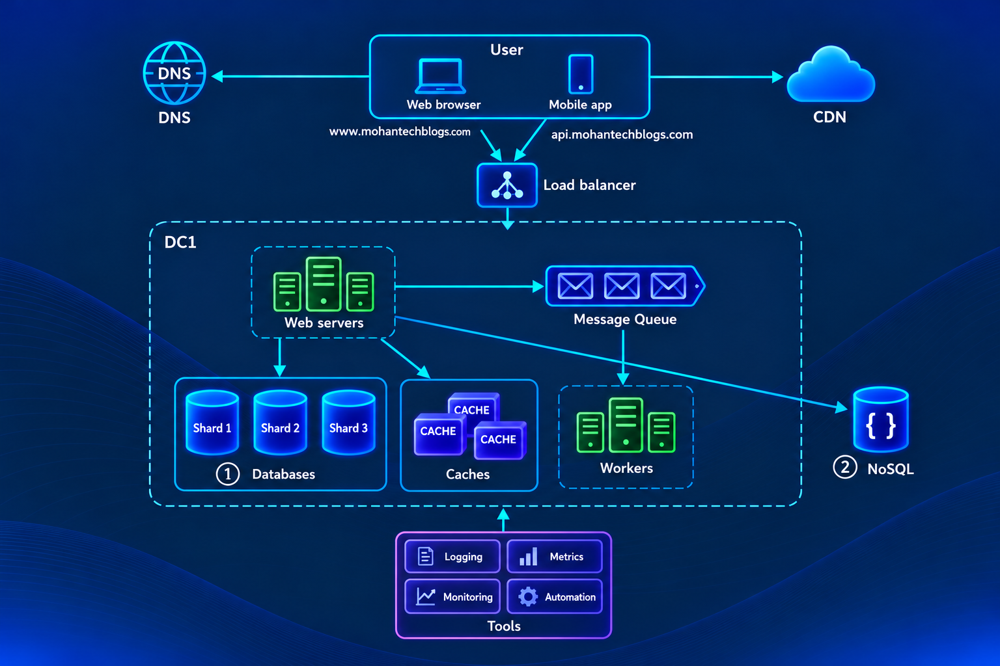

### **Scaling beyond millions of users**

Scaling a system is an iterative process. Repeating and building on what we covered in this blog can take us a long way. Going beyond millions of users, however, takes more fine-tuning and new strategies. For example, you may need to optimize the system further and break it down into even smaller services. The techniques in this blog give you a solid foundation for tackling those new challenges. To wrap up, here is a summary of how we scaled our system to support millions of users:

*   Keep the web tier stateless
    
*   Build redundancy at every tier
    
*   Cache data as much as you can
    
*   Support multiple data centers
    
*   Host static assets in a CDN
    
*   Scale your data tier with sharding
    
*   Split tiers into individual services
    
*   Monitor your system and use automation tools
