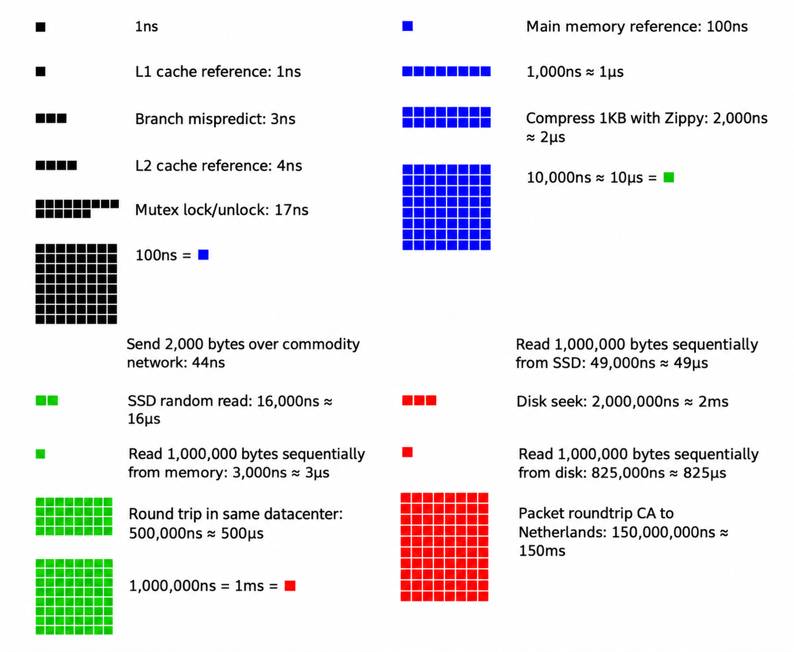

When designing a system we must evaluate system capacity and performance requirements using order of magnitude estimation. These estimations must be created using a combination of thought experiments and common performance numbers to get a good feel for which designs will meet your requirements.

 

### Power of two

When dealing with production grade distributed systems, calculations all boils down to the basics. To obtain correct calculations, it is critical to know the data volume unit using the power of 2. A byte is a sequence of 8 bits. An ASCII character uses one byte of memory(8-bits). Below is a table explaining the data volume unit

| Power | Approximate value | Full name | Short name |
| :- | :- | :- | :- |
| 10 | 1 Thousand | 1 Kilobyte | 1 KB |
| 20 | 1 Million | 1 Megabyte | 1 MB |
| 30 | 1 Billion | 1 Gigabyte | 1 GB |
| 40 | 1 Trillion | 1 Terabyte | 1 TB |
| 50 | 1 Quadrillion | 1 Petabyte | 1 PB |

 

### Latency numbers every programmer should know

Researcher from Google reveals the length of typical computer operations in 2010. Some numbers are outdated as computer technologies evolve computers become faster and more powerful. However, those numbers should still be able to gives us an idea of the fastness and slowness to different computer operations.

| Operation name | Time |
| :- | :- |
| L1 cache reference | 0.5 ns |
| Branch mispredict | 5 ns |
| L2 cache reference | 7 ns |
| Mutex lock/unlock | 100 ns |
| Main memory reference | 100 ns |
| Compress 1 KB with zippy | 10000ns = 10 micro seconds |
| Send 2 KB over 1 Gbps network | 20000ns = 20 micro seconds |
| Read 1 MB sequentially in memory | 250000 ns = 250 micro seconds |
| Roundtrip within same datacenter | 500000 ns = 500 micro seconds |
| Disk seek | 10000000 = 10 milli seconds |
| Read 1 MB sequentially from the network | 10000000 = 10 milli seconds |
| Read 1 MB sequentially from disk | 30000000 = 30 milli seconds |
| Send packet CA (California) -> Netherlands -> CA | 150000000 = 150 milli seconds |

 

Following image shows the visualisation of above figures by taking time factor into consideration, Following image shows the visualised latency numbers as of 2020.

 

 

By analysing  the numbers in above diagram, we get following conclusions:

- Memory is fast but the disk is slow.
- Avoid disk seeks if possible.
- Simple compression algorithms are fast.
- Compress data before sending it over the internet if possible.
- Datacenters are usually in different regions, and it takes time to send data between them.

### Availability numbers

High availability is the ability of a system to be continuously operational for a desirably long period of time. High availability is measured as a percentage, with 100% means as a service that has 0 downtime. Most services fall between 99% and 100%.

A service level agreement(SLA) is a commonly used term for service providers. This is an agreement between you(service provider) and your customer, and this agreement formally defines the level of uptime your service will deliver. Cloud providers Amazon, Google and Microsoft set their SLA at 99.9% or above. Uptime is traditionally measured in nines. The more the nines, the better. As shown in following table, the number of nines correlate to the expected system downtime.

| Availability % | Downtime per day | Downtime per week | Downtime per month | Downtime per year |
| :- | :- | :- | :- | :- |
| 99% | 14.40 minutes | 1.68 hours | 7.31 hours | 3.65 days |
| 99.9% | 1.44 minutes | 10.08 minutes | 43.83 minutes | 8.77 hours |
| 99.99% | 8.64 seconds | 1.01 minutes | 4.38 minutes | 52.60 minutes |
| 99.999% | 864.00 milliseconds | 6.05 seconds | 26.30 seconds | 5.26 minutes |
| 99.9999% | 86.40 milliseconds | 604.80 milliseconds | 2.63 seconds | 31.56 seconds |

### Example: Estimate Twitter QPS and storage requirements

Please note the following numbers are for this exercise only as they are not real numbers from Twitter.

**Assumptions:**

- 300 million monthly active users
- 50% of users use Twitter daily.
- Users post 2 tweets per day on average.
- 10% of tweets contain media.
- Data is stored for 5 years.

 

**Estimations:**

Query per second(QPS) estimate:

- Daily active users(DAU) = 300 million \* 50% = 150 million
- Tweets QPS = 150 million \* 2 tweets / 24 hour / 3600 seconds = \~ 3500
- Peak QPS = 2 \* QPS = \~ 7000

We will estimate media storage here.

- Average tweet size:

  - tweet_id        64 bytes
  - text                140 bytes
  - media            1 MB
- Media storage: 150 million \* 2  \* 10% \* 1 MB = 30 TB per day
- 5-year media storage: 30 TB \* 365 \* 5 = \~55 PB

### Tips

Estimation is all about the process. Solving the problem is more important than obtaining results. Interviewers may test your problem-solving skills. Here are few tips to follow:

- **Rounding and Approximation** : It is difficult to perform complicated math operations during the Interview. For example, what is the result of "99987. / 9.1" ? There is no need to spend valuable time to solve complicated math problems. Precision is not expected. Use the round numbers and approximation to your advantage. The division can be simplified as follows "100,000 / 10".
- Write down your assumptions. It is good idea to write down your assumptions to be referenced later.
- Label your units. When you write down "5", does it mean 5 KB or 5 MB? You might confuse yourself with this. Write down the units because "5 MB" helps to remove ambiguity.
- Commonly asked estimations: QPS, peak QPS, storage, cache, number of servers, etc. You can practice these calculations when preparing for an interview. Practice makes you perfect.
